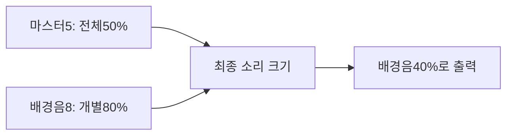
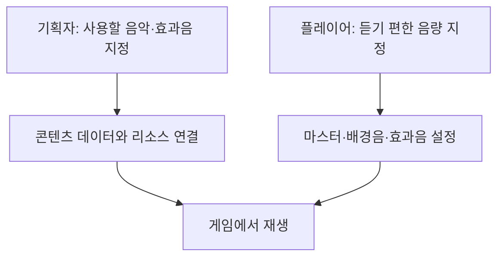

# 기획자용 사운드 설정 사용 안내

## 1. 이번에 준비된 기능

마스터는 모든 소리의 크기를 함께 줄이는 설정입니다. 배경음과 효과음의 개별 설정은 그대로 유지됩니다. 현재는 코드·저장·소리 적용 기반을 준비했으며 **게임 설정 화면에 마스터 버튼은 아직 없습니다.** 타이틀 옵션도 현재 임시 화면이며 기존 설정 화면 연결은 다음 작업입니다.

| 항목 | 범위 | 기본값 | 역할 |
| --- | --- | --- | --- |
| 마스터 | 0~10 | 10 | 배경음·효과음을 함께 조절 |
| 배경음 | 0~10 | 8 | 음악 크기 조절 |
| 효과음 | 0~10 | 8 | 효과음 크기 조절 |

마스터를0으로 해도 배경음·효과음 값은 없어지지 않습니다. 마스터를 다시10으로 올리면 기존 개별 크기로 돌아옵니다. 설정은 게임 저장 슬롯이 아닌 별도 settings.json에 보관합니다. 예전 설정 파일에 마스터 항목이 없어도 기본10으로 읽도록 구성했습니다. 보통 이 파일을 직접 편집할 필요는 없습니다.

## 2. 소리 교체는 어디에서 하나요?

플레이어가 음량을 조절하는 것과 기획자가 어떤 소리를 쓸지 지정하는 것은 다른 작업입니다.

현재 맵의 일반·전투 배경음은 Stage의 BGM_Normal·BGM_Battle 키로 선택합니다. 실제 클립은 GameAudio의 Inspector 소리 목록에 연결돼 있어 키만 바꾼다고 새 파일이 자동으로 연결되지는 않습니다. 타이틀 배경음과 전투 효과음에도 기존 Inspector·코드 설정이 남아 있습니다.

앞으로 배경음과 효과음 모두 데이터에서 소리와 재생 설정을 지정하도록 확장합니다. Sound 빈 표는 준비됐지만 주소와 실제 재생 연결은 아직 없으므로 새 컬럼·키를 임의 추가하기 전에 개발자와 데이터 담당에게 연결을 요청해 주세요. 이번 작업이 모든 사운드의 데이터 전환 완료를 뜻하지는 않습니다.

## 3. 화면 연결 뒤 확인할 내용

아래는 마스터 조작부를 붙인 뒤 진행할 확인 목록입니다. 현재 게임 화면에서 모두 조작할 수 있다는 의미는 아닙니다.

1. 마스터10에서 배경음·효과음이 기존과 같은 크기인지 확인합니다.
2. 마스터5로 낮췄을 때 두 종류가 함께 작아지는지 확인합니다.
3. 마스터0으로 무음 처리한 뒤 다시10으로 올려 개별 음량이 보존되는지 확인합니다.
4. 설정 변경을 취소하면 이전 크기로 돌아가는지 확인합니다.
5. 변경을 저장한 뒤 게임을 다시 실행해 유지되는지 확인합니다.
6. 일시정지 상태의 배경음 감쇠와 곡 전환이 마스터와 함께 적용되는지 확인합니다.

개발자 연결과 현재 미구현 범위는 [사운드 설정 설계](../개발자용%20설계문서/사운드%20설정%20설계.md)를 참고합니다.

## 4. 사운드 테이블 작성 안내

기획자가 소리 목록을 추가·수정·삭제하고 배포하는 순서는 별도의 [기획자용 사운드 테이블 작성과 배포 안내](기획자용%20사운드%20테이블%20작성과%20배포%20안내.md)를 따릅니다. 컬럼별 입력 예시·ID 빈칸 규칙·배포 오류 해결도 해당 문서에서 관리합니다.
