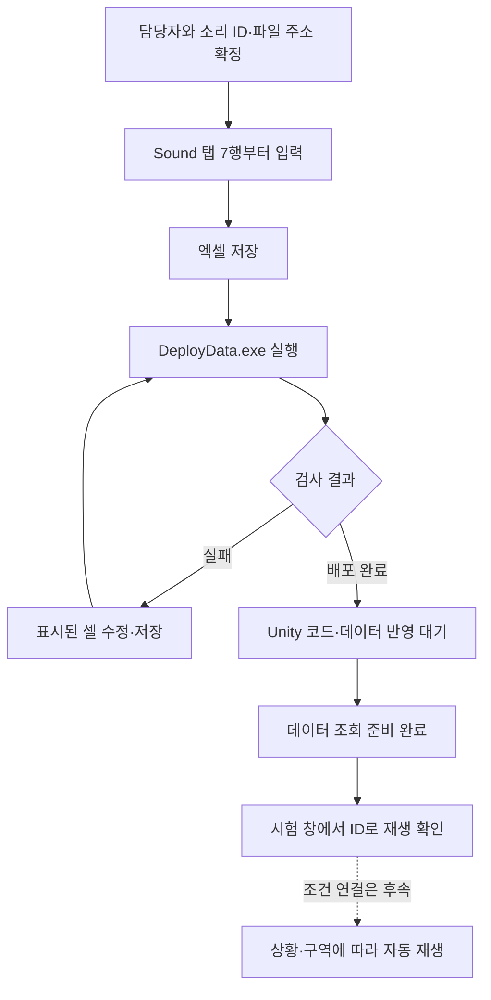
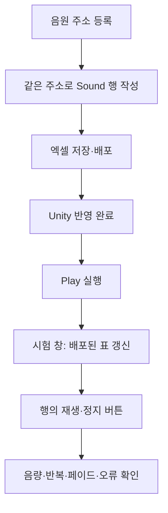
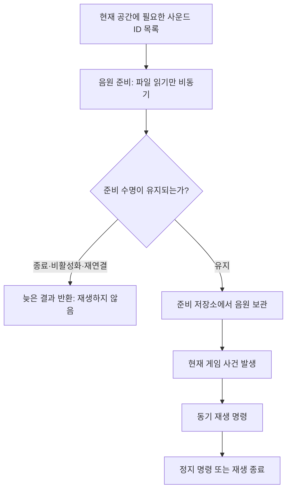

# 기획자용 사운드 테이블 작성과 배포 안내

## 1. 무엇을 하는 표인가요?

Sound 표는 게임에서 사용할 배경음과 효과음을 한곳에 적는 목록입니다. 한 행에 소리 하나를 작성하며, 사용할 파일 주소·종류·기본 음량·반복 여부·페이드 시간을 정합니다. 페이드는 소리가 서서히 커지거나 작아지는 효과입니다.

**현재는 표 작성·검사·배포·주소 로딩·시험 재생까지 기반을 준비했습니다.** 기획자가 Sound 행과 음원 주소를 설정한 뒤 전용 시험 창에서 재생할 수 있습니다. 공격·구역·보스 같은 실제 게임 상황과의 연결은 아직 없으므로 배포만으로 기존 게임 소리가 자동 교체되지는 않습니다. 문서의 예시는 작성법 설명용이며 원본 엑셀에는 예시 행을 넣지 않았습니다. 기준일: 2026-11-05.



## 2. 어디에서 작성하나요?

두 프로젝트 폴더는 같은 부모 폴더에 있어야 합니다.

```text
같은 부모 폴더/
├── DataSheet/
│   ├── tables/Sound.xlsx     ← 이 원본만 편집합니다
│   └── DeployData.exe        ← 저장한 뒤 실행합니다
└── Human_Ghost-/
    └── Assets/
        ├── Data/Csv/Sound.csv ← 자동 배포됩니다
        └── 3.Script/Data/Sound.cs ← 최초 생성되는 정의 코드입니다
```

Sound.xlsx를 열면 **README 탭**에 간단한 설명이 있고 **Sound 탭**에 실제 값을 작성할 수 있습니다. CSV·C#·자동 로딩 계획은 직접 편집하지 않습니다.

| 영역 | 하는 일 | 기획자 작업 |
| --- | --- | --- |
| README 탭 | 컬럼과 배포 설명 | 먼저 읽습니다 |
| Sound 1~5행 | 도구가 읽는 추출·타입·검사 규칙 | 수정하지 않습니다 |
| Sound 6행 | 컬럼명 | 이름·순서·컬럼 수를 임의 변경하지 않습니다 |
| Sound 7행부터 | 실제 소리 목록 | 입력·수정합니다 |

ID 번호 대역은 아직 확정하지 않았습니다. 데이터 담당에게 사용할 번호를 받은 뒤 입력해 주세요. 소리 주소는 리소스 담당에게 확인합니다. 주소는 파일이 어디에 있는지 찾기 위한 등록명이며 내 PC의 C드라이브 경로나 파일명만 적는 칸이 아닙니다.

## 3. 각 칸에는 무엇을 넣나요?

A~G는 데이터 행마다 필수입니다. H열 Note만 설명이 필요할 때 작성합니다. 값0도 의미 있는 값이므로 빈칸으로 대신하지 않습니다.

| 열 | 컬럼 | 입력 방법 | 올바른 값 예시 |
| --- | --- | --- | --- |
| A | ID | 받은 번호를 양의 정수로 입력. Sound 안에서 중복 금지 | 담당자가 확정한 번호 |
| B | Address | 담당자가 확인한 리소스 주소를 정확히 입력. 영문 대소문자를 유지 | Audio/Bgm/Village |
| C | Category | 1은 배경음, 2는 효과음 | 1 |
| D | Volume | 0~10000 정수. 소리 자체의 기본 크기 | 8000 |
| E | Loop | Y는 반복, N은 한 번 재생. 대문자만 사용 | Y |
| F | FadeInMs | 시작 시 서서히 커지는 시간. 0 이상 정수 | 1000 |
| G | FadeOutMs | 정지·교체 시 서서히 작아지는 시간. 0 이상 정수 | 1000 |
| H | Note | 자유 설명. 한글 사용 가능. 추출 대상에서 제외 | 마을 기본 배경음 |

Address 예시는 실제 프로젝트에 등록됐다는 뜻이 아닙니다. 파일을 넣거나 주소를 새로 적는 것만으로 등록이 끝나지 않으므로 담당자에게 확인합니다. 같은 파일 주소를 서로 다른 설정으로 사용하는 경우가 있을 수 있어 Address 중복 자체는 현재 금지 규칙이 아닙니다.

### 음량과 시간 읽는 방법

| 원하는 값 | 입력 숫자 |
| --- | ---: |
| 원본 음량 100% | Volume에 10000 |
| 원본 음량 80% | Volume에 8000 |
| 원본 음량 50% | Volume에 5000 |
| 무음 | Volume에 0 |
| 페이드 없음 | 시간 칸에 0 |
| 0.5초 페이드 | 시간 칸에 500 |
| 1초 페이드 | 시간 칸에 1000 |
| 2초 페이드 | 시간 칸에 2000 |

Volume에 80%나 0.8을 넣지 않습니다. 시간 칸에도 1초나 0.5를 넣지 않습니다. 쉼표·단위·앞뒤 공백 없이 정수로 입력합니다. 테이블의 소리별 Volume과 플레이어 설정의 마스터·배경음·효과음은 다른 값입니다. 마스터 설정은 이 표에 작성하지 않습니다.

## 4. 처음 한 행을 작성하는 순서

예를 들어 마을 배경음 하나를 준비한다면 다음 순서입니다.

1. 담당자에게 이 소리의 ID와 실제 등록 주소를 확인합니다.
2. Sound 탭 A7에 받은 ID, B7에 확인한 주소를 넣습니다.
3. C7에 1, D7에 8000, E7에 Y를 넣습니다.
4. F7과 G7에 1000을 넣습니다. 각각 1초 페이드 설정입니다.
5. H7에 알아보기 쉬운 설명을 적습니다.
6. 두 번째 소리는 8행, 그다음은 9행에 이어서 입력합니다.

아래는 ID를 제외한 작성 모양입니다. ID를 채우지 않은 채 배포하면 해당 행은 데이터로 추출되지 않습니다.

| 용도 | Address 예시 | Category | Volume | Loop | FadeInMs | FadeOutMs |
| --- | --- | ---: | ---: | --- | ---: | ---: |
| 마을 배경음 | Audio/Bgm/Village | 1 | 8000 | Y | 1000 | 1000 |
| 일반 명중 효과음 | Audio/Sfx/Hit | 2 | 10000 | N | 0 | 0 |

새 표 기반 재생기는 반복·음량·페이드를 사용합니다. 기존 문자열 키 효과음은 아직 이전 방식으로 동작하며 전환하지 않았습니다.

## 5. 추가·수정·삭제할 때 지킬 점

- 새 소리를 추가할 때 기존 행을 복사할 수 있지만 ID는 반드시 새 번호로 바꿉니다. 주소와 나머지 설정도 확인합니다.
- 같은 소리의 파일이나 음량을 바꿀 때는 기존 ID를 유지합니다. ID를 바꾸면 다른 기능에서 그 소리를 찾지 못할 수 있습니다.
- 삭제가 필요하면 먼저 다른 기능에서 해당 ID를 쓰는지 담당자에게 확인하고, 확인 후 데이터 영역의 행 전체를 삭제해 빈 줄을 남기지 않습니다.
- **A열 ID의 첫 빈칸에서 추출이 끝납니다.** 8행 ID가 비어 있으면 9행 이후를 작성했어도 추출하지 않습니다.
- 사용 중지를 위해 ID만 지우거나 Category에0을 넣지 않습니다. 현재 별도 사용 여부 컬럼은 없습니다.
- 새 컬럼·타입·재생 규칙이 필요하면 데이터 담당과 개발자에게 요청합니다. 기존 정의 클래스는 재배포만으로 자동 갱신되지 않습니다.

## 6. 검사하고 배포하기

1. 엑셀에서 저장합니다. 디스크에 저장하지 않은 수정은 도구가 읽지 못합니다. 파일 잠금 오류가 나면 엑셀을 닫고 다시 시도합니다.
2. DataSheet와 Human_Ghost-가 같은 부모 폴더에 있는지 확인합니다.
3. DataSheet 폴더의 DeployData.exe를 더블클릭합니다. 기획자 PC에 별도 .NET 설치는 필요하지 않습니다.
4. **배포 완료** 문구를 확인합니다. 이 도구는 Sound만이 아니라 다른 데이터 표도 함께 검사합니다.
5. 실패하면 화면의 파일명·탭·셀 주소·오류 내용을 읽고 해당 원본을 수정한 다음 다시 저장·실행합니다.
6. Unity가 코드 반영과 에셋 갱신을 마칠 때까지 기다립니다. 이미 실행 중인 Play에서는 반영을 기대하지 말고 종료 후 다시 시작합니다.
7. 담당자에게 작성한 ID·주소·원하는 재생 상황을 전달합니다. 실제 재생 연결 전에는 기존 Stage 키나 전투 코드를 직접 바꾸지 않습니다.

검사만 하고 배포하지 않을 때는 개발자 도움을 받아 DataSheet 폴더에서 `DeployData.exe --check`를 사용할 수 있습니다. 검사 완료와 배포 완료는 다릅니다. 이미 만든 게임 실행파일에 새 표가 자동으로 들어가는 것도 아니므로 배포 후 새 빌드가 필요합니다.

## 7. 자주 발생하는 문제

| 증상·원인 | 해결 방법 |
| --- | --- |
| ID가 중복됨 | 복사한 행의 ID를 새 번호로 바꿉니다 |
| 필수 값이 비어 있음 | A~G를 확인하고, 페이드 미사용은 빈칸 대신0을 넣습니다 |
| Category에 한글로 배경음 입력 | 1 또는2로 바꿉니다 |
| Loop에 소문자 y, 예, true 입력 | 대문자 Y 또는 N으로 바꿉니다 |
| Volume이 범위를 벗어남 | 0~10000 정수로 수정합니다 |
| 시간에 음수·소수·초 단위 문자 입력 | 0 이상 밀리세컨드 정수로 바꿉니다 |
| 아래쪽 행이 배포되지 않음 | 중간 ID 빈칸이 있는지 확인합니다 |
| 다른 표 오류로 배포 실패 | 화면에 표시된 원본 파일의 담당자에게 오류를 전달합니다 |
| 배포 성공했지만 소리가 바뀌지 않음 | 시험 창의 주소 등록과 ID를 확인합니다. 기존 게임 상황의 자동 소리 교체는 아직 연결 전입니다 |

현재 도구는 표의 ID·타입·범위·허용값을 검사합니다. **배포 단계에서는 실제 주소에 소리 파일이 있는지, AudioClip으로 등록됐는지까지 검사하지는 않습니다.** 시험 재생 때 실제 주소를 로딩하므로 누락 주소나 다른 타입의 에셋은 재생 실패로 보고합니다. SoundID를 다른 표에서 참조하는 스키마 연결도 아직 없으므로 삭제 전 참조 확인은 담당자와 진행합니다.

오류를 전달할 때는 원본 파일명, 탭 이름, 셀 주소, 입력 값, 오류 문구를 함께 알려 주세요. 예를 들어 Sound 탭 D7의 Volume에11000을 넣어 실패했다면 해당 값을 그대로 전달하면 원인 확인이 빠릅니다.

## 8. 관련 안내

- 플레이어 마스터·개별 음량과 현재 구현 범위: [사운드 설정 사용 안내](기획자용%20사운드%20설정%20사용%20안내.md)
- 개발자의 책임 분리·데이터 조회 연결: [사운드 설정 설계](../개발자용%20설계문서/사운드%20설정%20설계.md)


## 9. 처음 한 번: 음원 주소와 자동 빌드 설정

1. Unity의 코드·패키지 반영을 마칩니다. Addressables 2.7.3 패키지가 추가돼 있으므로 처음에는 복원이 필요합니다.
2. **인귀 → 사운드 → 테이블 재생 시험**을 엽니다.
3. Play를 끈 상태에서 **주소 설정 준비·등록 창 열기**를 누릅니다. 필요한 Addressables 설정을 만들고, 게임 빌드 시 주소 리소스도 함께 빌드하도록 설정합니다. 이 버튼을 누르는 것만으로 음원이 등록되지는 않습니다.
4. 열린 주소 그룹 창에서 로컬 그룹을 사용합니다. 원격 서버·다운로드 주소는 이번에 준비하지 않습니다.
5. Project에서 사용할 AudioClip을 선택해 Inspector의 Addressable 체크를 켭니다. 또는 주소 그룹 창의 로컬 그룹에 음원을 추가합니다.
6. 주소 그룹 창의 주소 값을 확인하거나 수정한 뒤 **그 주소를 Sound의 Address에 그대로 복사**합니다. 예시 주소를 보고 실제 등록 없이 입력하지 않습니다.
7. 새 설정·그룹·음원과 메타 파일을 다른 작업자도 받을 수 있도록 프로젝트 변경에 포함합니다. 보통 설정은 Assets/AddressableAssetsData 아래에 생성됩니다. Library나 빌드 임시 결과물을 원본처럼 공유하지 않습니다.

주소 그룹 창의 영문 메뉴명은 Unity 기본 UI입니다. 기본 그룹 설정을 쓰면 로컬 리소스로 시작할 수 있습니다. 빌드 자동 포함 설정을 나중에 끄면 개발자 PC에서는 들려도 배포 빌드에서 파일을 찾지 못할 수 있으므로 개발자와 확인합니다.

## 10. 실제 시험 재생 순서



1. Sound.xlsx에 실제로 배정받은 ID와 주소를 넣고 배포합니다. 현재 제공된 표는 여전히 빈 상태입니다.
2. Unity에서 Play를 실행합니다. 기존 맵 음악과 겹치지 않게 듣고 싶으면 별도의 빈 시험 씬에서 Play를 켭니다. 시험 창은 AudioListener가 하나도 없을 때만 자기 시험용 수신기를 만듭니다.
3. **인귀 → 사운드 → 테이블 재생 시험**에서 **배포된 표 갱신**을 누릅니다. 데이터가 없으면 표가 비었다는 안내가 나옵니다.
4. 원하는 행의 **재생**을 누릅니다. 처음에는 음원 준비 시간이 있을 수 있습니다. 준비 완료 뒤 재생 시작 안내를 확인합니다.
5. 반복 Y인 소리가 계속 재생되는지, N인 소리가 파일 끝에서 종료되는지 확인합니다. 시작·종료 페이드는 각 행의 밀리세컨드 값을 사용합니다.
6. 같은 행의 **정지**는 해당 Sound ID의 시험 재생들을 모두 정지합니다. **시험 소리 모두 정지**는 시험 창이 만든 소리만 정지합니다.
7. 창을 닫거나 Play를 종료하면 시험용 재생기와 리소스를 정리합니다. 표 갱신도 이전 시험 소리를 정리한 뒤 새 데이터를 읽습니다.
8. 실패하면 주소와 AudioClip 등록을 확인하고 Console 전체 오류를 전달합니다. 해당 씬에 준비된 오류 팝업이 있다면 같은 Unity 오류가 팝업으로도 수집됩니다. 빈 시험 씬에는 팝업이 자동 생성되지 않습니다.

소리 크기는 **Sound.Volume × 플레이어 마스터 × 배경음/효과음 설정 × 페이드**로 정해집니다. 음량 설정이0이면 재생 중이어도 들리지 않습니다. 시험 창은 시작 시 저장된 설정을 읽으며, 설정을 바꾼 뒤에는 표를 갱신해 새로 시험합니다. 시험 창은 기존 GameAudio 소리를 자동으로 끄지 않으므로 같은 맵에서 시험하면 기존 음악과 겹칠 수 있습니다.

현재 시험 기준은 새 배경음 요청이 이전 배경음을 교체하고, 효과음은 겹쳐 재생할 수 있으며, 모든 소리가2D 방식입니다. 개체별 정지·거리 감쇠·우선순위·구역별 한 번 재생 같은 규칙은 아직 구현하지 않았습니다.

## 11. 게임에서 자동으로 들리려면 추가로 필요한 것

현재 타이틀과 맵의 GameAudio에는 Sound 표 연결 진입점이 준비돼 있습니다. 개발자는 준비 단계에서 필요한 ID 목록으로 `PrepareAsync`를 완료하고, 실제 사건이 발생하면 `Play(ID)`로 즉시 재생하며 `Stop(ID)`로 정지합니다. 준비 완료 자체는 소리를 재생하지 않습니다. 새로운 상황이 생겼다고 원본 소리 재생 코드를 복사할 필요는 없습니다. 기존 Stage의 문자열 BGM과 코드 효과음을 새 ID로 자동 변환하지는 않았습니다.



파일 읽기를 기다려야 하는 준비에만 비동기를 사용하고 재생·정지·음량 적용은 동기로 처리합니다. 같은 주소는 준비 수명 안에서 한 번만 읽습니다. 재생기를 비활성화하거나 데이터를 다시 연결하면 이전 수명이 종료되므로 다시 준비해야 합니다. 채널의 음원 참조를 먼저 비운 뒤 리소스를 반환합니다. 외부에서 채널을 제거한 경우에도 빈 객체에 음량을 적용하지 않고 다음 갱신에서 정리·기록합니다.

개발자가 준비 완료를 기다리는 동안 공간이나 요청이 바뀔 수 있으므로, 완료 후에는 호출자 자신의 수명과 현재 조건을 확인해야 합니다. 준비 호출의 취소는 다음 주소 준비를 중단하지만, 이미 진행 중인 공유 파일 읽기를 즉시 중단하지는 않습니다. 완료한 음원은 저장소 종료까지 보관하며 저장소가 종료됐다면 늦은 결과도 반환합니다. 이 저장소는 Unity 주 스레드에서 사용합니다.

시험 창의 재생 버튼만 편의를 위해 준비 후 재생을 이어서 요청합니다. 준비 중 정지·표 갱신·창 닫기·Play 종료 또는 다른 배경음 요청이 발생하면 이전 요청으로 재생하지 않습니다. 실제 게임은 준비와 현재 사건의 재생 명령을 분리해서 연결합니다.

기획자는 [사운드 상황별 재생 조건 요청서](기획자용%20사운드%20상황별%20재생%20조건%20요청서.md)의 사례와 양식에 따라 시작·정지·중첩·재진입·저장 조건을 정해 주세요. 조건 표와 이벤트/구역 어댑터가 연결된 뒤에는 그 데이터로 상황별 소리를 조절하게 됩니다. 조건 이름만 새로 입력해서 게임 이벤트가 자동 생성되는 방식은 아닙니다.

최신 검사 결과는 [현재 구현과 검증 현황](../개발자용%20설계문서/현재%20구현과%20검증%20현황.md)에서 관리합니다. 실제 음원이 들어 있는 행과 주소 설정은 아직 없으므로 청취·주소 콘텐츠 빌드·최종 플레이어 빌드는 별도 확인 대상입니다. 사용자 요청으로 음원과 상황 조건 연결은 준비가 될 때까지 보류합니다.
