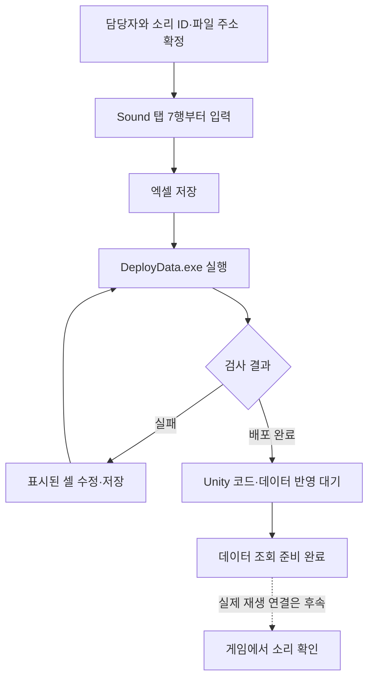

# 기획자용 사운드 테이블 작성과 배포 안내

## 1. 무엇을 하는 표인가요?

Sound 표는 게임에서 사용할 배경음과 효과음을 한곳에 적는 목록입니다. 한 행에 소리 하나를 작성하며, 사용할 파일 주소·종류·기본 음량·반복 여부·페이드 시간을 정합니다. 페이드는 소리가 서서히 커지거나 작아지는 효과입니다.

**현재는 표 작성·검사·클라이언트 데이터 로딩까지 준비됐습니다. 실제 소리 파일을 불러와 재생하는 연결은 후속입니다.** 표에 행을 추가해 배포가 성공해도 현재 게임 소리가 바로 바뀌지는 않습니다. 문서의 예시는 작성법 설명용이며 원본 엑셀에는 예시 행을 넣지 않았습니다. 기준일: 2026-11-05.



## 2. 어디에서 작성하나요?

두 프로젝트 폴더는 같은 부모 폴더에 있어야 합니다.

```text
같은 부모 폴더/
├── DataSheet/
│   ├── tables/Sound.xlsx     ← 이 원본만 편집합니다
│   └── DeployData.exe        ← 저장한 뒤 실행합니다
└── Human_Ghost-/
    └── Assets/
        ├── Data/Csv/Sound.csv ← 자동 배포됩니다
        └── 3.Script/Data/Sound.cs ← 최초 생성되는 정의 코드입니다
```

Sound.xlsx를 열면 **README 탭**에 간단한 설명이 있고 **Sound 탭**에 실제 값을 작성할 수 있습니다. CSV·C#·자동 로딩 계획은 직접 편집하지 않습니다.

| 영역 | 하는 일 | 기획자 작업 |
| --- | --- | --- |
| README 탭 | 컬럼과 배포 설명 | 먼저 읽습니다 |
| Sound 1~5행 | 도구가 읽는 추출·타입·검사 규칙 | 수정하지 않습니다 |
| Sound 6행 | 컬럼명 | 이름·순서·컬럼 수를 임의 변경하지 않습니다 |
| Sound 7행부터 | 실제 소리 목록 | 입력·수정합니다 |

ID 번호 대역은 아직 확정하지 않았습니다. 데이터 담당에게 사용할 번호를 받은 뒤 입력해 주세요. 소리 주소는 리소스 담당에게 확인합니다. 주소는 파일이 어디에 있는지 찾기 위한 등록명이며 내 PC의 C드라이브 경로나 파일명만 적는 칸이 아닙니다.

## 3. 각 칸에는 무엇을 넣나요?

A~G는 데이터 행마다 필수입니다. H열 Note만 설명이 필요할 때 작성합니다. 값0도 의미 있는 값이므로 빈칸으로 대신하지 않습니다.

| 열 | 컬럼 | 입력 방법 | 올바른 값 예시 |
| --- | --- | --- | --- |
| A | ID | 받은 번호를 양의 정수로 입력. Sound 안에서 중복 금지 | 담당자가 확정한 번호 |
| B | Address | 담당자가 확인한 리소스 주소를 정확히 입력. 영문 대소문자를 유지 | Audio/Bgm/Village |
| C | Category | 1은 배경음, 2는 효과음 | 1 |
| D | Volume | 0~10000 정수. 소리 자체의 기본 크기 | 8000 |
| E | Loop | Y는 반복, N은 한 번 재생. 대문자만 사용 | Y |
| F | FadeInMs | 시작 시 서서히 커지는 시간. 0 이상 정수 | 1000 |
| G | FadeOutMs | 정지·교체 시 서서히 작아지는 시간. 0 이상 정수 | 1000 |
| H | Note | 자유 설명. 한글 사용 가능. 추출 대상에서 제외 | 마을 기본 배경음 |

Address 예시는 실제 프로젝트에 등록됐다는 뜻이 아닙니다. 파일을 넣거나 주소를 새로 적는 것만으로 등록이 끝나지 않으므로 담당자에게 확인합니다. 같은 파일 주소를 서로 다른 설정으로 사용하는 경우가 있을 수 있어 Address 중복 자체는 현재 금지 규칙이 아닙니다.

### 음량과 시간 읽는 방법

| 원하는 값 | 입력 숫자 |
| --- | ---: |
| 원본 음량 100% | Volume에 10000 |
| 원본 음량 80% | Volume에 8000 |
| 원본 음량 50% | Volume에 5000 |
| 무음 | Volume에 0 |
| 페이드 없음 | 시간 칸에 0 |
| 0.5초 페이드 | 시간 칸에 500 |
| 1초 페이드 | 시간 칸에 1000 |
| 2초 페이드 | 시간 칸에 2000 |

Volume에 80%나 0.8을 넣지 않습니다. 시간 칸에도 1초나 0.5를 넣지 않습니다. 쉼표·단위·앞뒤 공백 없이 정수로 입력합니다. 테이블의 소리별 Volume과 플레이어 설정의 마스터·배경음·효과음은 다른 값입니다. 마스터 설정은 이 표에 작성하지 않습니다.

## 4. 처음 한 행을 작성하는 순서

예를 들어 마을 배경음 하나를 준비한다면 다음 순서입니다.

1. 담당자에게 이 소리의 ID와 실제 등록 주소를 확인합니다.
2. Sound 탭 A7에 받은 ID, B7에 확인한 주소를 넣습니다.
3. C7에 1, D7에 8000, E7에 Y를 넣습니다.
4. F7과 G7에 1000을 넣습니다. 각각 1초 페이드 설정입니다.
5. H7에 알아보기 쉬운 설명을 적습니다.
6. 두 번째 소리는 8행, 그다음은 9행에 이어서 입력합니다.

아래는 ID를 제외한 작성 모양입니다. ID를 채우지 않은 채 배포하면 해당 행은 데이터로 추출되지 않습니다.

| 용도 | Address 예시 | Category | Volume | Loop | FadeInMs | FadeOutMs |
| --- | --- | ---: | ---: | --- | ---: | ---: |
| 마을 배경음 | Audio/Bgm/Village | 1 | 8000 | Y | 1000 | 1000 |
| 일반 명중 효과음 | Audio/Sfx/Hit | 2 | 10000 | N | 0 | 0 |

현재 효과음 재생 코드는 이 표의 반복·페이드 설정을 아직 사용하지 않습니다. 이 표가 재생 기능까지 완성됐다고 해석하지 않습니다.

## 5. 추가·수정·삭제할 때 지킬 점

- 새 소리를 추가할 때 기존 행을 복사할 수 있지만 ID는 반드시 새 번호로 바꿉니다. 주소와 나머지 설정도 확인합니다.
- 같은 소리의 파일이나 음량을 바꿀 때는 기존 ID를 유지합니다. ID를 바꾸면 다른 기능에서 그 소리를 찾지 못할 수 있습니다.
- 삭제가 필요하면 먼저 다른 기능에서 해당 ID를 쓰는지 담당자에게 확인하고, 확인 후 데이터 영역의 행 전체를 삭제해 빈 줄을 남기지 않습니다.
- **A열 ID의 첫 빈칸에서 추출이 끝납니다.** 8행 ID가 비어 있으면 9행 이후를 작성했어도 추출하지 않습니다.
- 사용 중지를 위해 ID만 지우거나 Category에0을 넣지 않습니다. 현재 별도 사용 여부 컬럼은 없습니다.
- 새 컬럼·타입·재생 규칙이 필요하면 데이터 담당과 개발자에게 요청합니다. 기존 정의 클래스는 재배포만으로 자동 갱신되지 않습니다.

## 6. 검사하고 배포하기

1. 엑셀에서 저장합니다. 디스크에 저장하지 않은 수정은 도구가 읽지 못합니다. 파일 잠금 오류가 나면 엑셀을 닫고 다시 시도합니다.
2. DataSheet와 Human_Ghost-가 같은 부모 폴더에 있는지 확인합니다.
3. DataSheet 폴더의 DeployData.exe를 더블클릭합니다. 기획자 PC에 별도 .NET 설치는 필요하지 않습니다.
4. **배포 완료** 문구를 확인합니다. 이 도구는 Sound만이 아니라 다른 데이터 표도 함께 검사합니다.
5. 실패하면 화면의 파일명·탭·셀 주소·오류 내용을 읽고 해당 원본을 수정한 다음 다시 저장·실행합니다.
6. Unity가 코드 반영과 에셋 갱신을 마칠 때까지 기다립니다. 이미 실행 중인 Play에서는 반영을 기대하지 말고 종료 후 다시 시작합니다.
7. 담당자에게 작성한 ID·주소·원하는 재생 상황을 전달합니다. 실제 재생 연결 전에는 기존 Stage 키나 전투 코드를 직접 바꾸지 않습니다.

검사만 하고 배포하지 않을 때는 개발자 도움을 받아 DataSheet 폴더에서 `DeployData.exe --check`를 사용할 수 있습니다. 검사 완료와 배포 완료는 다릅니다. 이미 만든 게임 실행파일에 새 표가 자동으로 들어가는 것도 아니므로 배포 후 새 빌드가 필요합니다.

## 7. 자주 발생하는 문제

| 증상·원인 | 해결 방법 |
| --- | --- |
| ID가 중복됨 | 복사한 행의 ID를 새 번호로 바꿉니다 |
| 필수 값이 비어 있음 | A~G를 확인하고, 페이드 미사용은 빈칸 대신0을 넣습니다 |
| Category에 한글로 배경음 입력 | 1 또는2로 바꿉니다 |
| Loop에 소문자 y, 예, true 입력 | 대문자 Y 또는 N으로 바꿉니다 |
| Volume이 범위를 벗어남 | 0~10000 정수로 수정합니다 |
| 시간에 음수·소수·초 단위 문자 입력 | 0 이상 밀리세컨드 정수로 바꿉니다 |
| 아래쪽 행이 배포되지 않음 | 중간 ID 빈칸이 있는지 확인합니다 |
| 다른 표 오류로 배포 실패 | 화면에 표시된 원본 파일의 담당자에게 오류를 전달합니다 |
| 배포 성공했지만 소리가 바뀌지 않음 | 현재는 실제 재생 전환이 미구현입니다. 연결 완료 후에도 주소 등록과 호출 ID를 담당자가 확인해야 합니다 |

현재 도구는 표의 ID·타입·범위·허용값을 검사합니다. **실제 주소에 소리 파일이 있는지, AudioClip으로 등록됐는지까지 검사하지는 않습니다.** SoundID를 다른 표에서 참조하는 스키마 연결도 아직 없으므로 삭제 전 참조 확인은 담당자와 진행합니다.

오류를 전달할 때는 원본 파일명, 탭 이름, 셀 주소, 입력 값, 오류 문구를 함께 알려 주세요. 예를 들어 Sound 탭 D7의 Volume에11000을 넣어 실패했다면 해당 값을 그대로 전달하면 원인 확인이 빠릅니다.

## 8. 관련 안내

- 플레이어 마스터·개별 음량과 현재 구현 범위: [사운드 설정 사용 안내](기획자용%20사운드%20설정%20사용%20안내.md)
- 개발자의 책임 분리·데이터 조회 연결: [사운드 설정 설계](../개발자용%20설계문서/사운드%20설정%20설계.md)
