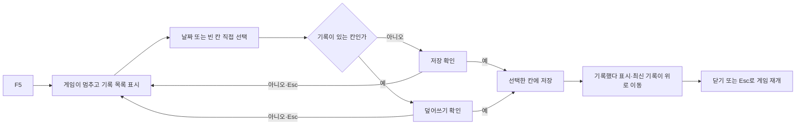
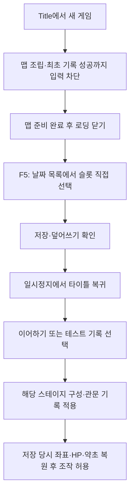

# 기획자용 수동 저장 사용 안내

현재 MapDohwagolTest에 저장 수집·복원과 수동 저장 프리팹 참조를 연결했습니다. 타이틀 새 게임·이어하기·테스트 기록 선택도 같은 저장 세션을 사용합니다. 실제 Unity 실행 검증은 아래 순서로 확인합니다. 개별 처치 기록도 저장하며, 서낭당과 사망 복원 확인은 [서낭당 저장 안내](서낭당%20저장과%20몬스터%20처치%20기록%20확인%20안내.md)를 참고합니다.

테스트·시연 중 원하는 상황을 직접 저장하기 위한 기능입니다. 출시 게임에는 F5 입력과 이 화면을 제공하지 않습니다.

## 1. 지금 준비된 것

화면·입력·저장 처리 연결 API를 구현했습니다. 실제 스테이지나 임시 플레이어를 자동 생성하지 않습니다. **현재 MapDohwagolTest에는 연결했습니다.** 다른 씬에는 상태 수집·준비·복원 계약을 구현한 조립자가 필요합니다.

기획자가 새 Stage 행이나 임시 좌표 데이터를 만들 필요는 없습니다. 연결 구조는 [저장 기능 설계](../%EA%B0%9C%EB%B0%9C%EC%9E%90%EC%9A%A9%20%EC%84%A4%EA%B3%84%EB%AC%B8%EC%84%9C/%EC%A0%80%EC%9E%A5%20%EA%B8%B0%EB%8A%A5%20%EC%84%A4%EA%B3%84.md) 8장을 개발자에게 전달하면 됩니다.

## 2. 연결된 테스트 씬에서 사용하기

1. 개발자가 연결한 테스트·시연 빌드 또는 Unity Play에서 게임을 시작합니다.
2. 게임 진행 중 **F5**를 누릅니다. 목록이 열린 동안 게임은 멈춥니다. F5를 다시 눌러 중복으로 열지는 않습니다.
3. 기존 기록은 **저장 날짜·시각이 최신인 순서**로 표시됩니다. 빈 칸은 그 아래에 나옵니다. 슬롯 번호는 표시하지 않습니다.
4. 마우스로 원하는 날짜나 **빈 칸**을 누릅니다. 키보드 위·아래 또는 패드 방향 입력으로 이동하고 Enter·C·패드 A로 결정할 수도 있습니다.
5. 빈 칸은 저장 확인창에서 예를 선택하면 저장합니다. 기록이 있는 칸은 선택한 날짜가 포함된 확인창이 나옵니다. 예를 선택하면 그 기록만 덮어쓰며, 아니오 또는 Esc는 목록으로 돌아갑니다.
6. **기록했다**가 표시되면 저장된 기록이 목록 위로 이동합니다. 이후 자동 저장도 방금 저장한 기록을 갱신합니다.
7. 목록에서 **닫기**, Esc 또는 패드 B를 누르면 게임을 재개합니다. 파일을 기록하는 동안에는 중복 저장과 닫기를 잠시 막습니다.

10칸이 모두 차 있어도 가장 오래된 기록을 자동으로 지우지 않습니다. 원하는 기록을 직접 골라 덮어씁니다. 새 게임의 슬롯 배정은 별도 규칙입니다.

## 3. 화면을 수정할 때

| 프리팹 | 역할 |
| --- | --- |
| `Assets/2.Model/Prefabs/UI/SaveSlotScreen.prefab` | 날짜 목록·빈 칸·닫기·확인창 공통 화면 |
| `Assets/2.Model/Prefabs/UI/ManualSaveScreen.prefab` | F5 입력과 저장 흐름을 연결하는 독립 화면 루트 |
| `Assets/2.Model/Prefabs/UI/TitleScreen.prefab` | 같은 공통 화면을 사용하는 타이틀 |

프리팹은 화면 구성을 재사용하기 위해 저장한 묶음입니다. 공통 화면의 글자·색·크기를 바꾸면 타이틀 기록 선택에도 반영될 수 있습니다. 수동 저장만 바꾸려면 개발자와 상의해 해당 인스턴스에서 수정합니다. 버튼·글자 컴포넌트와 연결 참조는 제거하지 않습니다.

`SaveRecord01` 같은 오브젝트 이름은 내부 연결용이며 화면 슬롯 번호가 아닙니다. 표시 위치가 바뀌어도 선택한 기록의 내부 ID로 저장합니다.

문구는 기존 Language·Popup 데이터를 사용합니다. 목록 제목30207·빈 칸30208·성공30024는 유지합니다. 현재 코드는 빈 칸 저장 확인15001·덮어쓰기15002를 사용하고, 취소하면 목록으로 돌아갑니다. 원본 엑셀에서 수정하고 기존 배포 도구로 배포합니다. 클라이언트 CSV를 직접 고치지 않습니다.

## 4. 열리지 않거나 실패할 때

| 상황 | 확인할 내용 |
| --- | --- |
| 현재 씬에서 F5가 아무 반응 없음 | 저장 실행 담당이 연결됐는지 개발자에게 확인합니다. 프리팹 배치만으로 연결되지는 않습니다. |
| 컷씬·로딩·사망 연출 중 F5가 동작하지 않음 | 연결 담당자가 열기를 막은 경우 정상입니다. 연출 중간 상태를 저장하지 않습니다. |
| 개발 빌드인데 열리지 않음 | 저장 정책도 테스트·시연용으로 연결했는지 확인합니다. |
| 오류 안내가 나옴 | 콘솔의 첫 오류를 개발자에게 전달합니다. 저장 파일을 직접 삭제하지 않습니다. |
| 출시 빌드에서 화면과 버튼이 전혀 없음 | 정상입니다. 전용 객체와 코드가 빌드에서 제외됩니다. |

Unity 직접 조작은 기획자·개발자가 수행합니다. 처음 연결할 때 개발자는 독립 ManualSaveScreen 프리팹, 입력 에셋, 공통 화면, 저장 흐름, 데이터 준비 결과를 연결해야 합니다. 다른 UI의 EventSystem과 중복되지 않는지도 확인합니다. 준비 후에는 위 순서대로 빈 칸 저장·덮어쓰기 취소·승인·닫기를 각각 확인합니다.

## 7. 현재 연결을 실제로 확인하기

1. 코드 반영과 자동 데이터 에셋 갱신이 끝나면 Title 씬에서 Play를 켭니다. 새 게임을 선택하고 맵이 열린 뒤 움직입니다.
2. 눈에 띄는 위치에서 F5를 눌러 빈 칸을 선택하고 저장 확인을 승인합니다. 목록은 날짜 내림차순이며 번호를 표시하지 않습니다.
3. 다른 위치로 이동하고 일시정지 메뉴에서 타이틀로 돌아갑니다. 이어하기는 최신 기록, 테스트 선택 버튼은 지정한 기록을 불러옵니다. 저장 위치·HP·약초가 맞는지 확인합니다.
4. 산길 관문을 열고 저장한 뒤 타이틀을 거쳐 불러옵니다. 열린 관문이 다시 막히지 않는지 확인합니다.
5. 일반 맵 이동은 마지막 저장 위치로 돌아가는 동작이 아닙니다. 왕복 이동 때는 도착 앵커와 현재 임시 진행 상태를 사용합니다.
6. 현재 자동 저장은 협곡 서낭당 통과 조건에 연결했습니다. 조건 충족 뒤 첫 성공만 기록하고 같은 플레이의 재방문으로 중복 기록하지 않는지 확인합니다. 임시 체크포인트 활성과 파일 기록 성공은 구분합니다.
7. 저장 준비 실패 시 오류를 확인합니다. 초기 기록 실패로 조작이 차단됐다면 오류 창을 닫고 Esc로 일시정지 메뉴를 열어 타이틀로 돌아갈 수 있습니다. 기존 파일을 자동 삭제하지 않습니다.

저장 폴더는 Unity의 persistentDataPath 아래입니다. 테스트·개발은 Saves/Demo, 출시 정책은 Saves/Release를 사용합니다. 출시에서는 수동 저장 코드·화면 생성이 제외되며 자동 1슬롯 정책을 사용합니다. 최종 플레이어에서 실제 비노출은 별도 검사합니다.

## 8. 관문 ID 작성

Stage.xlsx의 GateConfig는 관문을 저장용 정수 ID와 연결합니다. 각 칸의 뜻·현재 세 행·추가/이름 변경/제거·배포·오류 확인은 [관문 데이터 작성과 확인 안내](기획자용%20관문%20데이터%20작성과%20확인%20안내.md)에서 관리합니다. 같은 안내를 이 문서에 중복하지 않습니다.

## 9. 아직 공급이 필요한 범위

실제 컷씬, 정식 장부방·엔딩 공간, 몬스터별 고정 배치 ID와 처치 복원·리스폰 정책의 데이터 적용은 후속입니다. 몬스터 정책은 기본 리스폰 OFF, 추후 구간별 ON/OFF로 확정했습니다. 이번에는 그 정책을 스폰 JSON이나 시트에 임의 적용하지 않았습니다. 현재 개별 몬스터 재생성을 최종 기획으로 해석하지 않습니다.
