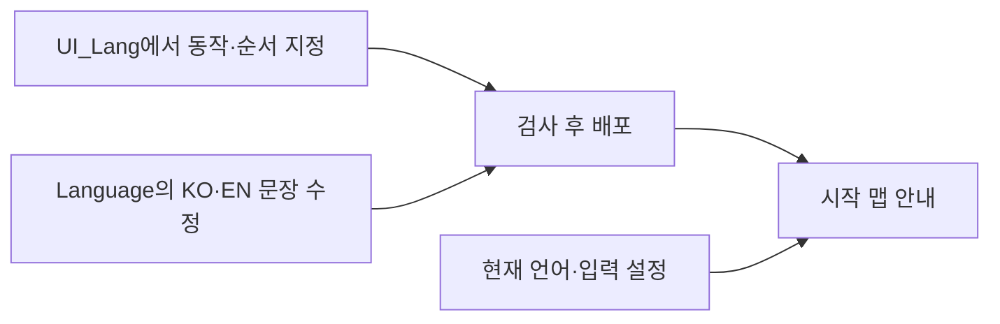

# 기획자용 언어 선택과 문구 작성 안내

한국어와 영어를 옵션에서 선택하는 기능입니다. 프로그램 코드를 수정하지 않고 기존 Language 표의 두 열로 표시 문구를 관리합니다.

## 목차

1. [게임에서 언어 바꾸기](#1-게임에서-언어-바꾸기)
2. [문구 수정 위치](#2-문구-수정-위치)
3. [확인 순서](#3-확인-순서)
4. [담당별 주의사항](#4-담당별-주의사항)
5. [시작 맵의 상세 조작 안내](#5-시작-맵의-상세-조작-안내)

## 1. 게임에서 언어 바꾸기

방향키·기존 메뉴 조작으로 언어 항목에 이동하고 좌우 또는 결정 입력으로 바꿉니다. 마우스로 언어 글자를 눌러도 전환됩니다. KO는 한국어, EN은 영어입니다. 현재 지원 선택지는 이 두 개입니다. 테스트·정식 빌드 모두 사용할 수 있습니다.

언어 설정은 저장 슬롯과 별개입니다. 게임 새로 시작이나 슬롯 선택으로 언어가 바뀌지 않습니다. 영어 타이틀에서는 한국어 메뉴 글자 이미지를 숨기고 번역 텍스트를 표시합니다. 배경 그림 자체의 글자는 자동 번역되지 않습니다.

## 2. 문구 수정 위치

형제 DataSheet의 `tables/Language.xlsx`에 있는 Language 탭을 사용합니다. ID는 연결 번호이며 KO·EN은 각각 표시할 원문입니다.

| 입력 | 의미 | 주의 |
| --- | --- | --- |
| ID | 같은 문구를 찾는 고정 번호 | 번역할 때 번호를 바꾸지 않음 |
| KO | 한국어 표시 | 비워 두지 않음 |
| EN | 영어 표시 | 임시 한국어를 복사해 번역 완료로 표시하지 않음 |

NPC는 NameTextID·대사 TextID, 팝업은 BodyTextID·버튼 TextID를 통해 같은 Language 원문을 가져옵니다. 엔딩 마무리는 30352, 옵션의 언어 제목은 30043입니다. 기존 문구는 새 ID를 중복 추가하지 말고 해당 행을 수정합니다. 기존 배포 도구의 검사 후 배포 절차를 따릅니다.

UI_Lang은 UI용 Key와 Language TextID를 모으는 관리 표입니다. 이번 옵션 선택은 Language의 KO·EN 선택을 연결한 것이며, 모든 기존 UI가 UI_Lang Key로 바뀐 것은 아닙니다. [UI 시트 작성 안내](../../../DataSheet/Docs/UI_Lang%20시트%20작성%20안내.md)를 함께 봅니다.

## 3. 확인 순서

1. 타이틀에서 옵션을 열고 언어를 EN으로 바꿉니다. 옵션의 음량·언어·화면 모드 제목과 저장 확인 버튼이 영어인지 확인합니다.
2. 저장하고 옵션을 닫습니다. 타이틀 메뉴가 영어 텍스트로 표시되는지 확인합니다.
3. 게임을 종료하고 다시 실행해 EN 선택이 유지되는지 확인합니다.
4. 옵션에서 KO로 바꾼 뒤 저장 확인에서 아니오를 고릅니다. 이전 EN으로 돌아와야 합니다.
5. 게임 안의 일시정지 옵션에서 KO로 바꾸고 저장합니다. 일시정지 제목·NPC 이름과 이후 여는 대사·팝업을 확인합니다.
6. 양쪽 언어에서 긴 문장·버튼·선택 행이 겹치거나 잘리는지 확인합니다. 언어 행은 키보드 조작 아래, 화면 모드 위입니다. 일시정지에서는 화면 모드를 숨기는 기존 규칙을 유지합니다.
7. 옵션을 여러 번 열고 닫고 맵을 왕복합니다. 한 번의 입력이 여러 번 적용되거나 이미 없어진 NPC를 참조하는 오류가 없어야 합니다.

실제 Unity 화면·빌드 확인은 자동 코드 검사와 별개입니다. 실행 결과를 확인하기 전 모든 번역과 화면 배치가 완료됐다고 처리하지 않습니다.

## 4. 담당별 주의사항

- 기획자: KO·EN 원문과 연결 ID를 관리합니다. 번역이 없으면 개발자가 자동으로 번역하지 않습니다.
- 개발자: 새 화면은 공통 LanguageTextSource를 사용하고 KO 열을 직접 고정하지 않습니다. 기존 화면에 없는 기능·UI_Lang Key 소비는 별도 연결이 필요합니다.
- 아트 담당자: 기존 메뉴 이미지·폰트 등 원본 아트 제작과 공급에 함께 참여했습니다. 영어 문장의 길이와 글자 지원을 확인하고 이미지 속 글자는 별도 버전으로 준비합니다.
- 임시 대사와 고정 안내 문구는 Language ID 연결 전에는 언어를 바꿔도 그대로 남을 수 있습니다. 발견한 화면·문구·선택 언어를 기록해 전달합니다.

설계 이유와 수명 계약은 [개발자 설계](../개발자용%20설계문서/언어%20선택%20설정%20설계.md)에 정리했습니다.

## 5. 시작 맵의 상세 조작 안내

2026-11-16: 기존 Language.xlsx의 UI_Lang 탭에 아래 8행을 추가하고 클라이언트에 배포했습니다. 별도 Inspector 할당은 필요하지 않습니다. 시작 맵을 구성하는 기존 연결에서 읽습니다.

| UI_Lang ID | Key | TextID | 안내 |
| --- | --- | --- | --- |
| ~~52201~~ | ~~StartGuide.Move~~ | 30368 | 이동 — 2026-11-16 원본에서 삭제(영상 안내 미사용) |
| 52202 | StartGuide.Jump | 30369 | 점프·발판 하강 |
| 52203 | StartGuide.Attack | 30370 | 공격 |
| 52204 | StartGuide.Herb | 30371 | 약초 |
| 52205 | StartGuide.Skill | 30372 | 결박 가르기 |
| 52206 | StartGuide.Execute | 30373 | 처형 |
| 52207 | StartGuide.Parry | 30374 | 패링 |
| 52208 | StartGuide.Shrine | 30375 | 서낭당 |

1. 설명을 바꾸려면 Language 탭에서 해당 TextID의 KO·EN을 수정합니다. 실제 키를 직접 쓰지 않고 `{0}`을 유지합니다. 실제 예: 30368의 `{0} 이동`은 현재 이동 키로 표시됩니다.
2. 다른 문구로 연결하려면 UI_Lang의 TextID를 존재하는 Language ID로 바꿉니다. Name·Note는 작업용 메모이며 화면에 나오지 않습니다.
3. 표시 순서는 UI_Lang ID 오름차순입니다. 엑셀 행을 끌어서 이동하는 것만으로 순서가 바뀌지는 않습니다. 기존 ID를 다른 기능에 재사용하지 마세요.
4. 안내가 불필요하면 해당 StartGuide 행을 제거할 수 있습니다. 다만 전부 없으면 필수 안내 연결 누락으로 처리합니다. Key는 위 동작 이름을 그대로 사용하세요. 새 입력 동작은 개발자의 입력 연결 확인이 필요합니다.
5. 검사 후 배포하고 시작 맵을 새로 엽니다. 데이터 파일 수정은 실행 중 자동 재로딩되지 않습니다. 언어·키 설정 변경은 열린 안내에 이벤트로 반영됩니다.
6. 판넬마다 안내 영상이 필요합니다. `Assets/StreamingAssets/Video/StartGuide_동작_A.mp4`(A 방향키)·`_B.mp4`(B WASD)를 두거나, 두 방식의 키가 같으면 `StartGuide_동작.mp4` 하나를 둡니다. 기본 스컬 배치도 `_A` 영상을 재생하므로, 스컬과 A의 키가 다른 동작(점프·구르기·패링·결박 가르기·약초)은 영상 속 키와 화면 키 문구가 다를 수 있습니다. 동작은 Key의 `StartGuide.` 뒤 이름입니다. 파일이 없으면 시작 맵 준비가 실패합니다. 플레이어가 판넬을 처음 지나갈 때 현재 키 방식의 영상이 3회 재생된 뒤 사라지고 키 문구는 남습니다. 영상 교체 시 [빌드 안내](GitHub%20빌드와%20디스코드%20공지%20사용%20안내.md)의 변환 절차를 따릅니다.
7. 한국어·영어와 세 입력 방식(스컬·A·B)에서 키·문장·줄바꿈을 확인합니다. 처형·서낭당은 기존 상호작용 키를 사용합니다. 너무 긴 설명은 영역에 맞게 작아지므로 핵심 문장으로 줄이는 것을 권장합니다.

현재 구현은 자동 데이터 검사·참조 컴파일로 확인합니다. 실제 화면의 가독성과 새 빌드 확인은 별도입니다. 배치 앵커·맵 생성 구조를 바꾸는 작업은 이번 문구 변경에 포함되지 않습니다.
