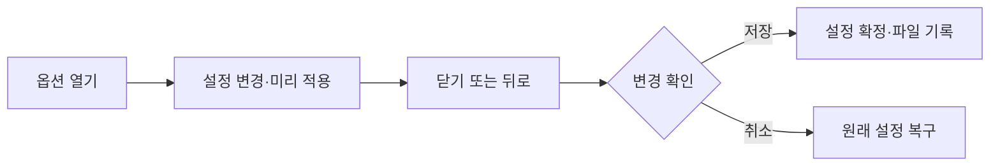
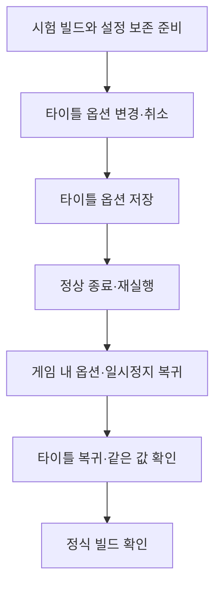

# 기획자용 옵션 설정과 실행파일 확인 안내

기준일: 2026-11-16. 현재 기능의 사용법과 아직 수행하지 않은 실행파일 확인 절차입니다. 새 옵션·새 데이터 열을 추가한 문서가 아닙니다.

## 목차

1. [무엇을 설정하나요](#1-무엇을-설정하나요)
2. [어디에서 수정하나요](#2-어디에서-수정하나요)
3. [실행파일 확인 순서](#3-실행파일-확인-순서)
4. [문제 전달과 현재 상태](#4-문제-전달과-현재-상태)

## 1. 무엇을 설정하나요

타이틀의 옵션과 게임 중 일시정지의 옵션을 사용합니다. 설정은 게임 저장 슬롯과 별도로 보관되므로 같은 PC의 다른 진행에도 적용됩니다. 기획자가 시트에서 정하는 문구·소리 종류와 플레이어가 선택하는 개인 설정을 구분합니다.

| 항목 | 사용법 |
| --- | --- |
| 마스터 | 전체 소리 크기 0~10 |
| 배경음·효과음 | 각각 0~10. 마스터 0이어도 값은 유지 |
| 카메라 흔들림 | 전투 화면 흔들림 켜기·끄기 |
| 입력 방식 | 스컬 기본 배열과 추천 A·B 중에서 선택. 입력 방식 행에서 R로 순환 |
| 언어 | 한국어·영어 선택 |
| 창 모드 | 타이틀에서만 제공. 현재 창 1280×720 또는 테두리 없는 전체 화면 |

현재 타이틀의 입력 방식은 저장/닫기 결과 처리 뒤 실제 키에 반영됩니다. 게임 내 미리보기 시점과 차이가 있으므로 화면의 선택 글자만으로 키 적용 완료를 판단하지 않습니다. 다른 설정을 취소했을 때도 원래 상태로 돌아오는지 확인합니다.

스컬 기본 배열은 방향키 이동, X 공격, C 점프, Z 구르기, A 결박 가르기, S 또는 왼쪽 Shift 패링, D 약초, F 상호작용·해체입니다. 기존에 저장된 추천 배열은 재실행해도 유지합니다.

## 2. 어디에서 수정하나요

- 문구·번역: 기존 UI_Lang·Language. [언어 작성 안내](기획자용%20언어%20선택과%20문구%20작성%20안내.md)를 참고합니다.
- 소리 종류·파일: 기존 Sound·소리 리소스 연결. [사운드 안내](기획자용%20사운드%20설정%20사용%20안내.md)를 참고합니다.
- 화면 배치·이미지: 기존 SettingsScreen 프리팹. 연결된 행·슬라이더·확인창·Canvas 크기를 유지하고 아트만 교체합니다. 참조를 지우면 개발자에게 알려야 합니다.
- 개인 설정: 게임 옵션 화면에서 조작합니다. settings.json을 직접 수정하거나 삭제할 필요가 없습니다.

기획자가 새 옵션을 추가하려면 실제 기능 적용·취소·저장 연결이 필요하므로 개발자에게 먼저 요청합니다. 시트에 문구를 추가하는 것만으로 새 기능이 생기지는 않습니다. 개발자는 [연결 설계](../개발자용%20설계문서/옵션%20연결과%20실행파일%20검증%20설계.md)를 사용합니다.

## 3. 실행파일 확인 순서

### 먼저 준비할 것

최신 빌드의 리비전·종류·exe 경로를 기록합니다. 개인 저장·설정을 보존할 시험 환경을 준비한 뒤 진행합니다. 현재 이 문서의 실기 항목은 모두 미확인입니다. 에디터에서는 실제 창 모드가 바뀌지 않으므로 실행파일로 확인해야 합니다.

| 순서 | 조작 | 정상 기준 | 이번 실기 결과 |
| --- | --- | --- | --- |
| 1 | 옵션 반복 열기·닫기 | 화면이 보이고 타이틀 입력 복귀 | 미확인 |
| 2 | 음량 변경 후 취소 | 원래 음량·표시 복구 | 미확인 |
| 3 | 마스터 0 후 복구 | 무음과 개별 음량 보존 | 미확인 |
| 4 | 언어 변경 후 취소·저장 | 원복 또는 선택 언어 유지, 문구 잘림 없음 | 미확인 |
| 5 | 입력 방식 변경·저장·취소 | 선택한 방식 반영, 취소 시 원래 키로 복귀 | 미확인 |
| 6 | 타이틀에서 창 모드 변경 | 1280×720 창/전체 화면 전환, 조작 가능 | 미확인 |
| 7 | 변경 저장 후 정상 종료·재실행 | 저장한 값 유지 | 미확인 |
| 8 | 게임 내 옵션 열기 | 창 모드 항목은 없고 기존 설정 일치 | 미확인 |
| 9 | 게임 내 설정 닫기 후 일시정지 닫기 | 자기 정지·입력 잠금이 풀리고 이동 가능 | 미확인 |
| 10 | 카메라 흔들림 변경·취소 | 해당 전투 상황에서 반영·원복 | 미확인 |
| 11 | 정식 실행파일에서 같은 절차 | 시험 전용 화면 없이 옵션 사용 가능 | 미확인 |

소리 청취·화면 전환·키보드/패드 입력은 코드 검사만으로 통과 처리하지 않습니다. 현재 지원 크기 정책은 1114 B7 최신 기록의 1280×720이며 과거 1208×720 문구와 구분합니다.

## 4. 문제 전달과 현재 상태

문제가 있으면 빌드 리비전·종류, 타이틀/게임 중 어느 화면인지, 바꾼 항목과 저장/취소, 직전 상태, 화면 캡처·로그를 전달합니다. 현재 진행을 초기화하거나 설정 파일부터 삭제하지 않습니다.

이번 소스 검사는 데이터 9373개·코어 2222개와 에디터 조건 컴파일을 통과했습니다. 실제 실행파일 검증은 최신 시험 exe 경로와 시험 환경 확보 뒤 진행해야 합니다. 이 기록은 실기 통과 기록이 아닙니다.
