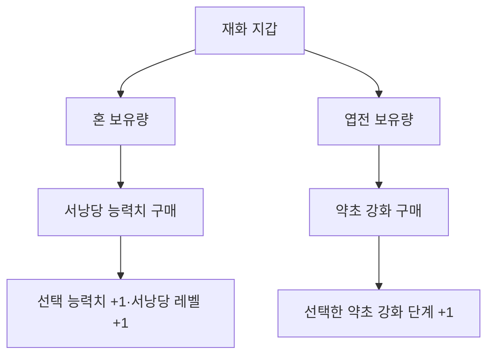
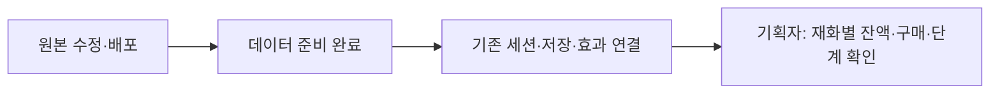
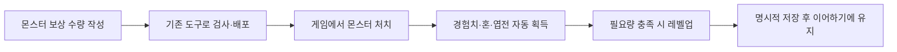

# 기획자용 재화와 강화 준비 안내

몬스터를 잡으면 경험치·혼·엽전을 자동으로 받고 플레이어 레벨이 오르도록 연결했습니다. 강화 효과·상태 저장도 준비했지만 **강화 창·보유량 표시·획득 연출은 이번에 만들지 않았습니다.** 기획자는 표를 수정하고 배포하며 별도 지갑 컴포넌트를 붙일 필요가 없습니다. [설계와 연결 계약](../개발자용%20설계문서/재화와%20강화%20구매%20설계.md)을 개발자에게 전달할 수 있습니다.

## 1. 무엇이 서로 다른가요

| 구분 | 현재 기준 | 관리하는 것 |
| --- | --- | --- |
| 혼 | Currency ID1 | 엽전과 별도의 보유량 |
| 엽전 | Currency ID2 | 혼과 별도의 보유량 |
| 서낭당 능력치 강화 | 혼 사용 | 능력치별 단계 + 전체 서낭당 레벨 |
| 약초 강화 | Upgrade 표에서 엽전 사용 | 약초 개수·회복량 등 대상별 단계 |

## 2. 수정할 원본

| DataSheet 원본 | 설정 내용 |
| --- | --- |
| tables/Currency.xlsx | 재화 ID·문구·사용 허용·사망 손실률. 현재 사망 차감에 사용 |
| stats/shrine/shrine_level.json | 혼 ID·최대 서낭당 레벨·비용 기본값·비율 |
| stats/shrine/stat/*.json | 능력치 종류·문구·단계별 효과·최대 단계·사용 허용 |
| tables/Currency.xlsx의 Upgrade 탭 | 강화 ID·사용 재화·대상·단계·효과값·가격·허용 여부 |

기존 원본을 수정하고 DeployData.exe로 배포합니다. 클라이언트 CSV·C# 파일을 직접 고치거나 새 컴포넌트를 붙이지 않습니다. [JSON 작성·배포와 로딩 안내](서낭당%20강화%20데이터%20배포%20안내.md)를 따릅니다.

## 3. 서낭당 비용은 어떻게 올라가나요

최신 기획의 비용식은 **버림(기본값 × (비율/10000)^(현재 서낭당 레벨−1))**입니다. 현재 soulCostBase=70, soulCostRate=11500이면 70·80·92·106입니다. 비율 11500은 1.15배입니다. 앞에서 버린 비용에 다시 비율을 곱하는 방식이 아닙니다.

어떤 능력치를 샀는지와 관계없이 전체 서낭당 레벨이 올라갑니다. 다음 구매는 그 레벨의 비용을 사용합니다. 개별 능력치의 최대 단계와 전체 서낭당 최대 레벨을 모두 넘을 수 없습니다. 계산 정책이 연결되지 않은 구성은 구매를 보류하며 무료로 처리하지 않습니다.

현재 levels 비용 표는 기존 배포 검사 호환을 위해 원본에 남아 있습니다. 이번 구매 계산은 soulCostBase·soulCostRate를 기준으로 하며 옛 표를 가격 대신 사용하지 않습니다. maxLevel을 바꿀 때는 현재 검사에 필요한 levels의 행 수·마지막 비용0도 함께 맞춥니다. 검사 호환 표를 없애는 작업은 개발자와 협의합니다.

## 4. 엽전 약초 강화는 어떻게 구분하나요

Upgrade의 CurrencyID가 어떤 재화를 쓸지 정합니다. 현재 약초 개수·회복량은 엽전 ID2입니다. 같은 Target의 Step을 1부터 순서대로 구매하며, 이미 산 단계나 다음 단계를 건너뛰는 구매는 처리하지 않습니다. 혼 보유량으로 엽전 부족분을 대신 지불하지 않습니다. 구매한 단계까지 Value를 합산해 약초 최대 수·회복량에 적용합니다. 개수 강화는 최대 수만 늘리고 현재 수를 채우지 않으며 서낭당 휴식 때 채웁니다. 구매 명령을 실행할 화면은 후속입니다.

## 5. 연결 후 확인할 목록

| 시험 | 기대 결과 |
| --- | --- |
| 혼으로 능력치 구매 | 혼만 차감, 능력치와 서낭당 레벨 각각 +1 |
| 다른 능력치로 바꿔 구매 | 전체 서낭당 레벨 기준 비용 유지 |
| 엽전으로 약초 강화 | 엽전만 차감, 해당 Target 단계 +1 |
| 잔액 부족·기획 잠금·상한 도달 | 재화와 단계가 바뀌지 않음 |
| 같은 강화 연속 입력 | 처리 중 중복 구매 차단 |
| 구매 후 저장·종료·이어하기 | 명시적으로 저장한 재화·강화 단계 복원. 구매 화면 연결 후 실제 확인 |

현재 자동 검사는 보상·레벨·구매·효과·저장 사본을 확인합니다. 강화 UI·획득 연출은 미구현이며 실제 게임 플레이·실행파일 확인은 별도로 필요합니다.

## 6. 몬스터 보상과 플레이어 레벨 설정

### 어떤 표를 수정하나요

DataSheet의 MonsterReward 탭에서 MonsterID로 몬스터를 고릅니다. Exp는 경험치 수량, SoulDrop은 혼 수량, CoinDrop은 엽전 수량입니다. 예를 들어 7·3·0이면 몬스터 한 마리를 잡을 때 경험치7·혼3을 받고 엽전은 받지 않습니다. 무작위 확률이나 랜덤박스 수량이 아닙니다. 랜덤박스 JSON 주소는 추후 별도 컬럼으로 추가합니다.

Player.xlsx의 PlayerLevel 탭은 레벨 요구량과 기본 능력치 대비 증가량을 정합니다. 클라이언트의 CSV나 C#을 직접 고치지 말고 원본 수정 → 기존 DeployData.exe 실행 → 배포 성공 확인 순서로 진행합니다.

### 레벨 값은 어떻게 읽나요

| 현재 레벨 | 다음 레벨까지 필요한 경험치 | 해당 레벨 능력치: HP / 스태미나 / 공격력 / 방어력 |
| --- | --- | --- |
| 1 | 40 | 100 / 100 / 15 / 0 |
| 2 | 80 | 110 / 105 / 16 / 1 |
| 3 | 120 | 120 / 110 / 17 / 2 |
| 4 | 160 | 130 / 115 / 18 / 3 |
| 5 | 상한, 경험치 획득 중지 | 140 / 120 / 19 / 4 |

경험치35에서10을 받으면 2레벨 경험치5가 됩니다. 초과한5는 다음 레벨에 남습니다. 6~10행은 현재 ContentEnabled가 꺼져 있어 올라가지 않습니다. HPAdd 등은 1레벨 대비 총 증가량입니다. 3레벨 HPAdd20을 앞의10에 또 더해30으로 계산하지 않습니다.

레벨업하면 현재 HP에는 늘어난 최대 HP만큼 더합니다. 현재 HP가60인 1레벨이 2레벨이 되면 현재70/최대110입니다. 전부 회복하는 방식이 아닙니다. 스태미나는 최대량만 올라갑니다. 죽어도 플레이어 레벨은 유지됩니다. 치명타·회피·공격 속도 등은 PlayerLevel이 아니라 서낭당 강화 표를 수정합니다.

### 저장과 사망은 어떻게 확인하나요

1. 같은 종류 몬스터를 서로 다른 배치에서 잡아 각각 한 번씩 보상을 받는지 확인합니다. 이미 죽은 몬스터의 피격 처리로 보상이 다시 생기면 안 됩니다.
2. 필요 경험치를 넘도록 사냥하고 최대 체력·스태미나와 공격·방어 변화가 적용되는지 확인합니다. 현재 UI에 레벨·재화 표시를 추가한 것은 아니므로 숫자 확인은 개발자에게 저장 기록·실행 상태 조회를 요청합니다.
3. F5 수동 저장 또는 기존 서낭당 저장 후 종료하고 이어합니다. 레벨·재화·강화가 같은 기록에서 복원돼야 합니다. F5는 테스트·시연 빌드 전용입니다.
4. 저장하지 않고 종료하면 이번 사냥의 재화·경험치도 파일에 확정되지 않습니다. 기존 저장·자동 저장 규칙은 바뀌지 않았습니다.
5. 사망하면 Currency의 DeathLossRate만큼 손실량을 버림해 차감합니다. 현재5000은50%입니다. 혼101이면50을 잃고51이 남으며 엽전3이면1을 잃고2가 남습니다. 레벨·강화는 잃지 않습니다.

이전 저장에는 새 항목이 없을 수 있습니다. 그 경우 기존 맵·관문·처치 기록은 유지하고 경험치·재화·강화만 초기값으로 읽습니다. 기존 파일을 읽기만 했다고 덮어쓰지는 않습니다.

획득 애니메이션·이펙트는 추후 지급 완료에 연결합니다. 연출 파일이 아직 없어도 지급 자체에는 필요하지 않습니다. 새 보상 종류·새 강화 기능은 열 이름만 추가해서 실행되지 않으므로 먼저 개발자에게 실행 연결을 요청합니다. 현재 보스 보상 행·랜덤박스·갈림길 보상 호출·강화 메뉴는 이번 자동 지급 범위 밖입니다.
