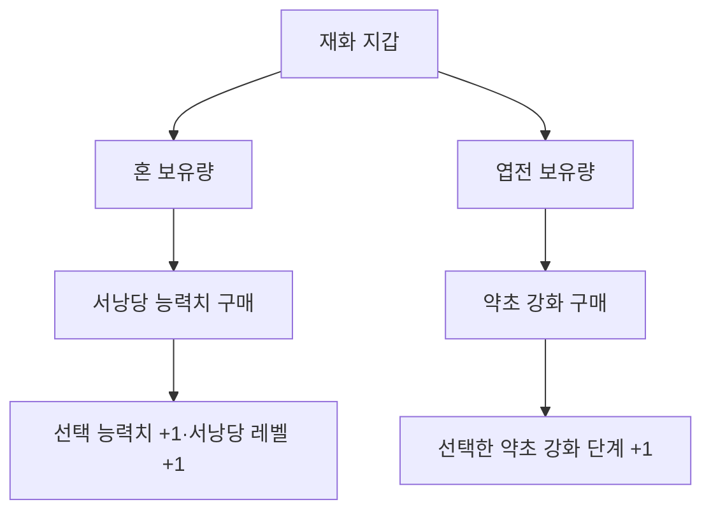

# 기획자용 재화와 강화 준비 안내

혼과 엽전을 따로 보유하고 강화에 사용할 수 있는 독립 처리 기반을 만들었습니다. **지금 게임에 강화 창이 생기거나 실제 플레이어 능력치가 바뀌는 단계는 아닙니다.** 정의 로딩·구매 규칙은 준비됐고 화면·게임 상태·저장 연결이 남아 있습니다. [설계와 연결 계약](../개발자용%20설계문서/재화와%20강화%20구매%20설계.md)을 개발자에게 전달할 수 있습니다.

## 1. 무엇이 서로 다른가요

| 구분 | 현재 기준 | 관리하는 것 |
| --- | --- | --- |
| 혼 | Currency ID1 | 엽전과 별도의 보유량 |
| 엽전 | Currency ID2 | 혼과 별도의 보유량 |
| 서낭당 능력치 강화 | 혼 사용 | 능력치별 단계 + 전체 서낭당 레벨 |
| 약초 강화 | Upgrade 표에서 엽전 사용 | 약초 개수·회복량 등 대상별 단계 |

## 2. 수정할 원본

| DataSheet 원본 | 설정 내용 |
| --- | --- |
| tables/Currency.xlsx | 재화 ID·문구·사용 허용·사망 손실률. 사망 시 차감 연결은 후속 |
| stats/shrine/shrine_level.json | 혼 ID·최대 서낭당 레벨·비용 기본값·비율 |
| stats/shrine/stat/*.json | 능력치 종류·문구·단계별 효과·최대 단계·사용 허용 |
| tables/Currency.xlsx의 Upgrade 탭 | 강화 ID·사용 재화·대상·단계·효과값·가격·허용 여부 |

기존 원본을 수정하고 DeployData.exe로 배포합니다. 클라이언트 CSV·C# 파일을 직접 고치거나 새 컴포넌트를 붙이지 않습니다. [JSON 작성·배포와 로딩 안내](서낭당%20강화%20데이터%20배포%20안내.md)를 따릅니다.

## 3. 서낭당 비용은 어떻게 올라가나요

최신 기획의 비용식은 **버림(기본값 × (비율/10000)^(현재 서낭당 레벨−1))**입니다. 현재 soulCostBase=70, soulCostRate=11500이면 70·80·92·106입니다. 비율 11500은 1.15배입니다. 앞에서 버린 비용에 다시 비율을 곱하는 방식이 아닙니다.

어떤 능력치를 샀는지와 관계없이 전체 서낭당 레벨이 올라갑니다. 다음 구매는 그 레벨의 비용을 사용합니다. 개별 능력치의 최대 단계와 전체 서낭당 최대 레벨을 모두 넘을 수 없습니다. 계산 정책이 연결되지 않은 구성은 구매를 보류하며 무료로 처리하지 않습니다.

현재 levels 비용 표는 기존 배포 검사 호환을 위해 원본에 남아 있습니다. 이번 구매 계산은 soulCostBase·soulCostRate를 기준으로 하며 옛 표를 가격 대신 사용하지 않습니다. maxLevel을 바꿀 때는 현재 검사에 필요한 levels의 행 수·마지막 비용0도 함께 맞춥니다. 검사 호환 표를 없애는 작업은 개발자와 협의합니다.

## 4. 엽전 약초 강화는 어떻게 구분하나요

Upgrade의 CurrencyID가 어떤 재화를 쓸지 정합니다. 현재 약초 개수·회복량은 엽전 ID2입니다. 같은 Target의 Step을 1부터 순서대로 구매하며, 이미 산 단계나 다음 단계를 건너뛰는 구매는 처리하지 않습니다. 혼 보유량으로 엽전 부족분을 대신 지불하지 않습니다. 표의 Value가 실제 약초 상태에 반영되는 연결은 다음 단계입니다.

## 5. 연결 후 확인할 목록

| 시험 | 기대 결과 |
| --- | --- |
| 혼으로 능력치 구매 | 혼만 차감, 능력치와 서낭당 레벨 각각 +1 |
| 다른 능력치로 바꿔 구매 | 전체 서낭당 레벨 기준 비용 유지 |
| 엽전으로 약초 강화 | 엽전만 차감, 해당 Target 단계 +1 |
| 잔액 부족·기획 잠금·상한 도달 | 재화와 단계가 바뀌지 않음 |
| 같은 강화 연속 입력 | 처리 중 중복 구매 차단 |
| 구매 후 종료·이어하기 | 저장 연결 후 확인할 항목. 현재 구현 완료로 간주하지 않음 |

현재 자동 검사는 코어 상태와 구매 결과를 확인합니다. 강화 UI·HUD·실제 약초/능력치 변화·획득 보상·사망 손실·저장은 아직 실제 게임에서 확인할 수 있는 완료 항목이 아닙니다.
