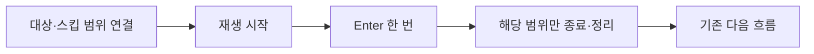

# 기획자용 즉시 스킵 사용 안내

## 스킵 안내 문구 — 2026-11-11

Language ID **30044**를 공용으로 사용합니다. 한국어는 **Enter키를 누르면 스킵됩니다.**, 영어는 **Press Enter to skip.**입니다. 문구를 바꾸려면 DataSheet의 Language.xlsx에서 이 ID의 KO·EN을 수정하고 배포합니다. 프리팹에 문장을 직접 적지 않습니다.

인트로 공용 CutsceneScreen과 현재 TextboxScreen에 안내를 연결했습니다. 기본 위치는 화면 오른쪽 위입니다. 스킵 가능한 동안 표시하고 종료·스킵·모달 차단·일시정지 때 숨깁니다. 화면의 SkipHintText에서 위치·크기·글꼴·색을 바꿀 수 있습니다. 표시 컴포넌트와 대상 연결은 유지합니다.

독립 영상·연출은 Canvas 아래에 `Assets/2.Model/Prefabs/UI/SkipHint.prefab`을 배치하고 SkipInput의 스킵 안내에 연결합니다. 개발자는 기존 언어 공급자와 선택 언어로 `SkipInput.ConnectText`를 호출하고 모달 차단을 `SetBlocked`에 전달합니다. 기존 CutsceneInput이나 대사 조립자가 입력을 연결한 화면에 SkipInput을 중복으로 붙이지 않습니다.

독립 VideoPlayer의 재생 시작·자연 종료·오류는 변경 알림으로 반영합니다. 별도 코드에서 Pause·Stop·재생 상태를 바꾸면 같은 소유자가 `VideoSkipTarget.NotifyPlaybackChanged`도 호출합니다. 연출은 기존 Begin·Complete·스킵에 따라 갱신됩니다. 매 프레임 표시 대상을 찾지 않습니다. 비활성화·대상 교체 뒤 다시 연결할 때는 언어·대상 연결도 다시 준비합니다.

확인은 **재생 → 안내 표시 → Enter → 안내 숨김**, **오류창/일시정지 → 숨김 → 복귀 시 다시 표시**, **영상 자연 종료·연출 완료 → 숨김**, **재진입 시 중복 안내 없음** 순서로 진행합니다. 현재 실제 인트로 미디어는 공급 대기이므로 자동 검사와 실제 재생 확인을 구분합니다.

## 1. 어떻게 동작하나요?

Enter를 한 번 누르면 즉시 스킵합니다. 숫자패드 Enter도 지원합니다. 계속 누르고 있어도 반복하지 않으며 다음 스킵은 키를 뗐다 다시 눌러야 합니다.

| 넘길 대상 | 결과 |
| --- | --- |
| 컷씬 전체 | 남은 컷씬을 종료하고 기존 다음 흐름으로 진행 |
| 영상 하나 | 현재 영상만 종료. 컷씬 안이면 다음 구간은 계속 재생 |
| 대사 하나 | 현재 문장의 남은 출력을 끝내고 즉시 다음 문장 로드. 마지막이면 대화 종료 |
| 연출 하나 | 담당자가 정한 최종 상태를 적용하고 완료 처리 |

## 2. 기존 기능에서 사용하는 방법

기존 CutsceneInput의 화면과 다음 장 입력은 유지합니다. Enter 스킵 범위를 Cutscene으로 두면 전체, Video로 두면 현재 영상만 넘깁니다. 예전 건너뛰기 유지 입력을 연결할 필요는 없습니다. 두 입력 담당을 같은 화면에 중복으로 붙이지 않습니다.

현재 GameplayPreview의 대사는 공용 입력이 이미 연결돼 있습니다. 일반 진행 키는 기존처럼 글자를 먼저 완성하고, Enter는 즉시 다음 문장으로 넘어갑니다. 오류창·일시정지·로딩·저장 잠금 중에는 대사 Enter를 처리하지 않습니다.

Cutscene 표의 SkipHoldMs는 현재 스킵 대기 시간으로 사용하지 않습니다. 기존 추출 규칙을 유지하기 위해 당장은 값을 지우거나 열을 삭제하지 마세요. DurationMs는 그림 표시 시간으로 계속 사용합니다.

## 3. 독립 화면에 붙이는 방법

Play를 끈 상태에서 설정합니다. 새 연결은 개발자와 함께 확인합니다.

| 대상 | 연결 순서 |
| --- | --- |
| 독립 대사 | TextboxScreen을 준비하고 SkipInput의 대상에 지정. 범위는 Dialogue |
| 독립 컷씬 | CutsceneScreen을 기존 방식으로 준비하고 SkipInput 대상에 지정. 범위는 Cutscene 또는 Video. 기존 CutsceneInput이 있으면 추가하지 않음 |
| 독립 영상 | VideoSkipTarget의 영상 플레이어에 VideoPlayer 지정. SkipInput의 대상은 VideoSkipTarget, 범위는 Video |
| 독립 연출 | PresentationSkipTarget 준비. SkipInput 대상에 지정하고 범위는 Presentation |

입력 컴포넌트는 스스로 활성화된 대상만 사용합니다. 화면에 붙였다고 데이터를 읽거나 영상 재생·다음 씬 이동까지 자동으로 만들어 주지는 않습니다. 한 번에 여러 스킵 대상이 떠 있다면 어떤 대상이 입력을 받을지 개발자가 차단·활성화를 연결해야 합니다.

독립 영상은 재생 중에 스킵할 수 있습니다. 스킵 완료 후 연결에 다음 화면·정리 동작을 지정합니다. Stop만으로 자연 종료 이벤트가 발생한다고 가정하지 않습니다. 영상 준비 대기·재생 실패는 영상 소유자의 별도 처리 대상입니다.

연출 담당자는 시작 때 Begin, 자연 종료 때 Complete를 호출하고 ‘최종 상태 적용’에 해당 연출의 정리 동작을 연결합니다. 예를 들어 문 열림 연출이라면 최종 문 상태·통행·카메라·입력 잠금까지 정리해야 합니다. 이 최초 연결은 개발자에게 요청하고, 기획자는 기존 연출의 최종 상태를 확인합니다.

## 4. Language ID와 대사 단위

앞으로 모든 텍스트는 Language ID 기준으로 공급합니다. 새 대사 연결은 개발자가 TextboxScreen.Open에 화자 ID·대사 ID 목록·언어 공급자·한국어/영어 코드를 전달합니다. ID 하나의 번역에 줄바꿈이 여러 개 있어도 한 번에 넘깁니다. 현재 피난민·명부의 기존 임시 문구는 사용자의 결정에 따라 ID 공급 전까지 유지하며 새 ID·엑셀 행은 이번에 추가하지 않았습니다. 모든 기존 텍스트가 전환 완료됐다는 뜻은 아닙니다. 신규 연결은 문구를 직접 입력하거나 ID 누락 시 임시 문구로 우회하지 않습니다.

## 5. 시험 순서

1. 문장이 출력되는 중 Enter를 누릅니다. 현재 문장에 멈추지 않고 다음 문장이 나와야 합니다.
2. Enter를 계속 누릅니다. 다음 문장을 반복해서 넘기면 안 됩니다. 마지막 문장에서 새로 누르면 대화가 닫혀야 합니다.
3. 컷씬 전체 범위에서는 한 번으로 종료되는지 확인합니다.
4. 영상 범위에서는 뒤의 그림·영상 구간이 남아 있는지 확인합니다.
5. 연출 스킵 뒤 최종 위치·문 상태·카메라·입력이 자연 종료와 일치하는지 확인합니다.
6. 오류창·일시정지·비활성화·재진입 뒤 입력 누락이나 중복이 없는지 확인합니다.

스킵 성공 자체가 파일 저장 성공은 아닙니다. 게임 진행을 보존하려면 기존 명시적 저장 절차를 사용합니다. 자세한 책임과 수명은 [개발자 설계](../개발자용%20설계문서/공용%20즉시%20스킵%20설계.md)를 봅니다.
