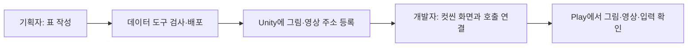

# 기획자용 컷씬 표시와 씬 이동 안내

## 1. 지금 사용할 수 있는 범위

컷씬의 순서·시간·주소는 기존 Cutscene·CutsceneStep 표로 정하고, 같은 화면 프리팹에서 영상과 그림을 재생합니다. 컷씬이 끝난 뒤 어디로 이동할지는 별도 호출 기능이 결정합니다. 현재 두 표는 비어 있어 실제 인트로가 자동 재생되는 상태는 아닙니다.

데이터 작성 규칙은 [DataSheet 컷씬 안내](../../../DataSheet/Docs/기획자용%20컷씬%20데이터%20작성과%20사용%20안내.md)를 따릅니다. 개발 구조는 [컷씬 재생 설계](../개발자용%20설계문서/컷씬%20재생%20설계.md)에 있습니다.

## 2. 기획자가 준비할 것

| 준비물 | 확인할 내용 |
| --- | --- |
| 컷씬 ID | 개발자와 확정한 번호를 사용합니다. 임의 예시 ID를 실제 표에 넣지 않습니다. |
| 구간 순서 | 같은 컷씬의 그림·영상을 1부터 순서대로 작성합니다. |
| 그림 | Unity 가져오기 형식을 Sprite로 설정합니다. |
| 영상 | Unity가 가져온 VideoClip을 사용합니다. 최종 Windows 빌드에서도 재생을 확인합니다. |
| 주소 | Addressables에 등록하고 표의 ResourceAddress와 정확히 맞춥니다. 파일 경로를 입력하지 않습니다. |
| 자막 | 필요한 구간만 TextID를 넣고 Language 행을 함께 준비합니다. |
| 종료 후 행동 | 맵 이동·타이틀 복귀·대화 재개 중 무엇인지 개발자에게 전달합니다. |

그림의 DurationMs는 표시 시간입니다. 영상은 실제 끝까지 재생되므로 DurationMs=0으로 둡니다. CanAdvance는 그림의 다음 장 허용 여부입니다. 건너뛰기 유지 시간은 Cutscene의 SkipHoldMs를 사용합니다.

## 3. 화면 프리팹 만들기

Unity 직접 조작은 아래 순서로 진행합니다. 처음 한 번 개발자와 함께 연결하고 이후 그림·영상·시간은 표에서 변경합니다.

1. Canvas 아래에 컷씬 화면 묶음을 만들고 이름을 `CutsceneScreen`으로 지정합니다. 화면 배경은 검게 설정합니다.
2. 같은 묶음에 CanvasGroup과 CutsceneScreen 컴포넌트를 추가합니다. 화면 캔버스와 표시 묶음에 각각 해당 참조를 넣습니다.
3. 전체 화면 Image를 `Illustration`으로 만들고 그림 표시에 연결합니다. 비율 유지를 켜고 색은 흰색으로 둡니다.
4. 전체 화면 RawImage를 `Video`로 만들고 영상 표시에 연결합니다. 영상의 RenderTexture와 VideoPlayer는 코드가 소유하므로 직접 만들지 않습니다.
5. 자막이 필요하면 Text를 `Subtitle`로 만들고 자막 표시에 연결합니다. 자막이 없으면 비워 둘 수 있습니다.
6. 재생 시작 전에는 CanvasGroup의 Alpha를 0, Blocks Raycasts를 끕니다. 화면 루트는 활성 상태로 두어 준비·명령을 받을 수 있게 합니다.
7. 키 조작을 붙이려면 CutsceneInput을 추가하고 화면·다음 장 입력·건너뛰기 유지 입력을 연결합니다. 기존 입력 에셋에서 버튼 액션을 선택합니다. 건너뛰기는 눌린 동안 값이 유지되는 버튼 액션을 사용합니다.
8. 프리팹으로 저장합니다. 기존 그림·영상은 자식 오브젝트를 새로 만들지 않고 교체할 수 있습니다.

키는 이 컴포넌트에 고정하지 않습니다. 확정된 E 유지·X 다음 장을 사용한다면 해당 키가 연결된 액션을 지정합니다. 게임 조작과 동시에 실행되지 않도록 개발자가 입력 잠금도 함께 연결해야 합니다.

## 4. 개발자에게 요청할 연결

다음은 개발자의 책임입니다. 표를 작성하는 것만으로 호출 장소나 다음 씬이 자동 생성되지는 않습니다.

1. 데이터 준비 뒤 CutsceneSequenceSource.Create로 해당 ID의 재생 정의를 만듭니다.
2. 활성 화면에 Connect로 언어 공급자·선택 언어를 전달하고 PrepareAsync로 필요한 리소스를 준비합니다.
3. 준비를 기다리는 동안 호출자가 사라지거나 요청이 바뀌지 않았는지 확인합니다.
4. 게임 입력·피해·시간 등 필요한 잠금을 소유한 뒤 Play로 재생합니다. 잠금은 다른 기능의 잠금을 임의로 해제하지 않게 관리합니다.
5. Finished 결과를 기록하고 다음 실행 흐름에서 잠금을 정리합니다. Completed·Skipped만 정상 다음 진행으로 취급하고 Cancelled·Failed는 별도로 처리합니다.
6. 화면을 비활성화하면 리소스가 정리됩니다. 다시 사용할 때 Connect와 PrepareAsync를 다시 수행합니다.

## 5. 씬 이동의 현재 두 경로

| 이동 | 현재 동작 |
| --- | --- |
| 맵 진입 | 기존 LoadingScreen.Begin을 사용하며 최소 2000ms 표시합니다. |
| 테스트 맵에서 타이틀 복귀 | 같은 프리팹의 BeginFade를 사용합니다. 로딩 그림·툴팁·도장·최소 2초 대기 없이 검은 암전만 표시합니다. |

새 씬은 Unity 빌드 씬 목록에 등록해야 합니다. 이름만 표나 코드에 넣어도 자동으로 씬이 만들어지지는 않습니다. 새 호출 장소는 개발자가 기존 이동 진입점을 연결합니다. 동시에 이동을 두 번 요청하면 두 번째 요청을 거부합니다.

로딩 화면의 새 시안은 이번 작업에서 바꾸지 않았습니다. 게임 실행 직후·엔딩·부스 리셋까지 모두 연결한 상태도 아닙니다. 현재 표기한 경로부터 확인합니다.

## 6. 확인 순서와 문제 전달

- 그림 2장: 정해진 시간에만 넘어가고, CanAdvance=N이면 다음 장 입력을 무시하는지 확인합니다.
- 영상: 첫 준비 후 끝까지 재생하고 다음 구간으로 넘어가는지 확인합니다. 영상 준비가 15000ms를 넘으면 기본 설정상 실패합니다.
- 건너뛰기: 유지 시간 직전에 놓으면 취소되고, 끝까지 누르면 전체 컷씬이 종료되는지 확인합니다.
- 재생 중 화면 비활성화: 영상·자막·입력이 남지 않는지 확인합니다. 다시 연결·준비한 뒤 재생할 수 있어야 합니다.
- 주소 오류·리소스 타입 오류·삭제된 표시 객체: Console에 상세 오류가 남고 진행 잠금이 정리되는지 확인합니다. 시작 실패의 잠금 정리는 호출자가 맡습니다.
- 맵 진입과 타이틀 복귀: 전자는 기존 로딩, 후자는 검은 암전만 보이는지 확인합니다.
- 두 번 빠르게 이동: 씬 로드가 중복 실행되지 않는지 확인합니다.

문제를 전달할 때 컷씬 ID·구간 순서·입력·이동 전후 씬 이름·Console 첫 오류를 함께 알려 주세요. 오류 팝업이 배치된 씬에서는 기존 수집 기능을 사용하며, 빈 시험 씬에 팝업을 자동 생성하지 않습니다.

최신 검사 결과는 [현재 구현과 검증 현황](../개발자용%20설계문서/현재%20구현과%20검증%20현황.md)에서 관리합니다. 실제 영상·키 입력·씬 화면·플레이어 빌드 검증은 별도입니다.
