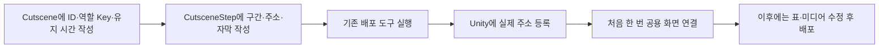
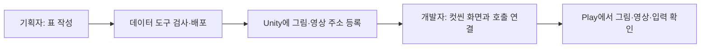
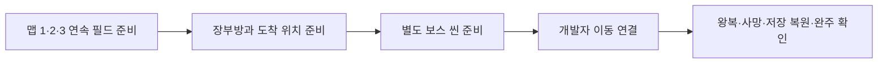

# 기획자용 컷씬 표시와 씬 이동 안내

## 1. 지금 사용할 수 있는 범위

### 기획자가 표에서 연결하는 방법

공용 실행 담당과 인트로·장부·엔딩 호출 기반을 준비했습니다. 실제 ID·미디어·화면 프리팹은 아직 미준비이므로 현재 게임에서 실제 컷씬이 재생되는 상태는 아닙니다.

| Cutscene의 Key 값 | 재생 시점 | 완료하거나 건너뛴 뒤 |
| --- | --- | --- |
| `Intro` | 타이틀 새 게임 요청 | 기존 맵 로딩과 새 게임 기록으로 진행 |
| `Ledger` | 처음 장부 조사 | 기존 조사 완료와 해금 처리 |
| `Ending` | 보스 사망·해체 상태 종료 후 | 로딩 화면 없이 타이틀 암전 복귀 |

위 Key는 영어 대소문자까지 일치시킵니다. 실제 ID 번호는 기획자가 확정한 번호를 쓰고, 인스펙터에 같은 번호를 다시 입력하지 않습니다. 세 역할 외의 컷씬도 기존 두 표로 작성할 수 있지만 새로운 호출 상황은 개발자가 연결해야 합니다.

1. Cutscene에 확정한 양수 ID와 역할 Key를 적습니다. SkipHoldMs는 기존 표 호환용이며 현재 스킵에는 사용하지 않습니다. 기존 추출 규칙 때문에 열·값은 당장 삭제하지 않습니다.
2. CutsceneStep의 CutsceneID에 그 ID를 입력하고 Order를 1부터 연속으로 작성합니다.
3. MediaType은 Image 또는 Video입니다. 그림 DurationMs는 양수 밀리초, 영상은 0입니다. CanAdvance는 그림 다음 장 허용 여부입니다.
4. ResourceAddress에는 실제 등록한 Addressables 주소를 적습니다. 파일 경로를 적지 않습니다. TextID가 있으면 Language 행도 준비합니다.
5. 기존 DataSheet 도구로 검사·배포합니다. 클라이언트의 CSV를 직접 수정하지 않습니다.
6. 개발자가 공용 화면 연결을 한 번 마친 뒤 새 게임·장부·보스 종료에서 확인합니다. ID·순서·시간·미디어 주소를 바꿀 때마다 컴포넌트를 추가하지 않습니다.

해당 역할 행이 없으면 제작 대기로 보고 기존 동작을 유지합니다. 행이 있는데 화면·주소가 빠졌다면 오류이며, 성공한 것으로 넘어가지 않습니다. 취소·실패한 장부 컷씬으로는 조사가 완료되지 않습니다. 상세 오류는 콘솔과 기존 오류 팝업 연결에서 확인합니다.

컷씬의 순서·시간·주소는 기존 Cutscene·CutsceneStep 표로 정하고, 같은 화면 프리팹에서 영상과 그림을 재생합니다. 컷씬이 끝난 뒤 어디로 이동할지는 별도 호출 기능이 결정합니다. 현재 두 표는 비어 있어 실제 인트로가 자동 재생되는 상태는 아닙니다.

데이터 작성 규칙은 [DataSheet 컷씬 안내](../../../DataSheet/Docs/기획자용%20컷씬%20데이터%20작성과%20사용%20안내.md)를 따릅니다. 개발 구조는 [컷씬 재생 설계](../개발자용%20설계문서/컷씬%20재생%20설계.md)에 있습니다.

## 2. 기획자가 준비할 것

| 준비물 | 확인할 내용 |
| --- | --- |
| 컷씬 ID | 개발자와 확정한 번호를 사용합니다. 임의 예시 ID를 실제 표에 넣지 않습니다. |
| 구간 순서 | 같은 컷씬의 그림·영상을 1부터 순서대로 작성합니다. |
| 그림 | Unity 가져오기 형식을 Sprite로 설정합니다. |
| 영상 | Unity가 가져온 VideoClip을 사용합니다. 최종 Windows 빌드에서도 재생을 확인합니다. |
| 주소 | Addressables에 등록하고 표의 ResourceAddress와 정확히 맞춥니다. 파일 경로를 입력하지 않습니다. |
| 자막 | 필요한 구간만 TextID를 넣고 Language 행을 함께 준비합니다. |
| 종료 후 행동 | 맵 이동·타이틀 복귀·대화 재개 중 무엇인지 개발자에게 전달합니다. |

그림의 DurationMs는 표시 시간입니다. 영상은 실제 끝까지 재생되므로 DurationMs=0으로 둡니다. CanAdvance는 그림의 다음 장 허용 여부입니다. Enter를 누르면 즉시 스킵하며 SkipHoldMs는 사용하지 않습니다.

## 3. 화면 프리팹 만들기

Unity 직접 조작은 아래 순서로 진행합니다. 처음 한 번 개발자와 함께 연결하고 이후 그림·영상·시간은 표에서 변경합니다.

1. Canvas 아래에 컷씬 화면 묶음을 만들고 이름을 `CutsceneScreen`으로 지정합니다. 화면 배경은 검게 설정합니다.
2. 같은 묶음에 CanvasGroup과 CutsceneScreen 컴포넌트를 추가합니다. 화면 캔버스와 표시 묶음에 각각 해당 참조를 넣습니다.
3. 전체 화면 Image를 `Illustration`으로 만들고 그림 표시에 연결합니다. 비율 유지를 켜고 색은 흰색으로 둡니다.
4. 전체 화면 RawImage를 `Video`로 만들고 영상 표시에 연결합니다. 영상의 RenderTexture와 VideoPlayer는 코드가 소유하므로 직접 만들지 않습니다.
5. 자막이 필요하면 Text를 `Subtitle`로 만들고 자막 표시에 연결합니다. 자막이 없으면 비워 둘 수 있습니다.
6. 재생 시작 전에는 CanvasGroup의 Alpha를 0, Blocks Raycasts를 끕니다. 화면 루트는 활성 상태로 두어 준비·명령을 받을 수 있게 합니다.
7. 키 조작을 붙이려면 CutsceneInput을 추가하고 화면·다음 장 입력을 연결합니다. Enter 스킵은 자동 연결되며 범위는 컷씬 전체 또는 현재 영상 하나를 선택합니다. 길게 누르기 입력은 연결하지 않습니다.
8. 프리팹으로 저장합니다. 기존 그림·영상은 자식 오브젝트를 새로 만들지 않고 교체할 수 있습니다.

키는 이 컴포넌트에 고정하지 않습니다. 확정된 E 유지·X 다음 장을 사용한다면 해당 키가 연결된 액션을 지정합니다. 게임 조작과 동시에 실행되지 않도록 개발자가 입력 잠금도 함께 연결해야 합니다.

## 4. 개발자에게 요청할 최초 연결

기획자가 표를 편집할 때마다 아래 작업을 반복하지 않습니다. 화면 프리팹이 처음 준비됐을 때 개발자가 한 번 조립합니다.

1. 활성 화면 루트의 CutsceneScreen에 Canvas·CanvasGroup·Image·RawImage·필요한 자막을 연결합니다. 그림·영상 자체는 여기 넣지 않습니다.
2. CutsceneInput에 같은 화면과 다음 장·건너뛰기 입력 액션을 연결하고 컴포넌트는 처음에 비활성화합니다. 루트 오브젝트는 활성 상태를 유지합니다.
3. CutsceneHost를 두고 화면·입력·기존 ErrorPopupSceneBinding을 연결합니다. 모달 연결의 잠금 대상에는 해당 씬의 타이틀 또는 게임 실행 담당이 포함되어야 합니다. 테스트 씬에는 GameSpeedController도 기존 모달에 연결합니다.
4. 타이틀의 TitleGameEntry와 게임 맵의 GameplayPreview에는 각 씬의 공용 CutsceneHost만 연결합니다. 컷씬 ID 필드는 없습니다.
5. 실제 데이터의 역할 키를 확인하고 실행합니다. 공용 실행 담당이 준비·재생·소리·잠금 정리를 처리합니다. 화면을 재사용할 때 호출자가 로딩 코드를 복제하지 않습니다.
## 5. 씬 이동의 현재 두 경로

| 이동 | 현재 동작 |
| --- | --- |
| 맵 진입 | 기존 LoadingScreen.Begin을 사용하며 최소 2000ms 표시합니다. |
| 테스트 맵에서 타이틀 복귀 | 같은 프리팹의 BeginFade를 사용합니다. 로딩 그림·툴팁·도장·최소 2초 대기 없이 검은 암전만 표시합니다. |

새 씬은 Unity 빌드 씬 목록에 등록해야 합니다. 이름만 표나 코드에 넣어도 자동으로 씬이 만들어지지는 않습니다. 새 호출 장소는 개발자가 기존 이동 진입점을 연결합니다. 동시에 이동을 두 번 요청하면 두 번째 요청을 거부합니다.

로딩 화면의 새 시안은 이번 작업에서 바꾸지 않았습니다. 엔딩 후 타이틀 암전 호출은 준비했지만 실제 엔딩 데이터·화면은 아직 없습니다. 현재 표기한 경로부터 확인합니다.

## 6. 확인 순서와 문제 전달

- 그림 2장: 정해진 시간에만 넘어가고, CanAdvance=N이면 다음 장 입력을 무시하는지 확인합니다.
- 영상: 첫 준비 후 끝까지 재생하고 다음 구간으로 넘어가는지 확인합니다. 영상 준비가 15000ms를 넘으면 기본 설정상 실패합니다.
- 건너뛰기: 유지 시간 직전에 놓으면 취소되고, 끝까지 누르면 전체 컷씬이 종료되는지 확인합니다.
- 재생 중 화면 비활성화: 영상·자막·입력이 남지 않는지 확인합니다. 다시 연결·준비한 뒤 재생할 수 있어야 합니다.
- 주소 오류·리소스 타입 오류·삭제된 표시 객체: Console에 상세 오류가 남고 진행 잠금이 정리되는지 확인합니다. 시작 실패의 잠금 정리는 호출자가 맡습니다.
- 맵 진입과 타이틀 복귀: 전자는 기존 로딩, 후자는 검은 암전만 보이는지 확인합니다.
- 씬 이동 시작부터 로딩·도착 상태 복원·암전 해제 완료까지 플레이어 이동이 잠깁니다. 이동키를 계속 눌러도 로딩 중 위치가 바뀌거나 다시 출구로 이동하지 않아야 합니다.
- 두 번 빠르게 이동: 진행 중인 이동 요청은 무시하며, “다른 씬 이동이 이미 진행 중입니다” 오류가 없어야 합니다. 로딩이 완전히 닫힌 뒤 이동이 재개되고 저장·대화·일시정지·오류 모달이 남아 있으면 해당 잠금은 유지돼야 합니다.
- 로딩5단계와 중복 요청·입력/실제 이동 잠금의 격리80건을 확인했습니다. 실제 키를 누른 왕복 Play는 별도 수용 항목입니다.

문제를 전달할 때 컷씬 ID·구간 순서·입력·이동 전후 씬 이름·Console 첫 오류를 함께 알려 주세요. 오류 팝업이 배치된 씬에서는 기존 수집 기능을 사용하며, 빈 시험 씬에 팝업을 자동 생성하지 않습니다.

최신 검사 결과는 [현재 구현과 검증 현황](../개발자용%20설계문서/현재%20구현과%20검증%20현황.md)에서 관리합니다. 실제 영상·키 입력·씬 화면·플레이어 빌드 검증은 별도입니다.

## 맵 준비 상태와 확인 순서 (2026-11-06)

K9 맵 1~3·장부방·보스 프리팹은 공급됐습니다. 연속 필드·장부방 실행 연결·별도 보스 씬은 대기입니다. 현재 테스트 게임은 맵 이동 때 기존 씬을 다시 읽습니다. 아래는 실제 공간이 준비된 뒤 연결할 순서입니다.

일반 맵은 몬스터를 남겨도 출구를 이용하도록 변경했습니다. 마을 장부 조사 조건은 유지하며 Stage의 ContentEnabled와 해금 조건을 목적지 진입 전에 확인합니다. 잠긴 목적지로 이동하지 않는 것은 정상입니다.

기획자는 임시 씬이나 예시 데이터를 추가하지 않아도 됩니다. 실제 에셋이 준비되면 개발자에게 위치·Stage ID·입구와 돌아오는 위치를 전달해 주세요. 연결 후에는 적을 남긴 이동, 장부 조사 전후, 잠긴 목적지 접근, 장부방 왕복, 보스 진입을 확인합니다. 서낭당 저장은 연결했으며 컷씬은 공용 호출 기반까지 준비했습니다. 실제 컷씬 데이터·화면과 정식 공간 연결은 후속입니다.

## 도착 준비 실패 확인 — 2026-11-10 후속

'이동한 공간의 게임 상태 준비·복원이 완료되지 않았습니다'가 나오면 같은 시각 Editor.log의 앞선 초기화 오류도 함께 확인합니다. 이번8002 진입 실패는 삭제 확정된 관문의 이전 표식이 남아 발생했습니다. 빈 GateConfig는 현재 기획에 맞는 상태이며 해당 세 표식만 이전 맵 호환으로 처리했습니다. 데이터에 삭제한 행을 임시로 되살리지 않았습니다.

현재 연결된5맵의 조립·활성화와 미연결 관문 정책을 포함한24항목 검사를 확인했습니다. 실제 Play에서는 장부방 조사/해금 후 산길8002→협곡8003을 이동하고, 이전 UI 확대·텍스트 표시 제거와 로딩 중 이동 잠금도 함께 확인합니다. 최신 Develop 정책에 따라 다른 미연결 관문은 경고를 남기고 생성을 생략하여 통행을 허용합니다. 정식 연결 전에는 개방 기록을 저장하지 않습니다.

## 로딩 배경 교체 — 2026-11-12

일반 로딩 화면은 `Assets/4.Sprite/LodingImage/Background_KeyArt1_1920x1080.png`를 표시합니다. LoadingScreen.prefab의 초기 Background Image와 배경 목록을 같은 원본Sprite로 연결했습니다.16:9 비율을 유지하므로 다른 화면 비율에서는 검은 여백이 생길 수 있습니다. 기존 팁·인장 진행 표시·최소 표시 시간·씬 이동 잠금은 그대로입니다.

Unity 격리27항목과1920×1080/1920×1200 렌더에서 배경·팁·진행 표시를 확인했습니다. 원본PNG/메타·맵/씬 배치는 수정하지 않았고 실제 씬 로드를 시작하지 않았습니다. 기획자는 프리팹을 열면 연결된 배경을 바로 볼 수 있습니다.
