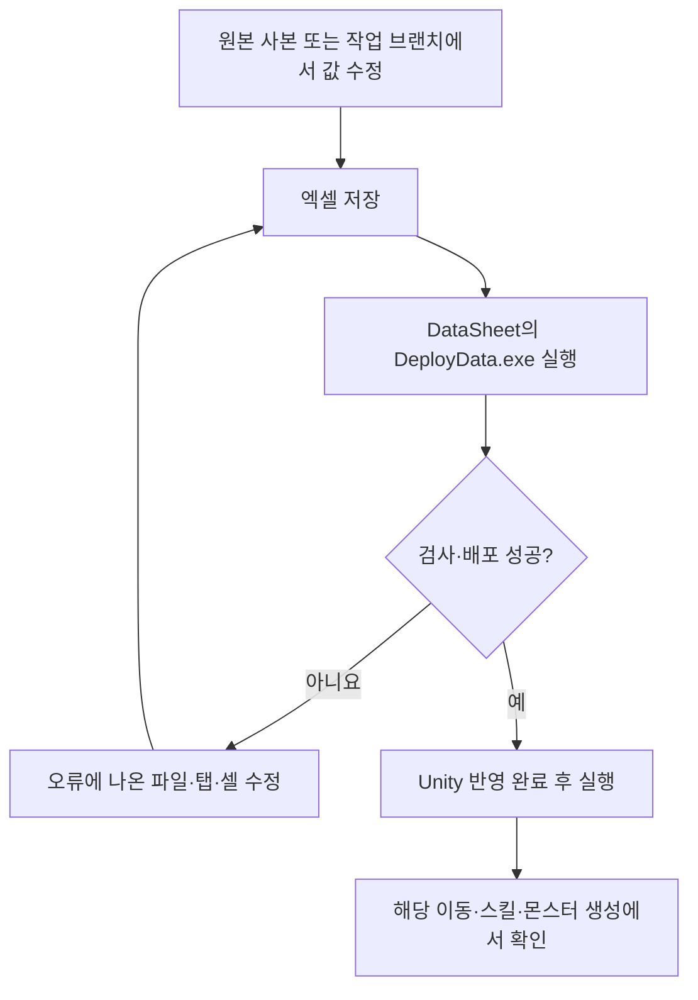

# 기획자용 콘텐츠 잠금 사용 안내

이 문서는 기획자가 콘텐츠 사용을 막거나 플레이어의 진행 조건에 따라 해금하도록 데이터를 설정하는 방법입니다. 타이틀 이미지·메뉴·옵션은 [타이틀 사용 안내](기획자용%20타이틀%20사용%20안내.md)에서 따로 다룹니다. 구조와 구현 범위는 [콘텐츠 잠금 설계](../개발자용%20설계문서/콘텐츠%20잠금%20설계.md)에 정리했습니다.

## 1. 두 가지 잠금의 차이

| 구분 | 뜻 | 예시 |
| --- | --- | --- |
| 기획자 잠금 | 이번 빌드에서 해당 콘텐츠의 사용 자체를 중지 | 아직 준비되지 않은 스킬을 사용하지 못하게 함 |
| 플레이어 해금 | 콘텐츠는 제공하되 플레이 중 조건을 달성해야 이용 가능 | 명부 조사를 끝낸 뒤 스킬 사용 가능 |

**기획자 잠금이 우선입니다.** ContentEnabled가 N이면 플레이어가 해금 조건을 달성했어도 사용할 수 없습니다. 저장이 없어 이어하기 메뉴가 안 보이는 현상이나, 선택하지 않은 타이틀 글자가 바랜 색인 것은 이 잠금과 다릅니다.

## 2. 어디를 수정하나요

기존 Stage·Skill·Item·Monster 엑셀의 해당 행을 수정합니다. 구체적인 시트별 컬럼·입력 규칙은 DataSheet의 [콘텐츠 잠금·해금 컬럼 작성안](../../../DataSheet/Docs/콘텐츠%20잠금과%20해금%20컬럼%20작성안.md)을 기준으로 합니다. 새 테이블이나 타이틀 인스펙터 설정은 필요하지 않습니다.

| 대상 | 사용할 열 | 설정 의미 |
| --- | --- | --- |
| Stage·Skill·Item·Monster | ContentEnabled | Y는 기획 허용, N은 기획 중지 |
| Stage·Skill | UnlockConditionType | 0은 조건 없음, 1은 대상 스테이지 클리어 필요 |
| Stage·Skill | UnlockTargetID | 조건 1일 때 클리어해야 하는 스테이지 ID |
| Stage·Skill | UnlockRequiredValue | 조건 1일 때 1. 조건 0이면 대상 ID와 필요 값도 0 |

예를 들어 `Y / 1 / 8005 / 1`은 기획자가 허용했으며 8005 클리어가 필요하다는 뜻입니다. 이 예시는 설명이며 새 ID나 행을 추가하라는 지시가 아닙니다. 현재 구현된 조건이 스테이지 클리어일 뿐 해금 대상 콘텐츠가 스테이지에만 한정되는 것은 아닙니다. 새 종류의 해금 조건 번호는 개발자와 합의한 뒤 추가해야 합니다.

기존 Active·UnlockType에는 다른 의도가 있으므로 이 용도로 바꾸지 않습니다. 배포된 CSV·JSON이나 클라이언트 C# 파일을 기획자가 직접 수정하지 않습니다.

## 3. 수정부터 게임 확인까지

1. 잠글 콘텐츠의 ID와 실제 사용 지점을 담당 개발자에게 확인합니다.
2. 원본 엑셀의 해당 행을 수정·저장한 뒤 배포 도구를 실행합니다.
3. 검사에 실패하면 배포 성공으로 간주하지 말고 원본을 고칩니다.
4. Unity 코드·데이터 반영이 끝나면 Play를 새로 시작합니다. 배포 성공만으로 게임의 모든 기능에 잠금이 연결된 것은 아닙니다.
5. 해금 조건을 시험할 때 저장 기록에 이미 조건이 달성됐는지도 확인합니다. 정상 저장 파일을 임의로 삭제하지 말고 개발자와 시험용 기록을 준비합니다.

## 4. 확인표와 사용 시 주의점

| 확인 상황 | 기대 결과 |
| --- | --- |
| N이며 플레이어가 조건을 달성함 | 기획 잠금으로 중지 |
| Y이며 조건 없음 | 해당 기능의 다른 실행 조건을 충족하면 이용 가능 |
| Y이며 필요한 클리어 기록 없음 | 해금 전이므로 중지 |
| Y이며 필요한 클리어 기록 있음 | 해당 기능의 다른 실행 조건을 충족하면 이용 가능 |
| 스킬 잠금 | 사용 불가, 잠긴 스킬의 잘못된 해금 알림이 없어야 함 |
| 몬스터 잠금 | 해당 몬스터가 새로 생성되지 않아야 함 |

현재는 Stage 진입·Skill 활성·Monster 생성에 연결되어 있습니다. Item 판단 API는 있으나 모든 획득·장착 처리가 연결된 상태는 아닙니다. 스킬을 막아 맵 진행이 불가능해지거나 필수 몬스터를 막아 진행이 끊기지 않도록 대체 경로도 확인합니다. 변경한 시험 데이터를 그대로 배포하지 않도록 담당자와 확인하세요.

문제가 있으면 콘텐츠 ID·수정한 값·배포 결과·사용한 저장 기록·실제 실행 지점과 첫 오류를 개발자에게 전달합니다. 타이틀 메뉴 설정을 바꿔 콘텐츠 잠금을 우회하지 않습니다.
