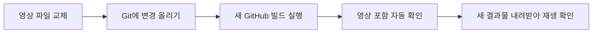
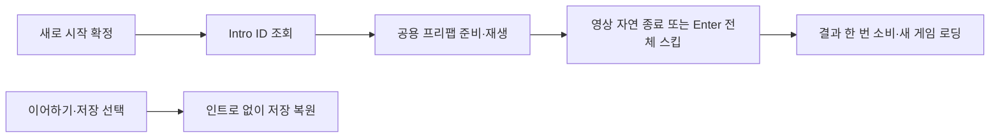
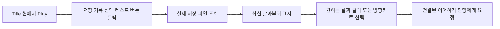
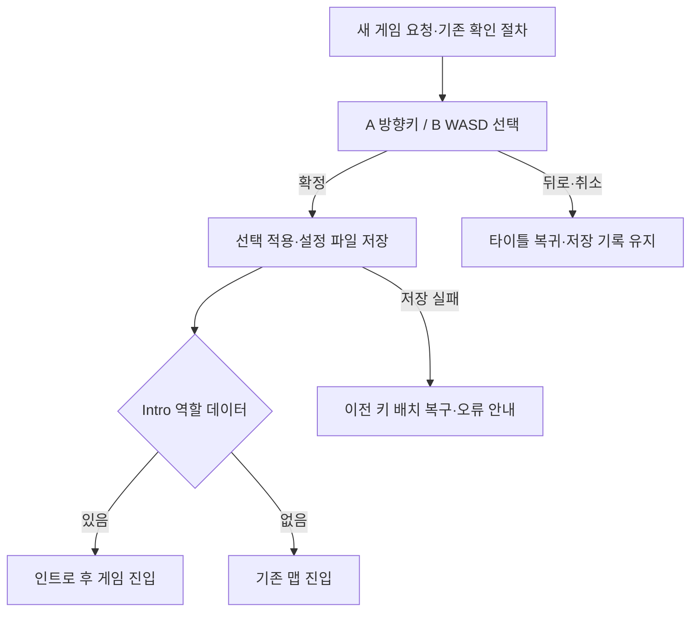
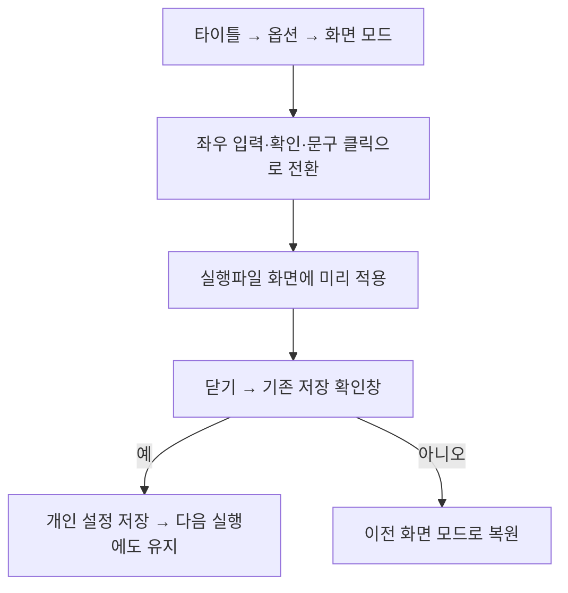

# 기획자용 타이틀 사용 안내

## 타이틀 배경 영상 교체와 빌드 확인 — 2026-11-11

지금 MP4를 그대로 사용합니다. 변환은 필요하지 않습니다. GitHub의 빌드 환경에서도 영상이 포함되도록 저장 위치와 읽는 방식을 바꿨습니다. 이 항목은 메뉴 뒤에서 반복되는 배경 영상이며 새 게임 인트로와는 별개입니다.



1. `Assets/StreamingAssets/Video/HG_BackGround.mp4`를 새 영상으로 교체합니다. 같은 이름을 쓰면 별도 연결 수정은 없습니다. `.meta`는 삭제하지 않습니다.
2. 파일명을 바꾸려면 `TitleScreen.prefab`의 `VideoBackground`에서 `TitleVideoBackground`의 `Video File` 값을 `Video/새파일명.mp4`처럼 수정합니다. `StreamingAssets` 아래 상대 경로만 입력합니다.
3. VideoPlayer의 Video Clip 칸에는 넣지 않습니다. 실행할 때 파일 경로가 자동 연결됩니다. 기존 `Assets/4.Sprite/Title` 위치에 MP4를 다시 넣지 않습니다.
4. 영상과 필요한 프리팹 변경을 Git에 올린 뒤 새 빌드를 실행합니다. 이미 내려받은 실행파일은 자동으로 바뀌지 않습니다.
5. 새 결과물을 전부 풀고 실행합니다. 타이틀 영상의 움직임·반복·배경음, 옵션을 열고 닫은 뒤의 표시, 타이틀 재진입을 확인합니다.

빌드 결과에는 `HumanGhost_Data/StreamingAssets/Video/HG_BackGround.mp4`가 포함됩니다. 배포할 때 실행파일 옆 Data 폴더도 함께 전달합니다. GitHub의 ‘타이틀 영상 포함 확인’이 실패하면 해당 오류를 개발자에게 전달합니다. 포함 검사가 통과해도 검은 화면이나 정지 배경만 나오면 Player.log와 재생 상황을 전달해 주세요. 새로 교체하는 영상의 코덱도 Windows 재생이 가능해야 합니다.

설계 이유와 검사 범위는 [타이틀 설계](../개발자용%20설계문서/타이틀%20설계.md#타이틀-영상의-빌드-포함-방식--2026-11-11)를 참고합니다.

## 인트로 재생 조건 — 2026-11-11

인트로는 새로 시작을 확정한 경우에만 재생합니다. 새 게임마다 재생하며, 이어하기·저장 기록 선택·맵 이동·사망 복귀·타이틀 복귀에는 재생하지 않습니다. 새 게임 확인·조작 선택에서 취소하면 인트로도 시작하지 않습니다.

Enter 한 번으로 인트로 전체를 즉시 스킵하고 새 게임으로 진행합니다. 길게 누르기는 없습니다. 타이틀의 인트로 호출은 코드에서 스킵 범위를 Cutscene으로 지정합니다. 영상 하나만 넘기는 Video와 구분합니다. 자연 종료·스킵은 진입을 허용하지만 실패·취소는 새 게임 진입으로 처리하지 않습니다.

### 현재 연결과 기획자 준비

TitleScreen의 TitleGameEntry에 공용 `Assets/2.Model/Prefabs/UI/CutsceneScreen.prefab`을 연결했습니다. 기획자가 별도 영상 스킵 컴포넌트를 또 붙이지 않습니다. 인트로 데이터가 있을 때 타이틀이 비활성 범위에서 프리팹을 만들고 기존 모달 연결을 전달한 뒤 활성화합니다. 화면 그림·영상 주소·자막은 기존 Cutscene·CutsceneStep·Language 데이터를 사용합니다. 표시 배치와 자막 글꼴은 공용 프리팹에서 수정할 수 있습니다.



현재 표는 비어 있어 영상 없이 새 게임에 진입하는 기존 제작 대기 동작을 유지합니다. 실제 영상 주소를 임의로 넣거나 샘플을 본편으로 배포하지 않았습니다. 데이터 공급 후 새 게임 자연 종료·Enter 스킵·키 유지·이어하기·슬롯 선택을 각각 확인하세요.

실제 재생에는 Cutscene.Key=Intro와 재생 행·영상 주소·화면 연결이 필요합니다. 현재 표에 Intro가 없으면 기존 코드가 영상 없이 새 게임으로 진입합니다. 데이터 준비 뒤 새 게임에서만 재생되는지, Enter 후 게임이 한 번만 시작되는지, 이어하기·슬롯 선택에서 재생되지 않는지 확인합니다. [공통 스킵 사용법](기획자용%20즉시%20스킵%20사용%20안내.md)을 함께 봅니다.

타이틀 화면 편집·메뉴 조작·개인 옵션 설정만 다룹니다. 스테이지·스킬·몬스터 사용을 막는 데이터는 [콘텐츠 잠금 사용 안내](기획자용%20콘텐츠%20잠금%20사용%20안내.md)에서 별도로 확인합니다.

## 2026-11-09 타이틀 영상·로고 적용

메뉴 선택은 빨간 점 대신 글자 밝기로 구분합니다. 선택된 항목은 밝게, 나머지는 색과 투명도를 낮춰 바랜 모습으로 표시합니다. 바랜 항목도 계속 선택·클릭할 수 있습니다. TitleScreen의 ‘선택된 메뉴 글자 색’과 ‘선택되지 않은 메뉴 글자 색’으로 조정하며, 이미지 글자와 Language 문구 표시 모두 같은 색 규칙을 사용합니다. 위아래 이동·마우스 올리기·옵션에서 복귀할 때 강조가 올바른 항목을 따라가는지 확인하세요.

- `TitleScreen.prefab`의 `VideoBackground`에서 배경 영상을 반복합니다. 11월 11일부터 VideoClip 직접 참조 대신 위의 StreamingAssets 상대 경로를 사용합니다. 화면 비율을 유지해 전체를 채우며 준비 전·재생 실패 시 기존 정지 배경이 보입니다. 영상은 메뉴 클릭을 막지 않습니다.
- 영상 준비 뒤 `TITLE_BACKGROUND` → `HG_TitleSound.WAV`를 시작합니다. 이 음원은 현재 Sound 표에 없어 기존 배경음 채널을 사용하며 마스터·배경음 옵션을 따릅니다. 화면 비활성화 시 정지합니다.
- 최신 `HG_Logo.png`는 기존 GUID로 반영됩니다. `LogoAnchor` 크기 1000×565→1200×678(20% 확대), `MenuAnchor` Y -190→-230, 배율 1→0.9입니다. 메뉴 전체의 글자·선택 표시·클릭 영역이 함께 이동·축소됩니다. 옵션 창 자체 크기는 기존대로입니다.
- 실제 Title Play에서 영상 준비·프레임 진행·반복 및 전용 음원 재생, 로고·메뉴 표시를 확인했습니다. 원본 영상의 첫 프레임이 0.1초부터 시작한다는 Unity 경고가 있어 완전한 음화 동기 수용은 별도입니다. 원본 파일은 보존했습니다.

2026-11-05 공용 설정 후속: 현재 타이틀과 일시정지는 같은 SettingsScreen을 사용합니다. 마스터·배경음·효과음·카메라 흔들림, 저장/취소와 모달 입력 차단을 연결했고 마스터 조작부를 추가했습니다. 이전의 임시 빈 타이틀 옵션 설명은 과거 상태입니다. 실제 Unity 표시·입력·소리 확인은 기획자용 사운드 설정 사용 안내를 따릅니다.


> 2026-11-04 최신 풀 점검: 새 게임·종료·공용 설정 화면과 기존 로딩이 연결됐고 이어하기 실제 복원은 현재 테스트 맵에 연결했고 Unity 실행 확인은 남아 있습니다. 이번 회의의 아이콘 확대·버튼 하단 배치·배경효과는 새 시안 공유 후 작업합니다. 전체 상태는 [현재 구현과 검증 현황](../%EA%B0%9C%EB%B0%9C%EC%9E%90%EC%9A%A9%20%EC%84%A4%EA%B3%84%EB%AC%B8%EC%84%9C/%ED%98%84%EC%9E%AC%20%EA%B5%AC%ED%98%84%EA%B3%BC%20%EA%B2%80%EC%A6%9D%20%ED%98%84%ED%99%A9.md), 우선순위는 [남은 작업](../%EA%B0%9C%EB%B0%9C%EC%9E%90%EC%9A%A9%20%EC%84%A4%EA%B3%84%EB%AC%B8%EC%84%9C/%EB%82%A8%EC%9D%80%20%EA%B5%AC%ED%98%84%EA%B3%BC%20%EA%B2%80%EC%A6%9D%20%EC%9E%91%EC%97%85.md)을 따릅니다.

Title 씬을 열어 화면을 편집하고, 시연 설정을 선택하고, 직접 확인하는 순서로 설명합니다. 기준일: 2026-11-03.

구조와 개발자 연결 계약은 [설계 문서](../%EA%B0%9C%EB%B0%9C%EC%9E%90%EC%9A%A9%20%EC%84%A4%EA%B3%84%EB%AC%B8%EC%84%9C/%ED%83%80%EC%9D%B4%ED%8B%80%20%EC%84%A4%EA%B3%84.md)를 참고합니다.

**현재 새로 시작(임시 로딩 화면 뒤 도화골 테스트 씬)과 종료가 연결되어 있고, 이어하기의 실제 복원은 현재 테스트 맵에 연결했으며 타이틀 옵션은 마스터·배경음·효과음·카메라 흔들림을 제공하는 공용 설정 화면입니다.** 저장 규칙·JSON 저장소와 테스트용 기록 선택 창, F5 수동 저장 화면은 구현했고 현재 테스트 맵에 상태 수집·복원을 연결했습니다. 정식 공간과 몬스터 개별 처치 복원은 후속입니다. 로딩 화면은 임시 그림으로 연결했고 그림은 `LoadingScreen` 프리팹에서 교체합니다. 타이틀의 화면 배치는 씬에서 직접 편집합니다. 상세 구현 범위와 검증 결과는 설계 문서 5~6장을 기준으로 확인합니다.

정규 타이틀 메뉴와 확인창은 키보드·패드·마우스(올리기·왼클릭)를 지원합니다. 메뉴 글자는 항목의 `LabelImage`에 넣은 이미지로 표시하며 이미지를 비우면 Language 문구로 돌아갑니다. 2026-11-03 점검 중 Title 씬의 루트 Canvas 크기·스케일0 오버라이드를 확인했습니다. 이후 루트 배율·앵커를 수정하고 열기 시 표시 계약을 확인하도록 보완했습니다. 실제 Unity 표시는 별도 확인합니다.

새 게임 A/B 조작 선택의 입력·취소·저장 절차는 아래 [상세 안내](#새-게임의-조작-방식-선택--2026-11-09)에 모았습니다.

## 1. 씬 열기부터 설정 저장까지

### 1.1 화면 확인

1. Unity에서 `Assets/1.Scene/Title.unity`를 엽니다.
2. Hierarchy에서 `TitleScreen`을 선택하고 Inspector의 `TitleSceneHost`를 찾습니다. Hierarchy는 씬의 오브젝트 목록, Inspector는 선택한 대상의 설정 창입니다.
3. **타이틀 메뉴 설정**에 사용할 설정 에셋이 연결되어 있는지 확인합니다. 설정 에셋은 옵션을 저장한 파일입니다.
4. 실제 사용은 **화면 검사 모드 사용**을 끕니다. 표시만 검사할 때에만 켜고 **화면 검사: 임시 저장 있음**을 설정합니다.
5. 코드 반영과 데이터 에셋 준비가 끝난 뒤 Play를 켜고 Game 화면을 클릭합니다.
6. 위·아래 또는 패드 방향 입력으로 이동하고 Enter·C·패드 A로 결정합니다.
7. 타이틀에서 Esc·패드 B는 동작하지 않습니다. 새 게임 확인 창에서는 취소로 사용합니다.
8. 설정을 바꾸려면 Play를 끈 뒤 수정합니다. 실행 중 변경은 저장되지 않거나 이미 만들어진 메뉴에 반영되지 않을 수 있습니다.

호스트의 **화면 검사 모드 사용**을 켠 상태에서 **화면 검사: 임시 저장 있음**을 Play 전에 바꿔 이어하기 표시와 확인 창을 점검할 수 있습니다. 이것은 저장 파일을 만들거나 읽는 설정이 아닙니다. 화면 검사 모드는 초기 저장 유무에 임시 값을 사용하며 화면 아래에 검사 모드임을 표시합니다. 별도로 추가한 **저장 기록 선택 (테스트)** 버튼은 실제 JSON 기록을 읽습니다.

**화면 검사 모드 사용**을 끄면 실제 연결 모드입니다. 데이터 준비와 외부 `RefreshSave` 전달이 모두 끝나야 메뉴·입력을 활성화합니다. 저장 조회가 미연결이면 대기 안내가 유지되는 것이 정상입니다. 저장 조회 실패를 저장 없음으로 전달하면 안 됩니다. 현재 TitleGameEntry가 저장 파일 조회와 결과 전달을 연결합니다. 조회 실패는 오류로 보고하며 빈 저장으로 대체하지 않습니다.

현재 종료는 TitleGameEntry가 TitleSceneHost에 직접 등록합니다. 빌드에서는 프로그램을 닫고 Unity 에디터에서는 Play를 종료합니다. 새 게임·공용 옵션·현재 테스트 맵의 이어하기 복원이 연결되어 있습니다. 요청을 받았다는 이유만으로 실제 실행 완료로 간주하지 않습니다.

### 1.2 이미지 교체

```text
TitleScreen
├─ Background                  ← 배경 이미지 교체
├─ LogoAnchor
│  ├─ Logo                     ← 씬에서 로고 이미지 교체
│  └─ LogoPlaceholder          ← 로고 적용 후 숨김
├─ MenuAnchor                  ← 정적인 메뉴 묶음, 씬에서 위치·크기 조정
│  ├─ NewGameEntry
│  ├─ ContinueEntry
│  ├─ SettingsEntry
│  └─ QuitEntry
│     ├─ Label                 ← 각 항목의 Language 문구
│     └─ Cursor                ← 이전 커서, 현재 표시하지 않음
├─ InputHintAnchor
├─ ConnectionStatus
└─ NewGameConfirmation
   ├─ Question
   └─ ConfirmationHint
```

이미지를 Unity의 Sprite 형식으로 준비한 뒤 해당 Image의 Source Image에 넣습니다. 색상은 Color, 크기는 RectTransform에서 조정합니다. 배경·로고·메뉴 글자 이미지는 게임 규칙과 분리되어 언제든 교체할 수 있습니다. 선택 표시는 TitleScreen의 선택/비선택 글자 색으로 조절하며 Cursor는 사용하지 않습니다. 최종 로고는 승인된 아트 리소스를 사용하며 현재는 교체 영역만 표시합니다.

구체적인 작업 순서는 다음과 같습니다.

1. Project 창에서 넣을 이미지 파일을 선택합니다.
2. Inspector의 Texture Type을 `Sprite (2D and UI)`로 설정하고 Apply를 누릅니다. 이미 Sprite라면 바꾸지 않습니다.
3. Title 씬의 Hierarchy에서 `TitleScreen`을 펼칩니다. 현재 씬에 배치된 화면을 직접 수정합니다.
4. 교체할 `Background`·`Logo`·각 항목의 `LabelImage`를 선택합니다.
5. Image 컴포넌트의 Source Image에 새 이미지를 끌어 넣습니다. 색이 예상과 다르면 Color가 이미지에 곱해지므로 흰색을 기준으로 확인합니다.
6. 로고를 넣었다면 `LogoPlaceholder`를 비활성화합니다. 선택한 이미지나 그 부모 묶음의 RectTransform에서 위치·크기를 조정합니다.
7. Title 씬을 저장하고 Play로 확인합니다. 공통 원본까지 바꿀 목적일 때만 프리팹 편집 화면에서 수정합니다. 프리팹은 여러 곳에서 재사용하는 화면 구성 파일입니다.

위치와 크기는 씬의 RectTransform에서 직접 조정합니다. 메뉴 묶음은 Vertical Layout Group의 간격·정렬과 각 항목의 크기를 함께 사용하므로, 개별 항목의 위치를 옮기면 레이아웃에 의해 다시 정렬될 수 있습니다. 이어하기·종료가 숨겨질 때도 빈칸 없이 배치하기 위한 구조입니다.

현재 오브젝트 이름에 있는 LogoAnchor·MenuAnchor·InputHintAnchor는 정적인 UI 묶음 이름입니다. 이름을 데이터에서 읽어 찾거나 스폰 위치로 해석하지 않습니다. 이름 자체를 런타임 계약으로 사용하지 않으며, 실제 연결은 직렬화된 참조로 유지합니다.

메뉴 문구는 Language의 30028~30031, 확인 문구는 30037, 예·아니오는 30038·30039를 사용합니다. 현재 표시 언어는 한국어이며 언어 전환 연결은 후속 범위입니다. 각 항목의 Text ID 참조와 문구 오브젝트를 지우지 말고 이미지 자산만 교체합니다.

### 1.3 빌드 정책 확인

호스트의 **타이틀 메뉴 설정**에 설정 에셋 하나를 연결합니다. `Assets/2.Model/Prefabs/Config/TitleSchoolSettings.asset`은 종료 표시·저장 있을 때 새 게임 확인을 사용합니다. `TitleBoothSettings.asset`은 종료 숨김·새 게임 확인 생략을 사용합니다. 두 에셋의 최초 이어하기 우선 선택은 현재 제안값으로 켜 두었습니다. 씬 프리팹 기본 연결은 학원 시연 설정입니다. Play 전에 에셋을 교체해 정책을 선택합니다.

설정 에셋은 공유되는 읽기 전용 정책이며 현재 저장 기록·진행 상태를 넣지 않습니다. 선택한 에셋은 빌드에도 포함되지만 GitHub 작업이 빌드 종류를 자동 선택하는 기능은 아닙니다. 임시 저장 유무는 메뉴 설정 에셋과 독립적인 화면 검사 옵션입니다.

기획서의 제안 항목은 설정으로 분리했습니다. 이를 확정된 데이터 테이블이나 전체 빌드 자동화 완료로 해석하지 않습니다.

| 선택할 에셋 | 저장 없음 | 저장 있음 | 새 게임 확인 |
| --- | --- | --- | --- |
| TitleSchoolSettings | 새로 시작·설정·종료 | 새로 시작·이어하기·설정·종료 | 저장 있을 때만 |
| TitleBoothSettings | 새로 시작·설정 | 새로 시작·이어하기·설정 | 생략 |

에셋을 바꾸려면 Play를 끄고 Project 창의 해당 설정 파일을 TitleSceneHost의 **타이틀 메뉴 설정** 칸으로 끌어 넣습니다. 선택만 하려면 에셋 내부 옵션을 수정할 필요가 없습니다.

### 1.4 타이틀 번역 문구 수정

타이틀 배치·이미지·크기는 씬에서 수정합니다. 메뉴 번역 문구는 DataSheet의 tables/Language.xlsx에서 기존 ID를 수정하고 DeployData.exe로 검사·배포합니다. 배포된 CSV는 직접 고치지 않습니다. 현재 타이틀은 한국어 열을 읽으며, 임시 안내 문구까지 모두 Language로 옮긴 상태는 아닙니다.

콘텐츠 사용 중지·플레이어 해금은 이 문서에서 설정하지 않습니다. [콘텐츠 잠금 사용 안내](기획자용%20콘텐츠%20잠금%20사용%20안내.md)를 따릅니다.

### 1.5 설정을 저장하는 위치

| 작업 | 수정·저장할 대상 | 영향 범위 |
| --- | --- | --- |
| 배경·로고·글자 이미지·위치·크기 조정 | Title 씬의 해당 오브젝트 수정 후 씬 저장 | 현재 씬 |
| 여러 화면에 같은 원본 수정 적용 | 선택적으로 TitleScreen 프리팹 원본 수정 | 해당 원본을 사용하는 화면 |
| 부스·학원 시연 선택 | Title 씬 인스턴스의 호스트 설정 후 씬 저장 | 해당 씬 |
| 메뉴 정책 자체 변경 | 선택한 TitleMenuSettings 에셋 | 그 에셋을 사용하는 모든 대상 |
| 타이틀 번역 문구 변경 | DataSheet의 Language 엑셀 저장 후 배포 | 해당 문구를 사용하는 화면 |
| 임시 저장 유무 확인 | Play 전 호스트 검사 옵션 | 화면 검사만, 실제 저장 파일에는 영향 없음 |

씬에서 바꾼 값은 프리팹 원본과 다를 수 있습니다. 현재 씬만 바꾸려면 씬을 저장하고, 모든 사용처에 적용할 의도가 있을 때만 프리팹 원본으로 반영합니다. 기획자가 코드 파일이나 GUID를 수정할 필요는 없습니다.

### 1.6 수정 시 유지할 연결

씬의 이미지와 UI 위치·크기는 바꿀 수 있지만 TitleSceneHost·TitleGameEntry·TitleScreen·GameDataInitializer 컴포넌트를 임의로 삭제하지 않습니다. Label의 부모가 해당 메뉴 항목인 구조와 호스트의 데이터·화면·입력·설정 참조를 유지합니다. 메뉴를 추가하거나 기존 항목을 삭제하려면 개발자에게 액션·문구·입력·실행 연결을 함께 요청합니다.

## 2. 확인과 문제 해결

### 2.1 기획자가 실행할 확인표

| 확인 상황 | 기대 결과 |
| --- | --- |
| 저장 없음·종료 표시 | 새로 시작·설정·종료 3개, 빈칸 없음 |
| 저장 없음·종료 숨김 | 새로 시작·설정 2개 |
| 저장 있음 | 이어하기 표시, 최초 선택 정책 반영 |
| 저장 있음·새 게임 확인 켬 | 새 게임 결정 시 확인 창, 결정·취소 가능 |
| 확인 끔 | 확인 창 없이 실행 요청 |
| 타이틀 뒤로 입력 | 변화 없음 |
| 실행 처리 중 | 중복 결정·선택 이동 차단 |
| 비활성화 후 재활성화 | 입력·표시가 한 번씩 반응 |
| 배경·로고·글자 이미지 교체 | 메뉴 규칙·입력 유지 |
| 새 게임·이어하기·설정 담당 미연결 | 안내 후 메뉴 복귀, 저장·씬 이동 없음 |
| 종료 선택 | 빌드 종료, 에디터에서는 Play 종료 |
| 화면 검사 모드 끔·저장 조회 미연결 | 대기 안내 유지, 메뉴·입력 비활성 |

순수 코어 검사는 선택·숨김·확인·복귀·중복 차단을 확인합니다. 데이터 검사는 실제 배포 파일 변환을 확인합니다. 실제 화면 배치·폰트·장치 입력·Unity 생명주기·최종 빌드는 별도로 확인해야 합니다.

### 2.2 예상과 다를 때 확인할 곳

| 보이는 현상 | 먼저 확인할 내용 |
| --- | --- |
| 저장 조회 결과 대기 안내만 표시 | 현재 TitleGameEntry의 저장 파일 조회를 확인합니다. Console 첫 오류·필수 참조를 개발자에게 전달하며 실제 복원을 검사할 때 화면 검사 모드로 우회하지 않습니다 |
| 이어하기가 안 보임 | 검사 모드의 임시 저장 있음 값 확인. 실제 연결 모드라면 저장 조회 결과 확인 |
| 종료가 안 보임 | TitleBoothSettings이면 정상 |
| 새 게임 확인 창이 안 나옴 | 저장 없음 또는 부스 설정이면 정상 |
| 새 게임·설정에서 미연결 안내 | 현재 타이틀은 새 게임·공용 설정이 연결되어 있습니다. 이 안내가 뜨면 해당 씬의 실제 참조·오류를 개발자에게 전달합니다 |
| 로고를 넣었는데 안내 글자가 남음 | LogoPlaceholder 비활성화 |
| 이미지 색이 바뀜 | Image의 Color 확인 |
| 키가 반응하지 않음 | Game 화면 포커스·데이터 준비 상태·콘솔 첫 오류 확인 |
| Play 중 고친 설정이 유지되지 않음 | Play 종료 후 수정하고 씬·프리팹·에셋 중 해당 대상을 저장 |

문제를 전달할 때 사용한 설정 에셋, 검사 모드와 임시 저장 값, 누른 키, 기대 결과·실제 결과, 콘솔의 첫 오류를 함께 적습니다. 사용하지 않는 저장 파일을 새로 만들거나 정상 데이터를 지워서 해결하려고 하지 않습니다.


## 테스트 전용 저장 기록 선택

이 기능은 원하는 저장 상황으로 돌아가 확인할 때 사용합니다. 일반 플레이어에게 제공하는 메뉴가 아닙니다.



1. Unity의 코드 반영이 끝나면 `Assets/1.Scene/Title.unity`를 엽니다. 씬은 기존 `TitleScreen` 프리팹을 사용하므로 새 프리팹을 만들 필요가 없습니다.
2. `TitleScreen`의 `TitleSceneHost`에서 **화면 검사 모드 사용**을 켜고 Play를 시작합니다. 정식 타이틀 초기화 연결 전에도 테스트 화면을 확인하기 위한 설정입니다.
3. 오른쪽 아래 **저장 기록 선택 (테스트)** 버튼을 마우스로 누릅니다. 기본 타이틀 메뉴가 준비되기 전이나 새 게임 확인창이 열린 동안에는 열리지 않습니다.
4. 저장 날짜·시각이 최신 기록부터 나타납니다. 슬롯 번호는 보이지 않습니다. 원하는 날짜를 클릭하거나 위·아래 방향키로 선택하고 Enter·C·패드 A로 결정합니다.
5. **닫기** 버튼 또는 Esc·패드 B로 타이틀로 돌아갑니다. 창이 열린 동안 방향키·결정 입력은 뒤쪽 타이틀 메뉴를 조작하지 않습니다.
6. 실제 맵 복원 담당이 미연결이면 그 사실을 창에 표시합니다. 날짜를 선택한 것만으로 맵이 이동하거나 플레이어가 복원된 것은 아닙니다.

| 표시 | 의미와 대응 |
| --- | --- |
| 저장된 기록이 없습니다 | 지정한 폴더에 저장 파일이 없습니다. 이 버튼은 예시 기록을 만들지 않습니다. 실제 저장 연결은 개발자에게 확인합니다. |
| 조회 실패 안내 | 손상·버전 불일치·파일 접근 실패일 수 있습니다. 파일을 지우지 말고 콘솔 첫 오류를 개발자에게 전달합니다. |
| 실제 맵 복원 담당 미연결 | MapDohwagolTest로의 저장 복원 연결은 구현되어 있습니다. 안내가 뜨면 현재 타이틀 프리팹·TitleGameEntry 연결을 확인합니다. |
| 빌드에서 버튼이 없음 | 일반 출시 빌드라면 정상입니다. 테스트용 실행파일인지 확인합니다. |

기본 기록 폴더는 Windows의 `%USERPROFILE%/AppData/LocalLow/DefaultCompany/Human_Ghost/Saves/Demo`입니다. 회사명·제품명을 바꾸면 앞부분 경로도 달라집니다. `TitleSaveSelection`의 **테스트 저장 하위 폴더**와 **지원 저장 버전**은 저장 담당 개발자와 맞춰야 하며 임의 변경하지 않습니다. **화면 검사: 임시 저장 있음**을 켜도 이 폴더에 기록이 생기지는 않습니다.

그림·글자 크기·위치는 `TestSaveSelectionButton`과 중첩된 `SaveSlotScreen`을 씬에서 수정합니다. 공통 `SaveSlotScreen.prefab`을 수정하면 F5 수동 저장 화면에도 반영됩니다. `SaveRecord01`~`SaveRecord10`은 내부 오브젝트 이름이며 화면에 표시하는 슬롯 번호가 아닙니다. 참조가 연결된 버튼·글자 컴포넌트를 제거하지 말고 모양을 교체합니다.

Unity 에디터와 **Development Build**에서만 사용합니다. 현재 GitHub 빌드 코드는 Development Build를 만들지만 시작 씬 기본값은 GameplayPreview입니다. 타이틀을 검사하려면 Title 씬이 포함되고 타이틀로 진입하는 빌드가 필요합니다. 이번 작업에서 시작 씬 설정은 바꾸지 않았습니다.

일반 출시 빌드에서는 버튼만 숨기지 않습니다. 빌드 중 테스트 버튼·창·전용 입력 객체를 장면에서 제거하고 전용 코드도 제외합니다. 원본 씬과 프리팹에는 편집용 구성이 남습니다. 실제 출시 빌드 확인 시 타이틀에 테스트 버튼이 없고 이를 여는 입력 경로도 없는지 확인해야 합니다.

이미 EventSystem을 추가한 별도 타이틀 씬으로 옮길 때는 전용 `TestSaveEventSystem`과 중복해서 두지 않도록 개발자에게 연결을 요청합니다. 기본 제공 Title 씬은 전용 포인터 입력 객체를 사용하며 별도 EventSystem을 만들 필요가 없습니다.

스테이지가 완성되기 전에도 개발자는 맵 준비를 기다리는 순서·저장 상태 수집·취소 처리를 독립적으로 검사할 수 있습니다. 이를 위해 `SaveGameFlow`를 준비했으며 기획자가 지금 새 컴포넌트를 붙이거나 임시 Stage 행을 만들 필요는 없습니다. 현재 MapDohwagolTest는 맵 준비·저장 복원을 연결했습니다. 새 공간은 같은 계약으로 추가 연결하며 기존 씬의 미연결 안내를 정상으로 넘기지 않습니다. 맵 데이터가 정리되면 개발자가 공통 준비 담당을 연결하고, 이후 기획자가 테이블의 맵 구성 데이터를 조정하는 흐름으로 사용합니다.

## 옵션 화면

현재는 빈 캔버스가 아니라 공용 SettingsScreen을 엽니다. 마스터·배경음·효과음·카메라 흔들림·키보드 조작을 제공하며 타이틀에서만 화면 모드를 추가합니다. 저장 확인에서 취소하면 편집 전 개인 설정으로 복원합니다. 자세한 화면 모드 절차는 아래 전용 절을 따릅니다.

## 현재 타이틀 연결 확인 — 2026-11-07

TitleScreen 프리팹의 화면 검사 모드는 꺼져 있습니다. TitleGameEntry가 저장 조회·새 게임·이어하기·공용 설정·종료를 연결하며 개발자는 실제 진입 시험에 화면 검사 모드를 켜지 않습니다. 화면만 편집할 때의 검사 모드와 실제 저장 복원 검사를 구분하세요. 키보드 A/B는 현재 공용 옵션의 다섯 번째 항목이며 원본 InputAction은 수정하지 않고 실행 사본에 적용합니다. 정식/테스트 빌드는 [GitHub 안내](GitHub%20빌드와%20디스코드%20공지%20사용%20안내.md)에서 선택합니다.

## 새 게임의 조작 방식 선택 — 2026-11-09

타이틀 옵션·조작 선택의 공용 UI 부모 크기는 코드에서 자동 설정합니다. 별도 필드 할당은 필요 없습니다. 코드 반영 뒤 Play를 다시 시작해 옵션이 보이는지, 닫은 뒤 타이틀 조작이 돌아오는지, 새 게임 선택 화면도 표시되는지 확인하세요. 같은 표시 영역 오류가 계속되면 실행 중 TitleMenuScreens와 SettingsScreen(Clone)의 RectTransform 크기를 함께 개발자에게 전달하세요.



기획자가 새 컴포넌트를 붙일 필요는 없습니다. 기존 TitleScreen의 TitleGameEntry가 설정 화면의 글꼴과 입력 참조를 재사용해 선택 화면을 생성합니다. 선택 화면이 없으면 공용 SettingsScreen 프리팹의 글꼴·입력 참조와 첫 오류를 개발자에게 전달하세요. 실제 영상은 Cutscene 표와 미디어가 준비되어야 재생됩니다.

1. Title에서 새 게임을 선택하고 기존 확인 절차를 통과합니다.
2. 키보드 위/아래 또는 좌우, 패드 방향, 마우스로 A·B를 선택합니다. 확정은 기존 메뉴 확인 키·패드 버튼·마우스 클릭을 사용합니다.
3. A는 방향키/C/X/Space/Z/Q, B는 WASD/K/J/L/U/I입니다. 상호작용 E는 같습니다.
4. 뒤로 또는 취소하면 타이틀로 돌아가며 새 게임 기록을 만들지 않습니다. 이전 조작 방식도 유지합니다.
5. 확정하면 선택이 settings.json에 저장되고 새 게임으로 진행합니다. 이어하기는 선택 화면을 다시 열지 않고 저장된 개인 설정을 사용합니다.
6. 재실행 후 선택이 유지되는지, 옵션에서 다시 바꾼 뒤 실제 입력이 맞는지 확인합니다. 게임 도중 바꾸는 경우에도 기존 공용 설정 저장·실패 복구 경계를 사용합니다.

입력 직후 화면이 바로 다시 열리거나 취소가 공격으로 전달되면 재현 순서와 빌드 번호를 개발자에게 전달하세요. 실제 Unity·패드·실행파일 수용은 별도 확인이 필요합니다.

게임패드로 새 게임을 결정하면 키보드 선택을 생략합니다. 키보드·마우스로 시작하면 선택 화면이 열리고 Enter·C·K 또는 마우스로 결정할 수 있습니다. 받아오는 작업의 이 동작을 공용 메뉴 구조에 통합했습니다.

## 타이틀에서 화면 모드 바꾸기 — 2026-11-09

게임을 창으로 띄우거나 화면 전체로 보려는 사용자를 위해 타이틀 옵션에만 화면 모드를 추가했습니다. 기획자가 데이터 표나 인스펙터 참조를 추가할 필요는 없습니다. 같은 설정 화면을 사용하는 일시정지 메뉴에는 이 항목이 표시되지 않으며 키보드로도 선택되지 않습니다.



1. Title 씬을 실행하고 옵션을 엽니다. 키보드 조작 항목 아래 **화면 모드 ◀ 전체 화면 ▶**가 나타납니다. 이미 창모드로 저장했다면 창모드로 표시됩니다.
2. 위아래로 항목을 선택한 다음 좌우·확인 입력으로 바꿉니다. 문구를 마우스로 클릭해도 전환됩니다.
3. 창모드는 **1208×720 한 가지 크기**만 제공합니다. 자동 축소와 해상도 선택은 제공하지 않으며 창 테두리 드래그로 크기를 바꿀 수 없습니다. 이 크기는 창 내부 게임 화면 기준입니다. 전체 화면은 테두리 없는 방식이며 현재 1920×1080 렌더링 요청을 유지합니다.
4. 닫은 뒤 기존 확인창에서 예를 누르면 저장하고, 아니오를 누르면 옵션을 열기 전 모드로 돌아갑니다. 화면 모드는 저장 슬롯과 별개인 settings.json에 보관합니다. 예전 파일에 이 값이 없으면 전체 화면으로 시작합니다.
5. **Unity 편집기에서는 실제 창 크기를 변경하지 않습니다.** 메뉴 표시·선택·저장 확인만 시험하고, 실제 전환은 새 Windows 빌드에서 확인합니다.

빌드 확인 순서: 전체 화면 → 창모드 → 저장 → 종료·재실행 → 창모드 유지 → 전체 화면으로 미리 전환 후 저장 취소 → 창모드 복원 → 게임 진입 → 일시정지에 화면 모드 항목이 없는지 확인합니다. Alt+Tab 복귀·작은 모니터·배율이 높은 Windows 환경에서도 창 테두리와 글씨가 잘 보이는지 확인하세요. 운영체제 단축키로 바꾼 화면 모드를 설정 파일에 자동 기록하는 기능은 이번 범위에 포함하지 않습니다.
