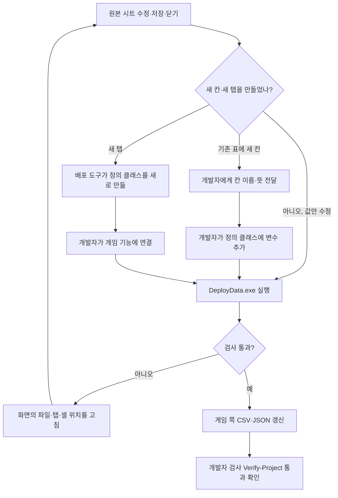

# 데이터 작업자 전달 — 조건 규칙 데이터 이전 안내

기준일: 2026-11-19 · 대상: DataSheet 원본 시트를 수정·배포하는 데이터 작업자

코드에 있던 게임 규칙 값을 시트로 옮겼습니다. 이 문서에는 이번에 새로 생긴 칸, 값을 바꿀 때 지킬 규칙, 바꿔도 게임에 반영되지 않는 칸이 정리돼 있습니다. 왜 이렇게 바꿨는지는 개발자 문서 [조건 규칙 교차 감사와 흐름 단절 위험 분석](../개발자용%20설계문서/조건%20규칙%20교차%20감사와%20흐름%20단절%20위험%20분석.md)에 있습니다.

## 목차

1. [먼저 알아 둘 원칙](#1-먼저-알아-둘-원칙)
2. [수정부터 게임 반영까지](#2-수정부터-게임-반영까지)
3. [이번에 생기거나 바뀐 칸](#3-이번에-생기거나-바뀐-칸)
4. [값을 바꿀 때 지킬 규칙](#4-값을-바꿀-때-지킬-규칙)
5. [바꿔도 게임에 반영되지 않는 칸](#5-바꿔도-게임에-반영되지-않는-칸)
6. [아직 코드가 정하는 값](#6-아직-코드가-정하는-값)
7. [문제가 생겼을 때](#7-문제가-생겼을-때)

## 1. 먼저 알아 둘 원칙

| 원칙 | 뜻 |
| --- | --- |
| 데이터가 이긴다 | 같은 의미의 값이 시트와 코드에 함께 있으면 시트 값을 씁니다. 이번 작업으로 코드 사본을 지웠습니다. |
| 원본 시트가 먼저다 | 값은 반드시 `DataSheet/tables` 원본에서 고치고 `DeployData.exe`로 배포합니다. 게임 쪽 `Assets/Data/Csv`·`Json`을 직접 고치면 다음 배포 때 덮어써져 사라집니다. |
| 새 칸은 개발자와 함께 | 기존 표에 칸을 추가하면 배포 도구가 멈춥니다. 개발자가 정의 클래스에 변수를 추가해야 다시 배포됩니다. |
| 한 의미는 한 곳에 | 같은 뜻의 값을 두 시트에 따로 적지 않습니다. 5장의 "다른 곳이 쓰는 칸"을 확인합니다. |

11/19 이전에 게임 쪽 CSV만 직접 고친 변경이 두 건 있었습니다. 둘 다 원본에 옮겨 두었습니다(3장 맨 아래 두 행).

## 2. 수정부터 게임 반영까지



배포 도구의 파일 처리 원칙:

| 파일 | 배포 때 |
| --- | --- |
| `Assets/Data/Csv`·`Json` | 매번 원본 기준으로 덮어씀 |
| 생성 enum(`Data/Generated/Enums`) | 매번 갱신 |
| 새 탭의 정의 클래스 | 처음 한 번 새로 만듦 |
| 이미 있는 정의 클래스 | **덮어쓰지 않음.** 원본 칸과 생성자가 다르면 "시트와 보존된 정의의 생성자 컬럼이 다릅니다"로 멈춤. 개발자가 변수를 추가해야 함 |

## 3. 이번에 생기거나 바뀐 칸

모든 값은 이전 코드·설정 파일 값을 그대로 옮긴 것이라 지금 게임 동작은 같습니다. 예외는 `Stage.BGM_*`이며, 이 칸은 아래 표에 설명한 대로 실제 소리가 달라집니다.

| 파일 / 탭 | 칸 | 뜻 | 단위·허용 값 | 현재 값 |
| --- | --- | --- | --- | --- |
| Stage / Stage | `Role` | 맵 역할 | `VILLAGE`(시작·보스방 사망 복귀 마을, 하나) · `LEDGER`(장부방, 하나) · `BOSS`(보스방) · `FIELD`(일반 맵) | 8001 VILLAGE, 8005 LEDGER, 8004 BOSS, 나머지 FIELD |
| Stage / Stage | `BGM_Normal`·`BGM_Battle` (기존 칸) | 평상·전투 배경음 키. **이제 실제로 재생됨** | GameAudio 소리 키, 비우면 음악 없음 | 마을·필드 `HG_Lobby_BGM` 계열, 전투 `Test_Boss_BGM`. 불 소리 루프를 계속 쓰려면 `AMBIANCE_FIRE` |
| Stage / StageExit | `EnterAction` | 출구 사용 연출 | 비움 = 바로 이동, `WALK_IN` = 걸어 들어가기 | 9번(장부방 문) WALK_IN |
| Stage / StageExit | `SoundID` | 떠나는 순간 효과음 | Sound ID, 비우면 없음 | 9·10번 3066(문소리) |
| Currency / Currency | `FirstNoticeTextID`·`NoticeIcon` | 처음 얻을 때 안내 문구·그림 키 | Language ID / `SOUL`·`COIN` | 1 혼 30365 SOUL, 2 엽전 30364 COIN |
| Skill / Skill | `FirstNoticeTextID`·`NoticeIcon` | 처음 얻을 때 안내 문구·그림 키 | Language ID / `CUT_BIND` | 7001 30366 CUT_BIND |
| Player / Player | `CoyoteTime` | 발판에서 떨어진 직후에도 점프를 받아 주는 시간 | ms | 100 |
| Player / Player | `JumpBufferTime` | 착지 직전에 누른 점프를 기억하는 시간 | ms | 100 |
| UnitState / BossState | `DesperationHPRate` | 발악 도약을 시작하는 남은 HP 비율 | 만분율 | 4002: 2500 (25%) |
| UnitState / BossState | `CloseRange`·`MidRange` | 근거리(기둥·휩쓸기 교대)·중거리(세 번 내려찍기) | tile_x100 | 4002: 300 / 600 |
| UnitState / BossState | `PlatformWaitTime` | 플레이어가 발판 위에 이만큼 있으면 기둥 | ms | 4002: 3000 |
| UnitState / BossState | `SlamAfterCount` | 일반 패턴 몇 번마다 광역 땅 찍기 | 횟수 | 4002: 3 |
| UnitState / BossState | `ChargeGap` | 돌진 뒤 몇 번 지나야 다시 돌진 | 횟수 | 4002: 2 |
| UnitState / BossState | `LeapAirTime` | 발악 도약 첫 타 선딜 끝의 공중 시간 | ms | 4002: 900 |
| UnitState / BossState | `Music` | 해당 보스 페이즈 시작 때 재생할 음악 키 | Sound 키, 비우면 없음 | 4001 `BGM_BOSS_PHASE1`, 4002 `BGM_BOSS_PHASE2` |
| Monster / Monster | `AIType` (허용 값 추가) | 행동 종류 이름 | `MELEE`·`CHARGER`·`THROWER`·`LOBBER` | 3004 CHARGER → **THROWER**, 3005 MELEE → **LOBBER** |
| Monster / Monster | `HitStun`·`CritHitStun` | 피격·치명타 피격 경직 | ms | 전원 300 / 500 |
| Monster / Monster | `DeathFireTime`·`DeathFireDamage`·`DeathFireHalfWidth`·`DeathFireTick` | 죽을 때 남기는 불의 시간·틱 피해·절반 폭·피해 간격 | ms·정수·tile_x100·ms, 시간 0 = 불 없음 | 3003만 0·5·100·1000(지금은 불 없음) |
| Monster / MonsterSkill | 패턴 14칸(아래) | 몬스터 공격 패턴 | 아래 표 | 몬스터 5종 11행(ID 3201~3211) |
| BossSkill / BossSkill·BossSkillHit (새 파일) | 보스 패턴·타격 칸(아래) | 보스 공격 패턴 | 아래 표 | 보스 1006: 패턴 9행·타격 16행 |
| StageLayer / StageLayer | (값·행 반영) | 11/19 게임 쪽에서 직접 고친 레이어 | — | `ParallaxY` 6행 10000, 9030 사냥터1 전경, 9031~9033 보스방 하늘·원경·중경 |
| Stage·Currency·Skill | (원본 반영) | 11/19 게임 쪽에서 먼저 추가된 칸 | — | 위 `EnterAction`·`SoundID`·`FirstNoticeTextID`·`NoticeIcon` |
| StageLayer / StageLayer | `LayerName` (허용 값 추가)·새 행 12개 | 맵 프리팹에 있던 레이어별 이동 배율을 시트 행으로 이전(11/20). 프리팹은 이제 레이어 이름만 정함 | `FAR_NEAR`·`MID_FAR`·`MID_NEAR`·`NEAR`·`PLAY_NEAR`, 만분율 | 9034~9038 사냥터1, 9039~9042 사냥터2, 9043~9045 가마터. 예: 9035 가까운 산 3500/세로 7000 |

### 몬스터 패턴 칸 (MonsterSkill)

한 행이 몬스터의 공격 패턴 하나입니다. 같은 `MonsterID` 행은 `StateID` 순서(Attack1 → Attack2 → Attack3)로 사용합니다. 예전 개발 설정 파일(`…Patterns.asset`)은 삭제했으므로 이제 이 시트만 고치면 됩니다.

| 칸 | 뜻 | 단위 |
| --- | --- | --- |
| `Range`·`MinRange` | 사용 거리(`MinRange` ≤ 거리 ≤ `Range`) | tile_x100 |
| `Windup`·`Active`·`Recovery` | 선딜·판정·후딜(돌진은 `Active`가 최대 돌진 시간) | ms |
| `ExtraDamage` | 추가 피해. **음수 가능** | 정수 |
| `BindTime`·`BindPresses` | 잡기 구속 상한(0 = 연타로만 해제)·해제 연타 횟수(0 = 잡기 아님) | ms·횟수 |
| `ChargeSpeed`·`WallStun` | 돌진 속도(0 = 돌진 아님)·벽 충돌 허점 | tile_x100/초·ms |
| `Projectile`·`Lob` | 투척·높이 던지기(높이 던지기는 둘 다 Y, 패링 불가) | Y/N |
| `RetreatDistance` | 뒤로 물러서기 거리(0 = 아님) | tile_x100 |
| `Cooldown` | 시작 후 재사용 대기 | ms |
| `EffectID` (기존) | 맞으면 주는 특수효과, 0 = 없음 | StatusEffect ID |

설명용 예시(현재 공급값과 같음):

```text
ID    MonsterID StateID EffectID Range MinRange Windup Active Recovery ExtraDamage … Projectile Lob RetreatDistance Cooldown
3201  3002      10005   19001    600   0        600    1000   400      5           … N          N   0               0      ← 지게귀 돌진(ChargeSpeed 900)
3211  3005      10006   0        200   0        150    400    100      0           … N          N   200             3000   ← 옹귀 물러서기
```

### 보스 패턴 칸 (BossSkill·BossSkillHit)

`BossSkill` 한 행이 보스 패턴 하나, `BossSkillHit` 행이 그 패턴의 타격 하나입니다. 타격은 `BossSkillHit.ID` 순서로 실행합니다. 예전 개발 설정 파일(`BossPatterns.asset`)은 삭제했으므로 이 두 탭만 고치면 됩니다.

| 탭 | 칸 | 뜻 | 단위 |
| --- | --- | --- | --- |
| BossSkill | `BossID` | 패턴을 쓰는 보스 | UnitStat ID |
| BossSkill | `StateID` | 공격 상태(그림·연출 키) | `10004`·`10005`·`10006`(Attack1~3) |
| BossSkill | `Kind` | 패턴 종류 | `Legacy`(1페이즈)·`Pillar`·`TripleSlam`·`Sweep`·`CrawlCharge`·`GroundSlam`·`DesperationLeap` |
| BossSkill | `MinPhase`·`MaxPhase` | 사용할 수 있는 페이즈 범위 | `BossState.Phase`(0부터) |
| BossSkill | `HitReactions` | 타격별 넉백·다운·감속 사용 | Y/N |
| BossSkill | `ChargeSpeed`·`WallPoiseDamage` | 돌진 속도·벽 충돌 체세 피해(돌진만) | tile_x100/초·정수 |
| BossSkill | `ChainRange`·`BindTime`·`BindPresses`·`PullSpeed` | 사슬이 닿는 거리·구속 상한·해제 연타·끄는 속도(사슬만) | tile_x100·ms·횟수·tile_x100 |
| BossSkill | `SoundKey` | 패턴 시작 효과음 | GameAudio 소리 키, 비우면 없음 |
| BossSkillHit | `BossSkillID` | 속한 패턴 | BossSkill ID |
| BossSkillHit | `Windup`·`Active`·`Recovery` | 선딜·판정·후딜. 선딜 0은 직전 타격 직후 울림 | ms |
| BossSkillHit | `ExtraDamage` | 추가 피해. **음수 가능** | 정수 |
| BossSkillHit | `Range`·`Height`·`Radial`·`DamageGroup` | 판정 범위·높이·양방향 여부·중복 피해 묶음 | tile_x100·Y/N·번호 |
| BossSkillHit | `KnockbackDistance`·`KnockbackTime`·`DownTime` | 넉백 거리·시간, 다운 시간 | tile_x100·ms |
| BossSkillHit | `SlowRate`·`SlowTime` | 감속 배율·시간 | 만분율·ms |
| BossSkillHit | `Parryable` | 패링 가능 | Y/N |

설명용 예시(현재 공급값과 같음):

```text
BossSkill    4101  1006  10004  Legacy           MinPhase 0  MaxPhase 0  … SoundKey BOSS_1_ATTACK1   ← 1페이즈 내려찍기
BossSkillHit 4201  4101  Windup 700  Active 120  Recovery 600  ExtraDamage 6  Range 450  Height 200 …
BossSkill    4109  1006  10004  DesperationLeap  MinPhase 1  MaxPhase 1  … SoundKey BOSS_2_LEAP      ← 발악 도약(타격 4213~4216)
```

## 4. 값을 바꿀 때 지킬 규칙

어긴 값은 배포 도구 또는 개발자 검사(`Verify-Project`)에서 실패합니다. "검사"가 비어 있는 행은 검사가 없으니 직접 확인해야 합니다.

| 규칙 | 걸리는 곳 | 검사 |
| --- | --- | --- |
| `MonsterSkill.MinRange` ≤ `Range` | 배포 도구 | 있음 |
| 패턴 `Range` ≤ 그 몬스터의 `Monster.AttackRange` | 개발자 검사 | 있음 |
| 사용 중(`ContentEnabled=Y`)인 몬스터는 `MonsterSkill` 패턴 행이 1개 이상 | 개발자 검사 | 있음 |
| `Monster.AIType`이 패턴 구성과 같음: `Lob=Y` 행이 있으면 LOBBER, 아니면 `Projectile=Y` 행이 있으면 THROWER, 아니면 `ChargeSpeed>0` 행이 있으면 CHARGER, 아무것도 없으면 MELEE | 개발자 검사 | 있음 |
| `Stage.Role`: VILLAGE 정확히 하나, LEDGER 정확히 하나, BOSS 하나 이상 | 게임 시작 시 오류 | 시작 시 |
| `BossState.CloseRange` ≤ `MidRange` | 배포 도구 | 있음 |
| `BossState.LeapAirTime` ≤ 발악 도약 패턴의 첫 타 선딜 | 배포 도구·보스 초기화 | 있음. 위반 시 `Verify-Project`와 게임 초기화가 실패 |
| `Stage.BGM_*` 키가 GameAudio 소리 목록에 있음 | 개발자 검사 | 있음 |
| 보스 패턴마다 `BossSkillHit` 행이 1개 이상, `Kind`는 위 허용 값, 판정 시간(`Active`)은 0보다 큼 | 개발자 검사·보스 초기화 | 있음 |
| `BossSkill.SoundKey`·`BossState.Music` 키가 GameAudio 소리 목록에 있음(비움 허용) | 개발자 검사 | 있음 |
| `NoticeIcon` 그림 키(SOUL·COIN·CUT_BIND)는 화면(TextboxScreen)에 그림이 연결돼 있어야 함. 새 키는 허용 값 추가 + 개발자에게 그림 연결 요청 | 배포 도구(허용 값) | 그림 연결은 실행 시 오류 로그 |
| `EnterAction`은 `WALK_IN`만. 새 연출은 개발자 구현 후 허용 값 추가 | 배포 도구 | 있음 |
| 혼·엽전 재화 ID(1·2)는 서낭당 `soulCurrencyId`·갈림길 `soulCurrencyId`·Currency와 같아야 함 | 개발자 검사 | 있음 |
| 몬스터를 `ContentEnabled=N`으로 끄면 맵에 직접 놓은 개체·편집기 시험 더미도 시작 시 오류. 배치에서 빼거나 Y로 되돌림 | 게임 시작 시 | 시작 시 |

## 5. 바꿔도 게임에 반영되지 않는 칸

아래 칸은 로드는 되지만 게임이 읽지 않습니다. 값을 바꿔도 아무 일이 없으므로, 의도한 변화가 있다면 개발자에게 연결을 요청합니다.

| 위치 | 칸 | 비고 |
| --- | --- | --- |
| Stage | `Active` | 시트 설명의 "Active N = 내보내지 않음"은 배포 도구에 구현돼 있지 않음. 맵을 끄려면 `ContentEnabled` |
| Stage | `Order` | 다른 기능의 소비 여부 미확인 |
| Monster | `SightRange` | 개발용 단순 인식에서만 씀. 실제 인식은 `MonsterAggro` |
| UnitState | `MonsterState`·`PlayerState`·`EliteState` 탭 전체 | 실제 경직은 `Player.HitStunTime`·`Monster.HitStun`, 면역은 `Monster.EffectImmunities` |
| 서낭당 JSON | `deathSoulLossRate` | 실제 사망 손실은 `Currency.DeathLossRate` |
| FieldObject | `WarnMs`·`ActiveMs`·`OffMs`·`SpreadSpeed`·`SlideDistance`·`TurnMs` | 미구현 종류 전용. 해당 종류를 `ContentEnabled=Y`로 켜면 배포 도구가 막음 |
| FieldObjectPlacement | `GuideFireID` | 미구현 |
| Skill | `WeaponID`, `Effect` | `Effect`는 `CUT_BIND`만 허용되며 결박 가르기로 고정 실행 |
| Player / PlayerAction | `StartWeapon` / `WeaponSwapTime` | 무기 교체 미구현 |
| Buff·StatusEffect | `TickInterval`·`Stackable` | 지속 피해·중첩 미구현 |
| Item | `ItemType`·`StatJson`·`SkillID`·`AcquireAnim` | 아이템 미구현 |
| Npc | `ShopID` | 상점 미구현 |
| 갈림길 보상 | `ShowGrade` | 표시 미구현 |
| UnitStat | `Tier` | 미사용 |
| StageLayer | `LayerIndex`·`ImageKey`·`SortOrder` | 배치는 맵 프리팹이 정함 |
| Sound | `RefIndex` | 미사용 |

## 6. 아직 코드가 정하는 값

다음 값은 이번에 옮기지 않았습니다. 시트로 조정하고 싶으면 개발자에게 칸 추가를 요청합니다.

| 값 | 현재 | 비고 |
| --- | --- | --- |
| 보스 2페이즈 패턴 선택 **순서** | 첫 패턴 돌진 → 발악 → 광역 → 발판 → 근거리 → 중거리 → 돌진 | 기준값은 BossState(3장), 순서는 코드 |
| 구덩이에 떨어지면 즉사 | 즉사 | 맵별 피해로 바꾸려면 칸 필요 |
| 사다리 한 칸·모서리 오르기 시간 | 350ms·1000ms | 애니메이션 길이와 묶임 |
| 전투 음악 유지 시간 | 3000ms | 마지막 교전 뒤 평상 음악으로 돌아가기까지 |
| 상호작용 표식 이름 | `Myeongbu`(명부)·`Seonangdang`(서낭당), 복귀 앵커 `Respawn_Seonangdang` | 맵 Markers 이름 규칙 |
| 서낭당 첫 안내·상호작용 안내 문구 ID | 30363·30063·30064·30065 | 재화·스킬 첫 안내처럼 칸으로 옮길 수 있음 |

## 7. 문제가 생겼을 때

| 화면 문구 | 원인 | 할 일 |
| --- | --- | --- |
| 시트와 보존된 정의의 생성자 컬럼이 다릅니다 | 기존 표에 칸을 추가함 | 개발자에게 칸 이름·뜻·단위를 전달해 정의 클래스 변수 추가 요청 |
| 허용되지 않은 값 | `AllowedValues`에 없는 값(예: `AIType`, `Role`, `NoticeIcon`) | 허용 값 안에서 고르거나, 새 값이면 개발자와 먼저 협의 |
| 몬스터 …의 AIType(…)이 패턴 구성(…)과 다릅니다 | 패턴 행과 `AIType`이 안 맞음 | 4장 규칙에 맞게 둘 중 하나를 고침 |
| 몬스터 …의 패턴 Range가 AttackRange보다 큽니다 | 패턴 거리가 공격 시작 거리를 넘음 | `Range`를 줄이거나 `AttackRange`를 늘림 |
| Stage.Role에 VILLAGE·LEDGER·BOSS 맵이 필요합니다 | 역할 누락·중복 | VILLAGE·LEDGER는 하나씩, BOSS는 하나 이상 |

배포 결과 화면 읽는 법은 [배포 검사 결과 확인 안내](배포%20검사%20결과%20확인%20안내.md), 새 탭 추가는 [새 시트와 JSON 자동 배포 사용 안내](새%20시트와%20JSON%20자동%20배포%20사용%20안내.md)를 봅니다.
