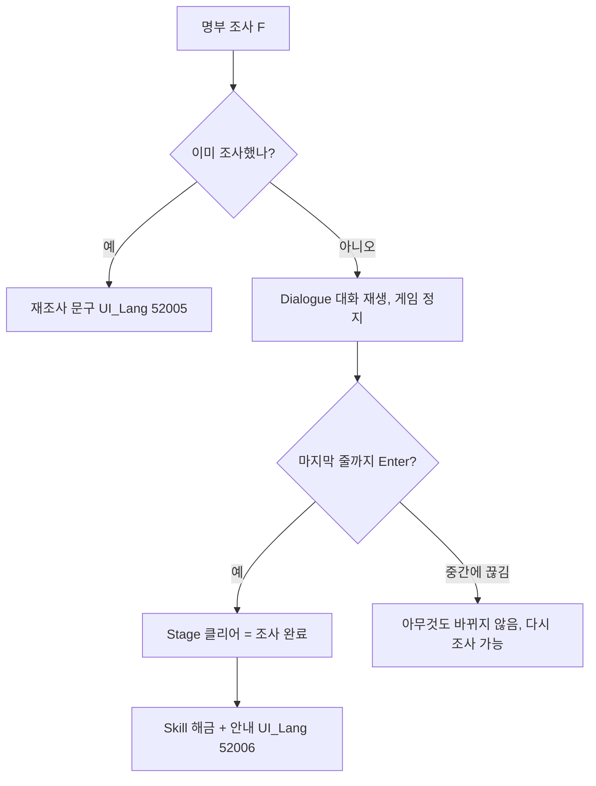

# 명부 조사 대화 작성과 확인 안내

기준일: 2026-11-16 · 대상: 명부 대사·해금을 수정하거나 새 명부를 준비하는 기획자

장부방 명부를 조사하면 **대화 → 마지막 줄까지 읽으면 조사 완료·스킬 해금 → 해금 안내** 순서로 진행됩니다. 이미 조사했다면 재조사 문구만 나옵니다. 이 안내는 시트 작성·배포·게임 확인 순서를 설명합니다. 코드 구조는 [개발자 설계](../개발자용%20설계문서/명부%20대화와%20조사%20완료%20연결%20설계.md)를 봅니다.

## 목차

1. [한눈에 보는 흐름](#1-한눈에-보는-흐름)
2. [시트 작성](#2-시트-작성)
3. [배포와 검사 오류](#3-배포와-검사-오류)
4. [게임에서 확인하기](#4-게임에서-확인하기)
5. [자주 하는 수정](#5-자주-하는-수정)

## 1. 한눈에 보는 흐름



대사 넘기기 입력은 한 줄씩 넘깁니다. 끝 줄까지 넘기면 끝까지 읽은 것으로 처리됩니다.

- 조사 완료는 **명부가 있는 Stage의 클리어**로 기록됩니다. 저장은 기존 자동·수동 저장 시점에 함께 저장됩니다.
- 스킬은 조사 완료를 조건으로 해금됩니다. 저장을 불러오면 조사 완료 기록으로 스킬이 다시 켜집니다.

## 2. 시트 작성

명부 하나에 필요한 데이터는 네 가지입니다. 현재 공급값(장부방 Stage 8005)을 예로 듭니다.

| 위치 | 필요한 값 | 현재 공급값 |
| --- | --- | --- |
| `tables/Npc.xlsx` Dialogue 탭 | TriggerType `LEDGER_INVESTIGATE`, TriggerTargetID = 명부가 있는 Stage ID | 24005 → 8005 |
| `dialogue/<ID>.json` | 화자·본문 Language ID 줄 목록 | `24005.json` 8줄 |
| `tables/Language.xlsx` | 화자 이름·본문 문구 | 30380, 30381~30388 |
| `tables/Skill.xlsx` | UnlockType `ROOM_LEDGER`, UnlockConditionType `1`, UnlockTargetID = 같은 Stage ID, UnlockRequiredValue `1` | 7001 |

### 2.1 Dialogue 행

```csv
ID,TriggerType,TriggerTargetID,RepeatMode,PauseGame,ObjectiveTextID,LineFile
24005,LEDGER_INVESTIGATE,8005,ONCE,Y,0,24005.json
```

| 열 | 작성 방법 |
| --- | --- |
| TriggerType | `LEDGER_INVESTIGATE` (명부 조사). NPC용 `TALK`를 쓰지 않습니다 |
| TriggerTargetID | 명부가 놓인 Stage ID. **Stage마다 한 행만** |
| RepeatMode | `ONCE` 권장. 조사 완료 뒤에는 대화 대신 재조사 문구가 나오므로 다른 값도 실제 동작은 같습니다 |
| PauseGame | `Y` 권장. 대화 동안 전투가 멈춥니다 |
| ObjectiveTextID | 대화 뒤 목표 안내가 필요할 때만. 없으면 `0` |
| LineFile | `<ID>.json`. ID와 파일명이 같아야 합니다 |

### 2.2 대사 JSON

```json
{
  "DialogueID": 24005,
  "Lines": [
    { "SpeakerTextID": 30380, "TextID": 30381 },
    { "SpeakerTextID": 30001, "TextID": 30382 }
  ]
}
```

위는 설명용으로 두 줄만 보인 예시입니다. 실제 공급 파일은 8줄입니다. 배열 순서가 재생 순서이고 한 줄이 Enter 한 번입니다. 작성 규칙은 [NPC 데이터 작성 안내](NPC%20데이터%20작성과%20배포%20준비%20안내.md)와 같습니다.

### 2.3 안내 문구

| 상황 | UI_Lang | 현재 Language |
| --- | --- | --- |
| 이미 조사한 명부 | 52005 `Notice.LedgerAlreadyExamined` | 30262 |
| 스킬 해금 안내 | 52006 `Notice.SkillLearned` | 30023 |

문장을 바꿀 때는 UI_Lang 행을 그대로 두고 연결된 Language 문구를 수정합니다. 방법은 [언어 선택과 문구 작성 안내](기획자용%20언어%20선택과%20문구%20작성%20안내.md)를 봅니다.

## 3. 배포와 검사 오류

DataSheet 폴더에서 평소처럼 `DeployData.exe`(또는 `DeployData.cmd`)를 실행합니다. 검사에 실패하면 클라이언트 파일은 바뀌지 않습니다.

| 오류 메시지에 포함된 내용 | 원인 | 해결 |
| --- | --- | --- |
| `JSON에서 Stage ID ...를 찾을 수 없습니다` | TriggerTargetID가 없는 Stage | Stage 표의 ID로 수정 |
| `Stage ...의 LEDGER_INVESTIGATE 대화가 중복됐습니다` | 같은 Stage에 명부 대화 두 행 | 한 행만 남김 |
| `Skill UnlockType=ROOM_LEDGER, UnlockTargetID=... 행이 하나 필요합니다` | 해금 Skill이 없거나 둘 이상 | Skill 표에서 한 행만 해당 Stage를 가리키게 수정 |
| `명부 해금 Skill은 UnlockConditionType 1(Stage 클리어)...` | 해금 조건이 Stage 클리어가 아님 | UnlockConditionType 1, UnlockRequiredValue 1 |
| TriggerType 허용값 오류 | 오타 | `LEDGER_INVESTIGATE` 대문자 그대로 |

검사를 통과했는데 게임에서 맵이 열리지 않고 오류 팝업에 "명부 대화는 Stage마다 하나여야 합니다"가 보이면, 클라이언트에 최신 배포가 반영되지 않은 경우입니다. 배포를 다시 실행하고 Unity 반영 후 확인합니다.

## 4. 게임에서 확인하기

Unity에서 MapDohwagolTest를 실행해 장부방으로 이동합니다. 새 진행으로 시작해야 첫 조사부터 확인할 수 있습니다.

| 순서 | 할 일 | 기대 결과 |
| --- | --- | --- |
| 1 | 명부 앞에서 F | 명부 대화가 열리고 게임이 멈춤 |
| 2 | Enter로 끝까지 진행 | 마지막 줄 뒤 "결박 가르기를 익혔다" 안내 |
| 3 | 다시 F | 대화 없이 재조사 문구(30262)만 표시 |
| 4 | 결박 가르기 사용 | 스킬이 동작 |
| 5 | 저장 후 다시 불러와 장부방 재입장 | 재조사 문구만 표시, 스킬 유지 |
| 6 | 새 진행에서 대화를 끝까지 읽지 않고 타이틀로 나가거나 Play를 멈춘 뒤 다시 장부방 진입 | 해금 없음. 다시 F로 처음부터 조사 가능 |
| 7 | 언어를 영어로 바꾼 뒤 조사 | 대사·안내가 영어 |
| 8 | 도화골 피난민 대화·보스 대사 | 기존과 동일하게 재생 |

확인 결과는 날짜와 실행 환경(에디터·실행파일)을 함께 [현재 구현과 검증 현황](../개발자용%20설계문서/현재%20구현과%20검증%20현황.md)에 기록하도록 개발자에게 전달합니다. 2026-11-16 기준 자동 검사는 통과했고 위 실제 확인은 아직 하지 않았습니다.

## 5. 자주 하는 수정

| 하고 싶은 일 | 수정할 곳 | 개발자 작업 |
| --- | --- | --- |
| 명부 대사 문장 변경 | Language 30381~30388 | 없음 |
| 대사 줄 추가·순서 변경 | `dialogue/24005.json`, 필요한 Language | 없음 |
| 해금 스킬 변경 | 새 Skill 행을 ROOM_LEDGER·8005로, 기존 행은 다른 조건으로 | 없음(스킬 동작 자체가 새것이면 개발 필요) |
| 해금 잠시 끄기 | Skill ContentEnabled `N` | 없음. 조사 완료는 기록되고 안내 문구는 나오지 않음 |
| 다른 맵에 명부 추가 | 맵에 `Myeongbu` 표식 배치 + 그 Stage용 Dialogue·Skill 행 | 표식 배치 확인. **한 맵에 명부는 하나**만 |
| 명부 영상 연출 추가 | 현재 미지원. Cutscene `Ledger` 행은 명부에서 읽지 않습니다 | 별도 설계 필요 |
