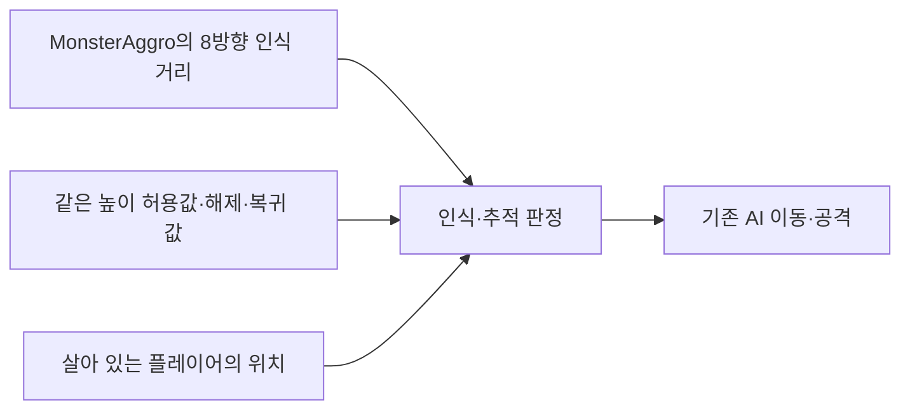
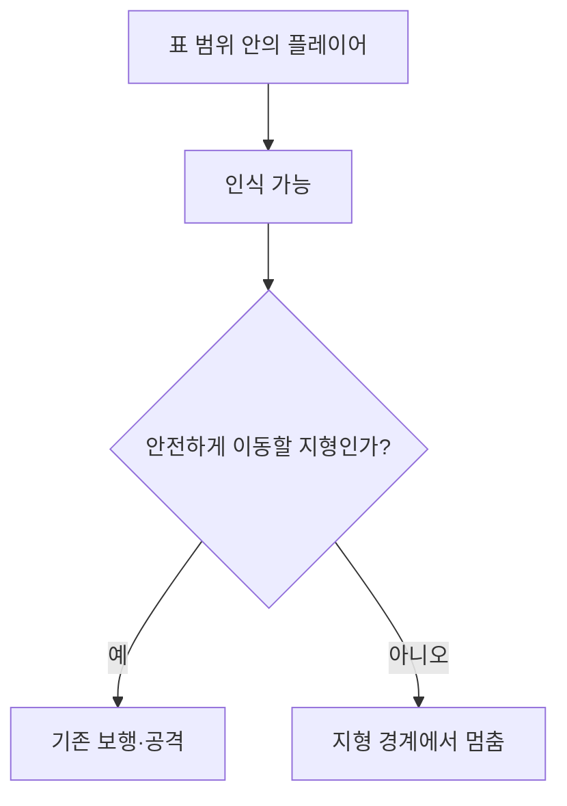
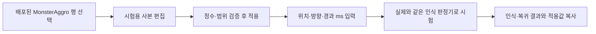

# 몬스터 인식과 추적 데이터 사용 안내

기준일: 2026-11-16. 기획자가 공급한 MonsterAggro의 **8방향 인식 표를 연결·배포**했습니다. 사용자 승인으로 SameLevelHeight를 추가했으며, 초기값 10은 기획자가 조정할 수 있습니다. 원본의 Monster.SightRange는 이제 운영 어그로 인식에 사용하지 않습니다.

## 목차

1. [무엇을 조정하는가](#1-무엇을-조정하는가)
2. [표 작성과 단위](#2-표-작성과-단위)
3. [수정하고 확인하는 순서](#3-수정하고-확인하는-순서)
4. [인식과 이동의 차이](#4-인식과-이동의-차이)
5. [F8 데이터 주입 시험](#5-f8-데이터-주입-시험)

## 1. 무엇을 조정하는가

어그로는 몬스터가 플레이어를 인식하고 추적하는 상태입니다. 이제 카메라에 보이는지, 같은 발판인지, 플레이어가 매달리거나 사다리를 타는지가 추가 인식 제한으로 사용되지 않습니다. 대상이 살아 있고 연결이 유효하면 아래 표의 범위로 판단합니다.

## 2. 표 작성과 단위

원본은 DataSheet의 `tables/Monster.xlsx`입니다. MonsterAggro의 MonsterID는 Monster 탭의 ID와 같아야 합니다. 같은 몬스터에 중복 행을 만들지 마세요.

| 위치·컬럼 | 의미 | 현재 공급 예시 |
| --- | --- | --- |
| FrontRange | 몬스터가 바라보는 정면 | 500 = 5칸 |
| BackRange | 몬스터의 등 뒤 | 100 = 1칸 |
| UpRange | 가로 반 칸 이내의 바로 위 | 100 = 1칸 |
| DownRange | 가로 반 칸 이내의 바로 아래 | 0 = 자동 인식 안 함 |
| FrontUpRange | 앞 위 대각선 | 200 = 가로·세로 각각 2칸 이내 |
| BackUpRange | 뒤 위 대각선 | 100 = 가로·세로 각각 1칸 이내 |
| FrontDownRange | 앞 아래 대각선 | 100 = 가로·세로 각각 1칸 이내 |
| BackDownRange | 뒤 아래 대각선 | 100 = 가로·세로 각각 1칸 이내 |
| SameLevelHeight | 앞·뒤로 분류할 발 높이 차이 허용값 | 초기 10 = 0.1칸 |
| LoseRange | 추적을 놓치는 가로 거리 | 1100 = 11칸 |
| LoseHeight | 추적을 놓치는 높이 차이 | 600 = 6칸 |
| LoseTime | 해제 범위를 벗어난 상태가 이어져야 하는 시간 | 2000 = 2초 |
| LeashRange | 처음 생성된 자리에서 벗어날 수 있는 가로 거리 | 1200 = 12칸 |
| ReacquireDelay | 추적 해제 뒤 다시 인식하기까지 기다리는 시간 | 1000 = 1초 |

거리는 100당 1칸, 시간은 1000당 1초입니다. 소수나 음수를 넣지 않습니다. 가로를 사용하는 방향은 LoseRange 이하, 세로를 사용하는 방향은 LoseHeight 이하, SameLevelHeight는 LoseHeight 이하, LeashRange는 0보다 커야 합니다. 이 수치는 코드에 고정한 값이 아닙니다.

오른쪽을 보고 있으면 정면은 오른쪽·후면은 왼쪽입니다. 왼쪽을 보고 있으면 반대입니다. 플레이어가 있는 쪽으로 먼저 돌아선 다음 인식하는 방식이 아닙니다.

| 뒤 위 | 바로 위 | 앞 위 |
| --- | --- | --- |
| BackUpRange | UpRange | FrontUpRange |
| BackRange | 오른쪽을 보는 몬스터 | FrontRange |
| BackDownRange | DownRange | FrontDownRange |

발 높이 차이가 SameLevelHeight 이하면 앞·뒤, 그 밖에서 가로 차이가 50 이하면 바로 위·아래, 나머지는 대각선으로 분류합니다. 선택한 방향 값이 0이면 다른 방향 값으로 대체하지 않습니다. DownRange가 0이어도 앞 아래 대각선은 별도로 활성화할 수 있습니다.

SameLevelHeight를 추가한 이유는 작은 발 위치 오차가 같은 지면의 대상을 대각선으로 바꿔 버리는 것을 줄이기 위해서입니다. 초기값 10은 확정 밸런스가 아니며 조절 가능합니다. 너무 크면 위·아래 대상을 앞·뒤로 분류하므로 해당 맵의 층 높이를 고려해 주세요.

## 3. 수정하고 확인하는 순서

1. MonsterAggro에서 방향별 거리·같은 높이 허용값·해제·복귀 값을 수정합니다. 몬스터 ID·컬럼명·단위를 유지합니다. 이전 SightHeight는 삭제됐습니다.
2. 원본을 저장하고 기존 검사·배포 절차를 진행합니다. 엑셀을 수정하기만 하면 실행 중 게임에 즉시 적용되는 구조는 아닙니다.
3. Unity Play를 중지한 상태에서 데이터 반영·컴파일을 끝낸 뒤 다시 실행합니다.
4. 거리·높이 경계의 안쪽과 바깥쪽에서 인식을 확인합니다. 화면 밖·다른 발판이라는 이유로 인식이 막히면 이전 연결이 남았는지 개발자에게 전달합니다.
5. 추적 해제 범위를 잠깐 벗어났다가 복귀한 경우, 충분히 오래 벗어난 경우, 스폰 지점에서 멀어진 경우를 나눠 확인합니다.
6. 테스트 빌드의 F8에서 피드백 QA 진단을 갱신합니다. 대상 유효 여부·가로 거리·발 높이 차이·정면/후면 거리·보행 구간을 확인할 수 있습니다. 거리·높이는 표와 같은 100당 1칸 단위이고, 발 높이 차이의 음수는 몬스터보다 아래라는 뜻입니다.

공격·노출 상태의 마무리와 기존 피격 반응은 별도 전투 흐름입니다. 인식 표 수정이 공격 애니메이션·낭떠러지 이동·피해 무적을 직접 바꾸지는 않습니다. 죽거나 비활성화된 대상을 해제하는 처리는 객체 수명 관리이므로 표에서 켜거나 끄지 않습니다.

인식에 성공하면 추적 해제는 방향별 짧은 거리 대신 LoseRange·LoseHeight·LoseTime으로 판단합니다. 피격 시 즉시 인식은 방향 범위·재인식 대기를 무시하는 원본 규칙입니다. 이후 새 컬럼이 생기면 개발자가 정의·검사·소비 연결을 맞춘 뒤 배포합니다.

## 4. 인식과 이동의 차이

다른 발판의 플레이어를 인식해도 몬스터가 구덩이를 건너거나 사다리를 타는 길 찾기를 새로 제공하는 것은 아닙니다. 가까워도 지형 끝에서 멈춘다면 인식 여부와 이동 가능 여부를 따로 확인해 주세요. 보스의 방 전체 추적은 일반 몬스터 표와 별도 정책을 유지합니다.

설계 이유·이전 방식과의 비교는 [몬스터 8방향 인식과 추적 설계](../개발자용%20설계문서/몬스터%208방향%20인식과%20추적%20설계.md)를 봅니다.

## 5. F8 데이터 주입 시험

에디터 또는 development 빌드에서 맵에 진입한 뒤 **F8 → 어그로 데이터 시험 펼치기**를 누릅니다. 별도 Inspector 연결은 필요하지 않습니다. release에는 이 시험 코드가 포함되지 않습니다.

### 5.1 원본 데이터 주입과 값 조정

1. 이전 데이터·다음 데이터로 시험할 행을 고릅니다. 화면의 MonsterAggro ID·Monster ID를 확인합니다. 행을 고르면 현재 배포된 모든 정수 설정값이 자동으로 들어갑니다.
2. 그대로 시험하거나 FrontRange·BackRange 등 값을 편집합니다. 시트와 같은 단위를 사용합니다.
3. **입력값 사본 검증·적용 / 시험 초기화**를 누릅니다. 새 판정기는 대기 상태에서 시작합니다.
4. 입력값만 바꾸고 적용 버튼을 누르지 않으면 이전 사본이 사용됩니다. 화면과 결과에 미적용 변경 경고가 나옵니다.
5. **현재 배포 원본값으로 복원**은 실행 중 카탈로그에서 다시 읽습니다. 디스크의 엑셀·CSV를 새로 배포하거나 저장하는 버튼은 아닙니다.

잘못된 정수·음수 거리·해제 범위보다 큰 값은 거부하고 마지막 정상 적용 상태를 유지합니다. ID는 바꾸지 않습니다. 원본 시트·실제 맵 몬스터·저장 파일에는 시험값을 적용하지 않습니다. 새 값이 좋으면 시트에 별도로 반영하고 검사·배포해야 합니다.

### 5.2 위치·방향·시간을 시험하는 방법

| 시험 입력 | 의미 |
| --- | --- |
| 가로 위치 차이 | 몬스터를 기준으로 양수는 월드 오른쪽, 음수는 왼쪽 |
| 발 높이 차이 | 양수는 위, 음수는 아래. 0은 같은 높이 |
| 스폰 자리 이탈 거리 | 몬스터가 원래 자리에서 가로로 떨어진 거리. 음수 금지 |
| 진행할 정수 ms | 버튼을 한 번 누를 때 진행할 시간. 음수 금지 |
| 바라보는 방향 | 같은 X 입력도 오른쪽·왼쪽 보기에서 정면/후면이 반대로 됨 |
| 대상 생존·활성 | 끄면 인식 대상 수명이 끝난 상황을 시험 |
| 공격·노출 중 복귀 보류 상태 | 기존 전투 상태가 해제를 보류하는 상황을 시험 |

**위치 관측만 판정**은 시간 0으로 관측합니다. **관측 후 입력한 ms 진행**은 같은 관측을 넣고 그 시간만큼 진행합니다. 실제 화면에서 기다리는 시간은 이 독립 시험에 더해지지 않습니다. **피격 즉시 인식 시험**은 유효한 대상의 공격에 맞았을 때 방향 범위·재인식 대기를 무시하는 규칙을 확인합니다.

다음은 현재 공급 예시(FrontRange=500, BackRange=100)의 시험 순서입니다. 값이 바뀌면 해당 배포값에 맞춰 입력하세요.

1. 사본을 적용해 초기화하고 오른쪽 보기·X=500·Y=0·스폰 거리=0에서 관측합니다. 인식·추적=True가 기대 결과입니다.
2. **사본 적용으로 다시 초기화**하고 X=-101·Y=0으로 관측하면 후면 100 밖이므로 False입니다. 이미 추적 중인 상태를 초기화하지 않으면 LoseRange·LoseTime 규칙으로 유지될 수 있습니다.
3. 다시 초기화하고 왼쪽 보기로 같은 X=-101을 관측하면 정면이므로 True입니다.
4. DownRange=0인 사본을 초기화한 뒤 X=0·Y가 SameLevelHeight보다 작은 음수 방향으로 충분히 떨어지도록 입력합니다(현재 예: -80). 바로 아래는 False이며 대각선 값으로 대체하지 않습니다.
5. 해제 시간을 보려면 먼저 인식시킨 뒤 X를 LoseRange보다 크게 하고 스폰 거리는 LeashRange 안에 둡니다. LoseTime-1 ms 진행 후 유지, 추가 1ms 후 복귀하는지 확인합니다. 보호 상태 토글은 끕니다.

**시험 결과 복사**는 원본 행 번호·실제 적용한 사본 값·관측값·이번 진행 시간·인식·복귀 결과를 복사합니다. 진행 상태는 여러 버튼 입력의 결과이므로 재현 시 버튼 순서도 함께 전달하세요.

### 5.3 주의사항

- 이 기능은 데이터 판정의 독립 시험입니다. 실제 몬스터가 움직이는지·벽에 막히는지·보이는지까지 시험한 것은 아닙니다. 실제 맵 상태는 기존 **피드백 QA 진단 갱신**으로 확인합니다.
- 게임 자체를 정지시키는 기능은 아닙니다. 실제 플레이가 안전한 상태에서 사용하세요. 기존 보스 처치·이동 버튼은 여전히 실제 진행을 바꾸는 별도 기능입니다.
- F8을 닫거나 맵을 떠나면 시험 사본·입력·대기 상태가 정리됩니다. 조정값을 남길 필요가 있으면 닫기 전에 결과를 복사합니다.
- Play 중 코드나 시트를 다시 배포해 상태를 바꾸지 않습니다. 재컴파일이 필요하면 Play를 중지하고 반영한 뒤 재시작합니다.
