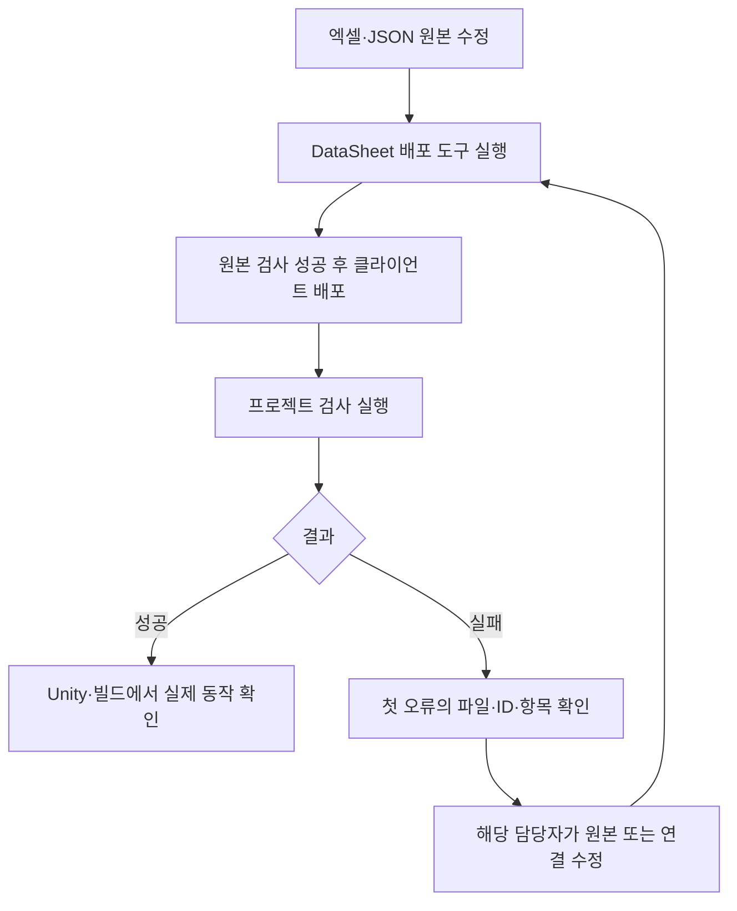

# 배포 검사 결과 확인 안내

## 목차

1. [이 검사를 사용하는 이유](#1-이-검사를-사용하는-이유)
2. [무엇을 확인하는가](#2-무엇을-확인하는가)
3. [실행과 실패 대응](#3-실행과-실패-대응)
4. [통과 후 남는 확인](#4-통과-후-남는-확인)

## 1. 이 검사를 사용하는 이유

기획자가 체력·보상·스폰 수를 바꿨을 때, 데이터가 올바르게 전달되고 필요한 코드와 파일에 연결되는지 확인하기 위한 도구입니다. 과거 체력이나 보상 수치를 유지하도록 강제하는 도구가 아닙니다.

## 2. 무엇을 확인하는가

| 항목 | 쉬운 예 |
| --- | --- |
| 값의 형식과 범위 | 체력은 양의 정수, 확률은 0~10000 |
| 데이터 연결 | 몬스터가 지정한 공통 스탯 ID가 실제로 있는지 |
| 코드 연결 | 엑셀 컬럼을 받는 코드 속성이 있고 읽은 값이 같은지 |
| 기능 연결 | CSV 체력이 실제 생성된 캐릭터 체력으로 전달되는지 |
| 파일 연결 | 스폰 JSON의 플랫폼·몬스터 프리팹과 배경음이 실제 연결됐는지 |
| 스폰 수 | 해당 JSON에서 정한 최대 수를 넘지 않는지 |

모든 수치를 무조건 양수로 작성하지는 않습니다. ‘없음’을 뜻하는 0, 왼쪽·아래쪽 좌표, 감소 효과의 음수 등은 해당 항목의 작성 규칙을 따릅니다. 임의로 0을 1로 바꾸면 다른 대상을 가리킬 수 있습니다.

## 3. 실행과 실패 대응

평소에는 기존 DataSheet 배포 도구로 원본을 검사하고 배포합니다. 클라이언트 검사 실행이 필요하면 개발자에게 요청하거나 프로젝트 폴더의 터미널에서 `./Tools/Verify-Project.ps1`을 실행합니다. GitHub 검사에서도 같은 스크립트를 사용합니다.

실패하면 첫 오류 문구 전체를 개발자에게 전달합니다. 예를 들어 `Monster[아이디].UnitID → UnitStat.ID=대상아이디 참조가 없습니다`라면 해당 몬스터가 가리키는 공통 스탯이 없다는 뜻입니다. 엑셀 원본의 ID와 실제 배포 여부를 확인합니다. CSV만 직접 고치면 다음 배포 때 사라지므로 원본을 수정합니다.

검사가 이전 체력이나 보상 수치를 요구한다면 검사 담당자에게 알려주세요. 정상 기획 수치를 옛값으로 되돌리는 것이 해결 방법은 아닙니다.

## 4. 통과 후 남는 확인

검사 통과는 현재 자동 검사 범위의 연결이 맞다는 뜻입니다. 실제 화면 표시, 애니메이션, 소리 재생, 충돌, 맵 이동과 저장 복원은 게임에서 확인해야 합니다. Spawn이 연결되지 않은 보스 전용 경로 등은 스폰 검사의 대상이 아닙니다. 신규 컬럼·리소스 연결 방식은 개발자와 검사 지원 범위를 맞춥니다.

검사 책임과 지원 범위는 [개발자 설계](../개발자용%20설계문서/배포%20데이터와%20기능%20연결%20검사%20설계.md)를 참고합니다.
