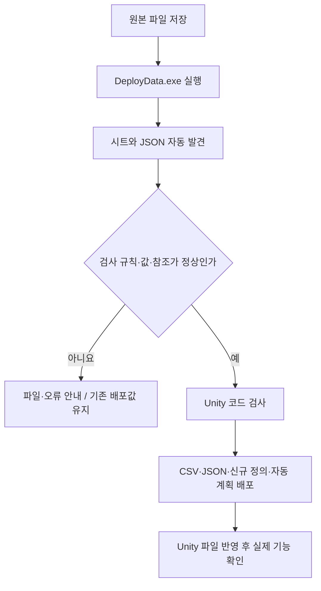

# 새 시트와 JSON 자동 배포 사용 안내

기준일: 2026-11-13. 새 파일을 넣을 때마다 개발자가 복사 코드를 추가하는 작업을 없애기 위한 안내입니다. 구조·검사 책임은 [개발자 설계](../개발자용%20설계문서/데이터%20자동%20발견과%20Unity%20배포%20경계%20설계.md), NPC 작성은 [NPC 안내](NPC%20데이터%20작성과%20배포%20준비%20안내.md)를 봅니다.

## 1. 어떤 경우 자동인가요

| 하려는 일 | 진행 방법 |
| --- | --- |
| 새 엑셀 파일·탭 추가 | tables 아래 기존 README·상단 규칙 형식으로 작성하고 실행 |
| 기존 스폰 형식의 새 스테이지 파일 추가 | spawn에 새 JSON을 넣고 실행 |
| 기존 대사 형식의 새 파일 추가 | Dialogue 행·Language 문구와 dialogue JSON을 함께 준비하고 실행 |
| 처음 보는 구조의 JSON 추가 | 도구가 발견해 필요한 검사 규칙을 안내. 개발자가 의미 검사를 준비한 뒤 배포 |
| 새 NPC·오브젝트 동작 추가 | 데이터 배포와 별도로 개발자에게 게임 기능 연결 요청 |

같은 구조의 파일 추가 때문에 도구를 다시 만드는 것은 아닙니다. 처음 등장한 구조의 검사 코드를 개발자가 추가한 경우에는 새 실행파일을 받아야 합니다. 검사 규칙이 없는 파일을 임의로 다른 폴더에 옮겨 우회하지 않습니다.

## 2. 실행 순서



1. DataSheet와 Human_Ghost-를 같은 부모 폴더에 둡니다.
2. 원본 엑셀이나 JSON을 수정하고 저장합니다.
3. DeployData.exe를 더블클릭합니다. 검사 성공 후 기존 공용 배포가 진행됩니다.
4. 완료 문구에서 탭 수와 폴더별 JSON 수를 확인합니다. 고정된 숫자를 맞추기 위해 파일을 추가하지 않습니다.
5. Unity가 변경 파일을 가져온 뒤 실제 동작을 확인합니다. 추출·복사 성공만으로 게임 기능 완료가 되지는 않습니다.

검사만 하려면 DataSheet 폴더에서 다음을 실행합니다.

```powershell
.\DeployData.exe --check
```

## 3. 파일 위치와 주의점

원본 상대 폴더 구조로 Assets/Data/Json 아래에 배포합니다. 기존 stats 원본은 호환을 위해 stats 이름만 빼서 배포합니다. spawn/8002.json은 Json/spawn/8002.json, stats/shrine/stat/Crit.json은 Json/shrine/stat/Crit.json이 됩니다.

Tools·Docs·tables·점으로 시작하는 관리 폴더는 별도 JSON 원본 탐색에서 제외합니다. stats/item은 기존 예시 폴더로 계속 제외합니다. 이 예시 폴더에 실제 배포 파일을 넣지 않습니다.

- 지원되는 형식의 파일은 자동 발견합니다. 파일명·필드·참조 규칙은 기존 안내를 따릅니다.
- 폴더와 파일 이름에는 영문·숫자·밑줄을 사용하고 .json 확장자를 씁니다.
- 규칙 없는 JSON은 자동으로 발견되지만 배포되지 않습니다. 파일명과 검사 규칙 안내를 개발자에게 전달합니다.
- 같은 파일 이름의 JSON을 다른 폴더에 중복해서 넣으면 로딩 키 충돌로 실패할 수 있습니다.
- 파일 삭제 시에는 시트·다른 파일의 참조도 함께 정리합니다. 이전 도구 소유 파일만 삭제 반영하며 수동 작성 파일은 보호합니다.

## 4. 기존 CSharp 파일은 어떻게 되나요

이미 존재하는 데이터 정의 `.cs`는 덮어쓰지 않습니다. 새 정의가 없을 때만 최초 생성합니다. CSV·JSON과 자동 생성 로딩 계획은 갱신합니다.

시트의 열을 삭제·추가한 뒤 기존 정의와 맞지 않으면 배포를 중단할 수 있습니다. 개발자가 기존 정의를 맞춰야 하며 파일을 지워 강제로 재생성하지 않습니다. 최신 .NET 문법을 사용하는 도구 소스가 Unity 폴더로 복사되는 구조가 아닙니다.

## 5. 이번 NPC 데이터 결과

현재 31개 탭과 별도 JSON 15개를 검사·배포했습니다. Npc·Dialogue는 CSV, 대사 24001~24004는 dialogue JSON입니다. 기존 정의 35개는 배포 전후 내용이 같았습니다. 실제 게임의 NPC 배치·대화 기능 연결은 따로 확인해야 합니다.
