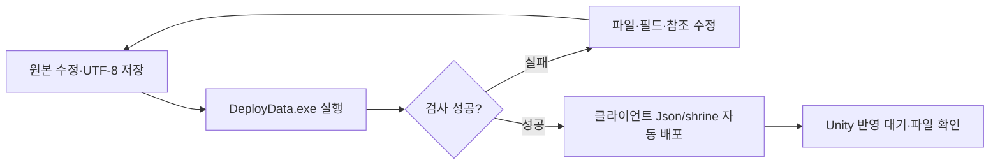

# 서낭당 강화 데이터 배포 안내

서낭당 JSON을 클라이언트에 직접 복사하지 않도록 자동 배포에 연결했습니다. **현재 완료된 것은 검사·배포이며, 강화 메뉴·구매·실제 효과는 아직 연결 전입니다.** 구조는 [개발자 설계](../개발자용%20설계문서/서낭당%20강화%20데이터%20배포%20설계.md)를 참고합니다.

## 1. 수정할 파일

| DataSheet 원본 | 역할 |
| --- | --- |
| stats/shrine/shrine_level.json | 최대 서낭당 레벨·혼 ID·레벨별 비용·사망 손실률 |
| stats/shrine/stat/*.json | 능력치 종류·문구 ID·허용 여부·최대 단계·단계별 증감 |

현재 레벨 1개·능력치 5개입니다. 최신 재화 ID는 혼 1·엽전 2입니다. 설명용 target 문자열만 고친다고 새로운 게임 효과가 만들어지지는 않습니다.

## 2. 실행 순서

1. DataSheet와 Human_Ghost-는 같은 상위 폴더에 둡니다.
2. 원본 JSON을 수정하고 UTF-8로 저장합니다. 기존 파일명·statType은 임의로 바꾸지 않습니다.
3. DataSheet의 DeployData.exe를 실행합니다. 별도 복사 도구나 Unity 인스펙터 할당은 필요하지 않습니다.
4. 완료 문구의 서낭당 JSON 개수를 확인합니다. 현재는 6개이며 파일을 추가하면 늘어납니다. --check는 검사만 하고 복사하지 않습니다.
5. 클라이언트 Assets/Data/Json/shrine/shrine_level.json과 stat 폴더를 확인합니다. 배포된 파일은 직접 수정하지 않습니다.

## 3. 작성 규칙과 주의점

- 레벨은 1부터 maxLevel까지, 능력치 단계는 1부터 maxStep까지 순서대로 빠짐없이 작성합니다. 중복 단계는 사용할 수 없습니다.
- 마지막 레벨의 다음 비용은 0, 그 이전 비용은 양수 정수입니다. 소수점 수치는 사용하지 않습니다.
- soulCurrencyId는 Currency에, textId는 Language에 있는 ID를 사용합니다.
- enabled는 true/false이며 파일 이름은 statType과 같아야 합니다.
- steps의 value는 단계마다 더하는 증감값입니다. 감소 효과는 음수도 가능합니다.
- deathSoulLossRate는 0~10000입니다. 5000은 50%입니다.

같은 형식의 능력치 JSON을 stat 폴더에 추가하면 자동 배포됩니다. **새 능력치 효과까지 자동 구현되지는 않으므로** 개발자에게 statType과 효과를 전달해야 합니다. 원본에서 삭제한 파일은 다음 배포 때 기존 생성 JSON도 제거됩니다. 사용 중인 데이터 삭제는 개발자와 확인합니다.

오류가 나면 원본을 수정한 뒤 다시 실행합니다. 검사 실패는 배포 성공이 아니며 기존 클라이언트 파일을 변경하지 않습니다. 배포 도중 실패하면 기존 파일로 원복합니다. 문제를 전달할 때 도구 버전·오류 전문·수정 파일을 함께 알려 주세요. 실제 강화 조작과 구매 검증 절차는 연결 후 추가합니다.
