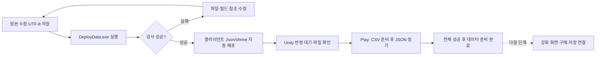

# 서낭당 강화 데이터 배포 안내

서낭당 JSON을 클라이언트에 직접 복사하지 않도록 자동 배포하고 게임의 기존 초기화에서 읽도록 연결했습니다. **검사·배포·정의 로딩까지 완료했으며 강화 효과·구매 코어·저장은 연결했고 강화 메뉴는 후속입니다.** 구조는 [개발자 설계](../개발자용%20설계문서/서낭당%20강화%20데이터%20배포%20설계.md)를 참고합니다.

독립 재화·구매 코어와 최신 비용식 계산도 준비했습니다. 아직 게임 화면에서 구매할 수 있는 상태는 아닙니다. 혼·엽전과 구매 데이터의 구분은 [재화·강화 준비 안내](기획자용%20재화와%20강화%20준비%20안내.md)를 봅니다. 최신 비용식의 soulCostBase는 양수, soulCostRate는 10000 이상의 정수 만분율로 검사합니다.

## 목차

1. [수정할 파일](#1-수정할-파일)
2. [실행 순서](#2-실행-순서)
3. [작성 규칙과 주의점](#3-작성-규칙과-주의점)
4. [이번 단계 확인표](#4-이번-단계-확인표)
5. [새 목재 패널 적용 — 2026-11-12](#새-목재-패널-적용--2026-11-12)

## 1. 수정할 파일

| DataSheet 원본 | 역할 |
| --- | --- |
| stats/shrine/shrine_level.json | 최대 서낭당 레벨·혼 ID·레벨별 비용·사망 손실률 |
| stats/shrine/stat/*.json | 능력치 종류·문구 ID·허용 여부·최대 단계·단계별 증감 |

현재 레벨 1개·능력치 5개입니다. 최신 재화 ID는 혼 1·엽전 2입니다. 설명용 target 문자열만 고친다고 새로운 게임 효과가 만들어지지는 않습니다.

## 2. 실행 순서

1. DataSheet와 Human_Ghost-는 같은 상위 폴더에 둡니다.
2. 원본 JSON을 수정하고 UTF-8로 저장합니다. 기존 파일명·statType은 임의로 바꾸지 않습니다.
3. DataSheet의 DeployData.exe를 실행합니다. 별도 복사 도구나 Unity 인스펙터 할당은 필요하지 않습니다.
4. 완료 문구의 서낭당 JSON 개수를 확인합니다. 현재는 6개이며 파일을 추가하면 늘어납니다. --check는 검사만 하고 복사하지 않습니다.
5. 클라이언트 Assets/Data/Json/shrine/shrine_level.json과 stat 폴더를 확인합니다. 배포된 파일은 직접 수정하지 않습니다.
6. Play를 새로 시작하고 데이터 초기화 완료 문구와 첫 오류 유무를 확인합니다. 파일 목록·공용 에셋 등록·정의 로딩은 자동이며 새 인스펙터 필드를 연결할 필요가 없습니다. 초기화 완료는 강화 구매까지 구현됐다는 의미가 아닙니다.

## 3. 작성 규칙과 주의점

- 레벨은 1부터 maxLevel까지, 능력치 단계는 1부터 maxStep까지 순서대로 빠짐없이 작성합니다. 중복 단계는 사용할 수 없습니다.
- 마지막 레벨의 다음 비용은 0, 그 이전 비용은 양수 정수입니다. 소수점 수치는 사용하지 않습니다.
- soulCurrencyId는 Currency에, textId는 Language에 있는 ID를 사용합니다.
- enabled는 true/false이며 파일 이름은 statType과 같아야 합니다.
- steps의 value는 단계마다 더하는 증감값입니다. 감소 효과는 음수도 가능합니다.
- deathSoulLossRate는 0~10000입니다. 5000은 50%입니다.

같은 형식의 능력치 JSON을 stat 폴더에 추가하면 자동 배포됩니다. **새 능력치 효과까지 자동 구현되지는 않으므로** 개발자에게 statType과 효과를 전달해야 합니다. 원본에서 삭제한 파일은 다음 배포 때 기존 생성 JSON도 제거됩니다. 사용 중인 데이터 삭제는 개발자와 확인합니다.

재배포하면 새 파일과 삭제한 파일이 자동 로딩 목록에도 반영됩니다. 인스펙터에 파일을 하나씩 추가하거나 C#의 이름 목록을 고치지 않습니다. 다른 JSON과 파일 이름이 같으면 연결을 혼동하므로 도구가 오류로 알려 줍니다. 이름 변경·삭제는 진행 기록의 식별자에도 영향을 줄 수 있어 개발자와 먼저 확인합니다.

## 4. 이번 단계 확인표

| 상황 | 기대 결과 |
| --- | --- |
| 기존 6개 파일 배포 후 Play | CSV 뒤에 JSON을 읽고 데이터 초기화 완료 |
| 같은 형식의 능력치 파일 추가·재배포 | 배포 개수와 자동 로딩 목록에 반영. 효과 구현은 별도 |
| 기존 비용·증감값 수정·재배포 | 다음 초기화에서 새 정의로 읽음. 원본 정의를 실행 중 수정하지 않음 |
| 필수 파일 누락·읽기 실패 | 초기화 오류. 일부 데이터로 정상 준비됐다고 처리하지 않음 |
| 파일 이름 중복 | 배포 전 오류. 기존 클라이언트 파일 유지 |

오류가 나면 원본을 수정한 뒤 다시 실행합니다. 검사 실패는 배포 성공이 아니며 기존 클라이언트 파일을 변경하지 않습니다. 배포 도중 실패하면 기존 파일로 원복합니다. 문제를 전달할 때 도구 버전·오류 전문·수정 파일을 함께 알려 주세요. 실제 강화 조작과 구매 검증 절차는 연결 후 추가합니다.

## 새 목재 패널 적용 — 2026-11-12

`ShrineScreen.prefab`의 메뉴 패널에는 `Dark_ShrineUI_Panel_Small_560x660`, 제사/약초 상세 패널에는 `Dark_ShrineUI_Panel_Large_1320x820`을 연결했습니다. 위치와 크기560×660/1320×820, 기존 항목·키 안내·화면 전환은 유지합니다.

목재 위 본문은 밝은 색으로, 다음 값은 밝은 파랑으로 조정했습니다. 밝은 키캡 안의 키 글자는 기존 어두운 색을 유지합니다. 붉은 선택 핀·단계 표시는 얇은 밝은 외곽으로 구분합니다. 구매·비용·단계·재화·저장 규칙과 ShrineScreen 코드는 변경하지 않았습니다.

기존 데이터와 독립된 상태로 메뉴→제사→약초→뒤로/닫기, 글자 대비·키캡·선택/단계 표시·패널 크기·화면 탐색 중 재화 불변을76건 검사했습니다. 실제 세 화면을 렌더해 확인했습니다. 원본 PNG와 공급 데이터는 그대로입니다.
