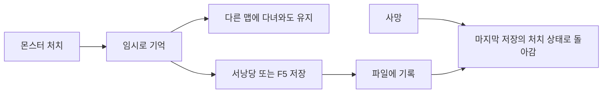

# 서낭당 저장과 몬스터 처치 기록 확인 안내

## 장부방 이후 사망 복귀 확인 — 2026-11-13

장부 조사 완료 후 초반 복귀 지점이 마을·장부방이면 다음 진행 맵의 시작점에서 태어납니다. 현재는 Stage의 마을 NextStage가 산길 8002입니다. 기획자가 다음 맵 연결을 바꾸면 해당 연결을 사용합니다. 후반의 정상 서낭당 체크포인트는 그대로 유지합니다.

장부 조사 전 사망, 조사 후 초반 사망, 후반 서낭당 저장 뒤 사망을 각각 확인하세요. 수동 저장 슬롯의 이어하기는 저장 당시 위치를 유지하며 이 사망 복귀 보정과 구분합니다. 코드 변경만으로 이미 받은 실행파일은 갱신되지 않으므로 새 빌드에서도 확인해야 합니다.

## 목차

- [장부방 이후 사망 복귀 확인](#장부방-이후-사망-복귀-확인--2026-11-13)

1. [무엇을 위해 사용하는가](#1-무엇을-위해-사용하는가)
2. [서낭당은 어떻게 사용하는가](#2-서낭당은-어떻게-사용하는가)
3. [몬스터 배치 데이터를 수정할 때](#3-몬스터-배치-데이터를-수정할-때)
4. [실제 게임에서 확인하는 순서](#4-실제-게임에서-확인하는-순서)
5. [현재 검증의 한계](#5-현재-검증의-한계)

## 1. 무엇을 위해 사용하는가

몬스터를 잡고 다른 맵에 다녀와도 같은 몬스터가 다시 나오지 않게 합니다. 저장하지 않고 사망하면 마지막 저장 이후에 잡은 몬스터는 다시 나옵니다. 보스 처치 정책은 이 일반 몬스터 기록과 별개입니다.

## 2. 서낭당은 어떻게 사용하는가

| 행동 | 결과 |
| --- | --- |
| 처음 서낭당에 가까이 다가가기 | 한 타일 반경에서 활성화하고 현재 상태를 자동 저장합니다. 체력·약초는 회복하지 않습니다. |
| 이미 활성화한 서낭당에 다시 다가가기 | 접촉만으로 같은 자동 저장을 반복하지 않습니다. |
| 활성 서낭당에서 E키로 상호작용 | 체력을 최대로, 약초를 Buff의 Charges 값까지 회복한 뒤 현재 슬롯에 저장합니다. 명시적 상호작용은 반복할 수 있습니다. |
| 저장 실패 | 기존 파일은 유지합니다. 이동 후 다시 접근하거나 E키로 재시도하고 오류 로그를 개발자에게 전달합니다. |

현재 약초 수량은 기존 데이터에서 가져옵니다. 스테이지당 서낭당은 하나이며 새 컬럼이나 별도의 저장 컴포넌트 필드를 기획자가 추가할 필요는 없습니다. 기존 맵의 Seonangdang 표식을 사용합니다. 새 맵의 배치와 연결은 개발자에게 요청합니다.

## 3. 몬스터 배치 데이터를 수정할 때

게임은 StageID + PlacementID + 같은 배치 안 개체 순번으로 몬스터를 구분합니다. 위치를 옮기는 것만으로 다른 몬스터로 취급하지 않습니다. 이미 배포한 목록 중간에 몬스터를 끼워 넣거나 삭제·정렬하면 순번의 의미가 달라질 수 있습니다. 배치 번호를 다른 배치에 재사용하지 말고, 이런 변경은 기존 저장 기록을 어떻게 처리할지 개발자와 먼저 정합니다. 처치 확인을 위해 배포된 JSON을 직접 수정하지 않습니다.

## 4. 실제 게임에서 확인하는 순서

실제 보관 중인 저장을 지우지 않도록 별도 시험용 슬롯을 사용합니다. F5 수동 저장은 테스트·시연 빌드에서만 사용할 수 있습니다.

1. 새 게임에서 일반 몬스터 A를 잡고 서낭당을 처음 접촉합니다. 저장 전후 체력과 약초가 그대로인지 확인합니다.
2. 다른 맵에 다녀와도 A가 나오지 않는지 확인합니다.
3. 몬스터 B를 잡은 뒤 저장하지 않고 사망합니다. A는 없고 B는 다시 나오는지 확인합니다.
4. 체력이나 약초를 소모한 뒤 활성 서낭당에서 E키를 누릅니다. 회복과 저장을 확인합니다. 이때 몬스터가 새로 나오면 안 됩니다.
5. 저장한 기록으로 이어하기를 시작해 처치 상태와 저장 당시 위치가 복원되는지 확인합니다. 사망 시 위치는 수동 저장 위치가 아니라 서낭당 체크포인트입니다.
6. 서낭당 재접촉만으로 저장이 반복되지 않고, E키 저장은 다시 가능한지 확인합니다.

예전 저장 파일에는 개별 처치 정보가 없으므로 처음 읽을 때 모든 일반 몬스터가 나올 수 있습니다. 파일은 자동 삭제하지 않습니다.

## 5. 현재 검증의 한계

저장·호환 자동 검사와 엔진 참조 컴파일은 개발자가 확인합니다. 실제 공간의 접촉 위치·E키 표시·왕복·사망·실행파일 확인은 별도입니다. 장부방 8005는 등록되어 실제 왕복 확인이 남고, 연속 필드·별도 보스 씬은 준비 대기이며, 추후 리스폰 ON/OFF 구간은 이번에 추가하지 않았습니다.

수동 저장 화면은 [수동 저장 안내](기획자용%20수동%20저장%20사용%20안내.md), 개발 구조는 [저장 기능 설계](../개발자용%20설계문서/저장%20기능%20설계.md)를 참고합니다.
