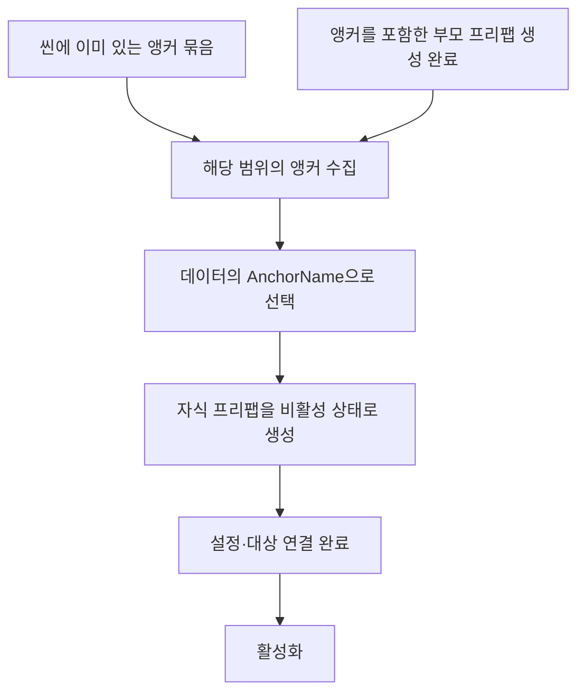
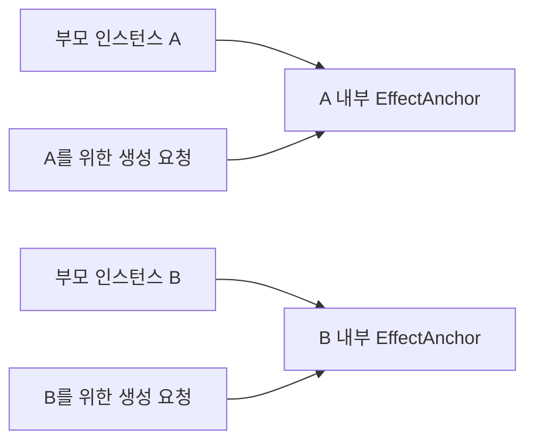
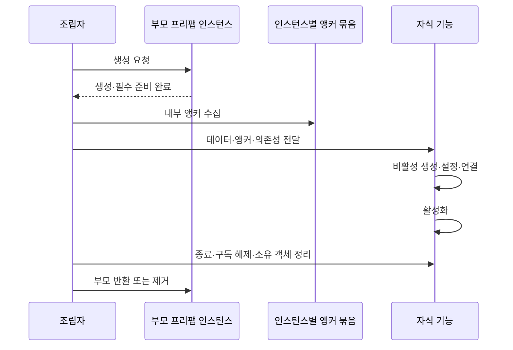

# 앵커 기반 프리팹 배치 안내

> **아트 공동 기여:** 공급된 원본 아트의 제작·Git 외부 파일 전달에는 아트 담당자가 함께 참여했습니다. 아래 리소스 가공·프리팹·애니메이션·화면 연결 이력과 원본 제작 기여를 구분합니다. 미공급 전용 자산은 완료로 표기하지 않습니다. [작업자·커밋 기준](../개발자용%20설계문서/현재%20구현과%20검증%20현황.md#5-작업자별-역할과-git-근거)

> 2026-11-04 최신 풀 점검: 체력 표시 앵커 규칙은 유지합니다. 월드는 맵 Markers에 지형 앵커를 두고 JSON2 Points로 몬스터 위치를 지정합니다. 맵마다 몬스터 앵커를 추가하는 방식은 아닙니다. 최신 SpawnTemp와 공식 배포 차이는 현황을 확인합니다. 전체 상태는 [현재 구현과 검증 현황](../%EA%B0%9C%EB%B0%9C%EC%9E%90%EC%9A%A9%20%EC%84%A4%EA%B3%84%EB%AC%B8%EC%84%9C/%ED%98%84%EC%9E%AC%20%EA%B5%AC%ED%98%84%EA%B3%BC%20%EA%B2%80%EC%A6%9D%20%ED%98%84%ED%99%A9.md), 우선순위는 [남은 작업](../%EA%B0%9C%EB%B0%9C%EC%9E%90%EC%9A%A9%20%EC%84%A4%EA%B3%84%EB%AC%B8%EC%84%9C/%EB%82%A8%EC%9D%80%20%EA%B5%AC%ED%98%84%EA%B3%BC%20%EA%B2%80%EC%A6%9D%20%EC%9E%91%EC%97%85.md)을 따릅니다.

프리팹 배치는 **빈 오브젝트를 앵커로 배치하고, 데이터의 AnchorName으로 선택**하는 것을 기본으로 합니다.
연출 담당자가 위치를 눈으로 확인하고 수정할 수 있도록 좌표를 테이블에서 강제하는 방식을 바꿨습니다.
데이터는 무엇을 어느 앵커에 만들지 정하고, 씬·부모 프리팹은 실제 배치 위치를 정합니다.

## 목차

1. [두 가지 사용 흐름](#두-가지-사용-흐름)
2. [인스턴스마다 독립적인 이름 범위](#인스턴스마다-독립적인-이름-범위)
3. [개발자 사용과 준비 순서](#개발자-사용과-준비-순서)
4. [생성·회수 정책의 책임](#생성회수-정책의-책임)
5. [현재 적용 범위와 기대 효과](#현재-적용-범위와-기대-효과)
6. [플랫폼 기준 몬스터 배치의 별도 방향](#플랫폼-기준-몬스터-배치의-별도-방향)

## 두 가지 사용 흐름



```text
부모 프리팹 인스턴스
├── 배경·장식
└── SpawnAnchorsRoot          ← 이 범위를 전달
    ├── PlayerHealthAnchor     ← 빈 오브젝트
    └── EffectRoot
        └── EffectAnchor         ← 여러 단계 아래 앵커도 가능
```

기획자는 빈 오브젝트를 원하는 위치로 옮기고 이름을 정합니다. UI에서는 빈 RectTransform을 사용합니다.
위치는 씬 또는 부모 프리팹에 저장합니다. 반복 사용하는 배치는 부모 프리팹·변형 프리팹으로 관리할 수 있습니다.
프리팹 원본 에셋 대신 **실제로 생성한 인스턴스의 앵커 묶음**을 전달합니다.

## 인스턴스마다 독립적인 이름 범위



같은 부모 프리팹을 여러 번 생성해도 각 인스턴스의 SpawnAnchors를 따로 만듭니다.
다른 인스턴스에 같은 앵커 이름이 있어도 문제가 없습니다. 장면 전체에서 이름을 찾지 않습니다.
앵커·프리팹 내부 오브젝트·호출용 키는 영문 ASCII로 작성하며 대소문자를 구분합니다. 전달한 범위 안에서 **선택하려는 이름**이 중복되면 실패합니다.
관계없는 장식 오브젝트끼리 이름이 겹치는 것은 선택하지 않는 한 문제가 되지 않습니다.

## 개발자 사용과 준비 순서

```csharp
// 부모 인스턴스와 내부 앵커 묶음이 준비된 뒤 한 번 수집합니다.
var anchors = new HumanGhost.Gameplay.Adapters.SpawnAnchors(anchorRoot);
Transform target = anchors.Get(anchorName);
```

SpawnAnchors는 전달받은 루트 아래를 한 번 수집하고 위치를 복사하지 않은 Transform 참조를 보관합니다.
앵커를 움직이면 Get으로 받은 참조도 최신 위치를 가리킵니다. 매 프레임 검색할 필요가 없습니다.
루트 자체는 앵커 이름으로 등록하지 않습니다. 선택할 빈 오브젝트를 루트 아래에 둡니다.
수집 후 앵커를 추가·삭제·이름 변경하면 새 SpawnAnchors를 만들어 사용합니다.
부모 교체·씬 전환 후에는 이전 인스턴스의 묶음을 재사용하지 않습니다.



부모가 비동기로 생성되면 완료를 기다린 다음 수집합니다. 씬 전환 취소나 이전 요청의 늦은 완료 여부는 조립자가 확인합니다.
이름이 없거나 중복되거나 앵커가 제거됐으면 원점 등에 대신 생성하지 않고 원인을 전달합니다.
이 검사는 실행 중 실제 객체 연결을 확인하는 경계입니다. 클라이언트에서 시트 숫자·타입 검사를 반복하는 기능이 아닙니다.

## 생성·회수 정책의 책임

| 책임 | 담당 |
| --- | --- |
| 앵커 이름과 참조 연결 | 공통 SpawnAnchors |
| 데이터 형식·범위 검사 | DataSheet |
| UI 크기·피벗·플레이어 연결 | 체력 표시 등 표현 모듈 |
| 월드 위치·회전·부모 연결 선택 | 해당 월드 기능의 생성 담당 |
| 풀링·재생·활성화·회수 | 각 기능의 소유자 |
| 비동기 취소·부모 생성·제거 순서 | 상위 조립자 |

앵커를 사용한다고 모든 객체가 같은 풀링·회수 정책을 갖는 것은 아닙니다.
현재 체력 표시는 앵커 아래에 생성하므로 이동·회전·배율과 활성 상태를 따라갑니다.
월드 객체가 처음 위치만 복사할지 부모에 계속 연결될지는 해당 기능에서 명시합니다. 현재 월드 스폰·풀링을 새로 구현한 것은 아닙니다.
자식 기능은 외부 소유 앵커를 파괴하지 않습니다. 앵커의 자식을 전부 지우지 말고 자신이 만든 객체만 정리합니다.

## 현재 적용 범위와 기대 효과

HealthDisplayConfig의 OffsetX·OffsetY를 AnchorName으로 교체했습니다. Width·Height·Visible은 기존 역할을 유지합니다.
사용법은 [체력 표시 모듈 안내](../%EA%B0%9C%EB%B0%9C%EC%9E%90%EC%9A%A9%20%EC%84%A4%EA%B3%84%EB%AC%B8%EC%84%9C/%EC%B2%B4%EB%A0%A5%20%ED%91%9C%EC%8B%9C%20%EB%AA%A8%EB%93%88%20%EC%82%AC%EC%9A%A9%EA%B3%BC%20%EC%84%A4%EA%B3%84%20%EC%95%88%EB%82%B4.md)를 따릅니다.
앵커를 담은 HealthDisplayAnchorLayout 예제 프리팹과 [실제 Unity 테스트 안내](%EC%95%B5%EC%BB%A4%20%EC%B2%B4%EB%A0%A5%20%ED%91%9C%EC%8B%9C%20%ED%85%8C%EC%8A%A4%ED%8A%B8%20%EC%95%88%EB%82%B4.md)를 추가했습니다. 2026-11-02 사용자가 메뉴 검사를 직접 실행해 통과했다고 전달했습니다. 운영 씬 연결·최종 화면·월드 스폰 검증까지 완료한 것은 아닙니다.
이후 새 프리팹 스폰 기능에도 이 원칙을 적용하되 미구현 맵·몬스터·연출 기능을 일괄 변경한 상태는 아닙니다.
예상 효과는 배치 수정 시 좌표 계산을 줄이고, 같은 부모 프리팹의 반복 배치와 인스턴스별 독립 구성을 재사용하는 것입니다.

## 플랫폼 기준 몬스터 배치의 별도 방향

2026-11-04 합의에 따라 일반 몬스터는 플랫폼 배치 JSON의 몬스터 코드·수량·Points를 읽고 플랫폼 앵커 기준으로 배치합니다. 실행 시 자동 분산이 아니라 편집 단계에서 계산한 위치를 사용합니다. 몬스터마다 개별 앵커를 만들지 않습니다. 기존 체력 표시 등의 앵커 기능은 유지하며 현재 JSON2 Points 방식 몬스터 스폰은 Preview에 연결됐으며 풀링은 없습니다. [맵 구성과 몬스터 배치 데이터 제안서](../../../DataSheet/Docs/%EB%A7%B5%20%EA%B5%AC%EC%84%B1%EA%B3%BC%20%EB%AA%AC%EC%8A%A4%ED%84%B0%20%EB%B0%B0%EC%B9%98%20%EB%8D%B0%EC%9D%B4%ED%84%B0%20%EC%A0%9C%EC%95%88%EC%84%9C.md)를 참고합니다.
