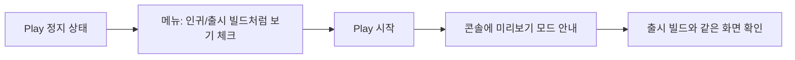

# 에디터 출시 빌드 미리보기 사용 안내

기준일: 2026-11-17 · 대상: 에디터에서 출시 빌드와 같은 화면을 확인하려는 기획자·개발자

## 목차

1. [무엇을 하는 기능인가](#1-무엇을-하는-기능인가)
2. [켜고 끄는 방법](#2-켜고-끄는-방법)
3. [꺼지는 테스트 기능](#3-꺼지는-테스트-기능)
4. [주의 사항](#4-주의-사항)

## 1. 무엇을 하는 기능인가

에디터 Play에서도 출시 빌드처럼 테스트 기능을 모두 끄고 실행합니다. 실행파일을 빌드하지 않고 출시 화면·저장 흐름을 확인할 때 사용합니다. 실제 빌드 결과에는 영향이 없습니다.

## 2. 켜고 끄는 방법

1. Play를 멈춥니다. Play 중에는 메뉴가 비활성입니다.
2. 상단 메뉴 **인귀 → 출시 빌드처럼 보기 (테스트 기능 끄기)** 를 누릅니다. 체크 표시가 켜짐 상태입니다.
3. Play를 시작하면 콘솔에 "출시 빌드 미리보기 모드입니다" 경고가 표시됩니다.
4. 다시 누르면 해제되고 다음 Play부터 테스트 기능이 돌아옵니다.

설정은 이 PC에만 저장되며 Git으로 다른 사람에게 전달되지 않습니다.

## 3. 꺼지는 테스트 기능

| 기능 | 미리보기 중 |
| --- | --- |
| F8 보스 시험창, H키 피격 | 동작 안 함 |
| F9 데이터 확인 화면 | 제거 |
| 플레이어 공격 판정 색 박스 | 숨김(판정은 그대로) |
| 수동 저장 화면, 타이틀 테스트 저장 선택, 테스트 초기화 | 제거 |
| Unity 오류 자동 팝업 | 동작 안 함 |
| 저장 | 출시용 저장(1칸, 별도 폴더) 사용 |
| 인귀/테스트 메뉴(이동·허수귀·처형·옹귀·키 배치 B·테스트 조절 창) | 비활성 |

## 4. 주의 사항

- 미리보기 중 저장은 출시용 폴더를 씁니다. 평소 테스트 저장(Demo)은 그대로 남아 있습니다.
- 플레이 통계에는 계속 개발용으로 기록됩니다.
- 최종 확인은 실제 실행파일로 합니다. 절차는 [GitHub 빌드와 디스코드 공지 사용 안내](GitHub%20빌드와%20디스코드%20공지%20사용%20안내.md)를 따릅니다. 설계는 [테스트와 정식 빌드 선택 설계](../개발자용%20설계문서/테스트와%20정식%20빌드%20선택%20설계.md#에디터-출시-빌드-미리보기--2026-11-17)를 봅니다.
