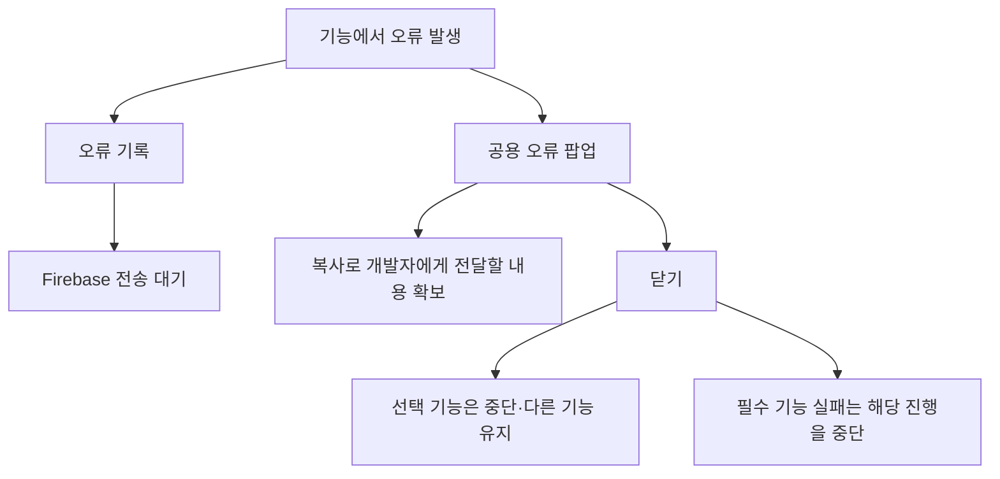

# 오류 안내와 기능 중단 확인 안내

기준일: 2026-11-13. 오류를 숨기지 않고 어떤 기능을 쓸 수 없는지 알려 주기 위한 안내입니다. 오류를 닫았다는 것은 문제가 해결됐다는 뜻이 아닙니다.

## 게임에서 보게 될 흐름

인터넷이 없으면 Firebase에 즉시 나타나지 않을 수 있습니다. 기존 로컬 보관·재전송 경로를 사용합니다. 수집이 꺼져 있거나 초기화에 실패한 경우까지 원격 도착을 보장하지는 않습니다. 통계 화면의 오류 조회법은 [통계 조회 안내](통계%20콘솔%20조회와%20엑셀%20다운로드%20안내.md)를 봅니다.

## 기획자가 준비할 문구

1. 기존 Language 탭에 새 안내문 ID를 준비합니다. 한국어 형식은 `오류가 발생하여 {0} 기능이 동작하지 않습니다.`입니다. `{0}`은 기능명이 들어가는 자리이므로 그대로 둡니다.
2. 영어 문구에도 `{0}` 자리를 유지합니다.
3. 기능명도 Language ID로 준비합니다. 예를 들어 ‘배경음 재생’처럼 사용자가 이해할 수 있는 이름을 씁니다. 클래스명이나 파일명은 넣지 않습니다.
4. 개발자에게 안내문 ID와 기능명 ID를 전달합니다. 개발자가 오류 경계에서 연결합니다. **시트에 행만 추가한다고 모든 기능에 자동 연결되는 것은 아닙니다.**
5. 기존 Popup 15007의 복사·닫기 구성을 재사용합니다. 기능마다 팝업 프리팹을 새로 만들 필요가 없습니다.

현재는 새 안내용 API와 정식 빌드 표시 기반을 준비했습니다. 새 문구 ID는 아직 추가하지 않았고 개별 기능의 안내 연결도 완료되지 않았습니다. 기존 일반 오류 문구는 계속 기존 ID를 사용합니다.

## 오류가 나면 확인할 것

| 확인 | 기대 결과 |
| --- | --- |
| 기능명 안내 | 어떤 기능이 중단됐는지 읽을 수 있음 |
| 복사 | 오류 상세를 복사할 수 있음 |
| 닫기 | 팝업의 입력 잠금이 풀림. 다른 창의 잠금은 유지 |
| 선택 기능 실패 | 맵·전투 등 관계없는 기능까지 멈추지 않음 |
| 필수 기능 실패 | 미완성 맵을 성공한 것처럼 진행하지 않음 |
| 오류 기록 | Firebase 오류 조회에서 빌드·시각·씬·상세 확인. 업로드 지연 가능 |
| 재진입·씬 이동 | 없어진 창이나 오브젝트에서 같은 오류가 계속 발생하지 않음 |

재현한 빌드 버전, 장면, 누른 버튼, 팝업 복사 내용과 반복 여부를 개발자에게 전달합니다. 서비스 계정 키나 로그인 토큰은 공유하지 않습니다. 실제 기기에서의 팝업 표시·입력 복귀·원격 도착 검증은 별도로 진행해야 합니다.

기능 분류와 개발 책임은 [필수 기능과 오류 처리 계약](../개발자용%20설계문서/필수%20기능과%20오류%20처리%20계약.md)에 모았습니다.
