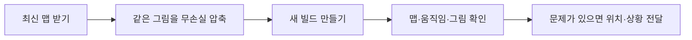

# 최신 맵과 리소스 압축 확인 안내

## 1. 이번 변경의 의미

최신 보스방 맵과 발판 점프 수정까지 `02d887c` 기준으로 반영했습니다. 그림을 작게 줄인 것이 아니라 같은 그림을 더 작은 PNG 파일로 보관하도록 압축했습니다. 맵 프리팹·애니메이션·이미지 연결은 유지했습니다.

이번에는 맵 PNG 467개를 점검해 203개를 추가 압축했습니다. 기존 작업을 포함해 최신 Git 원본보다 288개 파일이 작아졌으며 약 6.35MiB를 줄였습니다. 이 숫자가 최종 실행파일·GPU 메모리 감소량이라는 뜻은 아닙니다.

기획자가 시트·인스펙터 값을 바꿀 필요는 없습니다. Unity에서 이미지 반영이 끝나면 새 보스방 배경, 깃발·횃불·망루·지붕 불꽃 움직임과 발판 점프를 확인해 주세요. 이미지가 깨지거나 프레임이 빠지면 씬·오브젝트 이름과 화면을 개발자에게 전달해 주세요. 파일을 새 그림으로 교체하면 그 파일은 다시 압축 점검해야 합니다. 검증 수치와 전후 비교는 [개발자 문서](../개발자용%20설계문서/최신%20Git%20반영과%20코드·리소스%20개선%20비교.md)를 참고합니다.

## 2. 기획자·아트 담당자가 확인할 내용

| 확인 위치 | 확인할 내용 |
| --- | --- |
| 3번 맵 하늘·산·안개 | 줄무늬·색·투명도·반복 경계가 기존과 같은지 |
| 발판·구조물 | 그림과 충돌 위치·발 정렬이 어긋나지 않는지 |
| 새 화로·깃발·모닥불 등 | 프레임 누락·깜빡임·애니메이션 참조 누락이 없는지 |
| 일반 몬스터 이동 구간 | 기존과 같은 벽·낭떠러지에서 멈추는지 |
| 이전 맵 | 배경 색·테두리·알파 표현이 같은지 |

자동 검사에서는 압축 전후 영상 데이터와 메타데이터가 같은 것을 확인했습니다. 실제 새 맵 배치·움직임은 새 빌드에서 별도로 봐야 합니다. 화면 문제가 있다면 스테이지·위치·발생 상황을 개발자에게 전달합니다. 이미지를 다시 늘리거나 meta 파일을 삭제하지 않습니다.

## 3. 이미지를 교체할 때

기존과 같은 파일·meta를 유지하면 연결을 보존하기 쉽습니다. 아트 작업으로 이미지를 새로 내보낸 뒤에는 PNG 용량이 다시 커질 수 있으므로 개발자에게 재점검을 요청합니다. 픽셀 크기·슬라이스·피벗을 바꾸는 작업은 무손실 파일 압축과 다르므로 담당자와 확인합니다.

압축 도구는 기본적으로 점검만 하며 실제 반영은 개발자가 --apply로 수행합니다. 이번에는 화질 손실 압축·음원 재인코딩·텍스처 해상도 축소를 일괄 적용하지 않았습니다.

왜 바꿨는지와 전후 수치·검사 근거는 [개발자 비교 문서](../개발자용%20설계문서/최신%20Git%20반영과%20코드·리소스%20개선%20비교.md)를 참고합니다.
