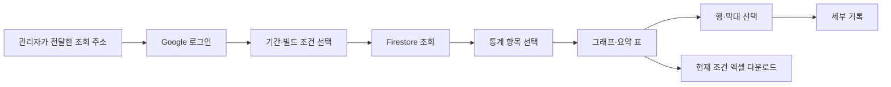
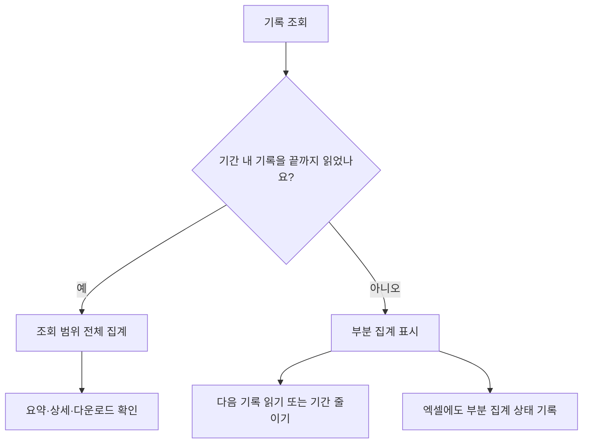

# 통계 콘솔 조회와 엑셀 다운로드 안내

## 목차

1. [무엇을 보는 화면인가요?](#1-무엇을-보는-화면인가요)
2. [처음 접속할 때](#2-처음-접속할-때)
3. [조회 조건을 정하는 순서](#3-조회-조건을-정하는-순서)
4. [전체 집계와 부분 집계](#4-전체-집계와-부분-집계)
5. [통계별 읽는 방법](#5-통계별-읽는-방법)
6. [엑셀로 받는 방법](#6-엑셀로-받는-방법)
7. [개발 중 로컬 확인](#7-개발-중-로컬-확인)
8. [문제가 생기면](#8-문제가-생기면)

## 1. 무엇을 보는 화면인가요?

게임에서 모은 기록을 사망 구간·재화·레벨·처치·경로 선택 등의 통계로 확인하는 화면입니다. 숫자 요약만 보는 것이 아니라 해당 항목을 선택해 개별 기록도 확인하고, 같은 조회 조건을 엑셀 파일로 받을 수 있습니다.

**2026-11-12 배포 완료:** [통계 화면 열기](https://humanghost-f85de.web.app). Google 로그인을 활성화하고 프로젝트 관리자 계정의 조회 권한을 등록했습니다. Firebase 웹 콘솔의 Firestore 문서 목록과 이 통계 화면은 다릅니다. 다른 팀원의 계정은 관리자가 따로 허용해야 합니다.

이미 로그인한 화면에서 ‘조회 권한 없음’이 남으면 새로고침한 뒤 Firestore 조회를 누릅니다. 현재 실서버 검사 기록은 deployment-check-20261112 버전의 session_start 한 개이며 사망·처치 통계로 보이지 않는 것이 정상입니다. 게임 플레이 자료는 원격 전송을 켠 새 게임 빌드에서 수집해야 합니다. 기존 실행파일은 자동으로 변경되지 않습니다.

## 2. 처음 접속할 때

1. 관리자가 전달한 Hosting 주소에 접속합니다. 배포 후 기본 주소는 프로젝트의 Hosting 설정에서 확인합니다.
2. Google 로그인을 누르고 팀에서 사용할 계정으로 로그인합니다.
3. ‘조회 권한이 없습니다’가 나오면 화면에 표시되는 Firebase 사용자 UID를 관리자에게 전달합니다. 비밀번호나 로그인 토큰은 전달하지 않습니다.
4. 관리자가 허용 계정으로 등록한 뒤 다시 로그인합니다. Google 로그인에 성공해도 통계 권한이 자동으로 생기지는 않습니다.

무료 Spark 요금제를 사용합니다. 이 화면이 Cloud Functions를 실행하거나 요금제를 올리지는 않습니다. Firebase 저장·읽기·Hosting의 무료 한도를 넘으면 이용이 제한될 수 있습니다.

## 3. 조회 조건을 정하는 순서

| 조건 | 의미와 사용 예 |
| --- | --- |
| 시작일·종료일 | 한국 시간 기준, 종료일 포함. 최대 31일 |
| 빌드 버전 | 비교할 실행파일 버전. 비워두면 전체 |
| 데이터 버전 | 같은 밸런스·데이터끼리 비교. unversioned는 미지정이므로 같다고 단정하지 않음 |
| 빌드 종류 | 테스트·정식 또는 전체 |
| 기록 형식 버전 | 기록 항목의 양식 버전. 플레이어 레벨이 아님 |

먼저 날짜를 좁게 정하고 Firestore 조회를 누릅니다. 기본 날짜는 오늘입니다. 이전 시연 기록이 없다면 날짜가 맞는지 먼저 확인하세요. 빌드·데이터·항목 변경은 이미 읽은 기록을 다시 집계하며 추가 읽기를 자동 수행하지 않습니다.

한 번에 500개, 한 조회에서 최대 5000개를 읽습니다. ‘다음 500개 읽기’가 활성화돼 있으면 추가 기록이 있을 수 있습니다. 더 읽거나 날짜 범위를 줄여 전체 집계를 확인합니다. 조회 버튼을 누를 때만 Firebase 읽기 할당량을 사용하고 상시 자동 새로고침하지 않습니다. 빌드 필터는 읽은 뒤 적용하므로 읽기 수를 줄이려면 날짜를 줄이는 것이 먼저입니다.

## 4. 전체 집계와 부분 집계

부분 집계는 전체 유저의 통계가 아닙니다. 읽은 기록 안에서만 계산한 값입니다. 5000개 한도에 도달했다면 날짜를 나누어 확인합니다. 기간을 넓히기만 하고 다시 조회하지 않은 경우도 전체 자료로 보지 않습니다. 여러 기간의 고유 세션 수를 단순 합산하면 중복될 수 있습니다.

## 5. 통계별 읽는 방법

| 항목 | 보는 내용 | 주의할 점 |
| --- | --- | --- |
| 사망 구간 | 스테이지별 사망 횟수·고유 세션·진입 대비 사망 세션 비율 | 한 세션의 반복 사망은 횟수에는 여러 번, 세션 수에는 한 번. 진입 기록이 없으면 분모 미제공 |
| 혼·엽전 수급 | 획득·소비·순증감 | 잔액 스냅샷은 획득량으로 더하지 않음 |
| 구간별 진입 레벨 | 어떤 레벨로 구간에 들어왔는지 | 현재 레벨 분포 전체가 아니라 진입 시점 기준 |
| 몬스터 처치 | 스테이지·종류별 처치 | 현재 보상 완료가 연결된 일반 몬스터 기준, 보스는 별도 연결 필요 |
| 아이템 획득·소비 | 획득 수량·많이 소비한 아이템 순위 | 현재 게임 아이템 이벤트 미연결이므로 기록이 없는 것이 정상 |
| 갈림길 선택 | 같은 갈림길에서 어느 경로를 몇 번 골랐는지·선택률 | 실제 선택 확정 이벤트 미연결. 도착 보상만으로 경로를 추정하지 않음 |
| 마지막 관측 구간 | 각 실행에서 마지막으로 들어간 스테이지 | 이탈·클리어 원인이 아님. 종료 기록 누락에는 강제 종료도 포함 |
| 오류 현황 | 같은 종류·문구·스택의 발생 수·영향 세션 | 로그가 없는 버그나 먹통은 자동 발견하지 못함 |

그래프는 상위 10개를 보여줍니다. 요약 표의 행이나 막대를 누르면 아래에 세부 기록이 표시됩니다. 화면에는 처음 100개를 보여주지만 엑셀은 현재 집계에 포함된 상세를 모두 담습니다. 통계 순위와 세부 기록의 발생 횟수·수량은 서로 구분합니다.

## 6. 엑셀로 받는 방법

1. 조회 기간·버전·통계 항목을 확정합니다.
2. 전체 집계인지 부분 집계인지 확인합니다.
3. ‘현재 조건 엑셀 다운로드’를 누릅니다. 실제 .xlsx 파일이 생성됩니다.
4. 파일의 ‘조회 조건’ 시트에서 기간·필터·자료 범위·부분 여부를 확인합니다.
5. ‘집계’ 시트에서 요약 통계를, ‘상세’ 시트에서 개별 기록을 확인합니다.

다운로드 때 Firestore를 다시 읽지 않고 현재 화면과 같은 자료를 사용합니다. 화면에서 항목 하나를 눌렀더라도 다운로드는 현재 통계 항목 전체의 집계와 상세를 담습니다. 특정 행만의 파일이 아닙니다.

## 7. 개발 중 로컬 확인

개발자는 프로젝트 루트에서 `npm --prefix Tools/TelemetryConsole ci`, `npm --prefix Tools/TelemetryConsole run dev`로 로컬 화면을 실행할 수 있습니다. 출력된 localhost 주소를 사용합니다. 기획자는 운영 주소를 받으면 이 설치 과정을 할 필요가 없습니다.

‘로컬 기록 확인’에서 statistics.jsonl·errors.jsonl 파일을 선택하면 Firebase 조회 없이 파일에 들어 있는 기록으로 집계할 수 있습니다. 날짜를 파일 기록 기간에 맞춰야 합니다. 로컬 파일을 선택하는 동작은 Firebase에 업로드하지 않습니다. 로컬 파일 전체를 읽었다는 뜻이지 전체 팀의 기록을 받았다는 뜻은 아닙니다.

게임 기록의 위치·수집 켜기/끄기는 [로컬 수집 안내](플레이%20통계%20수집과%20확인%20안내.md)를 참고합니다. 원격 전송은 Telemetry.json의 firebase.enabled를 별도로 켜야 하며, 운영 규칙·권한을 먼저 설정합니다. 이미 받은 빌드는 정책 파일을 Git에 올렸다고 자동 변경되지 않습니다.

## 8. 문제가 생기면

| 상황 | 확인할 내용 |
| --- | --- |
| Google 로그인 실패 | Google 제공자·허용 도메인·팝업 차단 여부를 관리자에게 전달 |
| 조회 권한 없음 | Firebase UID가 팀원 허용 목록에 있는지 확인 |
| 기록이 없음 | 기간·필터, 게임의 원격 전송 활성 여부, Pending 폴더의 미전송 기록 확인 |
| permission-denied | 권한·운영 규칙을 확인. 누구나 읽을 수 있게 규칙을 풀지 않음 |
| 부분 집계 | 다음 페이지를 읽거나 기간을 줄임 |
| 다운로드 실패 | 현재 항목과 오류 문구를 개발자에게 전달. 원본 기록은 삭제하지 않음 |

운영 배포와 개발자 연결 계약은 [Firebase 설계](../개발자용%20설계문서/Firebase%20통계%20인증·전송·조회%20설계.md)를 참고합니다.
