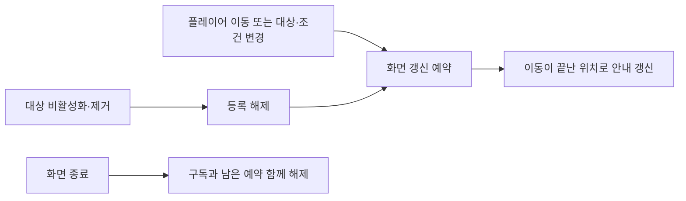

# 표시 갱신 최적화 확인 안내

## 1. 왜 확인하나요?

같은 글자를 계속 만들거나 끝난 연출을 다시 계산하던 부분을 줄였습니다. 이번 작업은 화면 해상도나 몬스터 수를 줄이는 작업이 아닙니다. 기획자가 새 테이블을 작성하거나 인스펙터에 새 기능을 연결할 필요는 없습니다. 기존 프리팹·화면·테이블을 그대로 사용합니다.

## 2. 순서대로 확인하기

| 순서 | 할 일 | 정상 결과 |
| --- | --- | --- |
| 1 | 플레이어·몬스터·보스의 체력을 줄이고 상태를 바꿉니다 | 체력·현재 상태·보스 페이즈가 바뀐 내용으로 표시됩니다 |
| 2 | 약초를 사용하고 스킬을 사용합니다 | 약초 개수와 스킬 남은 초가 갱신됩니다 |
| 3 | 피해 후 잠시 기다립니다. 반복 피해도 확인합니다 | 체력 잔상은 약 500ms 후 줄고 다시 피해를 받아도 잔상이 동작합니다 |
| 4 | 기력이 부족한 행동·피격·전투 진입과 종료를 확인합니다 | 점멸·피격 테두리·HUD 페이드가 끝까지 표시됩니다 |
| 5 | NPC·문·저장 지점 사이를 이동하고 상호작용합니다 | 가까운 사용 가능 대상의 문구가 나오고 E 입력 결과가 유지됩니다 |
| 6 | 대화를 열었다 닫습니다 | 대화 중 안내가 숨고 닫은 뒤 현재 위치에 맞는 안내가 다시 표시됩니다 |
| 7 | 몬스터를 마지막 타격으로 처치합니다 | 사망 색이 남고 마지막 섬광이 계속 남지 않습니다. 사망 연출도 유지됩니다 |
| 8 | 불길을 남기는 몬스터가 있는 설정에서 처치합니다 | 설정된 불길의 지속·피해 규칙이 유지됩니다. 불길이 없는 설정에서 새로 발생하면 안 됩니다 |
| 9 | 회피 판정으로 글자가 나오는 상황을 반복합니다 | 매번 새 위치에 글자가 표시되고 게임 진행 시간 약 600ms 후 사라집니다 |
| 10 | 맵 이동·사망 재시작·타이틀 복귀를 반복합니다 | 이전 회피 글자나 이름표 상태가 새 화면에 남지 않습니다 |

회피 표시의 대기 객체는 내부에서 재사용합니다. 기획자가 직접 회수하거나 저장할 필요가 없습니다. 표시 문구·피드백 프리팹을 바꾸는 기존 작업 방법은 같습니다.

## 3. 문제가 있다면 무엇을 전달하나요?

사용한 빌드의 커밋 또는 빌드 번호, 씬·스테이지, 직전에 한 행동, 기대한 표시와 실제 표시, 재현 순서, Console 첫 오류를 개발자에게 전달합니다. 데이터 수치나 프리팹을 임의로 줄여 현상을 숨기지 않습니다.

실제 후보 저사양 PC의 60FPS 확인은 별도입니다. 현재 PC에서 정상 표시된다는 사실과 최소 사양 검증 완료는 다릅니다. 해상도는 1920×1080을 유지하며 렌더링·리소스 변경은 이번 범위에 포함하지 않았습니다.

개발 책임과 기존 대비 차이는 [반복 갱신과 임시 표시 최적화 설계](../개발자용%20설계문서/반복%20갱신과%20임시%20표시%20최적화%20설계.md)에 정리되어 있습니다.

## 4. 변경 통지 방식에서 추가로 확인할 것

기획자가 이벤트나 등록소를 인스펙터에 새로 연결할 필요는 없습니다. 기존 NPC·문·명부·저장 지점 컴포넌트가 공통 기반을 상속하며 기존 조립자가 대상 묶음을 준비합니다.

1. 가만히 선 상태에서 저장 지점의 활성 조건을 기능으로 바꿉니다. 이동하지 않아도 안내가 바뀌어야 합니다.
2. 대상으로 다가갔다 멀어지고, 문·NPC가 비활성화됐다 다시 나타나는 상황을 확인합니다. 사라진 대상 안내가 남거나 중복 등록되면 안 됩니다.
3. 스킬을 해금하고 약초를 사용·복원합니다. 스킬 남은 초와 약초 개수가 바뀌어야 합니다.
4. 대화 중 화면을 닫았다 다시 열고, 맵을 왕복합니다. 이전 상태가 남지 않고 현재 값으로 표시되어야 합니다.
5. 플레이어가 멈춰 있어도 마지막 몬스터를 처치한 뒤 문 조건이 바뀌는지 확인합니다.

개발 중 Inspector에서 Transform을 직접 옮기는 동작은 게임의 이동 명령이 아닙니다. 움직이는 NPC·문·부모 오브젝트를 새 기능으로 만들 때에는 개발자가 변경 통지를 연결해야 합니다. 안내가 갱신되지 않으면 표 값을 임의로 바꾸지 말고 이동 기능 담당자에게 알려주세요. 기존 씬 배치는 실행 시작 시 현재 위치로 연결됩니다.
