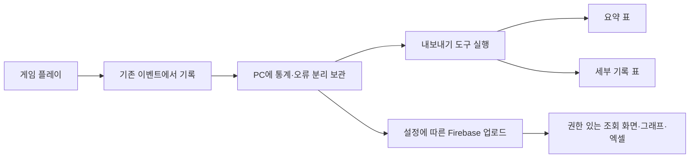

# 플레이 통계 수집과 확인 안내

## 목차

1. [무엇을 위한 기능인가요?](#1-무엇을-위한-기능인가요)
2. [지금 기록하는 항목](#2-지금-기록하는-항목)
3. [수집을 켜고 끄는 방법](#3-수집을-켜고-끄는-방법)
4. [기록을 확인하는 순서](#4-기록을-확인하는-순서)
5. [엑셀에서 볼 수 있는 표로 내보내기](#5-엑셀에서-볼-수-있는-표로-내보내기)
6. [확인 요청과 남은 작업](#6-확인-요청과-남은-작업)

## 1. 무엇을 위한 기능인가요?

어디에서 많이 죽는지, 혼·엽전이 얼마나 들어오고 나가는지, 어느 레벨에서 진행하는지 확인하기 위한 기록입니다. 게임 오류는 통계와 별도로 보관합니다. 이 문서는 로컬 보관·CSV 절차를 설명합니다. 후속 원격 전송·웹 통계·실제 엑셀 기능 코드는 준비했으며 운영 사이트와 규칙은 배포됐습니다. 현재 원격 수집은 활성화되어 새 게임 빌드부터 반영되며 실제 플레이 왕복 검증은 남아 있습니다. [통계 콘솔 조회 안내](통계%20콘솔%20조회와%20엑셀%20다운로드%20안내.md)를 따릅니다.



## 2. 지금 기록하는 항목

| 항목 | 확인할 수 있는 내용 |
| --- | --- |
| 사망 | 스테이지·위치·당시 레벨. 사망 원인·공격자는 아직 제공되지 않음 |
| 재화 | 진입 때 잔액, 혼·엽전 증감·잔액. 소비 이유는 아직 제공되지 않음 |
| 레벨 | 진입 레벨·경험치, 레벨업 전후 |
| 일반 몬스터 | 보상 지급이 완료된 몬스터 종류·배치별 처치 |
| 진행 | 스테이지·씬 진입과 종료 |
| 갈림길 선택 | 갈림길·선택 경로·목적지·당시 레벨의 기록 틀과 경로별 집계 준비. 실제 선택 이벤트는 아직 미연결 |
| 오류 | 오류 문구·스택·씬, 같은 오류의 발생 수·영향 실행 수 |
| 아이템 | 틀만 준비. 실제 획득·소비는 아직 수집하지 않음 |

진행 종료가 곧 클리어는 아닙니다. 사망·타이틀 이동·종료도 있을 수 있습니다. 종료 기록이 없다고 이탈로 확정하지도 않습니다. 강제 종료나 전원 중단이면 기록이 남지 않을 수 있습니다. 보스 처치·세부 구간별 통과율은 아직 연결 범위 밖입니다.

## 3. 수집을 켜고 끄는 방법

갈림길에서는 ‘어느 갈림길에서 어느 경로를 선택했는지’를 별도로 기록할 예정입니다. 갈림길 ID·경로 ID·목적지 스테이지 ID를 개발자에게 전달하고 선택 확정 이벤트가 연결된 뒤 확인합니다. 갈림길 도착 보상을 받았다는 사실만으로 선택을 기록하지 않습니다. route_selected는 해당 수집 정책 이름이며, 현재 정책이 켜져 있어도 실제 선택 기능이 연결되기 전에는 기록이 생기지 않습니다. 연결 후 요약 표에서 junction_id·route_id·destination_stage_id로 경로별 횟수와 세션 수를 확인하고 상세 표에서 개별 선택을 확인합니다.

원본 정책은 `Assets/StreamingAssets/Telemetry.json`입니다. 새 테이블이나 Inspector 필드를 만들 필요가 없습니다.

1. 전체 수집은 맨 위 enabled를 true 또는 false로 지정합니다.
2. 에디터 Play에서도 확인하려면 includeEditor를 true로 바꿉니다. 기본은 false이며 실행파일에서는 수집합니다.
3. 특정 항목만 끄려면 events 안의 해당 항목 enabled를 false로 바꿉니다. 삭제해도 기록하지 않습니다.
4. fields는 기록할 필드 목록입니다. 기존 제공 필드를 목록에서 빼면 기록에서 제외됩니다.
5. 변경 후 다시 실행합니다. 이미 실행 중인 게임에는 자동 반영하지 않습니다. 배포하려면 정책 파일을 Git에 올리고 새 빌드를 만듭니다.

예를 들어 currency_changed의 enabled를 false로 하면 재화 증감 수집이 꺼집니다. currency_snapshot은 진입 잔액 기록이므로 따로 제어합니다. 이름을 임의로 바꾸거나 새 이름만 추가해도 새로운 게임 이벤트가 생기는 것은 아닙니다. 신규 수집 정보는 개발자에게 연결을 요청해 주세요. 아이템 항목은 공급 기능 연결 전까지 꺼둡니다.

dataVersion은 데이터 배포 구분 이름입니다. 현재 unversioned는 미지정입니다. 데이터 버전을 실제로 지정하지 않았다면 데이터가 같은 것으로 판단하면 안 됩니다. version은 해당 수집 항목의 기록 양식 버전이며 게임 레벨이 아닙니다. 의미·단위를 바꿀 때는 개발자와 협의해 올립니다.

capacity·batchSize·maxLocalBytes는 기록 보관 한도입니다. 기본 512개·32개·20MiB이며 성능·누락에 영향을 주므로 담당 개발자와 조정합니다.

## 4. 기록을 확인하는 순서

Windows 실행파일의 기본 위치는 `%USERPROFILE%/AppData/LocalLow/DefaultCompany/Human_Ghost/Telemetry`입니다. 회사명·게임명이 바뀌면 경로도 바뀝니다. 주소 표시줄에 붙여 넣어 열 수 있습니다.

- statistics.jsonl: 플레이 기록
- errors.jsonl: 오류 기록. 오류가 없으면 아직 파일이 없을 수 있습니다.
- anonymous-id.txt: 무작위 설치 식별자. 계정 정보가 아니며 삭제하면 다음 실행부터 다른 식별자가 됩니다.

한 묶음이 쌓이거나 사망·오류·씬 종료·앱 일시정지·정상 종료 때 보관합니다. 테스트 후 정상 종료하면 남은 기록을 확인하기 쉽습니다. 강제 종료하면 메모리의 기록 일부가 사라질 수 있습니다. 기록 한도에 도달하면 새 기록을 보관하지 못하므로 무손실 수집으로 생각하면 안 됩니다. 이전 기록은 자동 삭제하지 않습니다.

## 5. 엑셀에서 볼 수 있는 표로 내보내기

Python이 설치된 개발 PC의 프로젝트 루트에서 실행합니다. 프로그래밍이 익숙하지 않으면 개발자에게 기록 폴더를 전달하고 아래 도구 실행을 요청하세요.

```powershell
python Tools/Telemetry/Export-Telemetry.py "$env:USERPROFILE/AppData/LocalLow/DefaultCompany/Human_Ghost/Telemetry" "$env:TEMP/HumanGhostTelemetryReport"
```

결과 폴더에는 statistics-summary.csv·statistics-details.csv·errors-summary.csv·errors-details.csv가 생성됩니다. 앞의 파일은 요약, 뒤의 파일은 개별 기록입니다. 엑셀에서 열 수 있습니다. 실제 .xlsx 다운로드 코드는 [별도 조회 화면](통계%20콘솔%20조회와%20엑셀%20다운로드%20안내.md)에 준비했고 운영 사이트와 규칙은 배포됐습니다. 현재 원격 수집은 활성화되어 새 게임 빌드부터 반영되며 실제 플레이 왕복 검증은 남아 있습니다. 같은 출력 폴더로 다시 실행하면 결과 표를 덮어씁니다. 원본 기록은 바꾸지 않습니다.

특정 버전만 보려면 명령 끝에 `--build "0.1.빌드번호"` 또는 `--data-version "데이터버전"`을 붙입니다. 표의 Count는 이벤트 수, TotalDelta는 재화 증감 합계, TotalQuantity는 아이템 수량 합계, SessionCount는 해당 그룹에 포함된 실행 수입니다. 진입 잔액을 획득량으로 더하지 마세요. 위치는 한 타일을 1,000,000으로 나타낸 정수입니다. 오류 표의 ErrorKey는 같은 종류·문구·스택을 묶는 값입니다.

## 6. 확인 요청과 남은 작업

기록이 없다면 정책 enabled·includeEditor, 정상 종료 여부와 저장 경로를 확인합니다. 파일이 한도에 도달하거나 저장 권한이 없으면 개발자에게 전달합니다. 로그 없는 게임 버그·먹통은 자동 발견되지 않으므로 별도로 제보해야 합니다.

후속 인증·전송·웹 집계·xlsx 코드는 준비했지만 실제 Firebase 로그인·규칙·권한·사이트 배포는 남아 있습니다. 무료 구성에서 별도 Cloud Functions 수신 API는 사용하지 않습니다. 이 작업 때문에 게임의 레벨·재화·저장 규칙이 바뀌지는 않습니다. 자세한 연결 경계는 [개발자 설계](../개발자용%20설계문서/플레이%20통계와%20오류%20수집%20설계.md)를 참고합니다.
