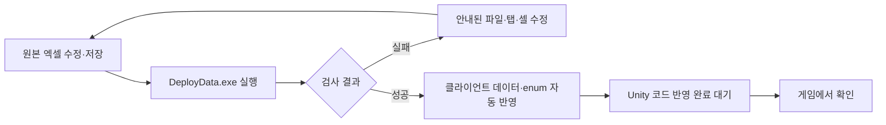
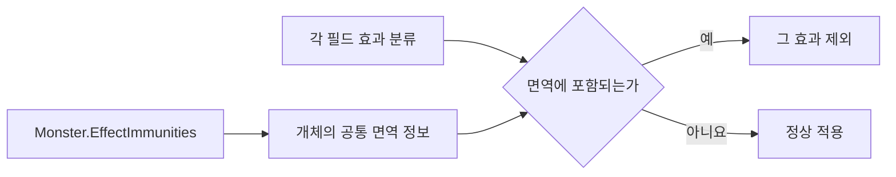

# 필드 효과와 enum 시트 사용 안내

기준일: 2026-11-13. 잔불·얼음의 수치와 위치, 몬스터 면역, 코드에서 공통으로 쓰는 enum을 관리하는 방법입니다. 현재는 데이터·코드 연결과 자동 검사를 준비한 상태이며 실제 게임의 자리·접촉은 아래 순서로 확인해야 합니다.

## 목차

1. [어떤 파일을 고치는가](#1-어떤-파일을-고치는가)
2. [잔불과 얼음 설정](#2-잔불과-얼음-설정)
3. [배치하는 방법](#3-배치하는-방법)
4. [면역은 몬스터 쪽에서 한 번만 관리](#4-면역은-몬스터-쪽에서-한-번만-관리)
5. [enum 시트는 무엇인가](#5-enum-시트는-무엇인가)
6. [실제 확인 순서](#6-실제-확인-순서)

## 1. 어떤 파일을 고치는가

| 하고 싶은 일 | 원본 파일·탭 | 고칠 내용 |
| --- | --- | --- |
| 불 피해·간격 변경 | tables/FieldObject.xlsx → FieldObject | Damage·TickMs |
| 얼음 넉백 거리 배율 변경 | 같은 탭 | KnockbackRate |
| 영역 추가·이동 | 같은 파일 → FieldObjectPlacement | StageID·PlacementID·X·Y·Width |
| 몬스터의 특정 효과 면역 변경 | tables/Monster.xlsx → Monster | EffectImmunities |
| 효과 종류의 코드 이름·입력 키 관리 | tables/Enum.xlsx → EnumDefinition | EnumName·Key·Value·SheetKey |

클라이언트의 CSV나 생성 enum C#를 직접 고치면 다음 배포에 덮어씁니다. **원본 엑셀을 수정하고 저장한 뒤 DeployData.exe를 실행**합니다. 기존 README·1~5행 규칙과 6행 컬럼 구조를 유지하고 실제 행은 7행부터 작성합니다. 새 규칙 탭을 따로 만들 필요는 없습니다.

일반 데이터 클래스는 기존 파일을 보존합니다. **enum 파일만 매번 갱신**합니다. 일반 클래스 컬럼을 추가했다면 개발자가 기존 C# 정의도 맞춰야 하며, 검사 오류를 무시하고 복사하지 않습니다.

## 2. 잔불과 얼음 설정

잔불은 Kind를 `FIRE_STATIC`으로 사용합니다. Damage는 한 번의 피해량, TickMs는 피해 사이의 시간입니다. 예를 들어 Damage 5·TickMs 1000이면 닿을 때 한 번, 계속 접촉하면 1초마다 피해를 요청합니다. 나오면 바로 끝나고 몸에 남는 화상은 없습니다. 구르기 등 기존 무적 중에는 피해를 받지 않습니다. 살아 있는 동안 필드 피해 때문에 공격이 취소되거나 피격 경직이 새로 생기지 않습니다.

얼음은 Kind를 `ICE`로 사용합니다. KnockbackRate는 분모 10000의 배율입니다. 20000은 거리 2배입니다. 현재 SlideDistance·TurnMs는 0으로 둡니다. 걷기·달리기·점프·구르기 거리를 변경하지 않습니다. 넉백을 받는 순간 거리를 확정하며 얼음 밖으로 나가도 그 거리를 다시 줄이지 않습니다. 벽에 막히면 이동은 멈춥니다.

같은 얼음 영역이 겹치면 배율을 서로 곱하지 않고 가장 높은 배율 하나를 사용합니다. 다른 중첩 규칙이 필요하면 개발자에게 먼저 요청합니다.

ContentEnabled가 N인 종류의 배치는 생성하지 않습니다. 보류 중인 종류를 Y로 바꾸면 아직 실행 코드가 없으므로 배포 검사가 중단될 수 있습니다.

## 3. 배치하는 방법

1. StageID에는 Stage 표의 맵 ID를 적습니다.
2. PlacementID에는 **해당 맵 spawn JSON의 플랫폼 배치 번호**를 적습니다. 플랫폼 종류 ID나 프리팹 이름이 아닙니다.
3. FieldObjectID에는 적용할 잔불·얼음 정의 ID를 적습니다.
4. X·Y는 해당 플랫폼 기준이며 단위는 칸×100입니다. X는 영역의 왼쪽 끝입니다.
5. Width는 오른쪽으로 덮을 너비입니다. 양의 정수를 입력합니다.

최신 산길 첫 잔불 22001은 X=2100, Y=200, Width=600입니다. 플랫폼 기준 왼쪽에서 21칸 지점부터 오른쪽으로 6칸, 높이 2칸입니다. 초기 Y=0에서 언덕 윗면에 맞게 바뀌었으므로 이전 값을 복원하지 않습니다. GuideFireID는 보류 기능이므로 이번 빌드에서는 연결하지 않습니다. 맵 전체에 앵커를 새로 만드는 작업은 필요하지 않습니다.

현재 활성 배치는 산길 잔불 2곳과 협곡 얼음 3곳입니다. 최신 원본 위치를 배포하며, 실제 지형과 맞지 않으면 FieldObjectPlacement 값을 수정합니다. 확인용 표시는 불은 주황색, 얼음은 흰색에 가까운 푸른 영역입니다. 전용 불 애니메이션·소리·이펙트 자산 연결 완료를 뜻하지 않습니다.

## 4. 면역은 몬스터 쪽에서 한 번만 관리

| 입력 예 | 뜻 |
| --- | --- |
| 빈칸 | 효과 면역 없음 |
| FIRE | 불 효과만 면역 |
| ICE | 얼음 효과만 면역 |
| FIRE,ICE | 두 분류 모두 면역 |

현재 불붙은 허수귀는 Monster 3003 행에 FIRE를 지정했습니다. 이 몬스터는 불 피해를 받지 않지만 얼음 넉백 보정은 받습니다. 필드마다 면역 몬스터 ID를 반복 입력하지 않습니다. 기본 공격까지 무적이 되는 설정이 아닙니다.

## 5. enum 시트는 무엇인가

enum은 코드에서 사용하는 **정해진 종류의 이름과 정수값 목록**입니다. 예를 들어 시트의 FIRE를 코드의 Fire라는 종류로 해석하는 기준입니다.

| 컬럼 | 뜻 | 예 |
| --- | --- | --- |
| ID | 행의 고유 번호 | 다른 행과 겹치지 않게 입력 |
| EnumName | 종류를 묶는 이름 | EffectCategory |
| Key | 코드에서 쓰는 이름 | Fire |
| Value | 그 항목의 고정 정수값 | 1 |
| SheetKey | 다른 시트에서 입력하는 키 | FIRE |
| Note | 설명용, 추출 제외 | 필요할 때 설명 |

EnumName·Key·SheetKey는 영문·숫자·밑줄로 쓰고 공백을 넣지 않습니다. 같은 EnumName 안에서 Key·Value·SheetKey는 중복되면 안 됩니다. **행을 정렬해도 Value는 바꾸지 않습니다. 기존 항목의 이름·값을 바꾸거나 재사용하기 전 개발자와 협의합니다.** 사용 중인 항목을 삭제하면 코드 참조 검사나 Unity 컴파일에서 중단될 수 있습니다.

현재 EffectExecution·EffectOperation·EffectCategory·FieldKind·EffectPhase·StatusEffectKind를 관리합니다. 기존 캐릭터 상태의 StateKey는 기존 State 탭을 계속 사용합니다. 같은 항목을 EnumDefinition에 다시 만들지 않습니다.

새 enum 행을 추가하면 코드 이름은 생성되지만 새로운 게임 기능까지 자동 구현되지는 않습니다. 예를 들어 독이라는 새 분류나 번지는 불의 동작을 추가하려면 개발자의 실행 연결이 필요합니다. 기존 잔불의 피해량이나 위치만 바꿀 때는 enum을 수정할 필요가 없습니다.

## 6. 실제 확인 순서

| 확인할 행동 | 기대 결과 |
| --- | --- |
| 불 영역 진입 | 무적이 아니면 즉시 피해 |
| 그대로 머무르기 | 설정한 간격으로 피해 |
| 빠져나와 기다리기 | 추가 피해 없음 |
| 다시 진입 | 즉시 피해부터 새로 시작 |
| 불 면역 몬스터 접촉 | 불 피해 없음 |
| 얼음 위에서 유효한 돌진 공격에 맞기 | 설정 배율의 넉백 거리 |
| 얼음 밖에서 같은 공격에 맞기 | 기본 거리 |
| 밀리는 중 얼음에서 벗어나기 | 처음 확정한 거리 유지 |
| 저장 복원·로딩 중 | 준비가 끝나기 전 필드 피해 없음 |
| 사망·맵 이동·재진입 | 이전 피해 예약이나 보정이 남지 않음 |

패링·회피·무적 성공 시 넉백이 발생하면 개발자에게 알려 주세요. 현재 일반몹이 플레이어에게 주는 넉백 경로를 연결했습니다. 몬스터 자신을 밀어내는 별도 공격은 추가 연결이 필요합니다. 문제를 전달할 때 맵·배치 ID, 몬스터 ID, 수정값, 실제 행동과 오류 로그를 함께 알려 주세요.

기술 구조와 확장 범위는 [개발자 설계](../개발자용%20설계문서/필드%20효과%20상태와%20enum%20배포%20설계.md)에 따로 정리했습니다.
