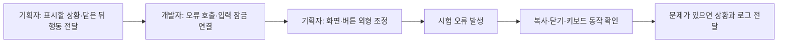
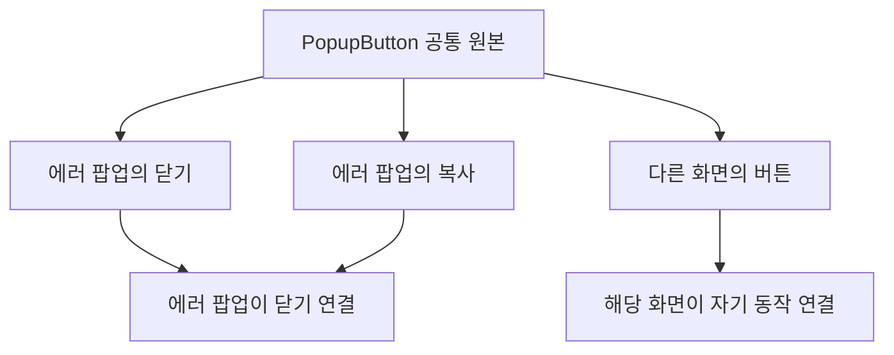

# 기획자용 에러 팝업 사용 안내

2026-11-05. Unity를 처음 사용하는 기획자도 연결 준비·외형 편집·동작 확인을 구분할 수 있도록 설명합니다. **지금은 독립 팝업 모듈과 프리팹이 준비된 상태입니다. 프리팹을 놓기만 하면 모든 오류에 자동으로 뜨는 기능은 아닙니다.** 최초 기능 연결은 개발자가 담당합니다.

## 1. 왜 사용하는 화면인가요?

사용자에게는 ‘에러가 발생했습니다.’라는 간단한 안내를 보여주고 개발자는 Unity Console에서 상세 원인을 확인합니다. 같은 팝업을 저장·로딩·컷씬 등에서 재사용하기 위한 구조입니다. 현재는 새 기획의 복사·닫기 두 버튼입니다. 복사는 오류 내용을 클립보드에 넣고 창을 유지하며, 닫기는 창을 닫습니다. 실패한 작업을 성공 처리하거나 자동 재시도하지 않습니다.



## 2. 용어와 파일부터 확인하세요

| 용어 | 쉬운 설명 |
| --- | --- |
| Project 창 | 프로젝트 파일을 찾는 창 |
| Hierarchy 창 | 현재 씬에 놓인 오브젝트 목록 |
| Inspector 창 | 선택한 대상의 그림·위치·기능 참조를 보는 창 |
| 프리팹 | 여러 곳에서 재사용할 수 있는 오브젝트 원본 |
| 호스트 | 팝업을 만들고 입력·로그를 연결하는 담당 컴포넌트 |
| EventSystem | UI의 클릭과 선택을 전달하는 Unity 입력 담당 |
| Console | 상세 오류 로그가 표시되는 창 |

Project 창에서 Assets → 2.Model → Prefabs → UI 폴더로 이동합니다.

| 파일 | 용도 | 언제 사용하나요? |
| --- | --- | --- |
| ErrorPopupHost.prefab | 오류 호출·화면 생성·입력 연결 담당 | 개발자가 실제 씬/기능에 연결할 때 |
| ErrorPopupScreen.prefab | 팝업 바탕·문구·복사·닫기 버튼 원본 | 기획자가 외형을 편집할 때 |
| PopupButton.prefab | 오류 전용 동작이 없는 공용 버튼 | 다른 화면에도 버튼을 사용할 때 |

## 3. 씬에 연결하는 순서

### 3.1. 기획자가 준비할 일

1. 팝업을 사용할 씬과 상황을 정합니다. 예: ‘맵 로딩 실패 때 표시’입니다.
2. 닫기 버튼으로 닫은 뒤 어디로 돌아가야 할지 개발자에게 전달합니다. 팝업만 닫기·타이틀 복귀·재시도는 서로 다른 요구입니다.
3. 개발자와 배치 담당을 정한 뒤 ErrorPopupHost.prefab을 Project 창에서 씬의 Hierarchy로 끌어 놓습니다. 이미 있다면 중복으로 놓지 않습니다.
4. 생성된 ErrorPopupHost를 선택하고 Inspector의 Error Popup Host 컴포넌트를 봅니다.
5. 아래 두 참조가 프리팹 기본값으로 연결돼 있는지 확인합니다. None이면 개발자에게 전달합니다.

| Inspector 항목 | 연결할 원본 |
| --- | --- |
| Prefab | ErrorPopupScreen 프리팹의 ErrorPopupScreen 컴포넌트 |
| Input | Assets/10.Input/InputSystem_Actions.inputactions |
| 에러 알림 팝업 ID | 15007 |

입력 잠금으로 함께 꺼지는 오브젝트 아래에 호스트를 넣으면 팝업까지 꺼질 수 있습니다. 부모 위치는 개발자와 확인합니다. 사용하지 않는 팝업 화면을 따로 씬에 중복 배치할 필요는 없습니다. 호스트가 처음 필요할 때 만들고 재사용합니다.

### 3.2. 개발자가 반드시 연결할 일

이 단계는 Inspector에서 그림을 드래그하는 것만으로 끝나지 않습니다.

| 연결 | 필요한 이유 |
| --- | --- |
| 기존 씬 EventSystem·데이터 저장소·언어코드를 전달하고 Initialize 호출 | 팝업이 어느 UI 입력 담당을 사용할지 지정 |
| 팝업 동안 뒤쪽 메뉴·게임 입력 잠금·일시정지 연결 | 확인을 눌렀을 때 뒤쪽 메뉴나 공격이 함께 실행되지 않게 함 |
| 실제 실패 경계의 Report 또는 Unity 오류 로그 연결 | Error·Exception·Assert 자동 수집과 명시적 보고의 적용 지점 결정 |
| 닫힌 뒤의 후속 처리 | 실패한 로딩·저장을 안전하게 중단하거나 복귀 |

기존 EventSystem을 임의로 하나 더 만들지 않습니다. Report는 예외 정보를 받는 코드 API이므로 일반 Button의 Inspector On Click 목록에 함수를 넣는 방식으로 오류 연결을 대신할 수 없습니다. 개발자 API와 예시는 [설계 문서](공용%20에러%20팝업%20설계.md)의3절을 참고합니다.

### 3.3. 개발자에게 그대로 전달할 요청 예시

> 이 씬의 맵 로딩 실패에 공용 에러 팝업을 연결해 주세요. 상세 오류는 Console에 남기고 화면에는 Popup15007의 문구와 진단 요약을 보여주세요. 팝업 동안 뒤쪽 입력을 막아주세요. 닫은 뒤에는 실패한 맵을 계속 진행하지 않고 타이틀로 돌아가게 해주세요. 실제 파일을 손상시키지 않고 확인할 수 있는 시험 오류 호출도 준비해 주세요.

위 ‘타이틀 복귀’는 요청 형식의 예시이며 현재 구현된 자동 동작이 아닙니다. 실제 상황에 맞게 후속 행동을 정합니다.

## 4. 팝업 외형을 수정하는 방법

1. Play를 끕니다. 실행 중 인스턴스를 편집하면 원본에 저장되지 않을 수 있습니다.
2. Project 창의 ErrorPopupScreen.prefab을 더블클릭해 프리팹 편집 화면을 엽니다.
3. 아래 구조에서 바꿀 대상을 선택합니다.

```text
ErrorPopupScreen                처음에는 비활성 유지
├─ ModalBackdrop                뒤쪽 클릭 차단·어두운 배경
└─ Panel                        팝업 바탕
   ├─ Message                   시트 본문 + 진단 요약
   ├─ CopyStatus                복사 완료 안내
   ├─ CloseButton               닫기 / 공용 버튼 인스턴스
   │  └─ Label
   └─ CopyButton                복사 / 공용 버튼 인스턴스
      └─ Label
```

| 바꿀 내용 | 선택할 대상·Inspector |
| --- | --- |
| 바탕 그림·색 | Panel의 Image → Source Image·Color |
| 팝업 크기·위치 | Panel의 RectTransform → 크기·위치 |
| 안내 글자 크기·색 | Message의 Text |
| 버튼 그림 | 각 버튼의 Image |
| 버튼 크기·위치 | 각 버튼의 RectTransform |
| 버튼 글자 | 각 버튼 아래 Label의 Text |

Message·Copy Label·Close Label·Status·Close·Copy 스크립트 참조를 비우거나 Button/Text 컴포넌트를 삭제하지 않습니다. ModalBackdrop은 뒤쪽 클릭을 막는 용도이므로 임의로 제거하지 않습니다. 화면 루트의 처음 비활성 설정도 유지합니다.

현재 본문·버튼은 Popup15007과 Language30209~30212·30214를 읽습니다. 프리팹에 직접 바꾼 문구는 실행 시 시트 값으로 교체됩니다. 상세 요약은 코드가 붙이며 로그 원문 전체를 기획자가 수동 입력하지 않습니다.

## 5. 버튼을 다른 화면에서 재사용하기



다른 화면에 PopupButton.prefab을 끌어 놓고 라벨·크기·위치를 해당 화면에 맞게 바꿉니다. 클릭 후 무엇을 할지는 그 화면 담당 개발자가 연결합니다. 공용 원본 자체에 오류 전용 닫기 함수를 저장하지 않습니다.

공용 원본 모양을 바꾸면 사용하는 다른 화면도 영향을 받습니다. 에러 팝업의 닫기만 바꿀 때는 해당 중첩 인스턴스를 수정하고, 공용 원본으로 변경을 적용하기 전에는 담당자와 확인합니다. X의 실제 오브젝트 이름은 영문으로 유지하며 화면 글자는 교체할 수 있습니다.

## 6. 연결 후 직접 확인할 순서

먼저 개발자가 준비한 시험 오류 발생 방법을 확인합니다. 개발자가 호스트 초기화·뒤쪽 입력/일시정지 연결을 마친 뒤에는 아래 Inspector 메뉴로 시험할 수 있습니다. 시험 전용 키는 없습니다.

1. 대상 씬에서 Play를 켭니다. Hierarchy의 연결된 ErrorPopupHost를 선택합니다.
2. Inspector의 Error Popup Host 컴포넌트 제목줄 메뉴에서 **테스트 → 자동 오류 수집 확인**을 실행합니다. 클릭 위치를 찾기 어렵다면 컴포넌트 제목줄을 오른쪽 클릭합니다. 이 메뉴는 Unity 에디터에서만 제공됩니다. 초기화 전이면 연결 안내 경고만 표시됩니다.
3. 이후 아래 항목을 확인합니다.
2. ‘오류가 발생했습니다’와 종류·횟수·메시지·스택3줄·씬·State·시각·기록 파일 위치가 보이는지 확인합니다. State는 개발자가 전달해야 합니다.
3. 복사를 누르고 메모장에 붙여넣어 현재 팝업 내용과 일치하는지 확인합니다. 창은 유지되고 ‘복사했습니다’가1500ms 표시돼야 합니다.
4. 닫기와 Esc/패드 취소로 각각 창을 닫습니다. 처음 키보드 선택은 복사입니다. Enter/C/패드 결정은 선택한 버튼을 실행합니다.
5. 바깥 클릭으로는 닫히지 않고 뒤 메뉴·플레이어가 반응하지 않는지 확인합니다. 일시정지까지 연결됐는지는 개발자와 확인합니다.
6. 열린 상태에서 다른 시험 오류를 발생시키고 창이 하나인 채 최신 요약과 누적 횟수로 갱신되는지 확인합니다. 원본 오류는 Console에 각각 남아야 합니다.
7. 한국어·영어 확인은 개발자가 언어코드로 초기화하거나 닫힌 상태에서 Configure를 호출해 준비합니다. 실제 옵션 언어 선택 버튼은 아직 없습니다.
8. 열린 상태에서 씬 종료·호스트 비활성화를 시험하고 입력·구독이 남지 않는지 확인합니다.

이 문서 작성 때 실제 Unity 화면 검사는 수행하지 않았습니다. 코드 컴파일 통과와 실제 클릭·그림·입력 통과를 구분합니다.

## 7. 열리지 않거나 이상할 때

| 증상 | 기획자가 확인·전달할 것 |
| --- | --- |
| 호스트를 놓았는데 오류 팝업이 안 나옴 | 개발자가 초기화와 해당 실패 지점의 Report를 연결했는지 확인 |
| None 또는 Missing Script가 보임 | 원본 프리팹·스크립트가 함께 반영됐는지 확인. 임의로 다른 스크립트를 연결하지 않음 |
| 화면은 보이는데 클릭이 안 됨 | 기존 EventSystem의 활성 상태와 입력 연결을 개발자에게 전달 |
| 팝업 뒤에서 공격·메뉴가 반응함 | 입력 잠금 연결 누락 가능성. 발생 입력과 상황 전달 |
| 닫은 뒤 게임이 진행되지 않음 | 실패 작업의 안전한 중단 상태일 수 있음. 의도한 복귀 동작과 실제 결과 비교 |
| 오류가 여러 번인데 팝업은 하나 | 정상적인 중복 표시 방지인지 Console의 개별 로그로 확인 |
| 영어 선택이 없음 | 현재 언어 선택 화면은 후속. 오류가 아님 |

## 8. 상세 로그를 전달하는 방법

Unity 메뉴 Window → General → Console을 엽니다. 오류 항목을 선택하고 상세 내용을 복사해 개발자에게 전달합니다. 일반 안내 화면만 보내면 원인 파악에 부족합니다.

```text
사용한 빌드 또는 커밋:
실행한 씬:
오류 직전 행동:
복사 / 닫기 / 키보드 중 사용한 입력:
닫은 뒤 실제 결과:
Console의 상세 오류:
```

Firebase·메일 자동 전송은 아직 연결하지 않았으므로 현재는 직접 전달합니다.

## 9. 언어 지원의 현재 범위

현재 본문과 버튼은 시트의 한국어·영어를 연결했습니다. LanguageCode는 Korean=0·English=1 두 값만 준비돼 있습니다. 언어 선택 버튼·선택 저장·추가 언어는 이번 범위가 아닙니다.

Popup15007이 본문30209·복사30210·닫기30211을 참조합니다. 기록 파일30212·복사 안내30214도 사용합니다. 기획자는 해당 Language 행을 수정하고 DataSheet 배포 도구를 실행합니다. 임의로 새 ID·열·번역을 추가해 바로 동작한다고 보지 않습니다. 일본어·만다린·프랑스어 등은 아직 확정된 지원 언어가 아닙니다.

## 현재 연결 범위

초기화된 에디터/개발 빌드 호스트는 Exception·Error·Assert를 자동 수집합니다. 일반 로그·경고는 팝업을 띄우지 않습니다. F9 기록·부스 구석 표시·출시 제외 전체 정책은 별도 구현 전입니다. 시트의 비고 전체가 이번 데이터 연결만으로 자동 실행되는 것은 아닙니다. 개발자가 Report를 호출하는 오류 경계와 빌드 정책을 연결해야 합니다.

## 자동 수집이 안 될 때 추가 확인

Inspector의 **테스트 환경 Unity 오류 자동 수집**이 켜져 있고, 개발자가 기존 EventSystem·데이터 저장소·입력/일시정지 콜백으로 Initialize를 호출했는지 확인합니다. 프리팹 배치만으로 이 초기화가 자동 완료되지는 않습니다. 테스트 오류는 Console에도 남습니다. 확인용 오류는 실제 버그와 구분해 전달합니다.

오류가 매우 많이 나오면 모든 오류를 새 창으로 쌓지 않고 최신 요약과 누적 횟수로 합쳐 보여줍니다. 호스트가 비활성화된 뒤 예전 오류가 새 씬에 떠서는 안 됩니다. 팝업 자체 표시 실패 때는 수집을 중지할 수 있으므로 Console을 확인해 주세요.

개발자는 같은 예외에 Debug.LogException과 Report를 연이어 호출하지 않습니다. Report가 원본 기록을 포함하며, 수집된 로그는 다시 기록하지 않습니다. 자동 수집된 팝업을 닫는 것은 오류 복구 완료를 뜻하지 않습니다.
