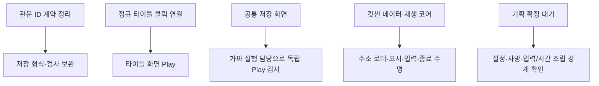
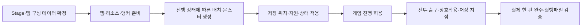

# 남은 구현과 검증 작업

기준일: 2026-11-03. 현재 구현과 검사 결과는 [검증 현황](현재%20구현과%20검증%20현황.md)을 기준으로 합니다. 모듈 구현, 운영 연결, 실제 Play·빌드 통과를 별도 완료 조건으로 관리합니다. 과거 N01/N02 단계 번호만으로 현재 구현 범위를 판단하지 않습니다.

## 1. 먼저 수정·확인할 항목

| 순서 | 작업 | 완료 기준 |
| --- | --- | --- |
| 1 | 관문 저장 형식 정합성 | StageID_PlacementID를 충돌 없이 저장·복원. 정수 쌍 또는 안정적 ID 정책 확정 후 코드·검사·버전 처리 동기화 |
| 2 | 정규 타이틀 마우스 | 새 게임·이어하기·설정·종료와 확인창을 클릭으로 조작. 뒤로·취소·커서 유지 검증 |
| 3 | Title 씬 표시 | 현재 루트 Canvas 크기·스케일0 오버라이드를 작업자와 확인하고 실제 화면 검증. 임의 원복하지 않음 |
| 4 | 독립 저장 화면 Play | 공통 프리팹·F5·빈 칸 선택·덮어쓰기 승인/취소·기록 중 닫기 차단·정상 재개 확인 |

규칙과 코드가 다른 항목을 문서만 고쳐 완료 처리하지 않습니다. 이번 문서 갱신으로 위 문제가 수정된 것은 아닙니다.

## 2. 스테이지 완성 전 독립적으로 가능한 작업

- 저장 코어·JSON 저장소·SaveGameFlow·F5 화면은 구현했습니다. 실제 ISaveGameRuntime·상태 수집/적용은 미연결입니다. 독립 검사에 임시 Stage 행이나 실제 맵을 강제로 만들지 않습니다.
- 콘텐츠 잠금 판단 코어는 구현했습니다. 진행 상태의 단일 소유와 소비 API, 입장·스킬·사용·생성 경계 적용은 남았습니다. 기존 코어를 다시 만들지 않습니다.
- 컷씬은 빈 탭과 재생 코어까지 준비했습니다. Addressables·그림/영상 표시·취소/해제·입력/시간/소리 연결은 별도 기능 단위로 확인받습니다. 실제 ID·행은 기획자 확정 후 작성합니다.
- 기획 확정이 필요한 기능은 원본을 확인한 뒤 진행합니다. 설정·사망/리스폰·상호작용 담당과 상태 소유권을 맞추고 같은 기능을 중복 구현하지 않습니다.

## 3. 스테이지 준비 후 연결할 항목

| 연결 영역 | 수용 기준 |
| --- | --- |
| 상태 소유 | clearedStages·shrineActive·openedGates와 처치/재방문 상태의 단일 소유. 명부·7001 해금은8005 클리어에서 계산하고 중복 플래그를 만들지 않음 |
| 맵·스폰 | 데이터와 호출자가 전달한 앵커만 사용. 비활성 생성→설정→연결→활성화. 생존0 AND 스폰 예정0 출구 규칙 |
| 잠금 | ContentEnabled=N을 해금으로 우회하지 못함. Stage·Skill·Item·Monster 실제 실행에서 같은 판정 사용 |
| 저장 | 상태 수집·정수 위치 복원·초기 기록·선택 슬롯·지점 최초 성공1회. 실제 맵 이동과 파일 기록 경계 검증 |
| 자동 저장 지점 | 맵3 잡몹30 처치 후 지정 앵커 통과. 처치 순간이나 서낭당 E로 저장하지 않음 |
| 사망·전환 | 저장과 별도 체크포인트 규칙, 낙하·문·보스방·실패·취소 정리. 로딩 수정 기획 확정 후 연결 |
| 입력·시간 | 게임 진행 단일 제어, UI는 필요한 별도 시간 사용. 창 닫는 프레임 입력·버퍼 폐기 |
| 전투·표현 | 운영 물리·히트박스·카메라·변종·사슬·최종 HUD. Preview의 임시 이동/표시를 완성 구현으로 사용하지 않음 |

월드 구조물과 몬스터의 생성·회수·재방문 정책은 기능 소유자가 결정합니다. 프리팹 재사용과 풀 반환/재대여의 초기화 계약을 구분합니다. 영구 저장은 명시적 저장 성공 시에만 갱신하고 임시 진행과 혼용하지 않습니다.

## 4. 빌드와 완료 판정

- 현재 GitHub 게임 빌드는 수동 시작 후 검사·빌드·보관·빌드 채널 알림이 자동입니다. Develop 푸시는 검사와 개발 알림을 실행하며 매 푸시 게임 빌드는 아닙니다.
- 기본 빌드는 GameplayPreview, Build Settings에는 SampleScene만 있습니다. 타이틀부터 이어지는 전체 진행 빌드 대상으로 조정할 작업이 남았습니다.
- 현재 빌드 코드는 Development Build 고정입니다. 출시 빌드를 준비할 때 정책을 분리하고 테스트 버튼·F5·공통 테스트 화면이 실행파일에 없음을 확인합니다.
- 실제 완주는 타이틀→장부방 왕복→운영 맵→보스→엔딩→타이틀과 사망·이어하기·스킵·잠금을 검증합니다. QR은 보류합니다.
- 최근 간트의 담당·일정은 이번 코드 점검에서 재조회하지 않았습니다. 저장·진행·상호작용의 담당과 소비 API는 해당 작업자와 맞춥니다.

사용 안내는 [수동 저장](기획자용%20수동%20저장%20사용%20안내.md), [타이틀](기획자용%20타이틀과%20콘텐츠%20잠금%20사용%20안내.md)을 참고합니다.
