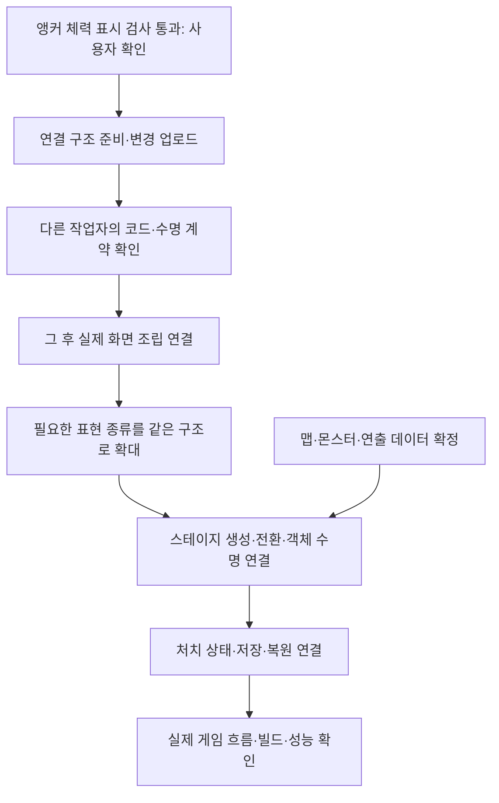

# 남은 구현과 검증 작업

2026-11-02 로컬 코드·씬 구성 문서·설계 문서를 대조한 상태입니다.
현재 저장소에서 확인할 수 있는 범위이며, 외부 일정표의 최신 담당자·완료일이나 GitHub 실행 결과까지 확인한 문서는 아닙니다.
새 기능 구현을 승인받은 목록이 아니라 다음 작업을 정하기 위한 현황입니다.

## 권장 진행 순서

각 항목은 독립 기능 단위로 설명·확인 후 진행합니다. 외부 의존성이 확정되지 않은 항목을 먼저 구현하지 않습니다.
운영 물리·카메라·아트 연결은 팀의 병행 작업이며, 위 도식이 모든 기능을 직렬로 개발해야 한다는 뜻은 아닙니다.

## 1. 이번 기능에서 남은 일

| 작업 | 현재 상태 | 완료 기준 |
| --- | --- | --- |
| 실제 Unity 앵커 연결 검사 | 완료: 2026-11-02 사용자 직접 실행·통과 확인 | 검사 코드의 범위이며 운영 씬·최종 화면 검증과 구분 |
| 실제 게임 화면 연결 | HealthDisplayHost 연결 창구까지 구현·참조 컴파일 확인. 사용자 요청으로 씬 부착 보류 | 현재 작업 업로드 → 다른 작업자 코드 확인 → 실제 조립·실행 검증 |
| 아트·해상도 확인 | 막대 프리팹 있음, 최종 화면 확인 전 | 실제 화면에서 배치·해상도·색상·이미지 확인 |
| 부모 전환·재연결의 운영 흐름 | 독립 모듈 수명 계약 있음 | 실제 씬 전환에서 늦은 생성·중복 요청·이전 화면 잔존 없음 확인 |

새 앵커 이름 연결 기능은 UI와 월드 기능이 재사용할 수 있습니다. 그렇다고 월드 스폰·풀링 전체가 구현된 상태는 아닙니다.
HealthDisplayHost는 기존 씬·프리팹에 부착하지 않았습니다. 이전24개 메뉴 검사 통과에 새 연결 컴포넌트의 실제 실행 검증까지 포함된 것으로 기록하지 않습니다.

## 2. 표현·데이터 연결의 다음 범위

| 작업 | 이미 있는 기반 | 남은 구현 |
| --- | --- | --- |
| 스태미나·보스 체력·체세 표시 | 플레이어 자원·보스 HP/체세 코어와 결과 이벤트 | 대상별 연결·표현 설정·프리팹·수명 검사 |
| 상태에 따른 아트·효과·소리 | 상태 머신·공격 시작/판정 창·피격 등의 코어 계약 | 데이터로 허용된 표현 선택, 애니메이션·효과·소리 어댑터 |
| 컷신·NPC 대사 | 설계 방향과 데이터 계층 | 재생 데이터 합의, 완료·취소·실패 계약, 플레이어 입력과의 조정 |
| 상태 구성의 데이터 연결 | ActorStateMachine과 여러 상태 구현 | 필요한 상태 팩토리·복합 상태 구성·JSON 연결 규칙의 구체화 |
| 전투·패턴 수치의 데이터 일원화 | PlayerCombatSettings·MonsterPatternSettings·BossPatternSettings 에셋 | 시트로 옮길 범위 합의, 검사·변환·소비자 연결 |

새 테이블을 읽어 저장소에 등록하는 자동화는 구현돼 있습니다. 새 종류의 게임 행동까지 임의로 만들어 주는 기능은 아닙니다.
JSON의 상태명과 실제 구현을 연결할 허용 목록·잘못된 키 처리·배포 호환 규칙을 먼저 정해야 합니다.
모든 패턴을 새로 추가하기보다 실제 필요한 책임에만 적용합니다.

## 3. 게임 진행·맵·저장

| 작업 | 현재 상태 | 필요한 합의·연결 |
| --- | --- | --- |
| 스테이지 전환·로딩 화면 | 데이터 초기화는 있으나 운영용 스테이지 전환 조립 없음 | 전환 명령·중복 요청 정책·입력 잠금·취소·이전 자원 정리 |
| 맵·배경·구조물 생성 | Stage·StageLayer 데이터와 제안 문서 | 앵커 기반 배치 원본·프리팹 참조·부모 생성 순서 |
| 몬스터 스폰·풀링 | MonsterRuntime·AI·일부 해제 처리 | 스폰 원본·안정적 배치 ID·풀 초기화·회수 계약 |
| 처치 기록 유지 | 실행 중 개별 몬스터 HP는 있으나 스테이지별 기록 저장소 없음 | 스테이지 왕복 시 처치 상태 복원, 임시 상태 소유권 |
| 저장·불러오기·체크포인트 | 현재 스크립트 폴더에서 운영 구현 확인되지 않음 | 임시 상태와 명시적 저장의 분리, JSON 영구 저장·복원·실패 처리 |

맵·배치 제안서의 좌표 항목도 현재 합의한 앵커 기본 원칙에 맞춰 재검토해야 합니다.
설정 JSON과 저장 JSON은 역할이 다릅니다. 정의 데이터를 게임 진행 상태로 직접 수정하지 않습니다.
몬스터의 Release는 구속·판정 정리이며 HP·목표·타이머까지 초기화하는 완성된 풀 재사용 계약이 아닙니다.

## 4. 운영 플레이 연결과 빌드

| 작업 | 이미 있는 것 | 남은 것 |
| --- | --- | --- |
| 이동·점프·구르기 | 코어와 임시 확인 장면의 이동 | 운영 물리·접지 센서·카메라·실제 입력 검증 |
| 공격·피격 | 콤보·판정 창·피해·무적·대상 중복 방지 | 실제 히트박스·애니메이션·효과·화면 연결 |
| 보스 | HP·체세·해체와 기본 패턴 실행 코어 | 패턴 선택 AI·페이즈 전환·정식 판정·연출 |
| 보스 해체 | 상호작용이 호출할 코어 API와 임시 연결 | 운영 대상 선택·연출 완료 신호·후속 진행 정책 |
| 빌드·디스코드 | 수동 시작 후 검사·Windows 빌드·보관·별도 빌드 채널 공지 설정 | 현재 원격 실행 성공·다운로드한 게임 플레이·대상 씬 확인 |
| 푸시 자동 빌드 | 현재 워크플로는 수동 실행 기준 | 원격 빌드 확인 후 트리거·실행 비용·브랜치 정책 결정 |
| 최적화 | 검사 경로와 모듈 책임 분리 | 실제 맵·콘텐츠로 용량·프레임·메모리 측정 후 개선 |
| 데이터 검사 보완 | 현재 시트 타입·값·중복·참조·배포 검사 | 행이 없는 테이블에서도 참조 규칙 자체가 유효한지 검사 |

코어 구현·임시 장면 동작·운영 게임 완성을 구분합니다. 기존 이동·전투·몬스터 AI를 전부 다시 만드는 작업은 아닙니다.

## 5. 확정·우선순위를 기다리는 항목

- 스폰 JSON 원본과 배치 규칙은 확정 후 진행합니다. 예시 데이터를 확정 원본으로 취급하지 않습니다.
- 콘텐츠 사용 잠금과 플레이어 해금은 문서 제안 상태입니다. 기획자 잠금을 상위로 두며 기존 Active와 섞지 않습니다. 사용자 요청에 따라 현재는 가이드 범위입니다.
- 일반 버프·디버프, 인벤토리·장착·추가 무기, 게임패드 등은 기존 프로젝트 문서의 보류·제외 범위를 확인한 뒤 재개합니다.
- 네트워크는 현재 게임 구현 범위에 넣지 않습니다.

## 확인 근거

- 현재 코드: Assets/3.Script의 Core·Adapters·Presentation·Preview·Data
- 현재 검증: [구현과 검증 현황](현재%20구현과%20검증%20현황.md)
- 운영 연결 경계: [게임플레이 코어와 프리팹 연결](게임플레이%20코어와%20프리팹%20연결.md)
- 표현 확장: [데이터 기반 모듈과 화면 표현 설계안](데이터%20기반%20모듈과%20화면%20표현%20설계안.md)
- 배치·수명: [앵커 기반 프리팹 배치 안내](앵커%20기반%20프리팹%20배치%20안내.md)
- 데이터·보류 사항: 형제 DataSheet 프로젝트의 README와 맵·몬스터 제안서, 콘텐츠 잠금 작성안
