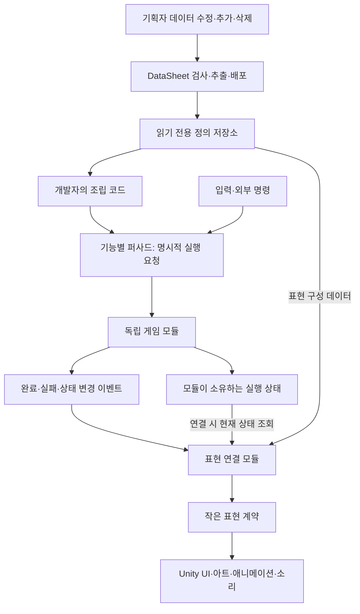
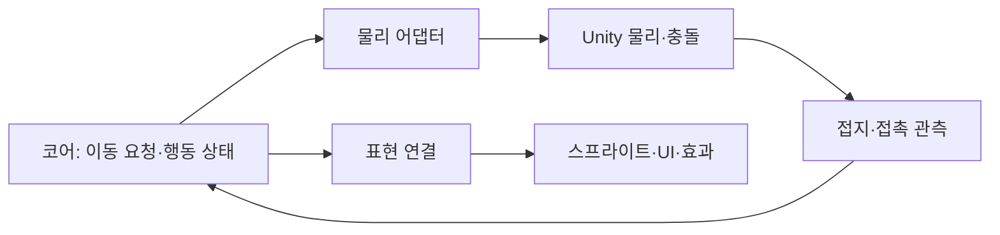
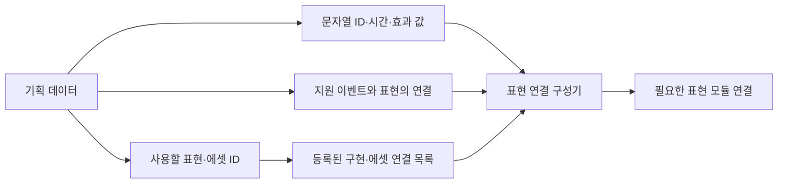
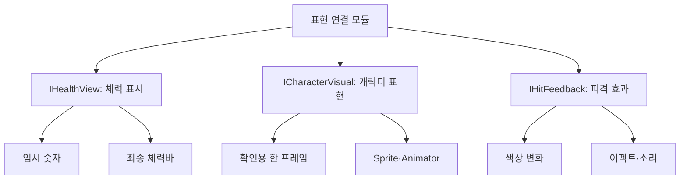
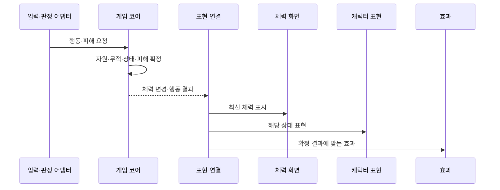
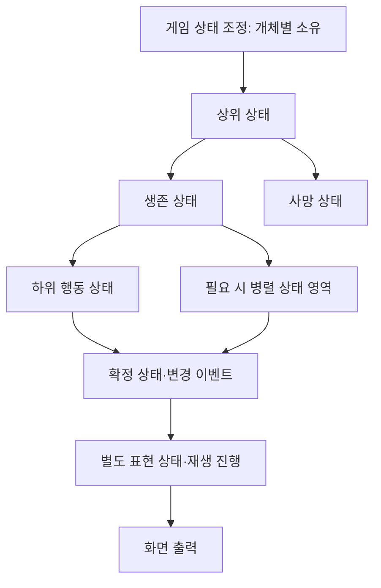
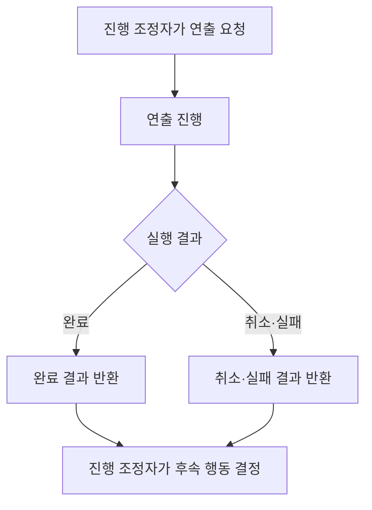
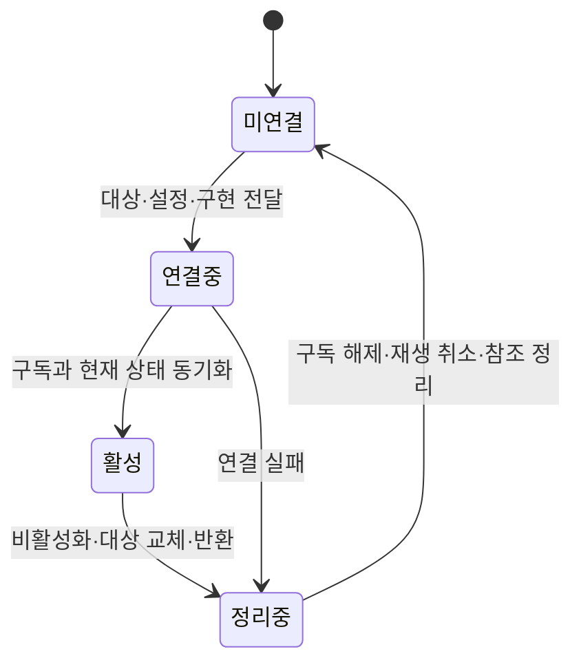
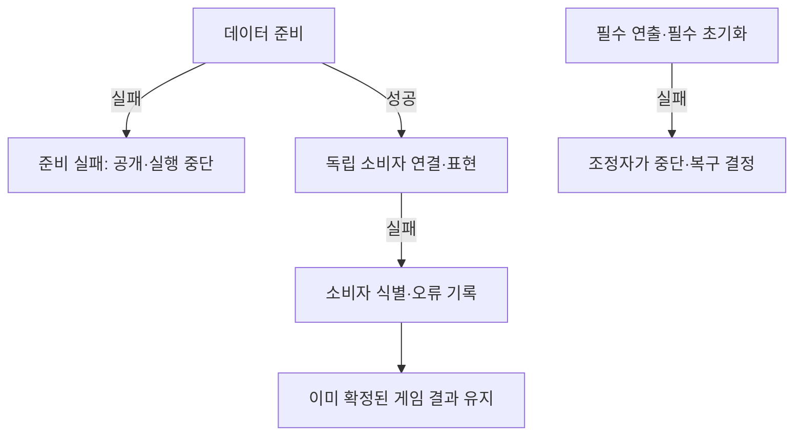
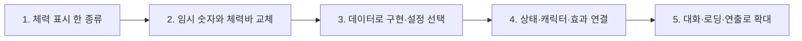

# 데이터 기반 모듈과 화면 표현 설계안

작성일: 2026-11-02. 현재 코드 확인과 지금까지 합의한 방향을 정리한 **설계 제안서**입니다.
이번에는 문서만 작성합니다. 아래 제안 타입·폴더·표현 테이블이 이미 구현됐다는 뜻은 아닙니다.
기획 미결 항목의 정책·수치·데이터 원본 형식은 이 문서에서 임의로 확정하지 않습니다.

## 1. 설계 목적과 프로젝트의 네 가지 기조

기획자는 지원되는 동작의 내용과 구성을 데이터로 조절하고, 개발자는 독립 기능을 필요한 순서와 수명으로 조립합니다.
게임 규칙은 UI·아트·연출을 교체해도 유지돼야 합니다.

| 기조 | 설계 기준 | 의도 |
| --- | --- | --- |
| 자동화 | 데이터 검사·추출·배포·로딩·지원 모듈 연결의 수동 목록 최소화 | 데이터 변경마다 개발자의 반복 등록 방지 |
| 모듈화 | 책임·입출력·상태 소유권·수명·실패 경계를 명시 | 필요한 기능만 선택해서 사용 |
| 이벤트·추상화·퍼사드·데이터 기반·복합 상태머신 | 계약을 통해 구현을 연결하고 규칙과 완료 통지를 분리 | 교체 가능한 구현과 명확한 실행 흐름 |
| 코드·오브젝트 재사용성 극대화 | 같은 책임은 공통화하고 개별 차이는 데이터·조합으로 표현 | 중복 코드·중복 자원 감소 |

공통화는 모든 기능을 하나의 거대한 관리자로 합친다는 뜻이 아닙니다.
팩토리는 상태 구성에 적용하고 캐릭터 자체에는 새 팩토리를 추가하지 않습니다.
공통 스탯은 추상 클래스에 한 번만 두고 하위 클래스는 고유 설정을 추가하는 기존 방침을 유지합니다.
기본 수치는 정수, 시간은 ms, 확률 분모는10000, 좌표는 타일×100을 따릅니다.
설명·주석·로그는 한국어이며 새 문서 파일명도 한글로 작성합니다.
네트워크 기능은 구현 범위에 넣지 않습니다.

## 2. 현재 구현과 목표 구조

| 영역 | 현재 확인한 내용 | 제안하는 확장 |
| --- | --- | --- |
| Core | Unity API와 분리된 전투·AI·상태·시간 규칙 | 기존 규칙을 보존하면서 필요한 결과 계약 보완 |
| Adapters | 입력·프레임 시간·설정 참조와 코어 연결 | 입력·물리·표현의 엔진 연결 책임을 구분 |
| PreviewPresentation | 코드에 고정된 확인용 문자열·상태 이름·색상 | 데이터와 작은 표현 계약으로 분리 |
| MonsterPreviewLabel | 현재 상태·HP를 매 프레임 읽어 이름표 표시 | 최초 상태 표시와 변경 통지 연결 |
| PreviewPlayerSprite | Inspector의 상태별 Sprite 목록으로 한 프레임 표시 | 데이터의 표현 ID와 등록 에셋을 연결하는 구조 검토 |
| GameplayPreview | 임시 장면 조립·표시·판정 호출 순서 | 확인용 연결을 유지하고 운영 조립과 분리 |
| 데이터 로딩 | 새 테이블 읽기·정의 변환·저장소 등록 자동화 | 표현 테이블을 읽은 뒤 대상과 구현을 연결하는 단계 추가 |
| 상태머신 | ActorStateMachine의 단일 현재 상태 전환 | 필요 시 상위·하위·병렬 상태를 명시한 복합 구조로 확장 |

현재 코드는 표현 분리의 기반이 있지만 정식 표현 서비스와 데이터 자동 연결이 완성된 상태는 아닙니다.
현재의 확인용 화면이 모두 이벤트만으로 갱신되는 것도 아닙니다.
기존 구현·검사 기록은 [게임플레이 모듈 구조](게임플레이%20모듈%20구조.md)와 [현재 구현과 검증 현황](현재%20구현과%20검증%20현황.md)을 따릅니다.
이 문서 작성 과정에서는 기존 검사를 재실행하거나 새로운 성능 수치를 측정하지 않았습니다.

## 3. 전체 설계도



화살표는 데이터 전달·호출·통지 방향입니다. 원본 데이터가 게임 진행의 시작 시점까지 결정하지 않습니다.
개발자는 데이터를 준비한 뒤 필요한 모듈을 연결하고 실행을 요청합니다.
퍼사드는 기능의 사용 입구를 정리하며 내부 규칙·저장소·모든 화면을 한곳에 소유하지 않습니다.
모듈의 내부 계산은 직접 호출할 수 있고 모든 호출을 전역 이벤트 버스로 바꾸지 않습니다.

## 4. 계층과 소유권

| 계층 | 소유하는 것 | 소유하지 않는 것 |
| --- | --- | --- |
| 데이터 정의 | 콘텐츠 설정·안정적인 ID·표현 연결 설정 | 현재 HP·재생 중인 연출 |
| 게임 모듈 | 규칙·현재 상태·타이머·행동 결과 | SpriteRenderer·UI 객체 |
| 표현 연결 모듈 | 코어 구독·표시 대상·정의에서 해석한 표현 설정 | 피해·자원·해금 조건의 최종 판단 |
| 표현 계약 | 표시·재생 요청과 필요한 결과 형식 | Unity 구체 컴포넌트 |
| Unity 표현 구현 | UI·애니메이션·효과·소리의 실제 출력 | 게임 규칙과 영구 진행 기록 |
| 물리 어댑터 | 엔진의 이동 적용·충돌·접지 관측 전달 | UI 표현 또는 저장 정책 |
| 조립 코드 | 구현 선택·의존성 주입·필수 순서·전체 수명 | 각 모듈의 세부 처리 |



화면과 물리는 모두 Unity를 사용하지만 서로 다른 책임입니다.
화면은 확정된 결과를 표현하고 물리는 게임 규칙에 필요한 관측을 돌려줍니다.
코어의 정수 값을 엔진에 전달할 때 단위를 변환합니다. 정수 사용만으로 Unity 물리의 결정성을 보장하지 않습니다.

## 5. 기획자가 데이터로 제어할 범위



| 조정 대상 | 데이터로 제어하려는 내용 |
| --- | --- |
| UI 구성 | 지원하는 표시 형식·프리팹 ID·문자열 ID |
| 캐릭터 표현 | 외형·상태별 애니메이션·방향 표현의 설정 ID |
| 결과 효과 | 지원하는 결과에 연결할 효과·소리 ID |
| 재생 값 | ms 시간·반복·전환·정수 강도 값 |
| 사용 여부 | 해당 표현 설정을 사용할지 여부. 콘텐츠 잠금과 의미를 혼용하지 않음 |

표현 테이블의 실제 이름·컬럼·원본 형식은 아직 확정하지 않습니다.
기존 데이터 정의·Language를 재사용할 수 있는 항목은 중복 저장하지 않습니다.
새 데이터가 기존 에셋·표현 종류를 선택하면 개발자가 매번 Inspector 연결 목록을 수정하지 않도록 구성하는 것이 목표입니다.
지원할 이벤트 종류와 표현 동작은 허용 목록으로 명시하고 임의 함수명·타입명을 실행하지 않습니다.
상태 ID와 프리팹 종류 ID, 배치 ID, 실행 중 개체 ID는 서로 다른 의미로 관리합니다.

### 데이터 변경과 개발 변경의 경계

| 변경 | 필요한 작업 |
| --- | --- |
| 지원 형식의 행·값 추가·수정·삭제 | 검사·배포·다음 초기화에서 반영 |
| 표현 행 삭제 후 참조가 남음 | 배포 전 참조 검사에서 차단하는 방향 |
| 새 이미지·프리팹 | 최초 등록·ID 연결·빌드 포함 준비 필요 |
| 새로운 종류의 표현 기능 | 구현·허용 목록·검사 규칙 보완 필요 |
| 기존 클래스의 컬럼 추가·삭제 | 현재 정책상 보존되는 C# 정의를 개발자가 함께 수정 |
| 이미 빌드한 게임에 새 코드 타입 추가 | 재빌드 필요 |
| 실행 중 즉시 설정 교체 | 별도 요구·수명 정책이 필요. 기본 범위에 포함하지 않음 |

정의 C#은 현재처럼 파일이 없을 때만 생성하고 기존 파일은 보존합니다.
자동 로딩 계획을 생성하는 정책은 유지합니다.
데이터 자동 로딩과 실제 표현 연결은 서로 다른 단계이므로 저장소 등록만으로 자동 연결이 완료됐다고 주장하지 않습니다.
에셋 연결 목록을 자동 수집하려면 ID 명명 규칙·중복 정책·빌드 포함 검사도 먼저 정해야 합니다.

## 6. 교체 가능한 작은 표현 계약



위 타입 이름은 제안이며 현재 구현된 계약이 아닙니다.
필요한 기능만 의존하도록 대화는 IDialogueView, 로딩은 ILoadingView처럼 별도 계약으로 나눌 수 있습니다.
캐릭터와 체력바를 함께 쓰는 경우에도 대상별 표현 연결 모듈이 자신의 구독을 소유합니다.
구현을 교체하려면 게임 코드 전체를 바꾸는 대신 조립 단계에서 같은 계약의 다른 구현을 전달합니다.

## 7. 요청·결과·표현의 실행 순서



체력바가 직접 피해를 계산하거나 Animator가 게임의 실제 상태를 소유하지 않습니다.
기존 HealthChanged·상태 변경·자원 이벤트를 우선 재사용합니다.
기존 이벤트에 없는 피격 위치·결과 정보가 필요하면 추측하지 않고 코어 결과 또는 판정 어댑터 계약을 보완합니다.
같은 효과를 체력 변경과 피격 결과 양쪽에서 중복 재생하지 않도록 이벤트별 사용 목적을 정합니다.
매 프레임 문자열을 새로 만드는 대신 변화 통지를 이용할 수 있지만 실제 절감량은 측정 후 판단합니다.
캐릭터 이동 보간·애니메이션 진행처럼 매 프레임 필요한 표현까지 이벤트만으로 대체하지 않습니다.

## 8. 복합 상태머신과 표현 상태



구체적인 상위·하위·병렬 상태 조합은 기획에 따라 정할 제안입니다.
병렬 실행은 실제로 동시에 유지해야 하는 상태에만 적용하고 상태 간 충돌·전환 우선순위를 명시합니다.
현재 단일 상태머신을 이 문서만으로 복합 구조로 구현 완료한 것으로 취급하지 않습니다.
표현 상태는 재생·블렌딩·전환만 관리하고 별도의 HP나 공격 가능 여부를 만들지 않습니다.
게임 상태와 Animator 상태를 같은 것이라고 가정하지 않습니다.
상태 팩토리를 도입할 때는 개체별 상태 구성 책임에 한정하고 가변 상태 인스턴스를 캐릭터 사이에 공유하지 않습니다.

## 9. 완료를 기다려야 하는 연출



일반 체력 표시와 해체·컷신처럼 완료를 기다리는 작업은 구분합니다.
필수 비동기 작업은 조정자가 Task 등 명시적인 완료 계약을 기다립니다. async void 이벤트로 순서를 보장하지 않습니다.
연출 모듈이 저장·씬 전환·피해 적용을 임의 실행하지 않습니다.
스킵·중단·실패 시 입력 복구와 다음 진행은 정해진 소유자가 책임집니다.
컷신의 실제 데이터 구조·스킵 정책·동시 재생 규칙은 미결 범위로 유지합니다.

## 10. 연결·해제·재사용



연결은 Unity 주 실행 흐름에서 수행하고 코어 이벤트의 발생 스레드·순서를 명시합니다.
구독 후 현재 상태를 조회해 최초 값을 맞추되 연결 중 변화가 중복 효과를 일으키지 않도록 초기 동기화와 순간 효과를 구분합니다.
재활성화 시 과거 피격 효과를 재생하지 않고 현재 HP·상태만 표시합니다.
한 번의 연결에 구독 한 벌만 유지하며 비활성화·반환 때 반드시 해제합니다.
연결 중 실패하면 이미 연결한 부분을 정리합니다.

| 재사용 대상 | 초기화 계약 |
| --- | --- |
| 표현 모듈 | 이전 대상 참조·텍스트·색상·재생 상태·이벤트 구독 정리 |
| 코어 실행 개체 | HP·상태·타이머·목표·공격 창 등 별도 초기화 |
| 공유 정의·에셋 | 원본 변경 금지. 사용자가 임의 파괴하지 않음 |
| 풀링 효과·소리 | 재생 중단·콜백 해제·소유 풀에 반환 |

오브젝트 재사용과 코드 재사용은 구분합니다. 정적인 맵 부품을 필요 없이 반복 회수하지 않습니다.
해당 자원의 생성·대여·반환·파괴 책임은 소유자에게 둡니다.

## 11. 오류 경계



현재 소비자 오류 격리 도우미는 데이터 완료 통지에 적용돼 있습니다.
새 표현 이벤트에 같은 정책이 자동 적용되는 것은 아니며, 이벤트별 중요도·기록·복구 정책을 설계해야 합니다.
독립 표시 실패는 확정 피해를 되돌리지 않지만 필수 연출 실패는 게임 준비 성공으로 숨기지 않습니다.
순간 효과 실패와 잘못된 필수 에셋 연결을 같은 수준으로 다루지 않습니다.
읽기·실행 실패와 배포 전 데이터 유효성 검사를 구분하고 클라이언트에 원본 검사기를 중복 배포하지 않습니다.

## 12. 관련 기능에도 같은 원칙 적용

| 기능 | 데이터와 독립 모듈의 경계 |
| --- | --- |
| 씬 전환·로딩 | 전환 요청·엔진 로딩·준비 작업·진행 표시 분리. 씬 로딩률과 전체 준비율 구분 |
| NPC 대화 | 문장 순서·문자열 ID와 진행 상태·텍스트박스 표시 분리. 퀘스트 보상은 별도 |
| 맵 구성 | Stage의 JSON 지정과 구조물·배경·오브젝트 배치 분리. 개발자가 실행 요청 |
| 몬스터 배치 | 종류·배치 ID와 임시 처치 기록을 받아 살아 있어야 할 개체만 배치 |
| 저장 | 현재 진행은 임시 상태. 명시적 자동·수동 저장 때만 영구 JSON 반영 |
| 콘텐츠 잠금 | 기획자의 전체 콘텐츠 제어가 상위 범위. 플레이어 해금은 그중 필요한 콘텐츠에만 적용 |
| 빌드 자동화 | 게임 실행 모듈 밖에서 검사·빌드·결과물·공지 조립. 원격 성공은 실행 기록으로 별도 확인 |

맵 구성 요소는 스테이지 내에서 배치 후 유지하고, 몬스터는 처치 후 기본 재스폰하지 않습니다.
재진입 시 맵을 다시 구성해도 임시 처치 기록을 유지합니다. 풀 반환과 재스폰 정책은 별개입니다.
맵·몬스터 데이터 상세는 DataSheet의 한글 제안서를 따르며 여기서 새 스키마를 추가 확정하지 않습니다.
일정표의 미결 저장·리셋·컷신·잠금 정책은 기능 기반 설계와 구분합니다.

## 13. 코드 배치 제안과 이유

```text
Assets/3.Script/
├── Core/                      기존 게임 규칙·실행 상태
├── Data/                      검사된 읽기 전용 정의·로딩·조회
├── Presentation/
│   ├── Contracts/             체력·캐릭터·효과 등 작은 표현 계약
│   └── Presenters/            코어 결과와 표현의 연결·구독 관리
├── Adapters/
│   ├── Input/                 Unity 입력 연결
│   ├── Physics/               이동·접지·충돌 연결
│   └── Presentation/          UI·Sprite·Animator·소리 구현
├── Composition/               의존성·순서·수명 조립
└── Preview/                   기존 임시 확인용 구성·교체 가능한 표시
```

위 새 하위 폴더는 제안이며 실제로 이동·생성하지 않았습니다.
계약·연결·Unity 구현·조립 책임을 경로에서도 알아보기 쉽게 나누려는 목적입니다.
Core는 표현 구현을 참조하지 않습니다. 표현 연결은 코어의 조회·이벤트 계약과 표현 계약에 의존합니다.
Unity API가 필요한 구현은 어댑터에 두고 MonoBehaviour는 엔진 수명·참조 연결에 집중합니다.
새 기능부터 적용하며 기존 파일·GUID·프리팹 참조를 한 번에 이동하지 않습니다.

## 14. 기존 코드 영향과 단계별 적용

| 현재 코드 | 계획하는 영향 |
| --- | --- |
| PlayerActor·MonsterActor·BossPoise | 규칙 유지. 필요한 상태·결과 계약만 검토 |
| PreviewPresentation | 고정 문구·색상·표시 구성을 데이터·표현 구현으로 분리 |
| PreviewPlayerSprite | 임시 표시를 보존하고 운영용 표현과 교체 가능한 연결 검토 |
| MonsterPreviewLabel | 현재 값 동기화·구독 수명 중심으로 전환 검토 |
| GameplayPreview | 확인용 조립 유지. 표시 갱신 책임을 별도 연결에 위임 |
| Runtime 어댑터 | 준비된 코어와 표현을 연결할 접점 검토 |
| 데이터 로딩 | 새 정의는 기존 생성 계획 사용. 실제 표현 연결 단계는 추가 구현 |
| 씬·프리팹·DataSheet | 최초 계약·에셋 등록·표현 데이터·참조 검사 준비 필요 |



첫 적용은 기존 HealthChanged와 현재 HP 조회를 사용해 게임 규칙을 바꾸지 않고 구조를 확인합니다.
기존 표시는 새 표시 검증 후 해제해 두 경로가 동시에 같은 대상을 갱신하지 않게 합니다.
복합 상태머신 개편·운영 물리 변경·맵 스폰 구현을 첫 표현 분리와 한꺼번에 진행하지 않습니다.
기능 단위로 목적·필요성·방식·위치·영향·검증을 사전에 설명하고 승인 후 구현합니다.

## 15. 검증 계획과 예상 효과

| 확인할 항목 | 확인하려는 결과 |
| --- | --- |
| 표현 구현 교체 | 같은 게임 결과가 다른 UI·아트에서도 동일하게 반영 |
| 데이터 행 추가·수정·삭제 | 지원 범위 내 자동 연결·갱신, 잘못된 참조는 배포 전 차단 |
| 연결·재활성화·대상 교체 | 최신 상태 표시, 과거 순간 효과 재생 없음 |
| 구독·풀 반환 | 중복 호출·이전 대상 참조·반환 후 호출 방지 |
| 실패·취소 | 확정 규칙 보존, 필수 작업 실패를 조정자가 인지 |
| 기존 규칙 회귀 | 공격·피격·AI·자원 동작 유지 |
| 실제 Unity 실행 | 프리팹·에셋·문자열·해제·빌드 포함 연결 확인 |
| 성능 | 문자열 생성·효과 생성·표현 갱신 비용을 실제 장면에서 측정 |

예상 효과는 기획자의 데이터 조절 범위 확대, UI·아트 교체 비용 감소, 중복 연결 감소, 독립 검사와 재사용성 개선입니다.
아직 구현·측정하지 않은 설계이므로 성능 향상이나 모든 기능의 자동 연결 완료를 주장하지 않습니다.
관련 실행·검증 경계는 [검사 자동화와 데이터 오류 경계](검사%20자동화와%20데이터%20오류%20경계.md)를 참고합니다.
