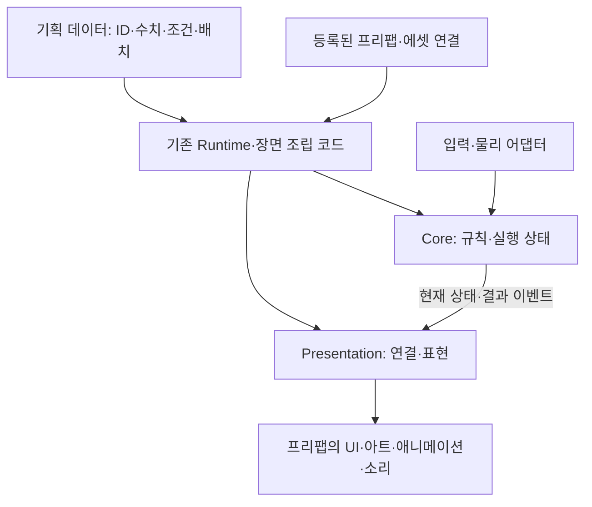
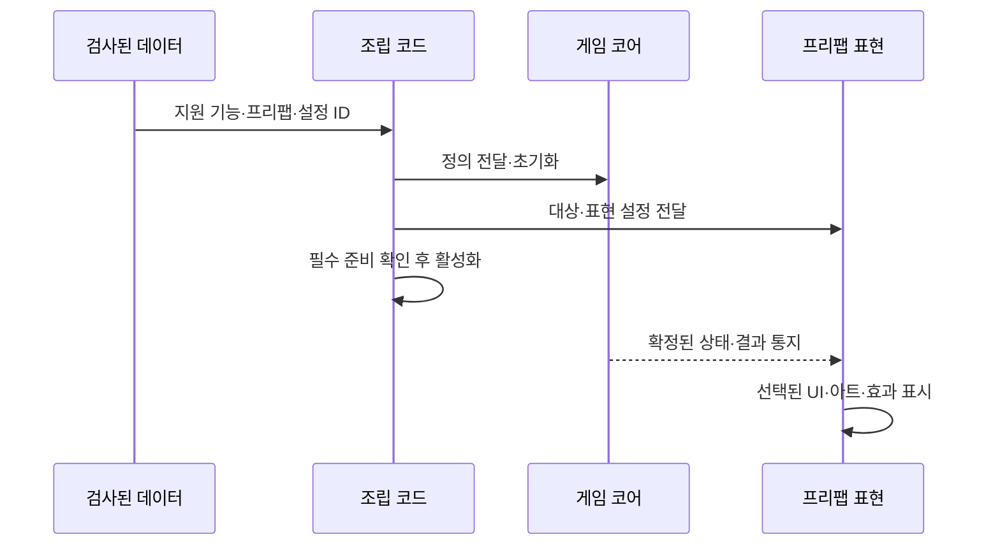
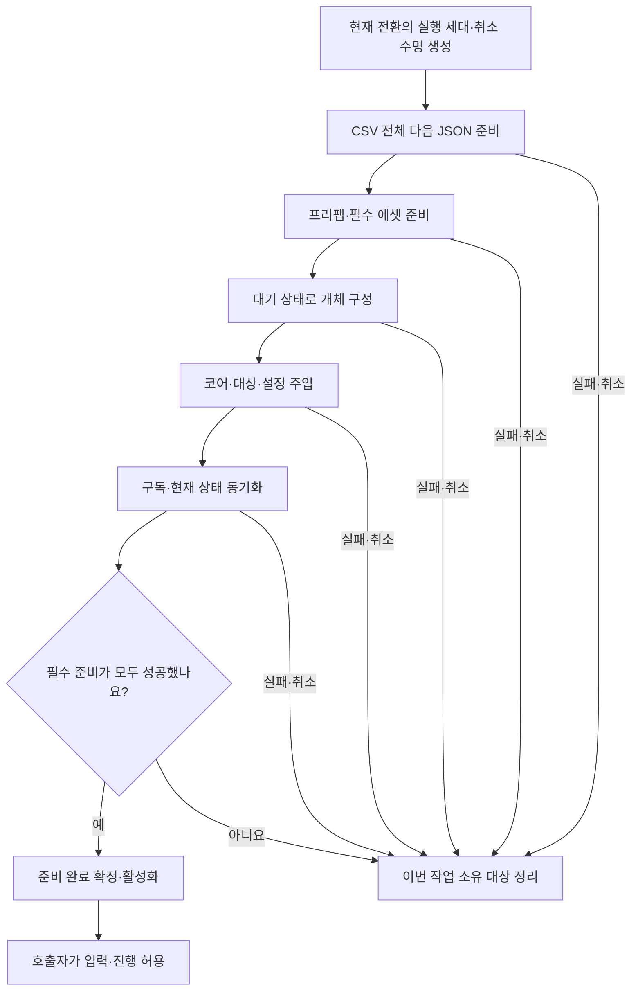

# 데이터 기반 모듈과 화면 표현 설계안

> 2026-11-04 최신 풀 점검: 체력 표시 외 HUD·일시정지·설정·텍스트·소리·Preview 맵 조립도 임시 연결됐습니다. 운영 전환은 기능 단위로 진행합니다. 매복은 비활성 준비 후 활성화하지만 풀은 없으며 부분 생성 실패 정리도 후속입니다. 전체 상태는 [현재 구현과 검증 현황](현재%20구현과%20검증%20현황.md), 우선순위는 [남은 작업](남은%20구현과%20검증%20작업.md)을 따릅니다.

작성·수정일: 2026-11-02. 최초 작성은 문서 단계의 설계안이며, 아래에 후속 구현 범위를 구분합니다.
후속 구현으로 플레이어 체력 표시·연결 수명·체력바 프리팹·HealthDisplayConfig 설정 연결을 추가했습니다.
구현 범위·사용법·검증은 [체력 표시 모듈 안내](체력%20표시%20모듈%20사용과%20설계%20안내.md)를 따릅니다.
체력 표시의 설정 자동 로딩과 프리팹 목록 수집·그룹 생성 API를 구현했습니다. 그 외 HUD·메뉴·소리·씬 조립은 현재 Preview에 임시 연결됐으며 정식 리소스와 수용 검증은 후속입니다.
현재 Core·Data·Adapters·Preview 구조를 유지하며 필요한 부분부터 확장합니다.
현재 코드와 설계의 적합성·개선 우선순위는 [설계 기준 점검과 개선 방향](설계%20기준%20점검과%20개선%20방향.md)에 정리했습니다. 이번 요청은 문서만 갱신하며 실제 저장·컷씬 연결은 별도 확인 후 진행합니다.

## 1. 목적과 설계 기준

기획자는 지원되는 기능의 내용·구성을 데이터로 조절하고, 개발자는 독립 기능을 필요한 순서와 수명으로 조립합니다.
게임 규칙은 UI·아트·연출을 바꿔도 유지하며 **책임 분리와 파일·계층 최소화**를 함께 지향합니다.

| 핵심 기조 | 적용 기준 |
| --- | --- |
| 자동화 | 데이터 수정·추가·삭제 → 검사·배포·로딩·지원 기능 연결. 수동 등록 최소화 |
| 모듈화 | 책임·입출력·상태 소유권·수명·실패 경계를 명시 |
| 이벤트·추상화·퍼사드·데이터 기반·복합 상태머신 | 실제 교체 지점만 추상화, 기존 진입점 재사용, 완료 결과 통지, 상태 관계 명시 |
| 코드·오브젝트 재사용 극대화 | 공통 코드·프리팹을 재사용하고 차이는 데이터·조합·필요 시 Variant로 표현 |

팩토리는 상태 구성에 한정합니다. 공통 스탯은 추상 클래스에 한 번만 두고 고유 스탯은 하위 클래스에 둡니다.
기본 수치는 정수, 시간 ms, 확률 분모10000, 좌표 타일×100, 문자 UTF-8을 유지합니다.
설명·주석·로그·문서명은 한국어를 기본으로 하며 네트워크 기능은 구현하지 않습니다.

## 2. 간결한 구조와 프리팹 중심 구성



| 구성 | 책임 | 넣지 않을 책임 |
| --- | --- | --- |
| 데이터 | 무엇을 쓸지, 값·조건·배치·문자열 ID | Unity 컴포넌트 직접 조작 |
| 프리팹 | 컴포넌트·외형 조합과 내부 참조 | 공용 원본에 현재 HP 등 개체 상태 저장 |
| Core | 규칙·현재 상태·전환·확정 결과 | UI·Animator·SpriteRenderer |
| Adapters | 입력·물리·엔진 수명·기존 Runtime의 조립 | 화면에 피해 계산 중복 구현 |
| Presentation | 구독·초기 표시·표현·해제. 필요할 때만 내부 분리 | 게임 상태 임의 변경 |
| 조립 코드 | 구현 선택·주입·필수 실행 순서·전체 수명 | 모든 세부 처리를 거대 관리자로 통합 |

```text
Assets/3.Script/
├── Core/             기존 게임 규칙·실행 상태
├── Data/             기존 정의·로딩·조회
├── Adapters/         입력·물리·Runtime 조립
├── Presentation/     표현 연결·Unity 구현·표현 설정
└── Preview/          임시 확인 전용
```

위 폴더 구조를 적용했고 Presentation에는 체력 표시·연결 수명·설정별 생성 그룹·Host를 구현했습니다. 다른 표현 종류의 구체 타입은 후속 범위입니다.
Contracts·Presenters·Composition 폴더, 중계 이벤트 버스, 기능별 별도 관리자·팩토리를 일괄 도입하지 않습니다.
새 표현은 작은 컴포넌트부터 시작합니다. 현재 체력 표시는 독립 검사할 구독 수명과 여러 행의 생성·정리, 컴포넌트 활성 수명을 분리했습니다.
실제 구현 교체가 필요해질 때만 IHealthView 같은 작은 계약을 적용합니다.
기존 공개 진입점이 퍼사드 역할을 하면 새 퍼사드 클래스를 덧붙이지 않습니다.
복잡한 연결이 생기면 해당 책임만 분리하고, 파일 수를 줄이기 위해 Core와 화면 규칙을 섞지는 않습니다.

### 프리팹 관리 기준

| 대상 | 구성 방향 |
| --- | --- |
| 캐릭터·몬스터 | Runtime·물리·표현 컴포넌트 조합. 기존 상속·목록 관리 유지 |
| 맵·플랫폼·배경·오브젝트 | 수명·충돌·상호작용 단위가 맞는 부품 묶음 |
| UI | 체력바·대화창·로딩 화면 등 기능 단위 |
| 효과 | 이펙트·소리의 준비·재생·정리 단위 |
| 같은 동작의 외형 차이 | 같은 코드 + 프리팹·데이터 교체. 필요할 때만 Variant |

프리팹 내부 참조는 원본에서 연결하고, 씬 대상·코어·서비스는 배치 시 외부에서 전달합니다.
프리팹 종류 ID와 실제 배치 ID·실행 중 개체 ID를 구분합니다.
프리팹화는 풀링과 다릅니다. 맵 부품은 배치 후 유지하고 재사용 대상만 별도 초기화·반환 계약을 적용합니다.
기획자는 등록된 프리팹 ID를 선택합니다. 새 에셋은 최초 등록·ID 연결·빌드 포함 준비가 필요합니다.
체력 표시는 Assets/2.Model/Prefabs/UI 아래 파일명 키를 에디터가 자동 수집하고 직접 참조 목록을 만듭니다. 다른 종류의 표현 목록은 아직 확정하지 않았습니다.

## 3. 데이터 제어와 실행 흐름



| 기획자가 조절할 내용 | 경계 |
| --- | --- |
| 지원 표현 종류·프리팹 ID·Language ID | 기존 테이블·등록 에셋을 우선 재사용 |
| 재생 시간·반복·전환·강도 | 필드별 단위·정수 의미를 먼저 합의 |
| 결과와 효과의 연결 | 허용된 결과·동작만 연결. 임의 함수명 실행 금지 |
| 표현 사용 여부 | 기존 Active·콘텐츠 잠금과 의미 혼용 금지 |
| 행 추가·수정·삭제 | 배포 전 타입·참조 검사, 다음 초기화에서 적용 |

체력 표시에는 CSV 테이블 HealthDisplayConfig를 적용했습니다. PrefabKey·AnchorName·Width·Height·Visible로 설정하며 그룹이 전체 행을 소비합니다.
앞으로 프리팹 배치는 빈 오브젝트 앵커를 데이터의 이름으로 선택하는 방식을 기본으로 합니다. 부모 프리팹을 먼저 생성한다면 해당 인스턴스가 준비된 뒤 내부 앵커를 수집합니다. [앵커 배치 안내](앵커%20기반%20프리팹%20배치%20안내.md)에 범위·수명·재사용 계약을 정리했습니다.
다른 표현 종류의 테이블 이름·컬럼·원본 형식은 후속 협의 대상입니다. 기존 C# 정의 보존·자동 로딩 계획 생성 정책은 유지합니다.
컬럼 구조 변경은 개발자가 기존 클래스를 맞추고, 새 기능 종류는 구현·검사 규칙을 보완해야 합니다.
실행 중 즉시 갱신이나 이미 빌드된 게임의 새 타입 추가는 기본 범위가 아닙니다.

게임 규칙은 Core가 판단하고 화면은 결과를 표시합니다. 체력바나 Animator가 피해·행동 가능 여부를 결정하지 않습니다.
입력·이동·충돌은 별도 어댑터이며 접지 같은 관측을 코어에 전달합니다. 엔진 경계에서 단위를 변환합니다.
기존 이벤트를 우선 사용하고 부족한 피격 위치·결과는 명시적 계약으로 보완합니다.
같은 효과를 여러 이벤트에서 중복 실행하지 않도록 이벤트별 용도를 정합니다.
이동 보간·애니메이션처럼 매 프레임 필요한 처리까지 이벤트로 대체하지 않습니다.

### 상태와 연출의 경계

게임의 상위·하위·병렬 상태는 필요한 관계만 복합 상태머신으로 관리하고 전환 우선순위와 소유권을 명시합니다.
표현은 재생·전환만 관리하며 별도의 HP·공격 가능 상태를 만들지 않습니다. 표현용 상태머신도 무조건 추가하지 않습니다.
필수 연출은 완료·취소·실패 결과를 조정자에게 반환합니다. 저장·다음 씬·피해 적용은 조정자가 결정합니다.
순서 보장이 필요한 비동기 작업은 직접 기다리고 async void 이벤트 구독 순서에 맡기지 않습니다.
현재 단일 상태머신이 이미 복합 상태머신으로 구현됐다는 뜻은 아닙니다.

## 4. 로드 순서·수명·오류 계약

**로드 완료, 의존성 주입 완료, 실제 동작 가능 상태를 구분합니다.**
Unity의 Awake·OnEnable·Start 순서나 Script Execution Order 설정만으로 준비를 보장하지 않습니다.
기존 데이터 초기화 컴포넌트의 자동 시작은 현재 구현으로 유지하되 새 모듈은 명시적인 준비·활성화 계약에 맞춰 연결하는 방향입니다.



| 위험 | 방지 계약 |
| --- | --- |
| 프리팹 생성 직후 OnEnable이 먼저 실행 | 필요한 경우 비활성 대기 부모·개체로 준비. 엔진 콜백에서 미주입 참조 사용 금지, 준비 전 입력·Tick·효과 차단 |
| 데이터만 준비됐는데 플레이 시작 | 데이터 준비와 게임 준비를 분리하고 필수 작업을 조립 코드가 직접 대기 |
| 씬 대상을 찾기 전에 표현이 구독 | 대상·설정 전달 후 연결. 임의 전역 검색·구독 순서에 의존하지 않음 |
| 구독 직전 변경을 놓침·같은 효과 중복 | 주 실행 흐름에서 구독·현재 상태 동기화, 초기 표시와 순간 효과 구분 |
| 이전 로딩 결과가 늦게 도착 | 취소 요청과 함께 실행 세대·현재 소유자 확인. 오래된 결과는 적용하지 않고 해당 작업이 정리 |
| 풀 반환 후 같은 개체가 다시 사용됨 | 대여 세대·연결 상태를 확인해 이전 콜백 거부. 반환 대상·자원도 세대 소유권에 따라 정리 |
| 초기화·종료 중복 요청 | 중복 초기화 거부 또는 같은 작업 공유 정책을 기능별로 명시. 해제·취소·반환은 중복 정리에 안전하게 설계 |
| 씬 전환 도중 새 요청·입력 | 진행 중 정책을 명시하고 새 요청 차단·교체 여부는 호출자가 결정 |

Awake는 자체 참조 준비, OnEnable은 준비 여부 확인 등 제한된 책임만 갖습니다.
활성 개체를 먼저 생성한 뒤 나중에 필드를 채우는 방식으로 준비 전 동작을 허용하지 않습니다.
대기 부모로 OnEnable을 늦추더라도 Awake 등 엔진 콜백이 호출될 수 있으므로 명시적 초기화를 대신하지 않습니다.
비동기 작업은 유효한 소유자와 실행 세대에서만 Unity 객체에 결과를 적용합니다.
취소 토큰만 전달하면 모든 엔진 작업이 즉시 중단된다고 가정하지 않습니다.
실행 세대 확인은 기존 안정적 배치 ID와 별개이며 새 전역 관리자를 반드시 뜻하지 않습니다.


소비자가 쓰는 자원보다 소비자를 먼저 정리합니다. 진행 중인 작업의 완료를 기다리거나 늦은 완료가 안전하게 자기 자원을 정리하는 계약이 필요합니다.
원본 프리팹·공유 에셋·외부 소유 서비스는 임의로 파괴하지 않습니다. 씬 기본 대상과 이번 생성 대상을 구분합니다.
새 스테이지 준비 실패 시 이전 스테이지를 유지할지 오류 화면으로 갈지는 호출자가 정할 별도 정책이며, 준비 전 입력을 임의 허용하지 않습니다.

독립 표시 실패는 확정된 게임 결과를 되돌리지 않습니다. 필수 에셋·필수 연출 실패는 준비 성공으로 숨기지 않습니다.
현재 데이터 완료 이벤트의 동기 소비자 오류 격리 정책이 모든 새 이벤트에 자동 적용되는 것은 아닙니다.
재사용 시 표현의 참조·색상·텍스트·재생·구독과 코어의 HP·상태·목표·타이머를 각각 초기화합니다.
**이 계약은 순서·수명 오류를 예방하기 위한 설계이며 아직 구현·검증돼 버그가 없다고 보장하는 상태는 아닙니다.**

## 5. 기존 코드 영향·적용 순서·예상 효과

| 기존 부분 | 적용 방향 |
| --- | --- |
| Core·기존 결과 이벤트 | 규칙 유지. 실제 필요한 결과 계약만 보완 |
| Runtime·GameplayPreview | 기존 진입점·조립 활용. 준비·활성화·종료 경계 명시 |
| PreviewPresentation·MonsterPreviewLabel | 고정 표시를 데이터 설정과 공통 표현으로 이동 검토 |
| PreviewPlayerSprite | 임시 표시 보존. 같은 동작은 에셋·프리팹 교체 우선 |
| 씬·프리팹 | 내부 참조는 원본에서, 외부 의존성은 주입. GUID·기존 참조 보존 |
| DataSheet·로딩 | 기존 검사·생성 계획 재사용. 체력 표시 파일 참조 검사·자동 목록은 구현, 다른 표현은 후속 |

적용 순서는 **체력 표시 한 종류 → 프리팹 외형 교체 → 데이터 선택 → 상태·효과 → 대화·로딩·연출 확대**입니다.
최초 체력 표시에는 연결·해제·준비 전 차단을 함께 검증합니다. 새 경로 검증 후 기존 표시를 해제해 중복 갱신을 막습니다.
물리 개편·복합 상태머신 개편·맵 스폰을 첫 표현 분리와 동시에 진행하지 않습니다.

관련 기능에서도 맵은 배치 후 유지하고 몬스터는 처치 후 기본 재스폰하지 않습니다.
재진입 시 임시 처치 기록을 유지하고 명시적 자동·수동 저장 때만 영구 JSON에 반영합니다.
기획자의 전체 콘텐츠 잠금과 일부 콘텐츠의 플레이어 해금은 구분합니다. 기존 Active 의미도 유지합니다.
맵 JSON 상세·콘텐츠 잠금은 DataSheet의 제안서를 따르며 미결 정책을 여기서 확정하지 않습니다.

| 검증할 상황 | 기대 결과 |
| --- | --- |
| 데이터·개체 준비 순서를 바꿔 지연 | 필수 준비 전 접근·입력·Tick·효과 없음 |
| 로딩 중 취소·씬 종료·즉시 재진입 | 이전 결과가 새 대상에 적용되지 않고 기존 작업 자원 정리 |
| 활성화·비활성화·반환·종료 반복 | 중복 구독·중복 반환·죽은 참조 접근 없음 |
| 개체를 풀에 반환 후 즉시 재대여 | 이전 연출·콜백이 새 개체 상태를 변경하지 않음 |
| 프리팹·에셋 누락·초기화 실패 | 필수 준비 실패 반환과 부분 구성 정리 |
| 표현 교체·설정 변경 | 같은 게임 결과 유지. 최초 상태는 표시하고 과거 순간 효과는 재생하지 않음 |
| 데이터 추가·삭제 | 지원 범위 자동 연결, 남은 참조는 배포 전 차단 |
| 실제 Unity·빌드 | 엔진 콜백·씬 전환·패키징·수명 동작 확인 |

예상 효과는 기획자의 데이터 제어 확대, 코드·프리팹 중복 감소, 교체 비용과 수동 연결 감소, 순서·수명 오류의 조기 발견입니다.
실제 프레임 비용과 메모리는 측정 후 판단합니다. 체력 표시의 설정·목록·그룹 연결은 구현했으며 전체 표현 자동화·운영 씬 연결·성능 개선까지 완료한 것은 아닙니다.
기능별로 목적·필요성·방식·위치·영향·검증을 먼저 설명하고 승인 후 구현합니다.

상세 현재 구조는 [게임플레이 모듈 구조](게임플레이%20모듈%20구조.md), 검증 경계는 [검사 자동화와 데이터 오류 경계](검사%20자동화와%20데이터%20오류%20경계.md)를 참고합니다.
