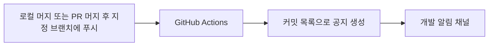

## 디스코드 머지 알림

알림 설정은 [.github/workflows/discord-merge.yml](../.github/workflows/discord-merge.yml)에서 관리합니다.
대상은 **Develop** 브랜치입니다. GitHub에 해당 브랜치가 푸시될 때 공지합니다.
Fork에서 로컬 머지 후 푸시, 빠른 병합, GitHub PR 머지를 모두 처리합니다.
직접 올린 일반 커밋도 공지하며 작업 브랜치만 푸시하거나 로컬에서만 머지하면 공지하지 않습니다.
푸시 이벤트만 사용하므로 PR 머지 이벤트와 중복 전송하지 않습니다.
머지 공지는 빌드·검사·게임 배포 성공을 뜻하지 않습니다.

Develop의 데이터·게임 코어 검사는 별도 [프로젝트 자동 검사](%EA%B2%80%EC%82%AC%20%EC%9E%90%EB%8F%99%ED%99%94%EC%99%80%20%EB%8D%B0%EC%9D%B4%ED%84%B0%20%EC%98%A4%EB%A5%98%20%EA%B2%BD%EA%B3%84.md)에서 수행합니다.
코드 반영 공지와 검사 결과는 독립적이며 검사 결과는 GitHub Actions에서 확인합니다.

저장소의 Settings → Secrets and variables → Actions에
`DISCORD_WEBHOOK_URL` 비밀값을 등록합니다. 웹훅 주소는 코드나 문서에 넣지 않습니다.
별도 서버나 봇 프로그램은 필요하지 않습니다.

설정 파일을 기본 브랜치에 반영한 뒤 Actions → 디스코드 머지 알림 → Run workflow로
연결 테스트를 실행합니다. 성공한 실행마다 테스트 공지가 한 건 올라옵니다.
이후 지정 브랜치에 푸시해 자동 공지도 확인합니다. 실행 기록을 다시 실행하면 같은 공지가 다시 전송될 수 있습니다.
전송 실패는 Actions 실행 기록에서 확인하고, 웹훅 삭제·주소 변경 시 비밀값을 갱신합니다.

공지에는 커밋 제목 최대 10건·반영 브랜치·푸시 담당자·변경 내역 링크가 포함됩니다.
본문은 3000자까지 표시합니다. GitHub가 제공하는 푸시 커밋 목록을 사용하며 전체 내용은 링크에서 확인합니다.
팀원이 이해할 수 있도록 커밋 제목에 변경 내용을 한글로 작성합니다.
전체 호출 알림은 사용하지 않습니다. 저장소 접근 권한이 없는 팀원도 공지 본문은 볼 수 있지만 비공개 저장소 링크는 열 수 없습니다.

