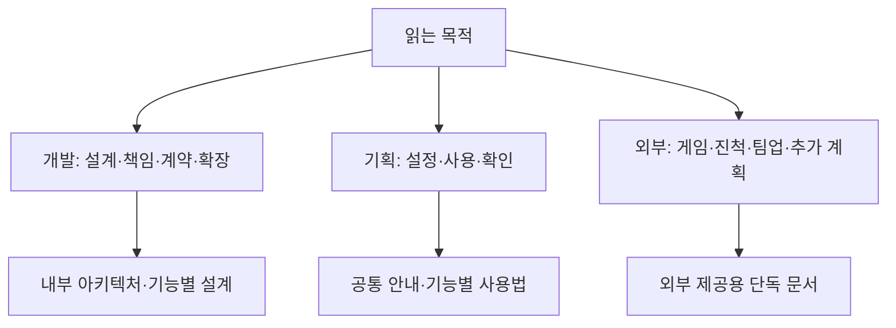

# 문서 안내

2026-11-13 기준입니다. 큰 기능을 고른 뒤 개발자 설계와 기획자 사용법을 나눠 읽습니다. 현재 상태는 현황 문서를 기준으로 하고, 날짜가 붙은 과거 검증·간트 보고서를 현재 완료율로 해석하지 않습니다.

## 목차

1. [읽는 사람에 따른 시작점](#1-읽는-사람에-따른-시작점)
2. [기능별 문서](#2-기능별-문서)
3. [데이터 프로젝트 원본과 안내](#3-데이터-프로젝트-원본과-안내)
4. [문서 갱신·귀속 기준](#4-문서-갱신귀속-기준)

## 1. 읽는 사람에 따른 시작점

| 목적 | 시작 문서 |
| --- | --- |
| 개발자 인수인계 | [내부 전체 아키텍처](개발자용%20설계문서/프로젝트%20전체%20아키텍처.md) |
| 현재 진행·변경·작업자 역할 | [현재 구현과 검증 현황](개발자용%20설계문서/현재%20구현과%20검증%20현황.md) |
| 기획자 설정·배포·게임 확인 | [공통 사용 안내](기획자용%20안내문서/기획자용%20공통%20모듈%20연결과%20확인%20안내.md) |
| 지스타 외부 전달 | [출품 개발 현황 소개](외부%20공개용%20문서/지스타%20출품%20개발%20현황%20소개.md) |

## 2. 기능별 문서

### 맵 출구와 도착 앵커

- [개발자 맵 출구와 도착 앵커 연결 설계](개발자용%20설계문서/맵%20출구와%20도착%20앵커%20연결%20설계.md)
- [기획자 가마터·갈림길 왕복 확인](기획자용%20안내문서/기획자용%20K9%20맵%20공급과%20연결%20확인%20안내.md#가마터갈림길-왕복-확인--2026-11-14)

### 언어 선택

- [개발자 언어 선택 설정 설계](개발자용%20설계문서/언어%20선택%20설정%20설계.md)
- [기획자 언어 선택과 문구 작성 안내](기획자용%20안내문서/기획자용%20언어%20선택과%20문구%20작성%20안내.md)

### 전체 설계·진행·공통 계약

- [담당 예정 기능 설계와 연결 기준](개발자용%20설계문서/담당%20예정%20기능%20설계와%20연결%20기준.md) — 2026-11-14 사용자 담당·옵션 후속·설계안과 미확정 범위
- [1114 통합 전달 대응 현황](개발자용%20설계문서/1114%20통합%20전달%20대응%20현황.md) — 2026-11-14 기획 통합 전달(A1~C6) 항목별 코드 기준 판정과 남은 작업
- [1114 다른 작업자 작업 가이드](개발자용%20설계문서/1114%20다른%20작업자%20작업%20가이드.md) — 2026-11-14 사용자 담당 외 1114 항목의 시작점·주의점·맞닿는 곳

**개발자용**

- [공통 모듈과 객체 수명 설계](%EA%B0%9C%EB%B0%9C%EC%9E%90%EC%9A%A9%20%EC%84%A4%EA%B3%84%EB%AC%B8%EC%84%9C/%EA%B3%B5%ED%86%B5%20%EB%AA%A8%EB%93%88%EA%B3%BC%20%EA%B0%9D%EC%B2%B4%20%EC%88%98%EB%AA%85%20%EC%84%A4%EA%B3%84.md)
- [남은 구현과 검증 작업](%EA%B0%9C%EB%B0%9C%EC%9E%90%EC%9A%A9%20%EC%84%A4%EA%B3%84%EB%AC%B8%EC%84%9C/%EB%82%A8%EC%9D%80%20%EA%B5%AC%ED%98%84%EA%B3%BC%20%EA%B2%80%EC%A6%9D%20%EC%9E%91%EC%97%85.md)
- [데이터 기반 모듈과 화면 표현 설계안](%EA%B0%9C%EB%B0%9C%EC%9E%90%EC%9A%A9%20%EC%84%A4%EA%B3%84%EB%AC%B8%EC%84%9C/%EB%8D%B0%EC%9D%B4%ED%84%B0%20%EA%B8%B0%EB%B0%98%20%EB%AA%A8%EB%93%88%EA%B3%BC%20%ED%99%94%EB%A9%B4%20%ED%91%9C%ED%98%84%20%EC%84%A4%EA%B3%84%EC%95%88.md)
- [설계 기준 점검과 개선 방향](%EA%B0%9C%EB%B0%9C%EC%9E%90%EC%9A%A9%20%EC%84%A4%EA%B3%84%EB%AC%B8%EC%84%9C/%EC%84%A4%EA%B3%84%20%EA%B8%B0%EC%A4%80%20%EC%A0%90%EA%B2%80%EA%B3%BC%20%EA%B0%9C%EC%84%A0%20%EB%B0%A9%ED%96%A5.md)
- [프로젝트 전체 아키텍처](%EA%B0%9C%EB%B0%9C%EC%9E%90%EC%9A%A9%20%EC%84%A4%EA%B3%84%EB%AC%B8%EC%84%9C/%ED%94%84%EB%A1%9C%EC%A0%9D%ED%8A%B8%20%EC%A0%84%EC%B2%B4%20%EC%95%84%ED%82%A4%ED%85%8D%EC%B2%98.md)
- [필수 기능과 오류 처리 계약](%EA%B0%9C%EB%B0%9C%EC%9E%90%EC%9A%A9%20%EC%84%A4%EA%B3%84%EB%AC%B8%EC%84%9C/%ED%95%84%EC%88%98%20%EA%B8%B0%EB%8A%A5%EA%B3%BC%20%EC%98%A4%EB%A5%98%20%EC%B2%98%EB%A6%AC%20%EA%B3%84%EC%95%BD.md)
- [현재 구현과 검증 현황](%EA%B0%9C%EB%B0%9C%EC%9E%90%EC%9A%A9%20%EC%84%A4%EA%B3%84%EB%AC%B8%EC%84%9C/%ED%98%84%EC%9E%AC%20%EA%B5%AC%ED%98%84%EA%B3%BC%20%EA%B2%80%EC%A6%9D%20%ED%98%84%ED%99%A9.md)

**기획자용**

- [기획자용 공통 모듈 연결과 확인 안내](%EA%B8%B0%ED%9A%8D%EC%9E%90%EC%9A%A9%20%EC%95%88%EB%82%B4%EB%AC%B8%EC%84%9C/%EA%B8%B0%ED%9A%8D%EC%9E%90%EC%9A%A9%20%EA%B3%B5%ED%86%B5%20%EB%AA%A8%EB%93%88%20%EC%97%B0%EA%B2%B0%EA%B3%BC%20%ED%99%95%EC%9D%B8%20%EC%95%88%EB%82%B4.md)

### 데이터·자동화·배포·검사

**개발자용**

- [검사 자동화와 데이터 오류 경계](%EA%B0%9C%EB%B0%9C%EC%9E%90%EC%9A%A9%20%EC%84%A4%EA%B3%84%EB%AC%B8%EC%84%9C/%EA%B2%80%EC%82%AC%20%EC%9E%90%EB%8F%99%ED%99%94%EC%99%80%20%EB%8D%B0%EC%9D%B4%ED%84%B0%20%EC%98%A4%EB%A5%98%20%EA%B2%BD%EA%B3%84.md)
- [데이터 계층 인수인계 가이드](%EA%B0%9C%EB%B0%9C%EC%9E%90%EC%9A%A9%20%EC%84%A4%EA%B3%84%EB%AC%B8%EC%84%9C/%EB%8D%B0%EC%9D%B4%ED%84%B0%20%EA%B3%84%EC%B8%B5%20%EC%9D%B8%EC%88%98%EC%9D%B8%EA%B3%84%20%EA%B0%80%EC%9D%B4%EB%93%9C.md)
- [데이터 자동 발견과 Unity 배포 경계 설계](%EA%B0%9C%EB%B0%9C%EC%9E%90%EC%9A%A9%20%EC%84%A4%EA%B3%84%EB%AC%B8%EC%84%9C/%EB%8D%B0%EC%9D%B4%ED%84%B0%20%EC%9E%90%EB%8F%99%20%EB%B0%9C%EA%B2%AC%EA%B3%BC%20Unity%20%EB%B0%B0%ED%8F%AC%20%EA%B2%BD%EA%B3%84%20%EC%84%A4%EA%B3%84.md)
- [배포 데이터와 기능 연결 검사 설계](%EA%B0%9C%EB%B0%9C%EC%9E%90%EC%9A%A9%20%EC%84%A4%EA%B3%84%EB%AC%B8%EC%84%9C/%EB%B0%B0%ED%8F%AC%20%EB%8D%B0%EC%9D%B4%ED%84%B0%EC%99%80%20%EA%B8%B0%EB%8A%A5%20%EC%97%B0%EA%B2%B0%20%EA%B2%80%EC%82%AC%20%EC%84%A4%EA%B3%84.md)
- [CSV 리더기](%EA%B0%9C%EB%B0%9C%EC%9E%90%EC%9A%A9%20%EC%84%A4%EA%B3%84%EB%AC%B8%EC%84%9C/CSV%20%EB%A6%AC%EB%8D%94%EA%B8%B0.md)
- [NPC 데이터 배포 준비 설계](%EA%B0%9C%EB%B0%9C%EC%9E%90%EC%9A%A9%20%EC%84%A4%EA%B3%84%EB%AC%B8%EC%84%9C/NPC%20%EB%8D%B0%EC%9D%B4%ED%84%B0%20%EB%B0%B0%ED%8F%AC%20%EC%A4%80%EB%B9%84%20%EC%84%A4%EA%B3%84.md)

**기획자용**

- [기획자용 프로젝트 검사 사용 안내](%EA%B8%B0%ED%9A%8D%EC%9E%90%EC%9A%A9%20%EC%95%88%EB%82%B4%EB%AC%B8%EC%84%9C/%EA%B8%B0%ED%9A%8D%EC%9E%90%EC%9A%A9%20%ED%94%84%EB%A1%9C%EC%A0%9D%ED%8A%B8%20%EA%B2%80%EC%82%AC%20%EC%82%AC%EC%9A%A9%20%EC%95%88%EB%82%B4.md)
- [배포 검사 결과 확인 안내](%EA%B8%B0%ED%9A%8D%EC%9E%90%EC%9A%A9%20%EC%95%88%EB%82%B4%EB%AC%B8%EC%84%9C/%EB%B0%B0%ED%8F%AC%20%EA%B2%80%EC%82%AC%20%EA%B2%B0%EA%B3%BC%20%ED%99%95%EC%9D%B8%20%EC%95%88%EB%82%B4.md)
- [새 시트와 JSON 자동 배포 사용 안내](%EA%B8%B0%ED%9A%8D%EC%9E%90%EC%9A%A9%20%EC%95%88%EB%82%B4%EB%AC%B8%EC%84%9C/%EC%83%88%20%EC%8B%9C%ED%8A%B8%EC%99%80%20JSON%20%EC%9E%90%EB%8F%99%20%EB%B0%B0%ED%8F%AC%20%EC%82%AC%EC%9A%A9%20%EC%95%88%EB%82%B4.md)
- [NPC 데이터 작성과 배포 준비 안내](%EA%B8%B0%ED%9A%8D%EC%9E%90%EC%9A%A9%20%EC%95%88%EB%82%B4%EB%AC%B8%EC%84%9C/NPC%20%EB%8D%B0%EC%9D%B4%ED%84%B0%20%EC%9E%91%EC%84%B1%EA%B3%BC%20%EB%B0%B0%ED%8F%AC%20%EC%A4%80%EB%B9%84%20%EC%95%88%EB%82%B4.md)

### 게임플레이·전투·이동·필드

**개발자용**

- [게임플레이 모듈 구조](%EA%B0%9C%EB%B0%9C%EC%9E%90%EC%9A%A9%20%EC%84%A4%EA%B3%84%EB%AC%B8%EC%84%9C/%EA%B2%8C%EC%9E%84%ED%94%8C%EB%A0%88%EC%9D%B4%20%EB%AA%A8%EB%93%88%20%EA%B5%AC%EC%A1%B0.md)
- [게임플레이 코어와 프리팹 연결](%EA%B0%9C%EB%B0%9C%EC%9E%90%EC%9A%A9%20%EC%84%A4%EA%B3%84%EB%AC%B8%EC%84%9C/%EA%B2%8C%EC%9E%84%ED%94%8C%EB%A0%88%EC%9D%B4%20%EC%BD%94%EC%96%B4%EC%99%80%20%ED%94%84%EB%A6%AC%ED%8C%B9%20%EC%97%B0%EA%B2%B0.md)
- [발판 내려가기와 사다리 이동 설계](%EA%B0%9C%EB%B0%9C%EC%9E%90%EC%9A%A9%20%EC%84%A4%EA%B3%84%EB%AC%B8%EC%84%9C/%EB%B0%9C%ED%8C%90%20%EB%82%B4%EB%A0%A4%EA%B0%80%EA%B8%B0%EC%99%80%20%EC%82%AC%EB%8B%A4%EB%A6%AC%20%EC%9D%B4%EB%8F%99%20%EC%84%A4%EA%B3%84.md)
- [이동과 스태미나 코어](%EA%B0%9C%EB%B0%9C%EC%9E%90%EC%9A%A9%20%EC%84%A4%EA%B3%84%EB%AC%B8%EC%84%9C/%EC%9D%B4%EB%8F%99%EA%B3%BC%20%EC%8A%A4%ED%83%9C%EB%AF%B8%EB%82%98%20%EC%BD%94%EC%96%B4.md)
- [일반 몬스터 인공지능](%EA%B0%9C%EB%B0%9C%EC%9E%90%EC%9A%A9%20%EC%84%A4%EA%B3%84%EB%AC%B8%EC%84%9C/%EC%9D%BC%EB%B0%98%20%EB%AA%AC%EC%8A%A4%ED%84%B0%20%EC%9D%B8%EA%B3%B5%EC%A7%80%EB%8A%A5.md)
- [필드 효과 상태와 enum 배포 설계](%EA%B0%9C%EB%B0%9C%EC%9E%90%EC%9A%A9%20%EC%84%A4%EA%B3%84%EB%AC%B8%EC%84%9C/%ED%95%84%EB%93%9C%20%ED%9A%A8%EA%B3%BC%20%EC%83%81%ED%83%9C%EC%99%80%20enum%20%EB%B0%B0%ED%8F%AC%20%EC%84%A4%EA%B3%84.md)

**기획자용**

- [기획자용 K9 맵 공급과 연결 확인 안내](%EA%B8%B0%ED%9A%8D%EC%9E%90%EC%9A%A9%20%EC%95%88%EB%82%B4%EB%AC%B8%EC%84%9C/%EA%B8%B0%ED%9A%8D%EC%9E%90%EC%9A%A9%20K9%20%EB%A7%B5%20%EA%B3%B5%EA%B8%89%EA%B3%BC%20%EC%97%B0%EA%B2%B0%20%ED%99%95%EC%9D%B8%20%EC%95%88%EB%82%B4.md)
- [임시 게임플레이 확인 안내](%EA%B8%B0%ED%9A%8D%EC%9E%90%EC%9A%A9%20%EC%95%88%EB%82%B4%EB%AC%B8%EC%84%9C/%EC%9E%84%EC%8B%9C%20%EA%B2%8C%EC%9E%84%ED%94%8C%EB%A0%88%EC%9D%B4%20%ED%99%95%EC%9D%B8%20%EC%95%88%EB%82%B4.md)
- [필드 효과와 enum 시트 사용 안내](%EA%B8%B0%ED%9A%8D%EC%9E%90%EC%9A%A9%20%EC%95%88%EB%82%B4%EB%AC%B8%EC%84%9C/%ED%95%84%EB%93%9C%20%ED%9A%A8%EA%B3%BC%EC%99%80%20enum%20%EC%8B%9C%ED%8A%B8%20%EC%82%AC%EC%9A%A9%20%EC%95%88%EB%82%B4.md)

### 성장·저장·공간 진행

**개발자용**

- [병합 누락 복구와 갈림길 보상 설계](%EA%B0%9C%EB%B0%9C%EC%9E%90%EC%9A%A9%20%EC%84%A4%EA%B3%84%EB%AC%B8%EC%84%9C/%EB%B3%91%ED%95%A9%20%EB%88%84%EB%9D%BD%20%EB%B3%B5%EA%B5%AC%EC%99%80%20%EA%B0%88%EB%A6%BC%EA%B8%B8%20%EB%B3%B4%EC%83%81%20%EC%84%A4%EA%B3%84.md)
- [서낭당 강화 데이터 배포 설계](%EA%B0%9C%EB%B0%9C%EC%9E%90%EC%9A%A9%20%EC%84%A4%EA%B3%84%EB%AC%B8%EC%84%9C/%EC%84%9C%EB%82%AD%EB%8B%B9%20%EA%B0%95%ED%99%94%20%EB%8D%B0%EC%9D%B4%ED%84%B0%20%EB%B0%B0%ED%8F%AC%20%EC%84%A4%EA%B3%84.md)
- [재화와 강화 구매 설계](%EA%B0%9C%EB%B0%9C%EC%9E%90%EC%9A%A9%20%EC%84%A4%EA%B3%84%EB%AC%B8%EC%84%9C/%EC%9E%AC%ED%99%94%EC%99%80%20%EA%B0%95%ED%99%94%20%EA%B5%AC%EB%A7%A4%20%EC%84%A4%EA%B3%84.md)
- [저장 기능 설계](%EA%B0%9C%EB%B0%9C%EC%9E%90%EC%9A%A9%20%EC%84%A4%EA%B3%84%EB%AC%B8%EC%84%9C/%EC%A0%80%EC%9E%A5%20%EA%B8%B0%EB%8A%A5%20%EC%84%A4%EA%B3%84.md)
- [콘텐츠 잠금 설계](%EA%B0%9C%EB%B0%9C%EC%9E%90%EC%9A%A9%20%EC%84%A4%EA%B3%84%EB%AC%B8%EC%84%9C/%EC%BD%98%ED%85%90%EC%B8%A0%20%EC%9E%A0%EA%B8%88%20%EC%84%A4%EA%B3%84.md)
- [테스트 초기화와 공용 확인 팝업 설계](%EA%B0%9C%EB%B0%9C%EC%9E%90%EC%9A%A9%20%EC%84%A4%EA%B3%84%EB%AC%B8%EC%84%9C/%ED%85%8C%EC%8A%A4%ED%8A%B8%20%EC%B4%88%EA%B8%B0%ED%99%94%EC%99%80%20%EA%B3%B5%EC%9A%A9%20%ED%99%95%EC%9D%B8%20%ED%8C%9D%EC%97%85%20%EC%84%A4%EA%B3%84.md)

**기획자용**

- [갈림길 보상 작성과 검수 안내](%EA%B8%B0%ED%9A%8D%EC%9E%90%EC%9A%A9%20%EC%95%88%EB%82%B4%EB%AC%B8%EC%84%9C/%EA%B0%88%EB%A6%BC%EA%B8%B8%20%EB%B3%B4%EC%83%81%20%EC%9E%91%EC%84%B1%EA%B3%BC%20%EA%B2%80%EC%88%98%20%EC%95%88%EB%82%B4.md)
- [기획자용 관문 데이터 작성과 확인 안내](%EA%B8%B0%ED%9A%8D%EC%9E%90%EC%9A%A9%20%EC%95%88%EB%82%B4%EB%AC%B8%EC%84%9C/%EA%B8%B0%ED%9A%8D%EC%9E%90%EC%9A%A9%20%EA%B4%80%EB%AC%B8%20%EB%8D%B0%EC%9D%B4%ED%84%B0%20%EC%9E%91%EC%84%B1%EA%B3%BC%20%ED%99%95%EC%9D%B8%20%EC%95%88%EB%82%B4.md)
- [기획자용 수동 저장 사용 안내](%EA%B8%B0%ED%9A%8D%EC%9E%90%EC%9A%A9%20%EC%95%88%EB%82%B4%EB%AC%B8%EC%84%9C/%EA%B8%B0%ED%9A%8D%EC%9E%90%EC%9A%A9%20%EC%88%98%EB%8F%99%20%EC%A0%80%EC%9E%A5%20%EC%82%AC%EC%9A%A9%20%EC%95%88%EB%82%B4.md)
- [기획자용 재화와 강화 준비 안내](%EA%B8%B0%ED%9A%8D%EC%9E%90%EC%9A%A9%20%EC%95%88%EB%82%B4%EB%AC%B8%EC%84%9C/%EA%B8%B0%ED%9A%8D%EC%9E%90%EC%9A%A9%20%EC%9E%AC%ED%99%94%EC%99%80%20%EA%B0%95%ED%99%94%20%EC%A4%80%EB%B9%84%20%EC%95%88%EB%82%B4.md)
- [기획자용 콘텐츠 잠금 사용 안내](%EA%B8%B0%ED%9A%8D%EC%9E%90%EC%9A%A9%20%EC%95%88%EB%82%B4%EB%AC%B8%EC%84%9C/%EA%B8%B0%ED%9A%8D%EC%9E%90%EC%9A%A9%20%EC%BD%98%ED%85%90%EC%B8%A0%20%EC%9E%A0%EA%B8%88%20%EC%82%AC%EC%9A%A9%20%EC%95%88%EB%82%B4.md)
- [기획자용 F12 초기화 사용 안내](%EA%B8%B0%ED%9A%8D%EC%9E%90%EC%9A%A9%20%EC%95%88%EB%82%B4%EB%AC%B8%EC%84%9C/%EA%B8%B0%ED%9A%8D%EC%9E%90%EC%9A%A9%20F12%20%EC%B4%88%EA%B8%B0%ED%99%94%20%EC%82%AC%EC%9A%A9%20%EC%95%88%EB%82%B4.md)
- [서낭당 강화 데이터 배포 안내](%EA%B8%B0%ED%9A%8D%EC%9E%90%EC%9A%A9%20%EC%95%88%EB%82%B4%EB%AC%B8%EC%84%9C/%EC%84%9C%EB%82%AD%EB%8B%B9%20%EA%B0%95%ED%99%94%20%EB%8D%B0%EC%9D%B4%ED%84%B0%20%EB%B0%B0%ED%8F%AC%20%EC%95%88%EB%82%B4.md)
- [서낭당 저장과 몬스터 처치 기록 확인 안내](%EA%B8%B0%ED%9A%8D%EC%9E%90%EC%9A%A9%20%EC%95%88%EB%82%B4%EB%AC%B8%EC%84%9C/%EC%84%9C%EB%82%AD%EB%8B%B9%20%EC%A0%80%EC%9E%A5%EA%B3%BC%20%EB%AA%AC%EC%8A%A4%ED%84%B0%20%EC%B2%98%EC%B9%98%20%EA%B8%B0%EB%A1%9D%20%ED%99%95%EC%9D%B8%20%EC%95%88%EB%82%B4.md)

### 화면·대사·연출·소리

**개발자용**

- [공용 에러 팝업 설계](%EA%B0%9C%EB%B0%9C%EC%9E%90%EC%9A%A9%20%EC%84%A4%EA%B3%84%EB%AC%B8%EC%84%9C/%EA%B3%B5%EC%9A%A9%20%EC%97%90%EB%9F%AC%20%ED%8C%9D%EC%97%85%20%EC%84%A4%EA%B3%84.md)
- [공용 즉시 스킵 설계](%EA%B0%9C%EB%B0%9C%EC%9E%90%EC%9A%A9%20%EC%84%A4%EA%B3%84%EB%AC%B8%EC%84%9C/%EA%B3%B5%EC%9A%A9%20%EC%A6%89%EC%8B%9C%20%EC%8A%A4%ED%82%B5%20%EC%84%A4%EA%B3%84.md)
- [반복 갱신과 임시 표시 최적화 설계](%EA%B0%9C%EB%B0%9C%EC%9E%90%EC%9A%A9%20%EC%84%A4%EA%B3%84%EB%AC%B8%EC%84%9C/%EB%B0%98%EB%B3%B5%20%EA%B0%B1%EC%8B%A0%EA%B3%BC%20%EC%9E%84%EC%8B%9C%20%ED%91%9C%EC%8B%9C%20%EC%B5%9C%EC%A0%81%ED%99%94%20%EC%84%A4%EA%B3%84.md)
- [사운드 설정 설계](%EA%B0%9C%EB%B0%9C%EC%9E%90%EC%9A%A9%20%EC%84%A4%EA%B3%84%EB%AC%B8%EC%84%9C/%EC%82%AC%EC%9A%B4%EB%93%9C%20%EC%84%A4%EC%A0%95%20%EC%84%A4%EA%B3%84.md)
- [체력 표시 모듈 사용과 설계 안내](%EA%B0%9C%EB%B0%9C%EC%9E%90%EC%9A%A9%20%EC%84%A4%EA%B3%84%EB%AC%B8%EC%84%9C/%EC%B2%B4%EB%A0%A5%20%ED%91%9C%EC%8B%9C%20%EB%AA%A8%EB%93%88%20%EC%82%AC%EC%9A%A9%EA%B3%BC%20%EC%84%A4%EA%B3%84%20%EC%95%88%EB%82%B4.md)
- [컷씬 재생 설계](%EA%B0%9C%EB%B0%9C%EC%9E%90%EC%9A%A9%20%EC%84%A4%EA%B3%84%EB%AC%B8%EC%84%9C/%EC%BB%B7%EC%94%AC%20%EC%9E%AC%EC%83%9D%20%EC%84%A4%EA%B3%84.md)
- [타이틀 설계](%EA%B0%9C%EB%B0%9C%EC%9E%90%EC%9A%A9%20%EC%84%A4%EA%B3%84%EB%AC%B8%EC%84%9C/%ED%83%80%EC%9D%B4%ED%8B%80%20%EC%84%A4%EA%B3%84.md)
- [UI 글꼴과 맵 도착 표시 설계](%EA%B0%9C%EB%B0%9C%EC%9E%90%EC%9A%A9%20%EC%84%A4%EA%B3%84%EB%AC%B8%EC%84%9C/UI%20%EA%B8%80%EA%BC%B4%EA%B3%BC%20%EB%A7%B5%20%EB%8F%84%EC%B0%A9%20%ED%91%9C%EC%8B%9C%20%EC%84%A4%EA%B3%84.md)

**기획자용**

- [기획자용 사운드 상황별 재생 조건 요청서](%EA%B8%B0%ED%9A%8D%EC%9E%90%EC%9A%A9%20%EC%95%88%EB%82%B4%EB%AC%B8%EC%84%9C/%EA%B8%B0%ED%9A%8D%EC%9E%90%EC%9A%A9%20%EC%82%AC%EC%9A%B4%EB%93%9C%20%EC%83%81%ED%99%A9%EB%B3%84%20%EC%9E%AC%EC%83%9D%20%EC%A1%B0%EA%B1%B4%20%EC%9A%94%EC%B2%AD%EC%84%9C.md)
- [기획자용 사운드 설정 사용 안내](%EA%B8%B0%ED%9A%8D%EC%9E%90%EC%9A%A9%20%EC%95%88%EB%82%B4%EB%AC%B8%EC%84%9C/%EA%B8%B0%ED%9A%8D%EC%9E%90%EC%9A%A9%20%EC%82%AC%EC%9A%B4%EB%93%9C%20%EC%84%A4%EC%A0%95%20%EC%82%AC%EC%9A%A9%20%EC%95%88%EB%82%B4.md)
- [기획자용 사운드 테이블 작성과 배포 안내](%EA%B8%B0%ED%9A%8D%EC%9E%90%EC%9A%A9%20%EC%95%88%EB%82%B4%EB%AC%B8%EC%84%9C/%EA%B8%B0%ED%9A%8D%EC%9E%90%EC%9A%A9%20%EC%82%AC%EC%9A%B4%EB%93%9C%20%ED%85%8C%EC%9D%B4%EB%B8%94%20%EC%9E%91%EC%84%B1%EA%B3%BC%20%EB%B0%B0%ED%8F%AC%20%EC%95%88%EB%82%B4.md)
- [기획자용 에러 팝업 사용 안내](%EA%B8%B0%ED%9A%8D%EC%9E%90%EC%9A%A9%20%EC%95%88%EB%82%B4%EB%AC%B8%EC%84%9C/%EA%B8%B0%ED%9A%8D%EC%9E%90%EC%9A%A9%20%EC%97%90%EB%9F%AC%20%ED%8C%9D%EC%97%85%20%EC%82%AC%EC%9A%A9%20%EC%95%88%EB%82%B4.md)
- [기획자용 즉시 스킵 사용 안내](%EA%B8%B0%ED%9A%8D%EC%9E%90%EC%9A%A9%20%EC%95%88%EB%82%B4%EB%AC%B8%EC%84%9C/%EA%B8%B0%ED%9A%8D%EC%9E%90%EC%9A%A9%20%EC%A6%89%EC%8B%9C%20%EC%8A%A4%ED%82%B5%20%EC%82%AC%EC%9A%A9%20%EC%95%88%EB%82%B4.md)
- [기획자용 컷씬 표시와 씬 이동 안내](%EA%B8%B0%ED%9A%8D%EC%9E%90%EC%9A%A9%20%EC%95%88%EB%82%B4%EB%AC%B8%EC%84%9C/%EA%B8%B0%ED%9A%8D%EC%9E%90%EC%9A%A9%20%EC%BB%B7%EC%94%AC%20%ED%91%9C%EC%8B%9C%EC%99%80%20%EC%94%AC%20%EC%9D%B4%EB%8F%99%20%EC%95%88%EB%82%B4.md)
- [기획자용 타이틀 사용 안내](%EA%B8%B0%ED%9A%8D%EC%9E%90%EC%9A%A9%20%EC%95%88%EB%82%B4%EB%AC%B8%EC%84%9C/%EA%B8%B0%ED%9A%8D%EC%9E%90%EC%9A%A9%20%ED%83%80%EC%9D%B4%ED%8B%80%20%EC%82%AC%EC%9A%A9%20%EC%95%88%EB%82%B4.md)
- [앵커 기반 프리팹 배치 안내](%EA%B8%B0%ED%9A%8D%EC%9E%90%EC%9A%A9%20%EC%95%88%EB%82%B4%EB%AC%B8%EC%84%9C/%EC%95%B5%EC%BB%A4%20%EA%B8%B0%EB%B0%98%20%ED%94%84%EB%A6%AC%ED%8C%B9%20%EB%B0%B0%EC%B9%98%20%EC%95%88%EB%82%B4.md)
- [앵커 체력 표시 테스트 안내](%EA%B8%B0%ED%9A%8D%EC%9E%90%EC%9A%A9%20%EC%95%88%EB%82%B4%EB%AC%B8%EC%84%9C/%EC%95%B5%EC%BB%A4%20%EC%B2%B4%EB%A0%A5%20%ED%91%9C%EC%8B%9C%20%ED%85%8C%EC%8A%A4%ED%8A%B8%20%EC%95%88%EB%82%B4.md)
- [오류 안내와 기능 중단 확인 안내](%EA%B8%B0%ED%9A%8D%EC%9E%90%EC%9A%A9%20%EC%95%88%EB%82%B4%EB%AC%B8%EC%84%9C/%EC%98%A4%EB%A5%98%20%EC%95%88%EB%82%B4%EC%99%80%20%EA%B8%B0%EB%8A%A5%20%EC%A4%91%EB%8B%A8%20%ED%99%95%EC%9D%B8%20%EC%95%88%EB%82%B4.md)
- [표시 갱신 최적화 확인 안내](%EA%B8%B0%ED%9A%8D%EC%9E%90%EC%9A%A9%20%EC%95%88%EB%82%B4%EB%AC%B8%EC%84%9C/%ED%91%9C%EC%8B%9C%20%EA%B0%B1%EC%8B%A0%20%EC%B5%9C%EC%A0%81%ED%99%94%20%ED%99%95%EC%9D%B8%20%EC%95%88%EB%82%B4.md)
- [플레이어 동작 사운드 연결 안내](%EA%B8%B0%ED%9A%8D%EC%9E%90%EC%9A%A9%20%EC%95%88%EB%82%B4%EB%AC%B8%EC%84%9C/%ED%94%8C%EB%A0%88%EC%9D%B4%EC%96%B4%20%EB%8F%99%EC%9E%91%20%EC%82%AC%EC%9A%B4%EB%93%9C%20%EC%97%B0%EA%B2%B0%20%EC%95%88%EB%82%B4.md)
- [하단 점프·사다리·신규 인게임 UI 확인 안내](%EA%B8%B0%ED%9A%8D%EC%9E%90%EC%9A%A9%20%EC%95%88%EB%82%B4%EB%AC%B8%EC%84%9C/%ED%95%98%EB%8B%A8%20%EC%A0%90%ED%94%84%C2%B7%EC%82%AC%EB%8B%A4%EB%A6%AC%C2%B7%EC%8B%A0%EA%B7%9C%20%EC%9D%B8%EA%B2%8C%EC%9E%84%20UI%20%ED%99%95%EC%9D%B8%20%EC%95%88%EB%82%B4.md)
- [UI 글꼴과 맵 도착 표시 안내](%EA%B8%B0%ED%9A%8D%EC%9E%90%EC%9A%A9%20%EC%95%88%EB%82%B4%EB%AC%B8%EC%84%9C/UI%20%EA%B8%80%EA%BC%B4%EA%B3%BC%20%EB%A7%B5%20%EB%8F%84%EC%B0%A9%20%ED%91%9C%EC%8B%9C%20%EC%95%88%EB%82%B4.md)

### 아트·리소스·리깅 검토

**개발자용**

- [쇄문아비 2페이즈 공격 전용 리그 개선과 검증](%EA%B0%9C%EB%B0%9C%EC%9E%90%EC%9A%A9%20%EC%84%A4%EA%B3%84%EB%AC%B8%EC%84%9C/%EC%87%84%EB%AC%B8%EC%95%84%EB%B9%84%202%ED%8E%98%EC%9D%B4%EC%A6%88%20%EA%B3%B5%EA%B2%A9%20%EC%A0%84%EC%9A%A9%20%EB%A6%AC%EA%B7%B8%20%EA%B0%9C%EC%84%A0%EA%B3%BC%20%EA%B2%80%EC%A6%9D.md)
- [쇄문아비 2페이즈 Attack1 대응 시험과 한계](%EA%B0%9C%EB%B0%9C%EC%9E%90%EC%9A%A9%20%EC%84%A4%EA%B3%84%EB%AC%B8%EC%84%9C/%EC%87%84%EB%AC%B8%EC%95%84%EB%B9%84%202%ED%8E%98%EC%9D%B4%EC%A6%88%20Attack1%20%EB%8C%80%EC%9D%91%20%EC%8B%9C%ED%97%98%EA%B3%BC%20%ED%95%9C%EA%B3%84.md)
- [쇄문아비 2페이즈 Attack2 설계와 검증](%EA%B0%9C%EB%B0%9C%EC%9E%90%EC%9A%A9%20%EC%84%A4%EA%B3%84%EB%AC%B8%EC%84%9C/%EC%87%84%EB%AC%B8%EC%95%84%EB%B9%84%202%ED%8E%98%EC%9D%B4%EC%A6%88%20Attack2%20%EC%84%A4%EA%B3%84%EC%99%80%20%EA%B2%80%EC%A6%9D.md)
- [쇄문아비 2페이즈 Idle 리그 설계와 검증](%EA%B0%9C%EB%B0%9C%EC%9E%90%EC%9A%A9%20%EC%84%A4%EA%B3%84%EB%AC%B8%EC%84%9C/%EC%87%84%EB%AC%B8%EC%95%84%EB%B9%84%202%ED%8E%98%EC%9D%B4%EC%A6%88%20Idle%20%EB%A6%AC%EA%B7%B8%20%EC%84%A4%EA%B3%84%EC%99%80%20%EA%B2%80%EC%A6%9D.md)
- [쇄문아비 2페이즈 Walk 초안 설계와 검증](%EA%B0%9C%EB%B0%9C%EC%9E%90%EC%9A%A9%20%EC%84%A4%EA%B3%84%EB%AC%B8%EC%84%9C/%EC%87%84%EB%AC%B8%EC%95%84%EB%B9%84%202%ED%8E%98%EC%9D%B4%EC%A6%88%20Walk%20%EC%B4%88%EC%95%88%20%EC%84%A4%EA%B3%84%EC%99%80%20%EA%B2%80%EC%A6%9D.md)
- [최신 Git 반영과 코드·리소스 개선 비교](%EA%B0%9C%EB%B0%9C%EC%9E%90%EC%9A%A9%20%EC%84%A4%EA%B3%84%EB%AC%B8%EC%84%9C/%EC%B5%9C%EC%8B%A0%20Git%20%EB%B0%98%EC%98%81%EA%B3%BC%20%EC%BD%94%EB%93%9C%C2%B7%EB%A6%AC%EC%86%8C%EC%8A%A4%20%EA%B0%9C%EC%84%A0%20%EB%B9%84%EA%B5%90.md)
- [캐릭터 상태 애니메이션 연결 설계](%EA%B0%9C%EB%B0%9C%EC%9E%90%EC%9A%A9%20%EC%84%A4%EA%B3%84%EB%AC%B8%EC%84%9C/%EC%BA%90%EB%A6%AD%ED%84%B0%20%EC%83%81%ED%83%9C%20%EC%95%A0%EB%8B%88%EB%A9%94%EC%9D%B4%EC%85%98%20%EC%97%B0%EA%B2%B0%20%EC%84%A4%EA%B3%84.md)

**기획자용**

- [쇄문아비 2페이즈 Attack1 개선본 확인 안내](%EA%B8%B0%ED%9A%8D%EC%9E%90%EC%9A%A9%20%EC%95%88%EB%82%B4%EB%AC%B8%EC%84%9C/%EC%87%84%EB%AC%B8%EC%95%84%EB%B9%84%202%ED%8E%98%EC%9D%B4%EC%A6%88%20Attack1%20%EA%B0%9C%EC%84%A0%EB%B3%B8%20%ED%99%95%EC%9D%B8%20%EC%95%88%EB%82%B4.md)
- [쇄문아비 2페이즈 Attack1 대응 시험 안내](%EA%B8%B0%ED%9A%8D%EC%9E%90%EC%9A%A9%20%EC%95%88%EB%82%B4%EB%AC%B8%EC%84%9C/%EC%87%84%EB%AC%B8%EC%95%84%EB%B9%84%202%ED%8E%98%EC%9D%B4%EC%A6%88%20Attack1%20%EB%8C%80%EC%9D%91%20%EC%8B%9C%ED%97%98%20%EC%95%88%EB%82%B4.md)
- [쇄문아비 2페이즈 Attack2 확인 안내](%EA%B8%B0%ED%9A%8D%EC%9E%90%EC%9A%A9%20%EC%95%88%EB%82%B4%EB%AC%B8%EC%84%9C/%EC%87%84%EB%AC%B8%EC%95%84%EB%B9%84%202%ED%8E%98%EC%9D%B4%EC%A6%88%20Attack2%20%ED%99%95%EC%9D%B8%20%EC%95%88%EB%82%B4.md)
- [쇄문아비 2페이즈 Idle 확인 안내](%EA%B8%B0%ED%9A%8D%EC%9E%90%EC%9A%A9%20%EC%95%88%EB%82%B4%EB%AC%B8%EC%84%9C/%EC%87%84%EB%AC%B8%EC%95%84%EB%B9%84%202%ED%8E%98%EC%9D%B4%EC%A6%88%20Idle%20%ED%99%95%EC%9D%B8%20%EC%95%88%EB%82%B4.md)
- [쇄문아비 2페이즈 Walk 초안 확인 안내](%EA%B8%B0%ED%9A%8D%EC%9E%90%EC%9A%A9%20%EC%95%88%EB%82%B4%EB%AC%B8%EC%84%9C/%EC%87%84%EB%AC%B8%EC%95%84%EB%B9%84%202%ED%8E%98%EC%9D%B4%EC%A6%88%20Walk%20%EC%B4%88%EC%95%88%20%ED%99%95%EC%9D%B8%20%EC%95%88%EB%82%B4.md)
- [최신 맵과 리소스 압축 확인 안내](%EA%B8%B0%ED%9A%8D%EC%9E%90%EC%9A%A9%20%EC%95%88%EB%82%B4%EB%AC%B8%EC%84%9C/%EC%B5%9C%EC%8B%A0%20%EB%A7%B5%EA%B3%BC%20%EB%A6%AC%EC%86%8C%EC%8A%A4%20%EC%95%95%EC%B6%95%20%ED%99%95%EC%9D%B8%20%EC%95%88%EB%82%B4.md)
- [캐릭터 스프라이트 애니메이션 확인 안내](%EA%B8%B0%ED%9A%8D%EC%9E%90%EC%9A%A9%20%EC%95%88%EB%82%B4%EB%AC%B8%EC%84%9C/%EC%BA%90%EB%A6%AD%ED%84%B0%20%EC%8A%A4%ED%94%84%EB%9D%BC%EC%9D%B4%ED%8A%B8%20%EC%95%A0%EB%8B%88%EB%A9%94%EC%9D%B4%EC%85%98%20%ED%99%95%EC%9D%B8%20%EC%95%88%EB%82%B4.md)

### 운영·통계·빌드

**개발자용**

- [테스트와 정식 빌드 선택 설계](%EA%B0%9C%EB%B0%9C%EC%9E%90%EC%9A%A9%20%EC%84%A4%EA%B3%84%EB%AC%B8%EC%84%9C/%ED%85%8C%EC%8A%A4%ED%8A%B8%EC%99%80%20%EC%A0%95%EC%8B%9D%20%EB%B9%8C%EB%93%9C%20%EC%84%A0%ED%83%9D%20%EC%84%A4%EA%B3%84.md)
- [플레이 통계와 오류 수집 설계](%EA%B0%9C%EB%B0%9C%EC%9E%90%EC%9A%A9%20%EC%84%A4%EA%B3%84%EB%AC%B8%EC%84%9C/%ED%94%8C%EB%A0%88%EC%9D%B4%20%ED%86%B5%EA%B3%84%EC%99%80%20%EC%98%A4%EB%A5%98%20%EC%88%98%EC%A7%91%20%EC%84%A4%EA%B3%84.md)
- [Firebase 통계 인증·전송·조회 설계](%EA%B0%9C%EB%B0%9C%EC%9E%90%EC%9A%A9%20%EC%84%A4%EA%B3%84%EB%AC%B8%EC%84%9C/Firebase%20%ED%86%B5%EA%B3%84%20%EC%9D%B8%EC%A6%9D%C2%B7%EC%A0%84%EC%86%A1%C2%B7%EC%A1%B0%ED%9A%8C%20%EC%84%A4%EA%B3%84.md)

**기획자용**

- [디스코드 알림 설정 안내](%EA%B8%B0%ED%9A%8D%EC%9E%90%EC%9A%A9%20%EC%95%88%EB%82%B4%EB%AC%B8%EC%84%9C/%EB%94%94%EC%8A%A4%EC%BD%94%EB%93%9C%20%EC%95%8C%EB%A6%BC%20%EC%84%A4%EC%A0%95%20%EC%95%88%EB%82%B4.md)
- [통계 콘솔 조회와 엑셀 다운로드 안내](%EA%B8%B0%ED%9A%8D%EC%9E%90%EC%9A%A9%20%EC%95%88%EB%82%B4%EB%AC%B8%EC%84%9C/%ED%86%B5%EA%B3%84%20%EC%BD%98%EC%86%94%20%EC%A1%B0%ED%9A%8C%EC%99%80%20%EC%97%91%EC%85%80%20%EB%8B%A4%EC%9A%B4%EB%A1%9C%EB%93%9C%20%EC%95%88%EB%82%B4.md)
- [플레이 통계 수집과 확인 안내](%EA%B8%B0%ED%9A%8D%EC%9E%90%EC%9A%A9%20%EC%95%88%EB%82%B4%EB%AC%B8%EC%84%9C/%ED%94%8C%EB%A0%88%EC%9D%B4%20%ED%86%B5%EA%B3%84%20%EC%88%98%EC%A7%91%EA%B3%BC%20%ED%99%95%EC%9D%B8%20%EC%95%88%EB%82%B4.md)
- [GitHub 빌드와 디스코드 공지 사용 안내](%EA%B8%B0%ED%9A%8D%EC%9E%90%EC%9A%A9%20%EC%95%88%EB%82%B4%EB%AC%B8%EC%84%9C/GitHub%20%EB%B9%8C%EB%93%9C%EC%99%80%20%EB%94%94%EC%8A%A4%EC%BD%94%EB%93%9C%20%EA%B3%B5%EC%A7%80%20%EC%82%AC%EC%9A%A9%20%EC%95%88%EB%82%B4.md)

### 기획 대조·제안·과거 기록

**개발자용**

- [간트와 프로젝트 통합 진행 현황](%EA%B0%9C%EB%B0%9C%EC%9E%90%EC%9A%A9%20%EC%84%A4%EA%B3%84%EB%AC%B8%EC%84%9C/%EA%B0%84%ED%8A%B8%EC%99%80%20%ED%94%84%EB%A1%9C%EC%A0%9D%ED%8A%B8%20%ED%86%B5%ED%95%A9%20%EC%A7%84%ED%96%89%20%ED%98%84%ED%99%A9.md)
- [기획 완료 기준 점검표](%EA%B0%9C%EB%B0%9C%EC%9E%90%EC%9A%A9%20%EC%84%A4%EA%B3%84%EB%AC%B8%EC%84%9C/%EA%B8%B0%ED%9A%8D%20%EC%99%84%EB%A3%8C%20%EA%B8%B0%EC%A4%80%20%EC%A0%90%EA%B2%80%ED%91%9C.md)
- [기획 확정 반영 기준](%EA%B0%9C%EB%B0%9C%EC%9E%90%EC%9A%A9%20%EC%84%A4%EA%B3%84%EB%AC%B8%EC%84%9C/%EA%B8%B0%ED%9A%8D%20%ED%99%95%EC%A0%95%20%EB%B0%98%EC%98%81%20%EA%B8%B0%EC%A4%80.md)
- [전투와 탐색 아이디어 검토안](%EA%B0%9C%EB%B0%9C%EC%9E%90%EC%9A%A9%20%EC%84%A4%EA%B3%84%EB%AC%B8%EC%84%9C/%EC%A0%84%ED%88%AC%EC%99%80%20%ED%83%90%EC%83%89%20%EC%95%84%EC%9D%B4%EB%94%94%EC%96%B4%20%EA%B2%80%ED%86%A0%EC%95%88.md)
- [UI 메뉴 레퍼런스 비교와 배치 기준](%EA%B0%9C%EB%B0%9C%EC%9E%90%EC%9A%A9%20%EC%84%A4%EA%B3%84%EB%AC%B8%EC%84%9C/UI%20%EB%A9%94%EB%89%B4%20%EB%A0%88%ED%8D%BC%EB%9F%B0%EC%8A%A4%20%EB%B9%84%EA%B5%90%EC%99%80%20%EB%B0%B0%EC%B9%98%20%EA%B8%B0%EC%A4%80.md)

## 3. 데이터 프로젝트 원본과 안내

- [DataSheet README](../../DataSheet/README.md): 실행파일·추출 규칙·배포 경로
- [기획자 데이터 작성과 배포 가이드](../../DataSheet/Docs/기획자%20데이터%20작성과%20배포%20가이드.md): 기존 탭의 타입·검사·상속 규칙
- [맵 구성·몬스터 배치](../../DataSheet/Docs/맵%20구성과%20몬스터%20배치%20데이터%20제안서.md): 플랫폼·Points·수량과 배포/실행 구분
- [NPC 배치 수정 제안](../../DataSheet/Docs/NPC%20플랫폼%20내부%20배치%20구조%20수정%20제안.md): 원안과 실제 준비 범위

기획자가 작성한 개발 전달 원문은 보존합니다. 원문의 당시 미구현 표현과 현재 구현이 다르면 원본을 개발 결과로 덮어쓰지 않고 현재 현황·설계·사용 안내에서 구분합니다.

## 4. 문서 갱신·귀속 기준

큰 기능→하위 기능→설정·사용·확인 순서, 목차·도식과 필요한 예시를 유지합니다. 내부에는 기획 대비 변경·추가·커밋 근거·확인 범위를 기록하고, 외부 소개에는 핵심 구현·내부 ID·계정·운영 정보를 넣지 않습니다.

DataSheet Claude 커밋은 사용자 확정에 따라 Kim Hyun Ho 작업으로 귀속합니다. 아트 담당자는 Git 외부 원본 공급으로 함께 참여했으며 가공·연결 커밋 작성자와 원본 제작 기여를 구분합니다. 커밋 수를 개인 기여율이나 게임 완성률로 사용하지 않습니다.

## 리소스 압축 기록 한글 보고서

- [리소스 압축 결과 종합 비교](개발자용%20설계문서/리소스%20압축%20결과%20종합%20비교.md) — 전체 수치 비교와 개별 보고서 5개의 상세 표를 확인합니다.

## 보스 시험과 확인

- [보스 시험 기능 사용 안내](기획자용%20안내문서/보스%20시험%20기능%20사용%20안내.md) — 테스트 전용 F8 조작창과 패턴·처치·엔딩 확인 순서.

## 공통 언어와 기능별 문구 관리 제안

- 다른 PC·새 작업 세션의 공통 진입점: [다른 PC 작업 시작과 설계원칙 인수인계](개발자용%20설계문서/다른%20PC%20작업%20시작과%20설계원칙%20인수인계.md).

- [공통 언어와 기능별 문구 연결 시트 제안](기획자용%20안내문서/공통%20언어와%20기능별%20문구%20연결%20시트%20제안.md) — 번역 원문·기능별 참조의 구분, UI 예시, 작성·검사·협업 절차를 설명합니다. 구현 완료 사용법이 아닌 협의용 제안입니다.
