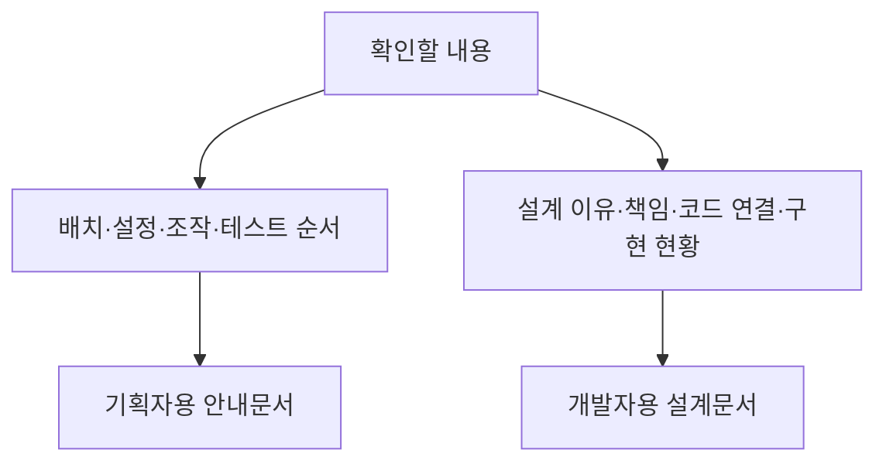
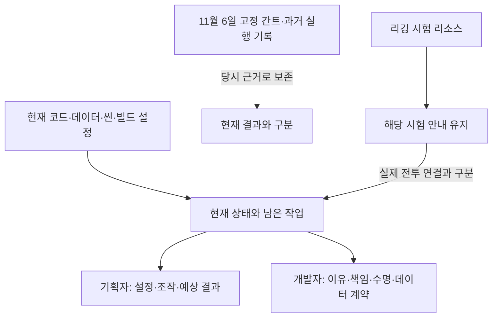

# 문서 안내

Enter 즉시 스킵은 [개발자 설계](개발자용%20설계문서/공용%20즉시%20스킵%20설계.md)와 [기획자 사용 안내](기획자용%20안내문서/기획자용%20즉시%20스킵%20사용%20안내.md)로 나눕니다. 컷씬 전체·영상 하나·Language ID 대사 하나·연출 하나를 구분하며 길게 누르기는 제거했습니다. 기존 임시 대사의 ID 공급은 대기입니다.

관문 표가 비어 맵 진입이 중단되던 상황의 임시 처리·정식 데이터 연결 순서는 [기획자 관문 안내](기획자용%20안내문서/기획자용%20관문%20데이터%20작성과%20확인%20안내.md), 저장 ID를 임의로 만들지 않는 이유는 [저장 설계](개발자용%20설계문서/저장%20기능%20설계.md)를 참고합니다. 미연결 관문은 임시로 생성하지 않아 길이 열립니다.

[병합 누락 복구와 갈림길 보상 설계](개발자용%20설계문서/병합%20누락%20복구와%20갈림길%20보상%20설계.md)는 문제의 원인·수정·공통화·검증 경계를 설명합니다. [기획자 작성과 검수 안내](기획자용%20안내문서/갈림길%20보상%20작성과%20검수%20안내.md)는 JSON 배포·향후 영역 배치·저장·동작 확인 순서입니다.

혼·엽전 공용 지갑과 상속 기반 구매 처리는 [재화·강화 설계](개발자용%20설계문서/재화와%20강화%20구매%20설계.md)와 [기획자 준비 안내](기획자용%20안내문서/기획자용%20재화와%20강화%20준비%20안내.md)로 구분합니다. 자동 보상·레벨·강화 효과·세션·저장을 연결했고 현재 맵의 임시 서낭당 화면을 연결했고 최종 디자인·획득 연출은 후속입니다.

2026-11-10 적 공격 판정·패링 이펙트·절벽 매달리기/오르기는 [애니메이션 확인 안내](기획자용%20안내문서/캐릭터%20스프라이트%20애니메이션%20확인%20안내.md#공격매달리기-추가-확인--2026-11-10)와 [타격 표시 설계](개발자용%20설계문서/캐릭터%20상태%20애니메이션%20연결%20설계.md#적-공격-판정과-프레임-동기화--2026-11-10)를 따릅니다.

서낭당 강화 JSON은 [기획자 배포 안내](기획자용%20안내문서/서낭당%20강화%20데이터%20배포%20안내.md)와 [개발자 설계·연결 경계](개발자용%20설계문서/서낭당%20강화%20데이터%20배포%20설계.md)를 구분해 읽습니다. 검사·자동 배포·정의 로딩·구매 코어·효과·저장을 연결했으며 임시 강화 화면까지 연결했습니다.

하단 점프·Map_ME 사다리·새 인게임 그림은 [사용 안내](기획자용%20안내문서/하단%20점프·사다리·신규%20인게임%20UI%20확인%20안내.md)·[연결 설계](개발자용%20설계문서/발판%20내려가기와%20사다리%20이동%20설계.md)를 따릅니다.

캐릭터 애니메이션은 [육안 확인 안내](기획자용%20안내문서/캐릭터%20스프라이트%20애니메이션%20확인%20안내.md)·[상태 연결 설계](개발자용%20설계문서/캐릭터%20상태%20애니메이션%20연결%20설계.md)를 따릅니다.

실행파일 아이콘은 [이미지 교체 안내](기획자용%20안내문서/GitHub%20빌드와%20디스코드%20공지%20사용%20안내.md#실행파일-아이콘-교체--2026-11-09), 타이틀 글자 선택 강조는 [타이틀 사용 안내](기획자용%20안내문서/기획자용%20타이틀%20사용%20안내.md)를 참고합니다.

현재 구현·검증 결과는 [현재 구현과 검증 현황](개발자용%20설계문서/현재%20구현과%20검증%20현황.md), 다음 작업은 [남은 구현과 검증 작업](개발자용%20설계문서/남은%20구현과%20검증%20작업.md)에서 확인합니다. 기능 안내의 예시는 실제 씬 연결 완료를 뜻하지 않습니다. 이 두 기준 문서에서 현재 상태를 확인한 뒤 역할별 사용법을 읽습니다.

현재 실행 전체 흐름·준비 전 호출·종료 후 콜백 도식은 [현재 구현과 검증 현황의 수명 도식](개발자용%20설계문서/현재%20구현과%20검증%20현황.md#8-현재-실행과-객체-수명-도식)에서 시작합니다. 원인과 연결 계약은 [공통 모듈과 객체 수명 설계](개발자용%20설계문서/공통%20모듈과%20객체%20수명%20설계.md), 조작 확인은 기획자 안내로 이어집니다.

## 전체 작업과 오늘 반영 상태

[간트·작업자·기획 대조 보고서](개발자용%20설계문서/간트와%20프로젝트%20통합%20진행%20현황.md)에서 집계 기준·오늘 변경·차이·문서 점검 범위를 확인합니다.

## 읽는 목적에 따라 선택하기

타이틀 옵션의 창모드/전체 화면 전환은 [기획자 조작·빌드 확인](기획자용%20안내문서/기획자용%20타이틀%20사용%20안내.md#타이틀에서-화면-모드-바꾸기--2026-11-09), 설정 사본·저장 복원·Unity 적용 경계는 [타이틀 설계](개발자용%20설계문서/타이틀%20설계.md#타이틀-전용-화면-모드)를 참고합니다.

설계 규칙을 왜 정했는지, 현재 코드가 어디까지 지키는지, 승인된 예외를 제외하고 무엇을 개선해야 하는지는 [설계 기준 점검과 개선 방향](개발자용%20설계문서/설계%20기준%20점검과%20개선%20방향.md)을 먼저 읽습니다. 규칙별 근거와 반영한 7개 개선의 전후 도식·코드 위치·정수 단위·리깅 확장 계획·확인 방법을 포함합니다. 조작 절차는 [기획자 공통 안내](기획자용%20안내문서/기획자용%20공통%20모듈%20연결과%20확인%20안내.md)를 따릅니다.

맵 출구 변경의 이유와 책임은 [게임플레이 모듈 구조](개발자용%20설계문서/게임플레이%20모듈%20구조.md), 기획자가 준비할 공간과 확인 순서는 [컷씬 표시와 씬 이동 안내](기획자용%20안내문서/기획자용%20컷씬%20표시와%20씬%20이동%20안내.md)를 참고합니다. 공간 제작 대기와 코드 구현 완료를 구분합니다.

## 기획자용 안내문서

- [콘텐츠 잠금 사용 안내](기획자용%20안내문서/기획자용%20콘텐츠%20잠금%20사용%20안내.md): 콘텐츠 사용 중지·플레이어 해금 데이터 작성과 확인

- [플레이어 동작 사운드 연결 안내](%EA%B8%B0%ED%9A%8D%EC%9E%90%EC%9A%A9%20%EC%95%88%EB%82%B4%EB%AC%B8%EC%84%9C/%ED%94%8C%EB%A0%88%EC%9D%B4%EC%96%B4%20%EB%8F%99%EC%9E%91%20%EC%82%AC%EC%9A%B4%EB%93%9C%20%EC%97%B0%EA%B2%B0%20%EC%95%88%EB%82%B4.md)

- [쇄문아비 2페이즈 Attack1 개선본 확인 안내](%EA%B8%B0%ED%9A%8D%EC%9E%90%EC%9A%A9%20%EC%95%88%EB%82%B4%EB%AC%B8%EC%84%9C/%EC%87%84%EB%AC%B8%EC%95%84%EB%B9%84%202%ED%8E%98%EC%9D%B4%EC%A6%88%20Attack1%20%EA%B0%9C%EC%84%A0%EB%B3%B8%20%ED%99%95%EC%9D%B8%20%EC%95%88%EB%82%B4.md)
- [쇄문아비 2페이즈 Attack1 대응 시험 안내](%EA%B8%B0%ED%9A%8D%EC%9E%90%EC%9A%A9%20%EC%95%88%EB%82%B4%EB%AC%B8%EC%84%9C/%EC%87%84%EB%AC%B8%EC%95%84%EB%B9%84%202%ED%8E%98%EC%9D%B4%EC%A6%88%20Attack1%20%EB%8C%80%EC%9D%91%20%EC%8B%9C%ED%97%98%20%EC%95%88%EB%82%B4.md)
- [쇄문아비 2페이즈 Attack2 확인 안내](%EA%B8%B0%ED%9A%8D%EC%9E%90%EC%9A%A9%20%EC%95%88%EB%82%B4%EB%AC%B8%EC%84%9C/%EC%87%84%EB%AC%B8%EC%95%84%EB%B9%84%202%ED%8E%98%EC%9D%B4%EC%A6%88%20Attack2%20%ED%99%95%EC%9D%B8%20%EC%95%88%EB%82%B4.md)
- [쇄문아비 2페이즈 Idle 확인 안내](%EA%B8%B0%ED%9A%8D%EC%9E%90%EC%9A%A9%20%EC%95%88%EB%82%B4%EB%AC%B8%EC%84%9C/%EC%87%84%EB%AC%B8%EC%95%84%EB%B9%84%202%ED%8E%98%EC%9D%B4%EC%A6%88%20Idle%20%ED%99%95%EC%9D%B8%20%EC%95%88%EB%82%B4.md)
- [쇄문아비 2페이즈 Walk 초안 확인 안내](%EA%B8%B0%ED%9A%8D%EC%9E%90%EC%9A%A9%20%EC%95%88%EB%82%B4%EB%AC%B8%EC%84%9C/%EC%87%84%EB%AC%B8%EC%95%84%EB%B9%84%202%ED%8E%98%EC%9D%B4%EC%A6%88%20Walk%20%EC%B4%88%EC%95%88%20%ED%99%95%EC%9D%B8%20%EC%95%88%EB%82%B4.md)

- [K9 맵 공급과 연결 확인](기획자용%20안내문서/기획자용%20K9%20맵%20공급과%20연결%20확인%20안내.md): 신규 맵 에셋과 실제 연결·검증 구분

컷씬은 [표 작성·최초 연결·확인 순서](기획자용%20안내문서/기획자용%20컷씬%20표시와%20씬%20이동%20안내.md)와 [데이터 기반 공용 실행 설계](개발자용%20설계문서/컷씬%20재생%20설계.md)를 구분해 읽습니다. 역할 키로 자동 연결하며 실제 ID·미디어·화면은 제작 대기입니다.

- [서낭당 저장과 몬스터 처치 기록 확인 안내](기획자용%20안내문서/서낭당%20저장과%20몬스터%20처치%20기록%20확인%20안내.md): 첫 접촉·E키 휴식·재방문·사망 복원·배치 ID 주의사항

- [표시 갱신 최적화 확인 안내](기획자용%20안내문서/표시%20갱신%20최적화%20확인%20안내.md): 기존 표시·사망·회피 재사용의 확인 순서

- [F12 초기화 사용 안내](기획자용%20안내문서/기획자용%20F12%20초기화%20사용%20안내.md)

- [관문 데이터 작성과 확인 안내](기획자용%20안내문서/기획자용%20관문%20데이터%20작성과%20확인%20안내.md): GateConfig 각 칸의 뜻·추가/수정·배포·저장 복원 확인

- [컷씬 표시와 씬 이동 안내](기획자용%20안내문서/기획자용%20컷씬%20표시와%20씬%20이동%20안내.md)

- [사운드 상황별 재생 조건 요청서](기획자용%20안내문서/기획자용%20사운드%20상황별%20재생%20조건%20요청서.md)

- [기획자용 공통 모듈 연결과 확인 안내](기획자용%20안내문서/기획자용%20공통%20모듈%20연결과%20확인%20안내.md)

- [기획자용 사운드 테이블 작성과 배포 안내](기획자용%20안내문서/기획자용%20사운드%20테이블%20작성과%20배포%20안내.md)

- [기획자용 사운드 설정 사용 안내](기획자용%20안내문서/기획자용%20사운드%20설정%20사용%20안내.md)

기획자와 작업자가 기능을 설정하고 확인할 때 읽습니다.

- [GitHub 빌드와 디스코드 공지 사용 안내](%EA%B8%B0%ED%9A%8D%EC%9E%90%EC%9A%A9%20%EC%95%88%EB%82%B4%EB%AC%B8%EC%84%9C/GitHub%20%EB%B9%8C%EB%93%9C%EC%99%80%20%EB%94%94%EC%8A%A4%EC%BD%94%EB%93%9C%20%EA%B3%B5%EC%A7%80%20%EC%82%AC%EC%9A%A9%20%EC%95%88%EB%82%B4.md)
- [기획자용 수동 저장 사용 안내](%EA%B8%B0%ED%9A%8D%EC%9E%90%EC%9A%A9%20%EC%95%88%EB%82%B4%EB%AC%B8%EC%84%9C/%EA%B8%B0%ED%9A%8D%EC%9E%90%EC%9A%A9%20%EC%88%98%EB%8F%99%20%EC%A0%80%EC%9E%A5%20%EC%82%AC%EC%9A%A9%20%EC%95%88%EB%82%B4.md)
- [기획자용 에러 팝업 사용 안내](%EA%B8%B0%ED%9A%8D%EC%9E%90%EC%9A%A9%20%EC%95%88%EB%82%B4%EB%AC%B8%EC%84%9C/%EA%B8%B0%ED%9A%8D%EC%9E%90%EC%9A%A9%20%EC%97%90%EB%9F%AC%20%ED%8C%9D%EC%97%85%20%EC%82%AC%EC%9A%A9%20%EC%95%88%EB%82%B4.md)
- [기획자용 타이틀 사용 안내](%EA%B8%B0%ED%9A%8D%EC%9E%90%EC%9A%A9%20%EC%95%88%EB%82%B4%EB%AC%B8%EC%84%9C/%EA%B8%B0%ED%9A%8D%EC%9E%90%EC%9A%A9%20%ED%83%80%EC%9D%B4%ED%8B%80%20%EC%82%AC%EC%9A%A9%20%EC%95%88%EB%82%B4.md)
- [기획자용 프로젝트 검사 사용 안내](%EA%B8%B0%ED%9A%8D%EC%9E%90%EC%9A%A9%20%EC%95%88%EB%82%B4%EB%AC%B8%EC%84%9C/%EA%B8%B0%ED%9A%8D%EC%9E%90%EC%9A%A9%20%ED%94%84%EB%A1%9C%EC%A0%9D%ED%8A%B8%20%EA%B2%80%EC%82%AC%20%EC%82%AC%EC%9A%A9%20%EC%95%88%EB%82%B4.md)
- [디스코드 알림 설정 안내](%EA%B8%B0%ED%9A%8D%EC%9E%90%EC%9A%A9%20%EC%95%88%EB%82%B4%EB%AC%B8%EC%84%9C/%EB%94%94%EC%8A%A4%EC%BD%94%EB%93%9C%20%EC%95%8C%EB%A6%BC%20%EC%84%A4%EC%A0%95%20%EC%95%88%EB%82%B4.md)
- [앵커 기반 프리팹 배치 안내](%EA%B8%B0%ED%9A%8D%EC%9E%90%EC%9A%A9%20%EC%95%88%EB%82%B4%EB%AC%B8%EC%84%9C/%EC%95%B5%EC%BB%A4%20%EA%B8%B0%EB%B0%98%20%ED%94%84%EB%A6%AC%ED%8C%B9%20%EB%B0%B0%EC%B9%98%20%EC%95%88%EB%82%B4.md)
- [앵커 체력 표시 테스트 안내](%EA%B8%B0%ED%9A%8D%EC%9E%90%EC%9A%A9%20%EC%95%88%EB%82%B4%EB%AC%B8%EC%84%9C/%EC%95%B5%EC%BB%A4%20%EC%B2%B4%EB%A0%A5%20%ED%91%9C%EC%8B%9C%20%ED%85%8C%EC%8A%A4%ED%8A%B8%20%EC%95%88%EB%82%B4.md)
- [임시 게임플레이 확인 안내](%EA%B8%B0%ED%9A%8D%EC%9E%90%EC%9A%A9%20%EC%95%88%EB%82%B4%EB%AC%B8%EC%84%9C/%EC%9E%84%EC%8B%9C%20%EA%B2%8C%EC%9E%84%ED%94%8C%EB%A0%88%EC%9D%B4%20%ED%99%95%EC%9D%B8%20%EC%95%88%EB%82%B4.md)

## 개발자용 설계문서

- [콘텐츠 잠금 설계](개발자용%20설계문서/콘텐츠%20잠금%20설계.md): 타이틀과 독립된 판단 계약·진행 기록 수명·기능별 실행 경계

- [쇄문아비 2페이즈 Attack1 대응 시험과 한계](%EA%B0%9C%EB%B0%9C%EC%9E%90%EC%9A%A9%20%EC%84%A4%EA%B3%84%EB%AC%B8%EC%84%9C/%EC%87%84%EB%AC%B8%EC%95%84%EB%B9%84%202%ED%8E%98%EC%9D%B4%EC%A6%88%20Attack1%20%EB%8C%80%EC%9D%91%20%EC%8B%9C%ED%97%98%EA%B3%BC%20%ED%95%9C%EA%B3%84.md)
- [쇄문아비 2페이즈 Attack2 설계와 검증](%EA%B0%9C%EB%B0%9C%EC%9E%90%EC%9A%A9%20%EC%84%A4%EA%B3%84%EB%AC%B8%EC%84%9C/%EC%87%84%EB%AC%B8%EC%95%84%EB%B9%84%202%ED%8E%98%EC%9D%B4%EC%A6%88%20Attack2%20%EC%84%A4%EA%B3%84%EC%99%80%20%EA%B2%80%EC%A6%9D.md)
- [쇄문아비 2페이즈 Idle 리그 설계와 검증](%EA%B0%9C%EB%B0%9C%EC%9E%90%EC%9A%A9%20%EC%84%A4%EA%B3%84%EB%AC%B8%EC%84%9C/%EC%87%84%EB%AC%B8%EC%95%84%EB%B9%84%202%ED%8E%98%EC%9D%B4%EC%A6%88%20Idle%20%EB%A6%AC%EA%B7%B8%20%EC%84%A4%EA%B3%84%EC%99%80%20%EA%B2%80%EC%A6%9D.md)
- [쇄문아비 2페이즈 Walk 초안 설계와 검증](%EA%B0%9C%EB%B0%9C%EC%9E%90%EC%9A%A9%20%EC%84%A4%EA%B3%84%EB%AC%B8%EC%84%9C/%EC%87%84%EB%AC%B8%EC%95%84%EB%B9%84%202%ED%8E%98%EC%9D%B4%EC%A6%88%20Walk%20%EC%B4%88%EC%95%88%20%EC%84%A4%EA%B3%84%EC%99%80%20%EA%B2%80%EC%A6%9D.md)
- [쇄문아비 2페이즈 공격 전용 리그 개선과 검증](%EA%B0%9C%EB%B0%9C%EC%9E%90%EC%9A%A9%20%EC%84%A4%EA%B3%84%EB%AC%B8%EC%84%9C/%EC%87%84%EB%AC%B8%EC%95%84%EB%B9%84%202%ED%8E%98%EC%9D%B4%EC%A6%88%20%EA%B3%B5%EA%B2%A9%20%EC%A0%84%EC%9A%A9%20%EB%A6%AC%EA%B7%B8%20%EA%B0%9C%EC%84%A0%EA%B3%BC%20%EA%B2%80%EC%A6%9D.md)

- [반복 갱신과 임시 표시 최적화 설계](개발자용%20설계문서/반복%20갱신과%20임시%20표시%20최적화%20설계.md): 작업 이유·전후 비교·수명·검증 범위

- [테스트 초기화와 공용 확인 팝업 설계](개발자용%20설계문서/테스트%20초기화와%20공용%20확인%20팝업%20설계.md)

- [공통 모듈과 객체 수명 설계](개발자용%20설계문서/공통%20모듈과%20객체%20수명%20설계.md)

- [사운드 설정 설계](개발자용%20설계문서/사운드%20설정%20설계.md)

개발자가 구조·연결 계약·현재 구현과 남은 작업을 확인할 때 읽습니다.

- [테스트와 정식 빌드 선택 설계](개발자용%20설계문서/테스트와%20정식%20빌드%20선택%20설계.md)

- [CSV 리더기](%EA%B0%9C%EB%B0%9C%EC%9E%90%EC%9A%A9%20%EC%84%A4%EA%B3%84%EB%AC%B8%EC%84%9C/CSV%20%EB%A6%AC%EB%8D%94%EA%B8%B0.md)
- [검사 자동화와 데이터 오류 경계](%EA%B0%9C%EB%B0%9C%EC%9E%90%EC%9A%A9%20%EC%84%A4%EA%B3%84%EB%AC%B8%EC%84%9C/%EA%B2%80%EC%82%AC%20%EC%9E%90%EB%8F%99%ED%99%94%EC%99%80%20%EB%8D%B0%EC%9D%B4%ED%84%B0%20%EC%98%A4%EB%A5%98%20%EA%B2%BD%EA%B3%84.md)
- [게임플레이 모듈 구조](%EA%B0%9C%EB%B0%9C%EC%9E%90%EC%9A%A9%20%EC%84%A4%EA%B3%84%EB%AC%B8%EC%84%9C/%EA%B2%8C%EC%9E%84%ED%94%8C%EB%A0%88%EC%9D%B4%20%EB%AA%A8%EB%93%88%20%EA%B5%AC%EC%A1%B0.md)
- [게임플레이 코어와 프리팹 연결](%EA%B0%9C%EB%B0%9C%EC%9E%90%EC%9A%A9%20%EC%84%A4%EA%B3%84%EB%AC%B8%EC%84%9C/%EA%B2%8C%EC%9E%84%ED%94%8C%EB%A0%88%EC%9D%B4%20%EC%BD%94%EC%96%B4%EC%99%80%20%ED%94%84%EB%A6%AC%ED%8C%B9%20%EC%97%B0%EA%B2%B0.md)
- [공용 에러 팝업 설계](%EA%B0%9C%EB%B0%9C%EC%9E%90%EC%9A%A9%20%EC%84%A4%EA%B3%84%EB%AC%B8%EC%84%9C/%EA%B3%B5%EC%9A%A9%20%EC%97%90%EB%9F%AC%20%ED%8C%9D%EC%97%85%20%EC%84%A4%EA%B3%84.md)
- [기획 완료 기준 점검표](%EA%B0%9C%EB%B0%9C%EC%9E%90%EC%9A%A9%20%EC%84%A4%EA%B3%84%EB%AC%B8%EC%84%9C/%EA%B8%B0%ED%9A%8D%20%EC%99%84%EB%A3%8C%20%EA%B8%B0%EC%A4%80%20%EC%A0%90%EA%B2%80%ED%91%9C.md)
- [기획 확정 반영 기준](%EA%B0%9C%EB%B0%9C%EC%9E%90%EC%9A%A9%20%EC%84%A4%EA%B3%84%EB%AC%B8%EC%84%9C/%EA%B8%B0%ED%9A%8D%20%ED%99%95%EC%A0%95%20%EB%B0%98%EC%98%81%20%EA%B8%B0%EC%A4%80.md)
- [남은 구현과 검증 작업](%EA%B0%9C%EB%B0%9C%EC%9E%90%EC%9A%A9%20%EC%84%A4%EA%B3%84%EB%AC%B8%EC%84%9C/%EB%82%A8%EC%9D%80%20%EA%B5%AC%ED%98%84%EA%B3%BC%20%EA%B2%80%EC%A6%9D%20%EC%9E%91%EC%97%85.md)
- [데이터 계층 인수인계 가이드](%EA%B0%9C%EB%B0%9C%EC%9E%90%EC%9A%A9%20%EC%84%A4%EA%B3%84%EB%AC%B8%EC%84%9C/%EB%8D%B0%EC%9D%B4%ED%84%B0%20%EA%B3%84%EC%B8%B5%20%EC%9D%B8%EC%88%98%EC%9D%B8%EA%B3%84%20%EA%B0%80%EC%9D%B4%EB%93%9C.md)
- [데이터 기반 모듈과 화면 표현 설계안](%EA%B0%9C%EB%B0%9C%EC%9E%90%EC%9A%A9%20%EC%84%A4%EA%B3%84%EB%AC%B8%EC%84%9C/%EB%8D%B0%EC%9D%B4%ED%84%B0%20%EA%B8%B0%EB%B0%98%20%EB%AA%A8%EB%93%88%EA%B3%BC%20%ED%99%94%EB%A9%B4%20%ED%91%9C%ED%98%84%20%EC%84%A4%EA%B3%84%EC%95%88.md)
- [설계 기준 점검과 개선 방향](%EA%B0%9C%EB%B0%9C%EC%9E%90%EC%9A%A9%20%EC%84%A4%EA%B3%84%EB%AC%B8%EC%84%9C/%EC%84%A4%EA%B3%84%20%EA%B8%B0%EC%A4%80%20%EC%A0%90%EA%B2%80%EA%B3%BC%20%EA%B0%9C%EC%84%A0%20%EB%B0%A9%ED%96%A5.md)
- [이동과 스태미나 코어](%EA%B0%9C%EB%B0%9C%EC%9E%90%EC%9A%A9%20%EC%84%A4%EA%B3%84%EB%AC%B8%EC%84%9C/%EC%9D%B4%EB%8F%99%EA%B3%BC%20%EC%8A%A4%ED%83%9C%EB%AF%B8%EB%82%98%20%EC%BD%94%EC%96%B4.md)
- [일반 몬스터 인공지능](%EA%B0%9C%EB%B0%9C%EC%9E%90%EC%9A%A9%20%EC%84%A4%EA%B3%84%EB%AC%B8%EC%84%9C/%EC%9D%BC%EB%B0%98%20%EB%AA%AC%EC%8A%A4%ED%84%B0%20%EC%9D%B8%EA%B3%B5%EC%A7%80%EB%8A%A5.md)
- [저장 기능 설계](%EA%B0%9C%EB%B0%9C%EC%9E%90%EC%9A%A9%20%EC%84%A4%EA%B3%84%EB%AC%B8%EC%84%9C/%EC%A0%80%EC%9E%A5%20%EA%B8%B0%EB%8A%A5%20%EC%84%A4%EA%B3%84.md)
- [전투와 탐색 아이디어 검토안](%EA%B0%9C%EB%B0%9C%EC%9E%90%EC%9A%A9%20%EC%84%A4%EA%B3%84%EB%AC%B8%EC%84%9C/%EC%A0%84%ED%88%AC%EC%99%80%20%ED%83%90%EC%83%89%20%EC%95%84%EC%9D%B4%EB%94%94%EC%96%B4%20%EA%B2%80%ED%86%A0%EC%95%88.md)
- [체력 표시 모듈 사용과 설계 안내](%EA%B0%9C%EB%B0%9C%EC%9E%90%EC%9A%A9%20%EC%84%A4%EA%B3%84%EB%AC%B8%EC%84%9C/%EC%B2%B4%EB%A0%A5%20%ED%91%9C%EC%8B%9C%20%EB%AA%A8%EB%93%88%20%EC%82%AC%EC%9A%A9%EA%B3%BC%20%EC%84%A4%EA%B3%84%20%EC%95%88%EB%82%B4.md)
- [컷씬 재생 설계](%EA%B0%9C%EB%B0%9C%EC%9E%90%EC%9A%A9%20%EC%84%A4%EA%B3%84%EB%AC%B8%EC%84%9C/%EC%BB%B7%EC%94%AC%20%EC%9E%AC%EC%83%9D%20%EC%84%A4%EA%B3%84.md)
- [타이틀 설계](%EA%B0%9C%EB%B0%9C%EC%9E%90%EC%9A%A9%20%EC%84%A4%EA%B3%84%EB%AC%B8%EC%84%9C/%ED%83%80%EC%9D%B4%ED%8B%80%20%EC%84%A4%EA%B3%84.md)
- [현재 구현과 검증 현황](%EA%B0%9C%EB%B0%9C%EC%9E%90%EC%9A%A9%20%EC%84%A4%EA%B3%84%EB%AC%B8%EC%84%9C/%ED%98%84%EC%9E%AC%20%EA%B5%AC%ED%98%84%EA%B3%BC%20%EA%B2%80%EC%A6%9D%20%ED%98%84%ED%99%A9.md)

## 2026-11-07 전체 문서 점검 기준

로컬 클라이언트 `769e205`의 코드·CSV/JSON·프리팹·빌드 설정을 기준으로 대조했습니다. 대상은 클라이언트 Docs 55개(기획자 24·개발자 30·이 안내 1), 루트 README·기본설계 2개, 형제 DataSheet README·안내 7개로 총 64개입니다. 외부 패키지 문서와 사용자 작업 규칙은 임의로 고치지 않습니다.

| 문서 범위 | 점검·갱신 원칙 |
| --- | --- |
| README·기본설계·현황·남은 작업 | 정수 이동·객체 수명·세션 소유·저장·빌드 선택의 현재 경계를 맞춤 |
| 타이틀·설정·저장·오류·맵 안내 | 실제 연결·기획자 조작·기대 결과를 바로잡음. 예전 미연결 설명을 정상 동작 안내로 남기지 않음 |
| 데이터·컷씬·사운드·체력 표시 | 원본/배포/실행 참조를 구분하고 공급이 필요한 범위를 명시 |
| 리깅 시험 설계·사용 안내 10개 | 씬·프리팹·클립 경로 확인. 기존 시험 수치·실제 게임 미연결 경계 보존 |
| 간트·원문 조회·과거 검증 기록 | 고정 수치·출처·기준 시각 보존. 오늘 원격 조회·실제 Play를 수행한 것처럼 바꾸지 않음 |
| 이상 없는 기능 문서 | 이유 없이 날짜·내용을 덮어쓰지 않고 계약과 경로 유지 |

현재 검증 수치의 단일 기준은 [현재 구현과 검증 현황](개발자용%20설계문서/현재%20구현과%20검증%20현황.md)입니다. 2026-11-10 문서 대조에서 현재 코드·배포 데이터·프리팹 연결과 자동 검사를 확인했습니다. 실제 Play·원격 빌드·간트/기획 원문은 다시 확인하지 않았습니다. 관문 임시 처리, 재화·서낭당·갈림길, 다른 작업자가 반영한 패링 이벤트를 현재 상태로 구분했습니다. 기획자의 개발자_제안사항 원본은 개발 결과를 기록하는 문서가 아니므로 수정하지 않습니다.

## 작성·갱신 기준

- 사용 안내에는 준비물, Inspector 연결, 조작 순서, 예상 결과, 문제 해결을 씁니다.
- 설계 문서에는 필요한 이유, 책임과 계층, 데이터·이벤트·수명 계약, 검증과 미구현 범위를 씁니다.
- 현재 구현과 향후 계획을 구분합니다. 구현 변경 시 관련 설계와 사용 안내를 함께 갱신합니다.
- 같은 기능의 설명을 복제하지 않고 상대 문서에 링크합니다. 사용과 설계가 함께 있는 기존 문서는 주된 목적에 따라 배치하며 필요한 부분은 절 번호로 안내합니다.
- 문서명은 한글을 우선하며, 이동·이름 변경 시 README·다른 문서·형제 프로젝트의 참조도 함께 고칩니다.
- 이 문서가 전체 목록입니다. 새 문서를 추가하면 해당 분류 목록에 링크를 추가합니다.
