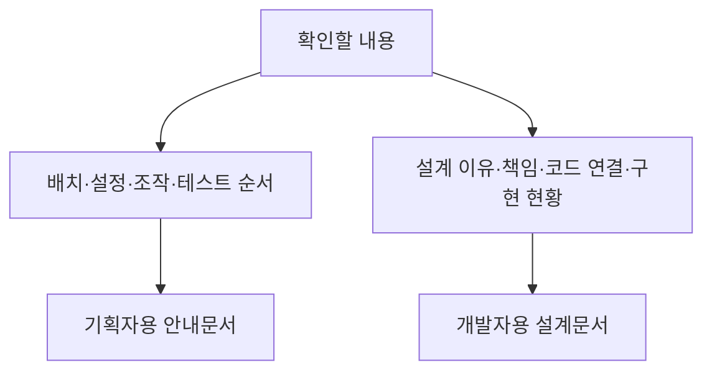

# 문서 안내

## 읽는 목적에 따라 선택하기

## 기획자용 안내문서

- [사운드 상황별 재생 조건 요청서](기획자용%20안내문서/기획자용%20사운드%20상황별%20재생%20조건%20요청서.md)

- [기획자용 공통 모듈 연결과 확인 안내](기획자용%20안내문서/기획자용%20공통%20모듈%20연결과%20확인%20안내.md)

- [기획자용 사운드 테이블 작성과 배포 안내](기획자용%20안내문서/기획자용%20사운드%20테이블%20작성과%20배포%20안내.md)

- [기획자용 사운드 설정 사용 안내](기획자용%20안내문서/기획자용%20사운드%20설정%20사용%20안내.md)

기획자와 작업자가 기능을 설정하고 확인할 때 읽습니다.

- [GitHub 빌드와 디스코드 공지 사용 안내](%EA%B8%B0%ED%9A%8D%EC%9E%90%EC%9A%A9%20%EC%95%88%EB%82%B4%EB%AC%B8%EC%84%9C/GitHub%20%EB%B9%8C%EB%93%9C%EC%99%80%20%EB%94%94%EC%8A%A4%EC%BD%94%EB%93%9C%20%EA%B3%B5%EC%A7%80%20%EC%82%AC%EC%9A%A9%20%EC%95%88%EB%82%B4.md)
- [기획자용 수동 저장 사용 안내](%EA%B8%B0%ED%9A%8D%EC%9E%90%EC%9A%A9%20%EC%95%88%EB%82%B4%EB%AC%B8%EC%84%9C/%EA%B8%B0%ED%9A%8D%EC%9E%90%EC%9A%A9%20%EC%88%98%EB%8F%99%20%EC%A0%80%EC%9E%A5%20%EC%82%AC%EC%9A%A9%20%EC%95%88%EB%82%B4.md)
- [기획자용 에러 팝업 사용 안내](%EA%B8%B0%ED%9A%8D%EC%9E%90%EC%9A%A9%20%EC%95%88%EB%82%B4%EB%AC%B8%EC%84%9C/%EA%B8%B0%ED%9A%8D%EC%9E%90%EC%9A%A9%20%EC%97%90%EB%9F%AC%20%ED%8C%9D%EC%97%85%20%EC%82%AC%EC%9A%A9%20%EC%95%88%EB%82%B4.md)
- [기획자용 타이틀과 콘텐츠 잠금 사용 안내](%EA%B8%B0%ED%9A%8D%EC%9E%90%EC%9A%A9%20%EC%95%88%EB%82%B4%EB%AC%B8%EC%84%9C/%EA%B8%B0%ED%9A%8D%EC%9E%90%EC%9A%A9%20%ED%83%80%EC%9D%B4%ED%8B%80%EA%B3%BC%20%EC%BD%98%ED%85%90%EC%B8%A0%20%EC%9E%A0%EA%B8%88%20%EC%82%AC%EC%9A%A9%20%EC%95%88%EB%82%B4.md)
- [기획자용 프로젝트 검사 사용 안내](%EA%B8%B0%ED%9A%8D%EC%9E%90%EC%9A%A9%20%EC%95%88%EB%82%B4%EB%AC%B8%EC%84%9C/%EA%B8%B0%ED%9A%8D%EC%9E%90%EC%9A%A9%20%ED%94%84%EB%A1%9C%EC%A0%9D%ED%8A%B8%20%EA%B2%80%EC%82%AC%20%EC%82%AC%EC%9A%A9%20%EC%95%88%EB%82%B4.md)
- [디스코드 알림 설정 안내](%EA%B8%B0%ED%9A%8D%EC%9E%90%EC%9A%A9%20%EC%95%88%EB%82%B4%EB%AC%B8%EC%84%9C/%EB%94%94%EC%8A%A4%EC%BD%94%EB%93%9C%20%EC%95%8C%EB%A6%BC%20%EC%84%A4%EC%A0%95%20%EC%95%88%EB%82%B4.md)
- [앵커 기반 프리팹 배치 안내](%EA%B8%B0%ED%9A%8D%EC%9E%90%EC%9A%A9%20%EC%95%88%EB%82%B4%EB%AC%B8%EC%84%9C/%EC%95%B5%EC%BB%A4%20%EA%B8%B0%EB%B0%98%20%ED%94%84%EB%A6%AC%ED%8C%B9%20%EB%B0%B0%EC%B9%98%20%EC%95%88%EB%82%B4.md)
- [앵커 체력 표시 테스트 안내](%EA%B8%B0%ED%9A%8D%EC%9E%90%EC%9A%A9%20%EC%95%88%EB%82%B4%EB%AC%B8%EC%84%9C/%EC%95%B5%EC%BB%A4%20%EC%B2%B4%EB%A0%A5%20%ED%91%9C%EC%8B%9C%20%ED%85%8C%EC%8A%A4%ED%8A%B8%20%EC%95%88%EB%82%B4.md)
- [임시 게임플레이 확인 안내](%EA%B8%B0%ED%9A%8D%EC%9E%90%EC%9A%A9%20%EC%95%88%EB%82%B4%EB%AC%B8%EC%84%9C/%EC%9E%84%EC%8B%9C%20%EA%B2%8C%EC%9E%84%ED%94%8C%EB%A0%88%EC%9D%B4%20%ED%99%95%EC%9D%B8%20%EC%95%88%EB%82%B4.md)

## 개발자용 설계문서

- [공통 모듈과 객체 수명 설계](개발자용%20설계문서/공통%20모듈과%20객체%20수명%20설계.md)

- [사운드 설정 설계](개발자용%20설계문서/사운드%20설정%20설계.md)

개발자가 구조·연결 계약·현재 구현과 남은 작업을 확인할 때 읽습니다.

- [CSV 리더기](%EA%B0%9C%EB%B0%9C%EC%9E%90%EC%9A%A9%20%EC%84%A4%EA%B3%84%EB%AC%B8%EC%84%9C/CSV%20%EB%A6%AC%EB%8D%94%EA%B8%B0.md)
- [검사 자동화와 데이터 오류 경계](%EA%B0%9C%EB%B0%9C%EC%9E%90%EC%9A%A9%20%EC%84%A4%EA%B3%84%EB%AC%B8%EC%84%9C/%EA%B2%80%EC%82%AC%20%EC%9E%90%EB%8F%99%ED%99%94%EC%99%80%20%EB%8D%B0%EC%9D%B4%ED%84%B0%20%EC%98%A4%EB%A5%98%20%EA%B2%BD%EA%B3%84.md)
- [게임플레이 모듈 구조](%EA%B0%9C%EB%B0%9C%EC%9E%90%EC%9A%A9%20%EC%84%A4%EA%B3%84%EB%AC%B8%EC%84%9C/%EA%B2%8C%EC%9E%84%ED%94%8C%EB%A0%88%EC%9D%B4%20%EB%AA%A8%EB%93%88%20%EA%B5%AC%EC%A1%B0.md)
- [게임플레이 코어와 프리팹 연결](%EA%B0%9C%EB%B0%9C%EC%9E%90%EC%9A%A9%20%EC%84%A4%EA%B3%84%EB%AC%B8%EC%84%9C/%EA%B2%8C%EC%9E%84%ED%94%8C%EB%A0%88%EC%9D%B4%20%EC%BD%94%EC%96%B4%EC%99%80%20%ED%94%84%EB%A6%AC%ED%8C%B9%20%EC%97%B0%EA%B2%B0.md)
- [공용 에러 팝업 설계](%EA%B0%9C%EB%B0%9C%EC%9E%90%EC%9A%A9%20%EC%84%A4%EA%B3%84%EB%AC%B8%EC%84%9C/%EA%B3%B5%EC%9A%A9%20%EC%97%90%EB%9F%AC%20%ED%8C%9D%EC%97%85%20%EC%84%A4%EA%B3%84.md)
- [기획 완료 기준 점검표](%EA%B0%9C%EB%B0%9C%EC%9E%90%EC%9A%A9%20%EC%84%A4%EA%B3%84%EB%AC%B8%EC%84%9C/%EA%B8%B0%ED%9A%8D%20%EC%99%84%EB%A3%8C%20%EA%B8%B0%EC%A4%80%20%EC%A0%90%EA%B2%80%ED%91%9C.md)
- [기획 확정 반영 기준](%EA%B0%9C%EB%B0%9C%EC%9E%90%EC%9A%A9%20%EC%84%A4%EA%B3%84%EB%AC%B8%EC%84%9C/%EA%B8%B0%ED%9A%8D%20%ED%99%95%EC%A0%95%20%EB%B0%98%EC%98%81%20%EA%B8%B0%EC%A4%80.md)
- [남은 구현과 검증 작업](%EA%B0%9C%EB%B0%9C%EC%9E%90%EC%9A%A9%20%EC%84%A4%EA%B3%84%EB%AC%B8%EC%84%9C/%EB%82%A8%EC%9D%80%20%EA%B5%AC%ED%98%84%EA%B3%BC%20%EA%B2%80%EC%A6%9D%20%EC%9E%91%EC%97%85.md)
- [데이터 계층 인수인계 가이드](%EA%B0%9C%EB%B0%9C%EC%9E%90%EC%9A%A9%20%EC%84%A4%EA%B3%84%EB%AC%B8%EC%84%9C/%EB%8D%B0%EC%9D%B4%ED%84%B0%20%EA%B3%84%EC%B8%B5%20%EC%9D%B8%EC%88%98%EC%9D%B8%EA%B3%84%20%EA%B0%80%EC%9D%B4%EB%93%9C.md)
- [데이터 기반 모듈과 화면 표현 설계안](%EA%B0%9C%EB%B0%9C%EC%9E%90%EC%9A%A9%20%EC%84%A4%EA%B3%84%EB%AC%B8%EC%84%9C/%EB%8D%B0%EC%9D%B4%ED%84%B0%20%EA%B8%B0%EB%B0%98%20%EB%AA%A8%EB%93%88%EA%B3%BC%20%ED%99%94%EB%A9%B4%20%ED%91%9C%ED%98%84%20%EC%84%A4%EA%B3%84%EC%95%88.md)
- [설계 기준 점검과 개선 방향](%EA%B0%9C%EB%B0%9C%EC%9E%90%EC%9A%A9%20%EC%84%A4%EA%B3%84%EB%AC%B8%EC%84%9C/%EC%84%A4%EA%B3%84%20%EA%B8%B0%EC%A4%80%20%EC%A0%90%EA%B2%80%EA%B3%BC%20%EA%B0%9C%EC%84%A0%20%EB%B0%A9%ED%96%A5.md)
- [이동과 스태미나 코어](%EA%B0%9C%EB%B0%9C%EC%9E%90%EC%9A%A9%20%EC%84%A4%EA%B3%84%EB%AC%B8%EC%84%9C/%EC%9D%B4%EB%8F%99%EA%B3%BC%20%EC%8A%A4%ED%83%9C%EB%AF%B8%EB%82%98%20%EC%BD%94%EC%96%B4.md)
- [일반 몬스터 인공지능](%EA%B0%9C%EB%B0%9C%EC%9E%90%EC%9A%A9%20%EC%84%A4%EA%B3%84%EB%AC%B8%EC%84%9C/%EC%9D%BC%EB%B0%98%20%EB%AA%AC%EC%8A%A4%ED%84%B0%20%EC%9D%B8%EA%B3%B5%EC%A7%80%EB%8A%A5.md)
- [저장 기능 설계](%EA%B0%9C%EB%B0%9C%EC%9E%90%EC%9A%A9%20%EC%84%A4%EA%B3%84%EB%AC%B8%EC%84%9C/%EC%A0%80%EC%9E%A5%20%EA%B8%B0%EB%8A%A5%20%EC%84%A4%EA%B3%84.md)
- [전투와 탐색 아이디어 검토안](%EA%B0%9C%EB%B0%9C%EC%9E%90%EC%9A%A9%20%EC%84%A4%EA%B3%84%EB%AC%B8%EC%84%9C/%EC%A0%84%ED%88%AC%EC%99%80%20%ED%83%90%EC%83%89%20%EC%95%84%EC%9D%B4%EB%94%94%EC%96%B4%20%EA%B2%80%ED%86%A0%EC%95%88.md)
- [체력 표시 모듈 사용과 설계 안내](%EA%B0%9C%EB%B0%9C%EC%9E%90%EC%9A%A9%20%EC%84%A4%EA%B3%84%EB%AC%B8%EC%84%9C/%EC%B2%B4%EB%A0%A5%20%ED%91%9C%EC%8B%9C%20%EB%AA%A8%EB%93%88%20%EC%82%AC%EC%9A%A9%EA%B3%BC%20%EC%84%A4%EA%B3%84%20%EC%95%88%EB%82%B4.md)
- [컷씬 재생 설계](%EA%B0%9C%EB%B0%9C%EC%9E%90%EC%9A%A9%20%EC%84%A4%EA%B3%84%EB%AC%B8%EC%84%9C/%EC%BB%B7%EC%94%AC%20%EC%9E%AC%EC%83%9D%20%EC%84%A4%EA%B3%84.md)
- [타이틀과 콘텐츠 잠금 설계](%EA%B0%9C%EB%B0%9C%EC%9E%90%EC%9A%A9%20%EC%84%A4%EA%B3%84%EB%AC%B8%EC%84%9C/%ED%83%80%EC%9D%B4%ED%8B%80%EA%B3%BC%20%EC%BD%98%ED%85%90%EC%B8%A0%20%EC%9E%A0%EA%B8%88%20%EC%84%A4%EA%B3%84.md)
- [현재 구현과 검증 현황](%EA%B0%9C%EB%B0%9C%EC%9E%90%EC%9A%A9%20%EC%84%A4%EA%B3%84%EB%AC%B8%EC%84%9C/%ED%98%84%EC%9E%AC%20%EA%B5%AC%ED%98%84%EA%B3%BC%20%EA%B2%80%EC%A6%9D%20%ED%98%84%ED%99%A9.md)

## 작성·갱신 기준

- 사용 안내에는 준비물, Inspector 연결, 조작 순서, 예상 결과, 문제 해결을 씁니다.
- 설계 문서에는 필요한 이유, 책임과 계층, 데이터·이벤트·수명 계약, 검증과 미구현 범위를 씁니다.
- 현재 구현과 향후 계획을 구분합니다. 구현 변경 시 관련 설계와 사용 안내를 함께 갱신합니다.
- 같은 기능의 설명을 복제하지 않고 상대 문서에 링크합니다. 사용과 설계가 함께 있는 기존 문서는 주된 목적에 따라 배치하며 필요한 부분은 절 번호로 안내합니다.
- 문서명은 한글을 우선하며, 이동·이름 변경 시 README·다른 문서·형제 프로젝트의 참조도 함께 고칩니다.
- 이 문서가 전체 목록입니다. 새 문서를 추가하면 해당 분류 목록에 링크를 추가합니다.
