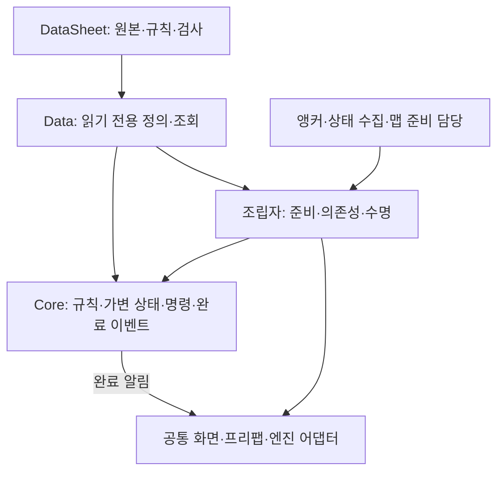

# 설계 기준 점검과 개선 방향

기준일: 2026-11-03. 현재 코드·데이터·문서와 저장·장부방·UI 관련 기획을 대조했습니다. 설계 방향은 유지되고 있으나 개별 모듈 구현과 운영 연결 완료를 구분해야 합니다. 실제 수치·검사 상태는 [검증 현황](현재%20구현과%20검증%20현황.md), 작업 순서는 [남은 작업](남은%20구현과%20검증%20작업.md)에서 관리합니다.

## 1. 설계 판단과 이유

| 원칙 | 현재 구조와 효과 | 남은 경계 |
| --- | --- | --- |
| 자동화 | 새 파일·탭 검사·추출·배포·자동 로딩 계획. 반복 초기화 등록 감소 | 기존 클래스 컬럼 변경과 새 행동 구현은 별도. 추출/조회 자동화와 콘텐츠 동작을 구분 |
| 모듈화 | Data·Core·Adapters·Presentation·Preview와 별도 DataSheet | 운영 맵 조립자를 전역 전체 관리자로 확대하지 않음 |
| 추상화·객체 지향 | 공통 CharacterStat 상속, ActorState, 저장 실행 담당 계약 | 진짜 공통 책임에만 상속·인터페이스 사용 |
| 이벤트 | 체력·상태·판정 창 결과, 화면 변경·입력 콜백 | Preview 이름표 반복 갱신은 운영 표현으로 옮길 때 정리 |
| 퍼사드·연결 창구 | Runtime·Host·SaveGameFlow가 명시적으로 의존성을 전달받음 | 전역 저장소·모든 호출용 이벤트 버스를 추가하지 않음 |
| 재사용 | 공통 변환·시간·판정·앵커·SaveSlotScreen·MenuInput | 프리팹 재사용과 풀 reset/반환 계약은 별도 |
| 준비 순서·수명 | CSV 후 JSON, 비활성 조립, 연결 해제·취소·늦은 결과 무시 | 실제 씬 전환·풀 재대여·독립 화면 Play 검증 필요 |
| 수치 | 정수 스탯·저장 위치·밀리초·확률10000 | Preview는 float 위치 누적. 운영 정수 위치·반올림은 미완성 |

단일 상태머신으로 충분한 현재 기능에 복합 상태와 팩토리를 강제로 추가하지 않습니다. 상태 데이터 연결과 상위/병렬 상태는 실제 책임·조합 요구가 생길 때 확장합니다. 캐릭터 자체 팩토리는 도입하지 않습니다.

## 2. 구조를 나눈 이유

데이터 변경이 화면마다 다른 규칙으로 해석되지 않게 코어 판단을 재사용합니다. UI·아트 교체가 저장·피해·상태 전환을 다시 작성하는 일이 되지 않게 표현을 분리합니다. 조립자는 준비된 의존성과 소유 수명을 전달합니다. 전역 검색과 매 프레임 준비 확인을 하지 않습니다.

일반 프리팹 배치는 앵커 기반입니다. 타이틀은 사용자가 승인한 예외로 씬에서 직접 편집하며 위치용 테이블이나 앵커 조회를 추가하지 않습니다. 저장 당시 위치는 실제 상태를 기록하는 값이므로 배치용 절대 좌표 테이블과 다른 책임입니다.

## 3. 기획과의 정합성

| 항목 | 판정 | 필요한 조치 |
| --- | --- | --- |
| 관문 저장 키 | 실제 불일치 | StageID_PlacementID와 정수 목록 OpenedGates를 정합화. 표현 정책 확정 전 문서만으로 수정 완료 처리하지 않음 |
| 정규 타이틀 클릭 | 구현 누락 | 마우스로 메뉴·확인창을 끝까지 조작할 수 있게 연결 |
| 수동 저장 규칙 | 사용자 최종 지시와 부합 | 직접 선택·날짜 내림차순·번호 숨김·테스트/시연 허용을 유지. 기획서의 옛 자동 선택으로 되돌리지 않음 |
| 실제 맵 복원 연결 | 의도적 보류 | 스테이지 준비 전 ISaveGameRuntime 계약과 독립 검사 유지 |
| 컷씬·로딩·최종 아트 | 부분 구현·보류 | 원본과 확정 기획 준비 후 연결. 빈 데이터·코어 검사를 재생 성공으로 보지 않음 |
| 빌드 | 개발 확인용 경로 | 전체 진행 씬과 출시 빌드 정책 분리·실행파일 검증 |

자료의 우선순위는 [기획 기준](기획%20확정%20반영%20기준.md)을 따릅니다. 과거 기획 규칙과 사용자 변경을 섞어 같은 기능에 두 기준을 적용하지 않습니다.

## 4. 이후 개선 방향과 예상 효과

- 관문 식별자와 저장 형식을 먼저 맞추면 운영 연결 이후의 기록 변환과 재방문 오류를 줄입니다.
- 공통 화면·입력을 유지하면 타이틀과 F5 수정이 따로 어긋날 가능성을 줄입니다. 작은 조건마다 새 계층을 늘리지 않습니다.
- 코어 검사와 Play·실행파일 검증을 나누면 코드 통과만으로 완료를 선언하는 문제를 줄입니다.
- 운영 정수 위치의 상태 소유·단위·반올림을 한곳에서 정하면 임시 이동과 저장 복원 사이의 오차를 줄일 수 있습니다.
- DataSheet의 기존 정의 보존 정책을 유지하면서 스키마와 실제 생성자 차이를 더 명확히 보고하는 보완은 공급 도구 개선 대상으로 둡니다. 별도 규칙 탭이나 기존 클래스 자동 덮어쓰기를 전제로 하지 않습니다.

네트워크 구현은 이번 범위에 없습니다. 경계의 ID·상태 소유·시간·난수·명령 순서는 향후 검토 가능하게 유지하되 정수 사용만으로 결정성이나 네트워크 호환을 보장하지 않습니다. 실제 성능 개선은 운영 연결 후 측정해 판단합니다.
