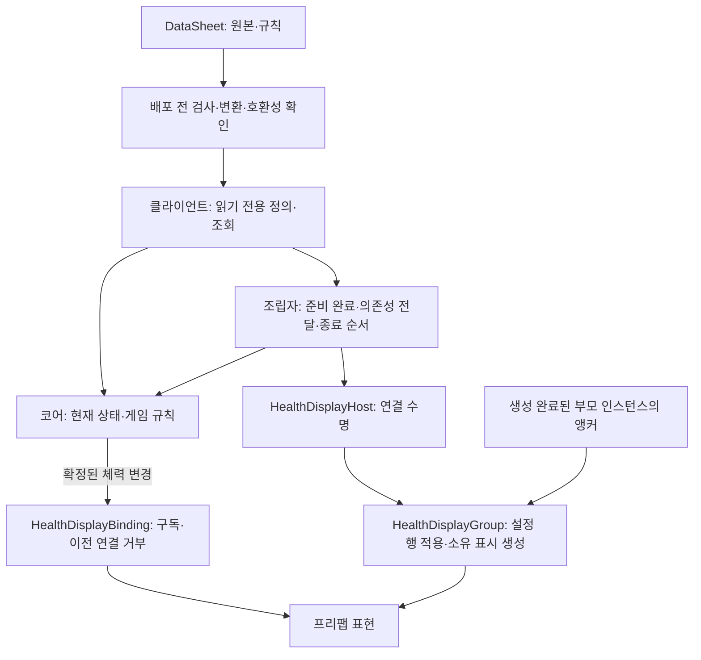
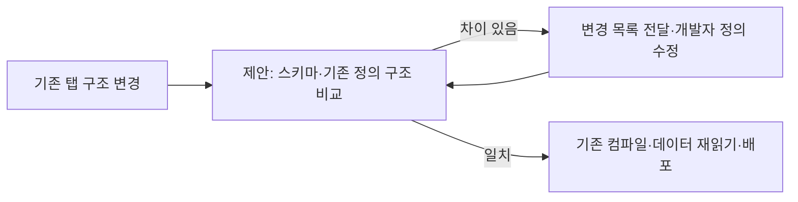
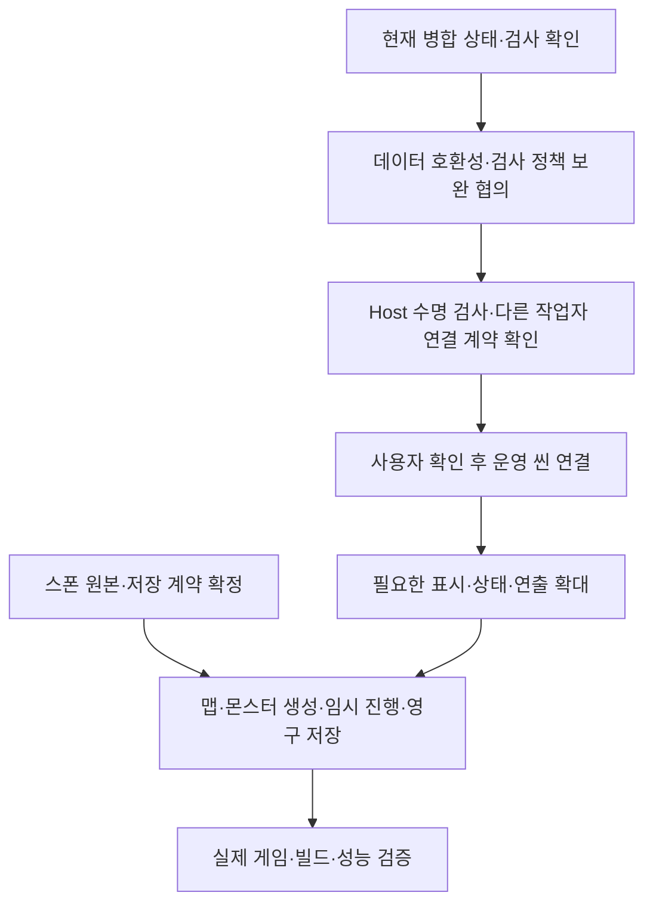

# 설계 기준 점검과 개선 방향

2026-11-02, 클라이언트 커밋 a604b4d의 작업 트리와 형제 DataSheet를 대조한 점검입니다.
이번 변경은 문서만 대상으로 합니다. 구현 코드·시트·씬·프리팹·워크플로는 수정하지 않았습니다.

## 1. 판단

**프로젝트는 합의한 설계 방향으로 진행 중입니다. 데이터 공급과 코어 분리 기반은 갖췄고, 표현 모듈을 분리하는 단계입니다.**
다만 모든 기능의 데이터 제어·복합 상태 구성·운영 씬 조립·풀링까지 완료된 상태는 아닙니다.
현재 구조를 유지하면서 배포 전 스키마 호환성, 표시 소비자의 오류 경계, 새 연결 컴포넌트 수명 검사를 보완하는 방향이 적절합니다.
큰 공통 프레임워크나 전역 관리자를 먼저 늘릴 필요는 확인하지 못했습니다.

| 설계 기준 | 실제 근거 | 판단과 남은 범위 |
| --- | --- | --- |
| 자동화 | 새 파일·탭 탐색, 검사·추출·정의 최초 생성, 자동 로딩 계획, Unity 에셋 수집 | 공급 경로는 구현. 기존 컬럼 변경과 새로운 행동 구현까지 자동인 것은 아님 |
| 책임 분리 | Core·Data·Adapters·Presentation·Preview, 별도 DataSheet 추출·배포 | 대체로 부합. 임시 확인 장면의 조립을 운영 전체 관리자처럼 확대하지 않음 |
| 데이터 기반 | 읽기 전용 정의, 스탯 상속, BossState 페이즈, HealthDisplayConfig | 부분 적용. 전투·패턴 수치 일부는 Unity 설정 에셋이며 스폰·연출 원본은 미정 |
| 이벤트 기반 | 체력·상태·판정 창 결과 이벤트, 초기 연결·재활성 동기화 | 체력 표시는 부합. Preview 표시에는 매 프레임 조회·문자열 구성이 남음 |
| 추상화·퍼사드 | CharacterStat·ActorState, Runtime·Host·Group의 공개 진입점 | 기존 진입점 재사용. 상태 팩토리·상위/병렬 복합 상태는 후속 설계 |
| 재사용 | 프리팹·공통 변환·판정 창·시간 변환·앵커 조회 | 기반 구현. 프리팹 재사용과 풀의 초기화·반환 계약은 별개 |
| 준비 순서·수명 | CSV 후 JSON, 데이터 공개 후 통지, 비활성 생성·Bind·활성화·해제 | 데이터·기존 체력 그룹 범위에서 검사. Host·운영 씬 전환·풀 재대여는 추가 검증 필요 |
| 정수·시간·확률 | 정수 정의·ms Tick·확률 분모10000, 엔진 경계의 좌표/시간 변환 | 부합. 표현 비율·엔진 시간 변환에 실수 사용 가능. 정수만으로 결정성을 보장하지 않음 |

## 2. 왜 현재 구조가 필요한가요?

- DataSheet는 작성 실수를 배포 전에 찾습니다. 클라이언트가 같은 시트 검사기를 반복 실행하지 않게 합니다.
- 정의와 현재 상태를 나눠 같은 Player·Monster 정의를 여러 개체가 공유해도 HP·대상·타이머가 섞이지 않게 합니다.
- Core는 Unity 표현을 참조하지 않습니다. UI나 외형을 바꿀 때 피해·상태 전환 규칙을 다시 만들지 않습니다.
- Runtime과 Host 같은 기존 진입점이 필요한 조립·명령 창구 역할을 합니다. 퍼사드 이름의 클래스를 별도로 추가할 필요는 없습니다.
- Presentation 내부 분리는 체력 이벤트 수명·설정별 생성·Unity 화면·컴포넌트 활성 수명이 실제로 다르기 때문입니다. 코드 줄 수를 맞추기 위한 분할이 아닙니다.
- 앵커는 기획자가 위치를 눈으로 조정하기 위한 계약입니다. 데이터는 프리팹과 앵커 이름을 선택하고 실제 위치는 씬·부모 프리팹이 소유합니다.

## 3. 확인된 구현과 아직 없는 구현

| 영역 | 현재 구현 | 아직 필요한 것 |
| --- | --- | --- |
| 데이터 공급 | CSV10개·JSON4개·정의18개·자동 계획1개, 기존 정의 보존 | 기존 정의와 변경 스키마의 차이를 배포 전에 명시적으로 비교 |
| 초기화 | CSV 전체 다음 JSON, 성공 후 Data 공개, 완료 소비자별 동기 예외 격리 | 운영 씬 조립자가 다른 기능의 준비·취소·실패 정책을 연결 |
| 보스 | HP·체세·해체, HP 기준 페이즈 수치 전환, 내려찍기·2연타·문 돌진 실행 | 자동 패턴 선택·운영 이동/벽 관측·사슬 당기기·기획 수치·전환 연출 |
| 체력 표시 | 설정·프리팹 수집·앵커·연결 세대·생성 그룹, Host 코드 | Host의 실제 Play 수명 검사, 운영 씬 부착·최종 화면 |
| 상태 구성 | 단일 ActorStateMachine, 상태 클래스와 행동 함수 전환 | 실제 요구에 맞는 상위/하위/병렬 구성과 상태 팩토리·데이터 연결 |
| 맵·몬스터·저장 | Stage·StageLayer·몬스터 코어와 제안 문서 | 원본 확정·스폰·풀·안정적 배치 ID·처치 기록·JSON 저장/복원 |
| 빌드 | 수동 요청 후 검사·빌드·보관·별도 디스코드 공지 설정 | 최신 원격 실행과 실제 실행파일 플레이 확인. 이번 점검은 원격 조회를 하지 않음 |

보스 페이즈 수치 전환은 이미 구현돼 있습니다. 페이즈 전체를 미구현으로 기록하지 않습니다.
신규 시트 자동 등록은 지원하는 데이터의 로딩 경로를 자동으로 만드는 기능입니다. 새 상태·연출·게임 규칙 자체를 생성하는 기능은 아닙니다.
캐릭터 팩토리는 추가하지 않고 기존 상속·목록 관리 방향을 유지합니다. 팩토리 확장은 상태 구성의 실제 필요에 한정합니다.

## 4. 개선 우선순위와 완료 기준

| 순서 | 관찰한 근거 | 개선 방법과 완료 기준 |
| --- | --- | --- |
| 1 | ClientLoadPlanCompiler는 보존된 정의를 우선해 컴파일. DefinitionMapper는 실행 시 생성자 컬럼 조회 | DataSheet에서 시트 컬럼·타입·선택 값과 실제 정의 생성자의 구조 차이 보고·배포 차단. 기존 클래스는 계속 보존 |
| 2 | DataValidator의 ReferenceTable 확인이 행 반복 내부에 있음 | 행이 없어도 참조 테이블·규칙 자체를 먼저 확인. 빈 시트·없는 참조에 대한 회귀 검사 |
| 3 | 전체 참조 검사가 직렬화 필드 CS0649 18개로 실패 | 직렬화 필드의 언어 초기값과 경고 정책을 명확히 정리. 미공급 기획 수치는 여전히 준비 실패로 유지하고 선택 검사 통과 확인 |
| 4 | Host는 참조 컴파일까지 확인. 기존24개 메뉴 검사는 Group 중심 | 비활성 Connect→활성화, 반복 Connect/Disconnect, 대상 교체, 부모 제거, 재활성 실패를 실제 Play에서 검사 |
| 5 | 게임플레이 이벤트는 동기 호출이며 소비자별 예외 격리 없음 | 필수 도메인 처리와 선택 표시를 구분. 표시 오류를 자기 경계에서 기록·정리하고 필수 준비 실패는 조립자에게 전달. 코어 변경 후 표시 예외가 나도 확정 결과·다른 필수 처리 경계를 확인 |
| 6 | MonsterPreviewLabel·PreviewPresentation은 매 프레임 문자열 구성 | 운영 표시로 옮기는 부분부터 상태·HP·자원 이벤트와 최초 스냅샷 사용. 이동·센서·진행 중 행동의 Tick은 계속 필요한 주기에 실행 |
| 7 | 전투·패턴 설정이 Unity 에셋과 시트에 나뉨 | 필드별 단위·원본 담당을 먼저 정한 뒤 중복 원본 정리. 수정→배포→동작 확인 사례를 하나씩 추가 |
| 8 | 풀 초기화와 장기 비동기 화면 전환은 미구현 | 대여 세대·반환·구독·HP/목표/타이머 초기화 계약을 실제 풀 기능에 추가하고 즉시 재대여·늦은 완료 검사 |

### 스키마 비교를 우선하는 이유

기존 정의를 보존하는 현재 정책은 개발자가 수정한 클래스를 보호합니다. 이 정책은 유지해야 합니다.
다만 생성 코드와 실제 클라이언트 코드가 컴파일된다는 사실만으로 CSV 컬럼과 기존 생성자의 일치가 보장되지는 않습니다.
예를 들어 시트에서 기존 생성자가 필요로 하는 컬럼을 삭제하면 컴파일 단계와 런타임의 컬럼 조회는 서로 다른 결과를 낼 수 있습니다.
이는 정적 코드 검토로 확인한 검증 범위의 공백이며, 이번에 실제 시트를 바꾸거나 오류 데이터를 배포해 재현한 결과는 아닙니다.

비교 시 공통 스탯 상속·UnitStat 의존성·Boss/Elite 집계·제외 컬럼·선택 타입을 고려해야 합니다.
헤더와 모든 C# 속성을 그대로 같은 목록으로 비교하는 방식은 현재 캐릭터 구조에 맞지 않습니다.
스키마 변경 자동 덮어쓰기나 새로운 규칙 탭은 이 개선의 전제가 아닙니다.
BossPoise는 페이즈 행의 범위·관계도 생성 시 확인하고 있습니다. 원본 행의 관계 검사는 DataSheet와 책임을 맞춰 배포 전에 찾도록 보완할 대상입니다. 반면 공개 코어 API의 잘못된 호출·시간·현재 상태 제약은 원본 파일 검사와 다른 책임이므로 모두 제거할 대상이 아닙니다.

### 이벤트와 구독의 주의점

데이터 완료 통지는 DataReadyNotification에서 소비자별 동기 예외를 격리합니다. 모든 게임플레이 이벤트에 같은 정책이 자동 적용되지는 않습니다.
BossPoise는 PhaseChanged 다음 Changed를 같은 호출 안에서 발행합니다. 표시 소비자가 예외를 던지거나 상태를 다시 바꾸면 뒤 처리와 관찰 순서에 영향을 줄 수 있습니다.
게임플레이 이벤트 콜백에서 코어 명령을 재진입시키지 않는 기존 규칙을 유지하고, 선택 표시의 오류 경계를 실제 연결 때 확인해야 합니다.
HealthDisplayBinding의 이전 연결 세대 거부는 유효하지만 이벤트 표시 콜백 전체의 예외 격리 장치는 아닙니다.

BossCombat은 BossPoise.Changed를 구독하고 Release는 패턴·대기만 정리합니다.
현재 두 객체를 함께 소유하는 구조를 즉시 누수로 단정할 근거는 없습니다. 이후 Actor를 유지한 채 Combat을 교체하거나 풀 수명을 분리할 때 구독 해제·재연결 계약이 필요합니다.

### 작은 구조를 유지하는 방법

- 새 기능은 정의·상태 소유자·조립 창구·표현 경계부터 정하고, 기존 Runtime·Host·Group으로 해결되는 책임은 재사용합니다.
- 새로운 교체 구현이 실제로 생길 때 작은 인터페이스를 추출합니다. 기능마다 관리자·이벤트 버스·팩토리를 추가하지 않습니다.
- Core와 Unity의 분리는 현재 소스 책임 기준입니다. asmdef에 의한 컴파일 경계는 아직 없습니다. 팀 규모나 의존 혼입이 실제 문제가 될 때 도입을 검토합니다.
- Host 비활성 때 표시를 재생성하는 현재 방식은 단순합니다. 자주 반복되는 화면에서 비용을 측정한 뒤 표시 유지·비활성 정책 또는 풀링 적용을 판단합니다.
- 데이터 필드가 아니라 공격 배열 인덱스가 외부 식별자로 쓰이는 부분은, 패턴을 테이블로 옮길 때 안정적 키 연결을 검토합니다.
- 두 저장소의 배포를 추적하기 어려워지면 원본·도구·스키마 판본 기록을 배포 정보에 추가하는 방법을 검토합니다.

## 5. 앞으로의 진행과 협업

이번 점검은 기존의 **실제 씬 연결 보류**를 해제하지 않습니다. 병합과 문서 검토가 끝났어도 씬 부착은 별도로 확인받아 진행합니다.
기획자는 지원하는 값·행·프리팹·앵커를 조정하고, 새 컬럼·타입·상태 동작은 개발자와 변경 범위를 맞춥니다.
다른 개발자는 데이터 완료와 플레이어 준비, 부모 인스턴스 생성 완료를 따로 확인하고, 연결 소비자를 외부 자원보다 먼저 정리합니다.
의존성이 준비됐다는 의미와 화면·전투·스테이지 전체가 준비됐다는 의미를 섞지 않습니다.
화면 상태는 게임 규칙을 다시 계산하거나 독자적인 HP·행동 가능 상태를 소유하지 않습니다.

이 게임의 네트워크 구현은 계속 범위 밖입니다. 이후 확장을 고려한다면 기존 Core에 전송 처리를 넣지 않고, 명령·ID·상태 소유권·틱·난수·순서를 별도로 정해야 합니다.
현재 런타임은 개체별 환경 기반 난수 시드를 사용하므로 정수 연산만으로 같은 실행·리플레이를 재현한다고 판단하지 않습니다.

## 6. 이번 확인 결과와 한계

| 실행·확인 | 이번 결과 |
| --- | --- |
| Verify-Project.ps1 | 데이터659개·코어354개 통과 |
| DataSheet DeployData.exe --check | 14개 탭·데이터14개·정의18개·자동 계획1개 통과. 배포하지 않음 |
| DataExporter.Checks | 48개 통과 |
| Verify-Data.ps1 -CompileUnity | 데이터659개 통과 후 전체 참조 컴파일 실패. MonsterPatternSettings·BossPatternSettings의 CS0649가 오류18개로 처리됨 |
| 실제 앵커 메뉴 검사 | 이전 사용자 직접 실행 통과 기록 유지. 이번 병합 상태에서 재실행하지 않음 |
| Host·운영 씬·최종 빌드·성능 | 이번에 실행하지 않음. 자동으로 완료 처리하지 않음 |

선택 참조 컴파일 실패는 현재 검사 도구의 결과입니다. 실제 Unity의 현재 컴파일 실패나 게임 실행 실패를 이번 점검에서 관찰한 것은 아닙니다.
과거 신규 모듈의 제한된 참조 컴파일 성공과 전체 소스 검사 실패도 서로 다른 범위입니다.
기대 효과는 배포 후 구조 오류 감소, 표시 교체의 영향 축소, 수명 오류 조기 발견, 수동 등록·반복 튜닝 작업 감소입니다. 실제 성능 수치는 측정 후 기록합니다.

## 근거와 문서 관리

주요 근거는 DataSheet의 ProjectData·CodeGenerator·ClientLoadPlanCompiler·DeploymentService와 클라이언트의 DataBootstrapper·DefinitionMapper·ActorStateMachine·BossPoise·BossCombat·SpawnAnchors·Presentation입니다.
최신 실행 결과와 역사 기록은 [현재 구현과 검증 현황](현재%20구현과%20검증%20현황.md)에 모으고, 사용법과 설계 문서는 해당 결과를 참조합니다.
남은 기능은 [남은 구현과 검증 작업](남은%20구현과%20검증%20작업.md), 배치 계약은 [앵커 안내](앵커%20기반%20프리팹%20배치%20안내.md)를 따릅니다.
