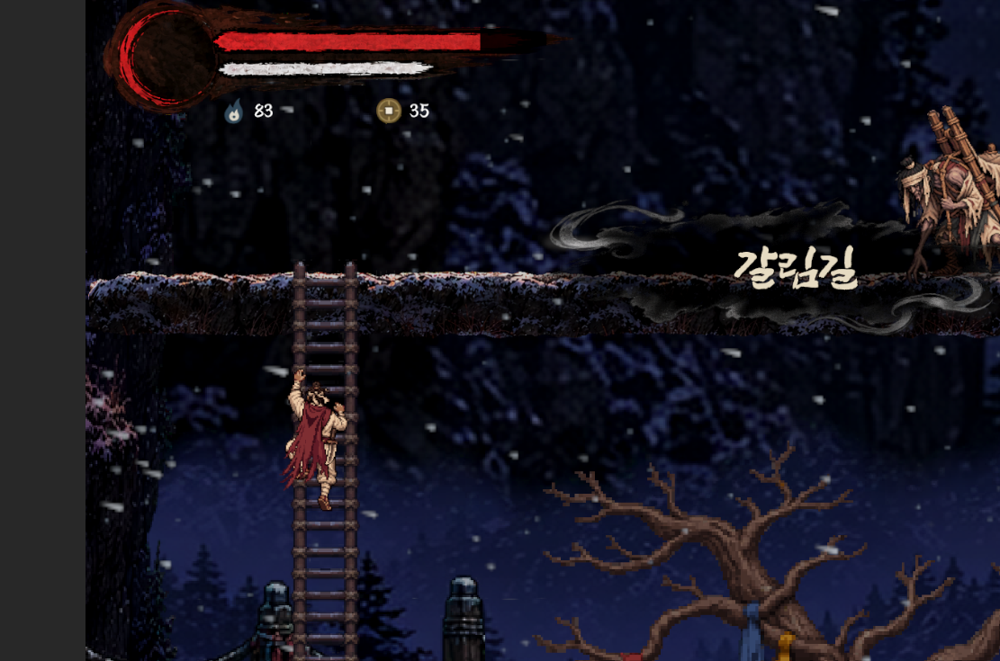
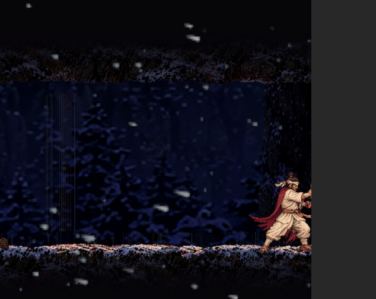
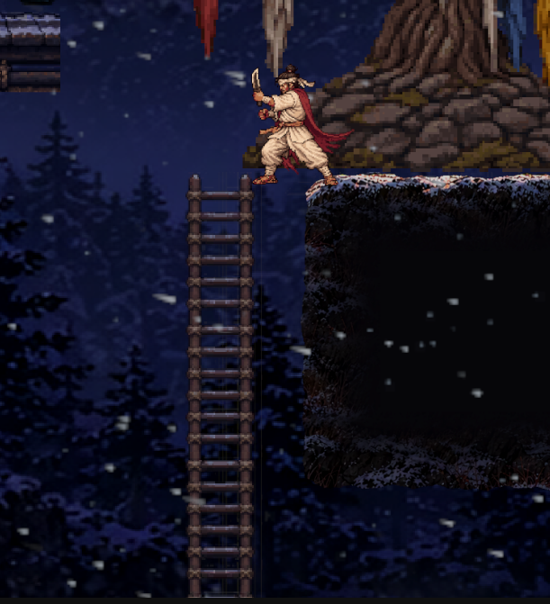
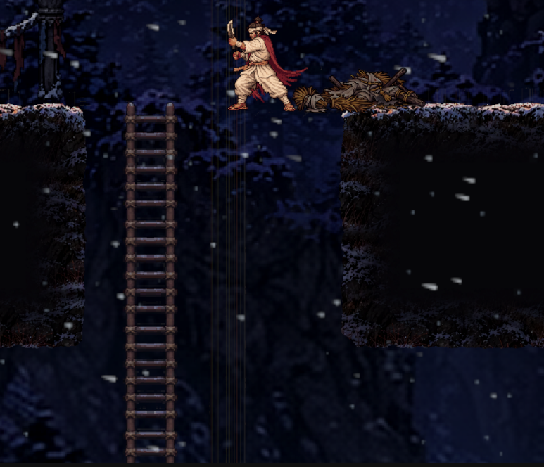
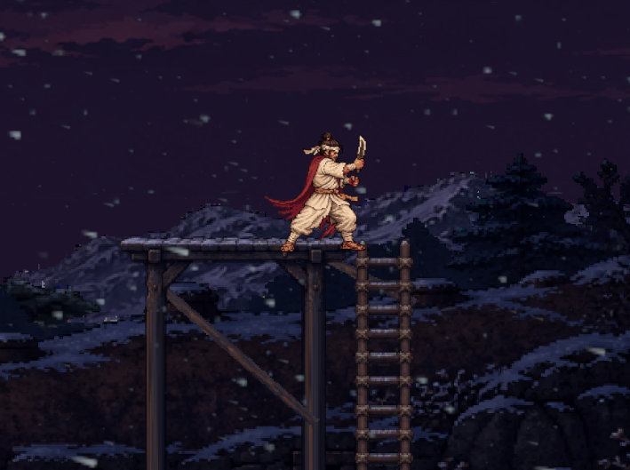
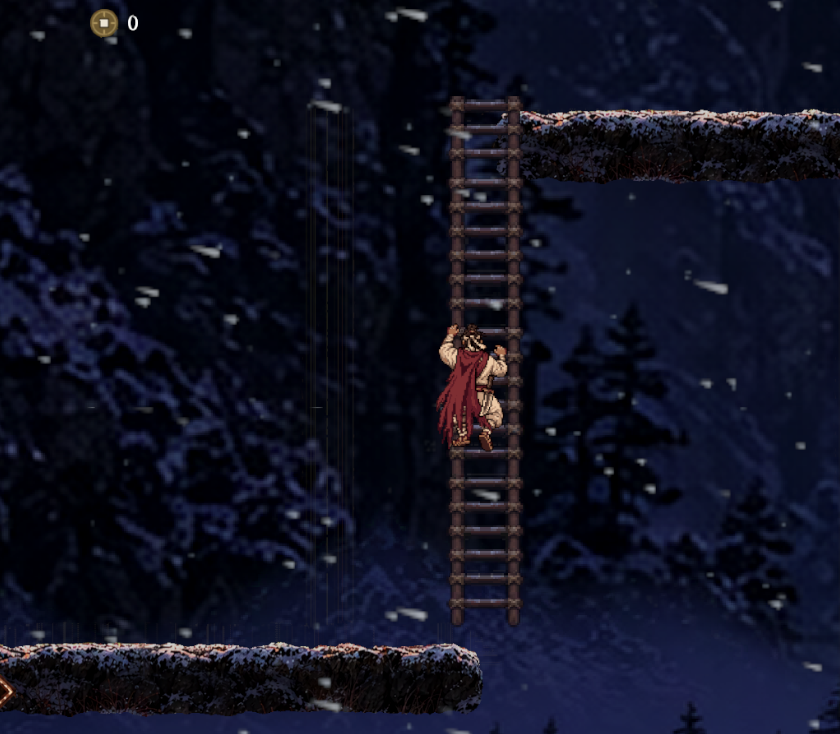
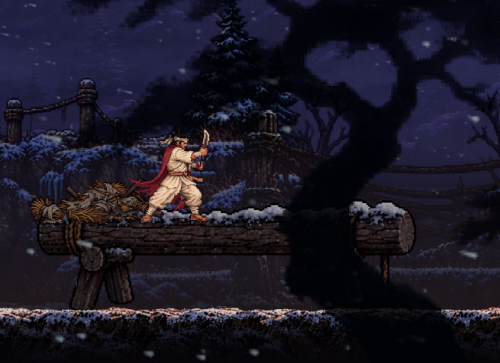

# 프리팹·배치 수정 목록 (11/27, 학원 PC 맵 프리팹)

11/27 사진 확인에서 나온 것 중 **맵 프리팹(충돌체·사다리·표식 자리)**만 고치면 되는 것입니다. DataSheet 데이터는 바꾸지 않습니다. 사진은 `사진/`. 자리(x)는 맵 왼쪽 끝에서 센 칸 수, 갈림길 높이는 명세 기준(아랫길 +28 · 가운데 길 +35 · 흔들다리 +37~40 · 1차 선반 +44 · 윗 선반 +50)입니다.

## 우선 (버그)

| # | 맵 · 자리 | 문제 | 고칠 것 |
|---|---|---|---|
| P1 | 갈림길 1차 선반(+44) 왼쪽 끝 | 사다리(x3.5)로 올라가 왼쪽으로 가면 가마터로 넘어감(지스타 #9 '뒤로 가는 길'). StageExit 6번(왼쪽 끝 출구)이 높이 제한이 없어서 | 1차 선반 왼쪽 끝에 벽 충돌체. 되돌아가는 길은 흔들다리 하나만 |
| P2 | 갈림길 폐광 입구 쪽 오른쪽 끝(x44, 아랫길) | 맵 오른쪽 끝을 넘어 회색 바깥까지 걸어감 | 오른쪽 끝에 맵 높이 전체를 막는 벽 |
| P3 | 갈림길 서낭당 옆 사다리(Ladder_LowOut x7.5, 아랫길 → 가운데 길) | 사다리와 땅 끝(x9) 사이 약 1칸 빈틈, 위 끝이 땅에 안 닿음. 아랫길에서 올라오는 유일한 길이라 길이 안 읽힘 | 사다리를 땅 끝에 붙이거나 땅을 x7까지 늘림 |
| P4 | 갈림길 폐광 입구(Blocked_MineEntrance x24~28) | 구멍 약 7칸, 막는 충돌체 위에 허공 서기. 폐광 사다리도 양쪽 땅에 안 붙음 | 구멍을 약 2칸으로 좁히고(양쪽 땅 늘림) 사다리를 한쪽 땅 끝에 붙임. 그 자리 위험 경고 그림은 아트(K7) |

## 사다리 자리 (공통 기준, 11/27 확정: 위·아래 발판 끝 안쪽으로 0.5칸 겹치게, 위 끝 = 발판 윗면)

| # | 맵 · 자리 | 문제 | 고칠 것 |
|---|---|---|---|
| P5 | 가마터 오른쪽 사다리 Ladder_x98 (Transform x 96.85, 판정 x96.85~97.85, 높이 6~10) | 위 발판 Air_Platform_26은 x94~97(윗면 10)인데 사다리 판정이 발판 끝 바깥으로 0.85칸 나가 있음 → 허공 사다리, 다 오르면 옆으로 순간이동(G7) | **Transform x 96.85 → 96.0**(판정 x96~97, 발판 오른쪽 끝 안쪽). 사다리 그림도 같이 옮김. 11/27 학원 PC 최신 Develop 확인: 11/15 수정(8107e71)은 들어가 있음(값이 맞음), 그래도 0.5칸 옮긴 것으로는 부족했음. 왼쪽 Ladder_x50(판정 x48.85~49.85, 위 13)은 Air_Platform_29(x48~58, 윗면 13) 안쪽이라 괜찮음 |
| P6 | 갈림길 1차 선반 → 윗 선반 사다리(Ladder_Up2 x21.5) | 명세부터 두 선반 경계에 걸쳐 어느 쪽에도 안 겹침 | 윗 선반을 왼쪽으로 1~2칸 늘려 사다리 위 끝이 안쪽에, 아래 끝은 1차 선반 윗면에 |
| P7 | 산길 두 번째 잔불 위 다리 오른쪽 사다리 Ladder_SangilRight (Transform x 102.95, 판정 폭 1.9 → x102.0~103.9) | **오를 수 있는 진짜 사다리**(11/27 확인, 처음엔 장식으로 봤음). 위 발판 Air_Platform_14는 x92~103이라 판정 절반이 발판 끝 바깥. 사다리 그림 SteppedRockWithLadderRight는 x104.3에 있어 판정과도 약 1.3칸 어긋남(왼쪽도 그림 x91.7 vs 판정 x93) | **Transform x 102.95 → 102.5**(발판 끝 안쪽 0.5칸), 그림을 판정 자리에 맞춤. 왼쪽 Ladder_Sangil(x92.2~93.8)은 발판 안쪽이라 판정은 괜찮고 그림만 맞춤 |

## 자리·충돌

| # | 맵 · 자리 | 문제 | 고칠 것 |
|---|---|---|---|
| P8 | 갈림길 서낭당(Seonangdang x11, 가운데 길) | 돌무더기 받침 왼쪽이 땅 끝(x9) 밖으로 나가 떠 보임 | 서낭당·Respawn_Seonangdang 표식을 x13~14로 |
| P9 | 산길 통나무 발판(허수귀가 선 곳, 어느 발판인지 확인 필요) | 플레이어·허수귀 발이 통나무 윗면보다 약 0.3칸 묻힘(평지는 정상) | 그 발판 충돌 윗면을 그림 윗선에 맞추거나 그림을 내림 |
| P10 | 가마터 문틀 발판 기둥 | 기둥 그림을 세로로 늘림 | Sprite Draw Mode Tiled/9-slice로(아트 1-3과 같이) |
| P11 | 가마터 중경 PNG | 계단 모양 깨짐 | Import Settings: Max Size ≥ 원본 폭(8192 권장), Compression None, Filter Point 확인 |

## 데이터와 같이 바꿀 것 (3단계 맵 재검토 때, 지금은 안 함)
- 협곡 왼쪽 끝 → 갈림길 윗 선반으로 넘어감(StageExit 8번, 11/25 결정과 어긋남): 8번 행 끄기 + 협곡 왼쪽 끝 벽, 갈림길 넘어가기 전 확인 창·강제 저장(K1)
- 갈림길 층 간격 줄이기(사다리 7·6칸 → 5·4칸쯤), 1차 선반에 오를 이유
- 몬스터 자리: 협곡 지게귀 x71.5(발판 10 밑) → x66쯤, 갈림길 협곡 도착 자리 옆 허수귀, 가마터 구덩이 양쪽 지게귀
