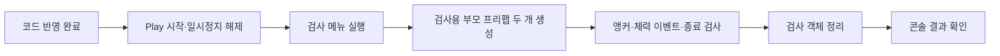

# 앵커 체력 표시 테스트 안내

2026-11-02 사용자가 Unity 메뉴 검사를 직접 실행한 뒤 **통과했다고 전달했습니다**. 코드와 프리팹 준비·참조 컴파일에 이어 실제 Play 검사 통과를 사용자 확인 결과로 기록합니다.
이 검사는 앵커를 담은 부모 프리팹을 먼저 생성하고, 그 인스턴스 내부 앵커에 체력바를 연결하는 흐름을 확인합니다.

## 1. 왜 이 검사가 필요한가요?

C# 컴파일 성공만으로 Unity의 활성화·비활성화·지연 제거와 프리팹 내부 참조가 올바르다고 판단할 수 없습니다.
부모가 여러 개일 때 이름이 섞이지 않는지, 비활성 중 이벤트를 멈추는지, 생성 실패 후 객체가 남지 않는지를 실제 Play에서 확인해야 합니다.



## 2. 먼저 준비할 것

1. Unity에서 Human_Ghost- 프로젝트를 엽니다. 현재 사용 버전은 6000.2.8f1입니다.
2. 코드를 반영한 후 스크립트 컴파일이나 에셋 가져오기 진행 표시가 끝날 때까지 기다립니다.
3. **Window → General → Console**에서 콘솔 창을 엽니다.
4. 새로 발생한 빨간 컴파일 오류가 있으면 Play를 시작하지 말고 첫 오류를 개발자에게 전달합니다.
5. Project 창에서 아래 두 파일이 존재하는지 확인합니다. 직접 수정할 필요는 없습니다.

| 파일 | 용도 |
| --- | --- |
| Assets/2.Model/Prefabs/UI/PlayerHealthBar.prefab | 실제 표시할 체력바 |
| Assets/2.Model/Prefabs/UI/HealthDisplayAnchorLayout.prefab | 빈 앵커를 포함한 배치 예제 |

배치 예제에는 Canvas·플레이어·자동 실행 스크립트가 들어 있지 않습니다.
Canvas 아래에서 사용하는 앵커 부품이며, 검사 코드가 먼저 생성해 사용합니다. 파일을 열기만 해도 체력바가 생기는 것은 아닙니다.
현재 사용 중인 씬에 위 프리팹을 직접 배치하거나 씬을 저장할 필요가 없습니다.

## 3. 실제 실행 순서

1. 열려 있는 씬에서 상단 **Play 버튼**을 누릅니다. 이미 Play 중이면 그대로 진행합니다.
2. Play 전환이 끝날 때까지 기다립니다.
3. **Pause가 켜져 있으면 해제**합니다. 지연 제거를 다음 프레임에서 확인하기 때문에 프레임이 진행되어야 합니다.
4. 상단 메뉴에서 **인귀 → 검사 → 앵커 체력 표시 연결 검사**를 선택합니다.
5. 몇 프레임 뒤 콘솔에 표시되는 새 결과를 확인합니다. 검사 중에는 코드나 시트를 수정하지 않습니다.

```text
인귀
└── 검사
    └── 앵커 체력 표시 연결 검사
```

검사 중 같은 메뉴는 중복 실행되지 않습니다. 완료 후 다시 실행할 수 있습니다.
실행 중이던 게임은 원래대로 계속 진행합니다. 검사는 별도의 플레이어 코어와 임시 화면을 사용해 기존 플레이어에게 피해를 주지 않습니다.

## 4. 정상 결과는 무엇인가요?

현재 코드의 모든 항목이 통과하면 다음 문구가 나옵니다.

```text
앵커 체력 표시 연결 검사 24개를 통과했습니다.
```

위 문구는 현재 코드의 성공 문구입니다. 2026-11-02 사용자로부터 검사 통과 결과를 전달받았으며, 별도 콘솔 원문이나 화면을 수집한 것은 아닙니다.
실패하면 다음 접두어와 원인이 나옵니다.

```text
앵커 체력 표시 연결 검사 실패: ...
```

| 확인하는 내용 | 정상 동작 |
| --- | --- |
| 프리팹 선택 | 파일명 키로 실제 체력바 에셋 조회 |
| 부모 생성 순서 | 부모 배치 프리팹 생성 후 내부 앵커 수집 |
| 인스턴스 분리 | 같은 이름이어도 서로 다른 부모의 앵커와 표시가 섞이지 않음 |
| 위치·크기 | 표시 피벗이 앵커 위치와 일치하고 검사 데이터의 크기 적용 |
| 앵커 이동 | 부모 아래 자식 표시가 함께 이동 |
| 피격 | 해당 플레이어의 체력 변경 이벤트로 막대 비율 갱신 |
| 비활성 부모 | 이벤트를 소비하지 않고, 활성화되면 최신 체력으로 동기화 |
| 앵커 오류 | 누락·중복 이름을 실패로 전달하고 원점에 대신 생성하지 않음 |
| 중첩 배치 | 여러 단계 아래의 앵커도 조회 |
| 정상 종료 | 생성한 표시만 정리하고 외부 부모·앵커·다른 그룹 보존 |
| 일부 생성 후 실패 | 구독·활성 상태를 즉시 정리하고 다음 프레임에 소유 객체 제거 |
| 숨긴 행 | Visible=N이면 표시를 생성하지 않음 |
| 부모 제거 | 제거된 앵커 참조 사용을 거부하고 표시 정리 |

검사 화면은 잠깐 만들어졌다가 제거됩니다. 눈으로 모든 과정을 관찰하는 방식은 아니며 **콘솔 결과로 판정**합니다.
기본 시트의 너비240·높이20을 바꾸지 않고, 검사 내부에서 너비333·높이22 설정을 임시로 사용합니다.
원본 CSV·시트·프리팹·기존 씬을 수정하거나 저장하지 않습니다. 기존 편집 상태가 깨끗해졌다는 뜻도 아닙니다.

## 5. 메뉴나 결과가 보이지 않을 때

| 상황 | 확인 순서 |
| --- | --- |
| 인귀 메뉴가 없음 | 코드가 최신인지, 컴파일이 끝났는지, 콘솔의 첫 컴파일 오류 확인 |
| 검사 메뉴가 비활성 | Play 중인지, Pause가 해제됐는지, 검사가 이미 진행 중인지 확인 |
| 결과가 안 보임 | 콘솔의 일반 로그·오류 표시 필터가 켜져 있는지 확인 |
| 체력 표시 설정에 검사할 행이 없음 | 배포된 HealthDisplayConfig에 외형을 선택할 행이 있는지 확인 후 다시 배포 |
| 프리팹 키를 찾지 못함 | Play 종료 후 인귀 → 데이터 → 에셋 목록 갱신 실행, 에디터 오류 해결 후 다시 Play |
| 그 외 실패 | 첫 실패 문구와 그 아래 내용을 개발자에게 전달 |

검사에 필요한 외형 선택을 위해 설정 행이 하나 필요합니다. 이것이 운영 기능의 빈 설정을 금지한다는 뜻은 아닙니다.
오류를 해결하기 위해 생성된 C#이나 에셋 참조 목록을 기획자가 직접 고치지 않습니다.

## 6. 결과를 전달할 때

```text
프로젝트: Human_Ghost-
Unity 버전: 6000.2.8f1
열어 둔 씬 이름:
Play 켜짐 / Pause 꺼짐 확인: 예 또는 아니오
실행한 메뉴: 인귀 → 검사 → 앵커 체력 표시 연결 검사
성공 문구 또는 첫 실패 문구:
실패 문구 아래의 상세 내용:
```

검사 후 이 검사를 위해 켰던 Play는 종료하면 됩니다. 원래부터 진행 중이던 Play를 검사 코드가 임의로 종료하지 않습니다.
기존 씬을 저장하라는 대화상자가 나타나면 기존 편집 내용의 저장 여부를 직접 판단하세요. 검사 때문에 저장할 필요는 없습니다.

## 7. 코드 위치와 검증 한계

| 위치 | 이유 |
| --- | --- |
| Assets/Editor/Presentation/HealthDisplayVerification.cs | 메뉴·배치 실행·실제 Unity 객체 검사를 에디터 전용으로 분리 |
| Assets/2.Model/Prefabs/UI/HealthDisplayAnchorLayout.prefab | 기획자가 위치를 수정하고 재사용할 수 있는 앵커 배치 예제 |
| Presentation/HealthDisplayGroup.cs | 실제 생성·연결·정리 동작을 검사하며 테스트용 동작으로 대체하지 않음 |
| Adapters/SpawnAnchors.cs | 실제 Transform을 이용한 인스턴스별 이름 연결 검사 |

에디터 검사 코드는 플레이어 빌드에 포함되지 않습니다. 공통 게임 기능에 자동 검사 실행을 붙이지 않았습니다.
실제 배포 데이터와 프리팹을 읽되, 실패·숨김 같은 검사용 행만 별도의 읽기 전용 저장소로 전달합니다.
지연 제거는 실제 프레임이 바뀐 뒤 확인합니다. 게임 코드에 새로운 매 프레임 갱신을 추가한 것은 아닙니다.

이 검사는 화면 객체의 배치·크기·막대 비율·수명을 확인합니다. 아트의 시각적 품질, 해상도별 배치, 최종 실행파일 렌더링까지 검증하지 않습니다.
이후 실제 게임 씬에 조립 코드를 연결하고 화면·입력·스테이지 전환을 함께 확인해야 합니다.

현재 자동 실행 시도는 Unity 검사 진입 전에 종료됐고, 라이선스 프로세스 연결 충돌 로그를 확인했습니다.
열려 있는 Unity 창은 관리자 권한으로 실행 중이어서 자동 제어도 제한됐습니다. 이후 사용자가 같은 검사 메뉴를 직접 실행해 통과 결과를 전달했습니다. 자동 실행 실패 기록과 사용자 실행 통과 기록을 구분합니다.
코드는 설치된 Unity 모듈 참조 컴파일에서 경고·오류 0개를 확인했습니다.
