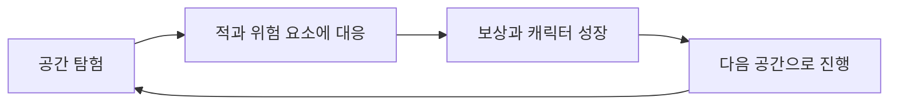
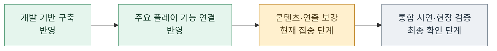
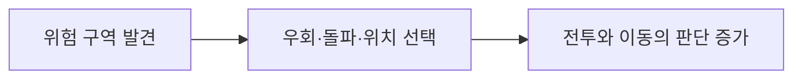
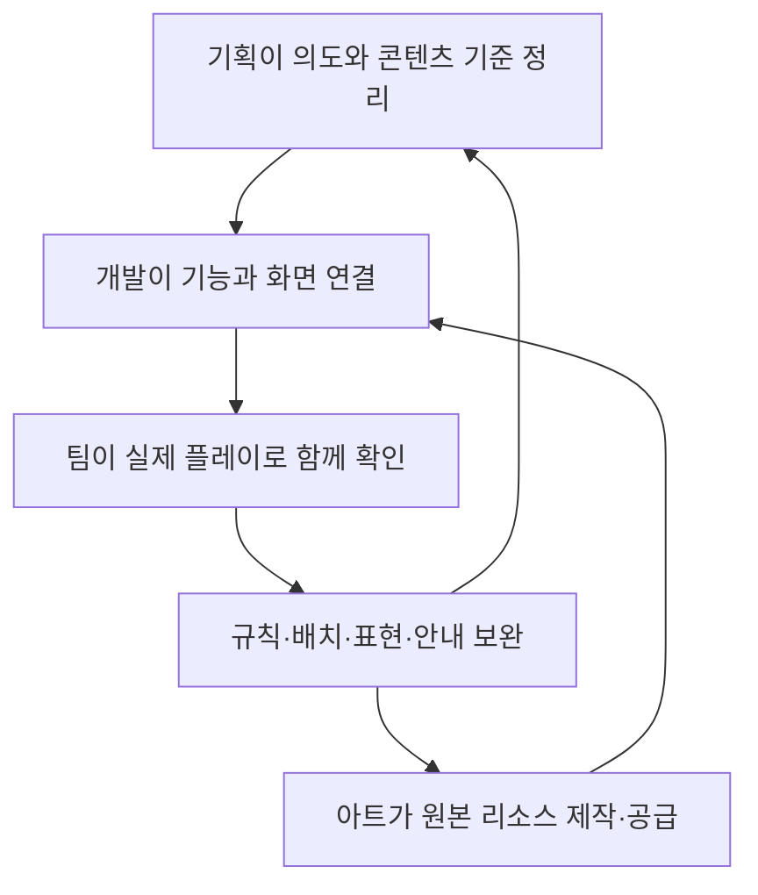

# 인귀 — 지스타 출품 개발 현황 소개

2026년 11월 13일 기준. 프로젝트 소개와 개발 진행 상황을 전달하기 위한 외부 제공용 자료입니다.

## 목차

1. [어떤 게임을 만들고 있나요](#1-어떤-게임을-만들고-있나요)
2. [지금 어디까지 진행됐나요](#2-지금-어디까지-진행됐나요)
3. [최근 어떤 경험을 보강했나요](#3-최근-어떤-경험을-보강했나요)
4. [팀은 어떻게 함께 만들고 있나요](#4-팀은-어떻게-함께-만들고-있나요)
5. [앞으로 무엇을 준비하나요](#5-앞으로-무엇을-준비하나요)

## 1. 어떤 게임을 만들고 있나요

인귀는 전투와 공간 탐험을 연결하는 **2D 액션 메트로배니아** 프로젝트입니다. 적의 행동에 대응하는 전투, 캐릭터의 성장, 지형을 살피며 이동하는 경험을 함께 다듬고 있습니다.

지스타 시연에서는 개별 기능을 나열하기보다 전투하고 성장한 뒤 다음 공간으로 나아가는 흐름이 자연스럽게 이어지도록 준비하고 있습니다.

## 2. 지금 어디까지 진행됐나요

**개발 기반과 주요 플레이 시스템의 구현·연결을 마련했으며, 현재는 지스타 시연을 위한 콘텐츠·연출 통합과 안정성 확인에 집중하고 있습니다.**

| 개발 영역 | 현재 확보한 범위 | 시연 준비의 다음 초점 |
| --- | --- | --- |
| 전투·캐릭터 | 플레이어·일반 적·보스의 행동과 전투 연결 기반 | 반복 전투의 흐름·체감·안정성 확인 |
| 성장·저장 | 보상·레벨·강화와 저장·이어하기 연결 | 플레이를 이어 갔을 때의 경험 확인 |
| 맵·위험 요소 | 맵 구성과 불·얼음 필드 효과 연결 | 배치·이동·넉백 상황의 현장감 조정 |
| 화면·조작 | 타이틀·설정·게임 화면과 조작 연결 | 안내의 명확성·가독성·입력 복귀 확인 |
| 제작·검증 환경 | 데이터 반영·검사·빌드·플레이 기록 확인 기반 | 시연 빌드의 반복 점검과 피드백 반영 |

표의 ‘확보한 범위’는 기능 구현·연결 상태를 뜻합니다. 최종 시연 전체 흐름의 검증 완료나 모든 콘텐츠 제작 완료를 뜻하지 않습니다. 기능마다 작업 규모가 달라 임의의 게임 완성률 하나로 합산하지 않습니다.

## 3. 최근 어떤 경험을 보강했나요

### 3.1 지형을 살피는 전투와 이동

불과 얼음처럼 공간에 따라 판단을 바꾸는 위험 요소를 추가했습니다. 불은 위험 구역을 피해 이동할 이유를 만들고, 얼음은 공격을 받았을 때의 위치와 거리를 더 신경 쓰게 합니다. 관련 기능을 연결했으며 실제 맵과 전투 안에서 배치를 확인하고 있습니다.

### 3.2 플레이 흐름과 안내

전투로 얻은 보상이 성장으로 이어지고, 저장한 진행을 다시 이어 갈 수 있는 기능을 마련했습니다. 타이틀·설정·화면 안내도 함께 보강하고 있습니다. 기능에 문제가 생겼을 때 상황을 확인할 수 있는 안내와 개발 검증 환경도 정비했습니다.

### 3.3 빠르게 수정하고 다시 확인하는 제작 환경

기획 데이터의 변경을 게임에 반영하고 검사하는 제작 과정을 정리했습니다. 이를 통해 팀이 수치·문구·배치를 조정한 뒤 시연 결과를 확인하는 반복 작업에 집중할 수 있도록 했습니다. 새로운 규칙이나 기능 자체를 추가하는 개발 작업과는 구분합니다.

## 4. 팀은 어떻게 함께 만들고 있나요

개발 2명·기획 2명·아트 1명이 서로 다른 책임을 맡고 결과물을 연결하는 방식으로 작업합니다. 아래 역할은 한 사람이 해당 영역의 모든 작업을 단독으로 했다는 의미가 아닙니다.

| 역할 | 함께 만든 내용 |
| --- | --- |
| 공통 기능·자동화 개발 | 데이터 반영 환경, 저장·성장 등 공통 기능, 오류 대응·검증 기반과 기능 연결 |
| 전투·화면 개발 | 캐릭터·적의 동작, 전투와 애니메이션 연결, UI와 전달받은 리소스의 게임 적용 |
| 데이터·규칙 기획 | 콘텐츠 규칙·수치·배치 기준 정리, 데이터 작성·조정과 개발 요구 전달 |
| 콘텐츠·사운드 기획 | 공간·대사·소리 관련 콘텐츠 정리, 게임에 반영된 결과 확인·보완 |
| 아트 제작·공급 | 원본 아트 작업과 별도 파일 업로드를 통한 리소스 공급, 표현 개선 협업 |

**아트 담당자는 Git 외부의 파일 전달 방식으로 함께 참여했습니다.** 개발팀의 리소스 가공·애니메이션 연결·게임 적용 이력과 원본 아트 제작 기여를 구분합니다. 커밋 기록만으로 팀의 기여를 평가하지 않습니다.

## 5. 앞으로 무엇을 준비하나요

### 5.1 지스타 시연을 위한 연결·보강

| 준비 항목 | 플레이어에게 전달하려는 경험 |
| --- | --- |
| 컷씬·대사 콘텐츠와 플레이 흐름 연결 | 시작·상호작용·마무리가 자연스럽게 이어지는 경험 |
| NPC와 공간 콘텐츠 연결 | 탐험 중 인물·공간의 역할을 이해하는 경험 |
| 위험 구역·전투·화면·소리 조정 | 위험과 행동 결과를 알아보기 쉬운 경험 |
| 저장·복귀·설정·전체 흐름 검증 | 시연을 시작하고 이어 가기 편한 환경 |

### 5.2 이후 확장 검토

추가 필드 효과와 상호작용, 아이템·보상 콘텐츠 등은 기존 제작 기반을 활용해 확장할 수 있도록 검토하고 있습니다. 검토 항목을 이번 시연의 확정 제공 기능으로 안내하지 않습니다. 최종 시연 범위는 콘텐츠 준비와 통합 검증 결과를 바탕으로 정합니다.
