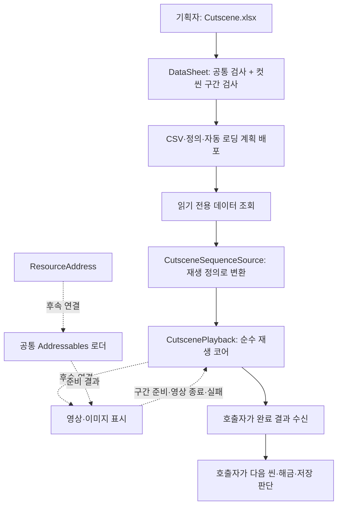
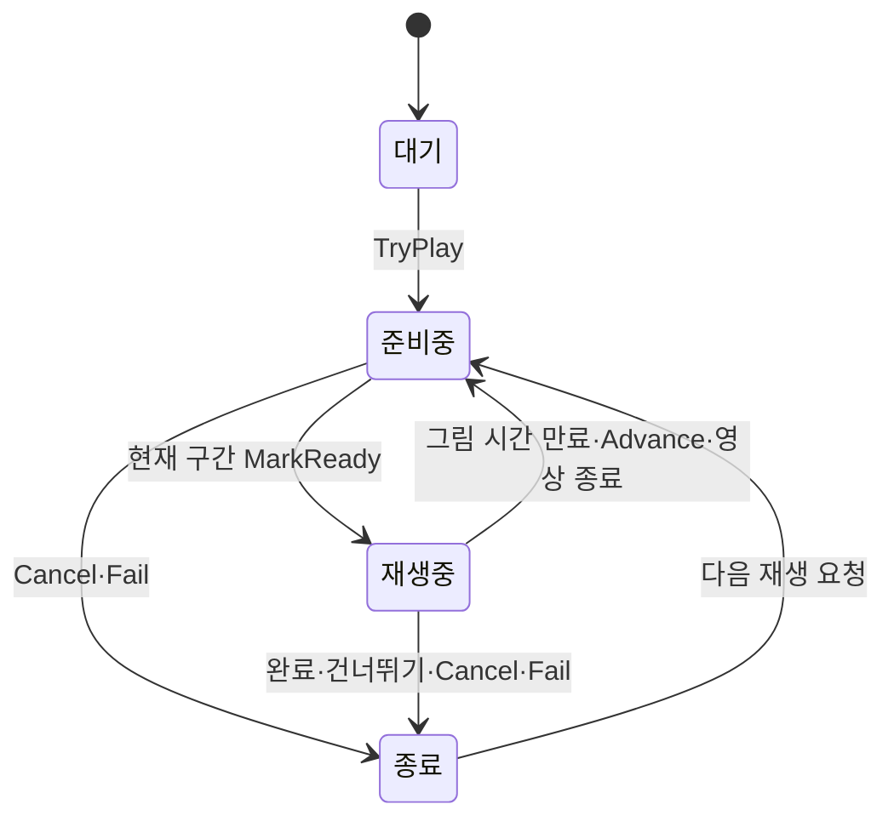

# 컷씬 재생 설계

## 1. 왜 독립 모듈로 구성하는가

인트로 영상·장부방 그림·엔딩이 재생 순서와 건너뛰기 규칙을 재사용하도록 구성합니다. 씬 이동·저장·해금은 컷씬을 호출한 기능의 책임입니다. 테이블·리소스 로드·화면을 바꿔도 순수 재생 규칙은 유지하는 것이 목적입니다.

현재 문서는 구현한 데이터·코어와 이후 연결할 표시 기능을 구분합니다. 사용법은 형제 DataSheet 프로젝트의 [기획자 설명서](../../DataSheet/Docs/기획자용%20컷씬%20데이터%20작성과%20사용%20안내.md)를 참고합니다.

## 2. 책임과 계층



| 위치 | 역할 | 분리 이유 |
| --- | --- | --- |
| DataSheet `tables/Cutscene.xlsx` | 공통 설정·구간 행 | 기획자가 코드 없이 순서·시간·주소 수정 |
| DataSheet `CutsceneDataValidator` | 컷씬 고유 조건 | 클라이언트에 배포 전 검사기를 복제하지 않기 |
| `Assets/3.Script/Data/Cutscene.cs`·`CutsceneStep.cs` | 읽기 전용 정의 | 기존 생성·매핑·조회 재사용 |
| `Assets/3.Script/Adapters/CutsceneSequenceSource.cs` | 데이터 조회와 재생 정의 연결 | Data가 게임 코어에 의존하지 않기 |
| `Assets/3.Script/Core/Cutscenes` | 상태·시간·재생 결과 | Unity·Addressables·저장 방식과 독립 |

빈 두 탭도 기존 탐색·배포·자동 로딩 계획에 포함됩니다. 새 정의는 도구가 최초 생성하며 기존 파일을 덮어쓰지 않습니다. 생성 코드를 DataSheet에 중복 보관하지 않습니다.

## 3. 왜 두 탭인가

```text
Cutscene: ID·Key·SkipHoldMs
   └─ CutsceneStep 여러 행
      ID·CutsceneID·Order·MediaType·ResourceAddress·DurationMs·TextID·CanAdvance
```

공통 건너뛰기 시간을 컷마다 반복하지 않도록 분리했습니다. 컷씬 ID와 구간 ID는 기획자가 대역을 정한 뒤 입력하며 현재 실제 행은 없습니다. 구간은 같은 CutsceneID 안에서 Order로 정렬합니다. TextID는 미사용 시 빈칸이고 재생 코어에서 0으로 변환합니다.

영상은 실제 종료 신호를 사용하므로 DurationMs=0·CanAdvance=N입니다. 그림은 양수 밀리초가 지나거나 허용된 다음 장 명령을 받으면 넘어갑니다. ResourceAddress는 Addressables의 논리 주소이며 파일 경로나 앵커 이름이 아닙니다.

## 4. 재생 수명과 결과



`StepToken`은 구간마다 증가하며 재시작 때도 초기화하지 않습니다. 이전 리소스의 지연 완료·실패 콜백은 현재 토큰과 다르면 무시합니다. 준비 중에는 그림 표시 시간·건너뛰기 시간을 진행하지 않습니다. 큰 프레임 시간이 들어와도 현재 구간까지만 진행하고, 아직 준비되지 않은 다음 그림을 건너뛰지 않습니다.

시간 누적·상한 처리는 AccumulateTime, 현재 구간 판정은 IsCurrent, 상태 변경 알림은 ChangeState로 일원화했습니다. 외부 명령은 준비·다음 장·영상 종료·취소·실패라는 서로 다른 의도를 유지합니다.

결과는 Completed·Skipped·Cancelled·Failed를 구분합니다. Changed와 Finished는 동기 결과 알림이며 소비자가 콜백 안에서 코어 명령을 다시 호출하지 않습니다. 다음 재생이나 씬 이동은 호출자가 자기 실행 흐름에서 처리합니다. 입력·시간·소리 잠금의 정리는 실제 조립 단계에서 종료 이유와 무관하게 수행해야 합니다.

## 5. 배포 전 검사의 경계

기존 컬럼 규칙으로 타입·범위·ID와 키 중복·참조·컷씬별 순서 중복을 검사합니다. CutsceneDataValidator는 구간 없는 컷씬, 1부터 연속되지 않는 순서, 미디어별 시간·넘김 조건, 주소 ASCII 형식만 추가 검사합니다. 해당 두 탭이 없는 다른 파일에는 영향을 주지 않습니다.

Addressables 주소의 실제 등록·중복·리소스 타입은 아직 검사하지 않습니다. 패키지가 미설치 상태이므로 실제 리소스 연결 검사는 다음 구현 범위입니다. 형식 검사를 실제 영상 재생 성공으로 해석하지 않습니다.

## 6. 개발자 연결 방법

1. 데이터 초기화 완료 후 조회 묶음을 명시적으로 전달합니다.
2. `CutsceneSequenceSource.Create(data, cutsceneId)`로 재생 정의를 얻습니다.
3. CutscenePlayback에 TryPlay를 요청합니다. 이미 재생 중이면 거부합니다.
4. 표시 담당이 현재 ResourceAddress를 로드하고 준비가 끝난 구간 토큰으로 MarkReady를 호출합니다. 결과 이벤트 안에서 명령을 다시 호출하지 않도록 비동기 준비 또는 별도 실행 흐름에서 전달합니다.
5. 영상 종료는 ReportVideoEnded, 그림 다음 장은 Advance, 유지 입력은 SetSkipHeld로 전달합니다.
6. 호출자가 정한 시간 공급으로 Tick에 정수 밀리초를 전달합니다. 게임 시간이 멈춰도 컷씬이 진행되어야 할 때의 시간 선택은 조립자의 책임입니다.
7. 실패는 현재 토큰의 Fail, 중단은 Cancel로 전달합니다. 리소스·구독·잠금 수명은 Unity 조립자가 소유합니다.

네트워크 전송·권한 로직은 포함하지 않습니다. 경계를 넘는 값은 ID·주소·정수 시간·토큰이며 Unity 오브젝트를 순수 코어로 전달하지 않습니다. 정수 시간만으로 리플레이 결정성이 보장되는 것은 아닙니다.

## 7. 현재 구현과 다음 범위

현재 구현: 빈 데이터 탭·검사·배포·정의 생성·자동 로딩·재생 정의 변환·순수 재생 코어. 실제 행은 기획자 입력 대기입니다.

미구현: Addressables 설치와 로더·리소스 등록 검사·영상/이미지 표시 컴포넌트·입력·안내 게이지·게임 입력/시간/소리 잠금·실제 씬 연결. 기존 씬·프리팹을 자동 수정하지 않았습니다. 저장·씬 전환은 독립 기능으로 유지합니다.
