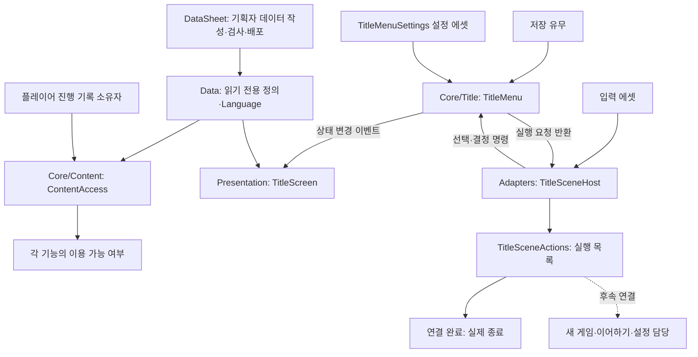
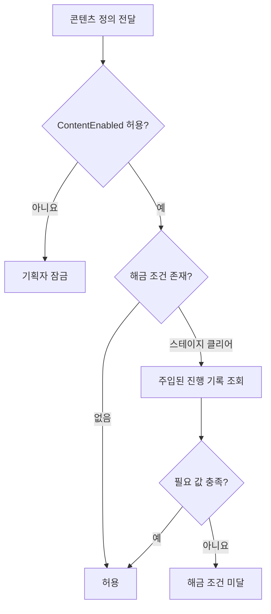
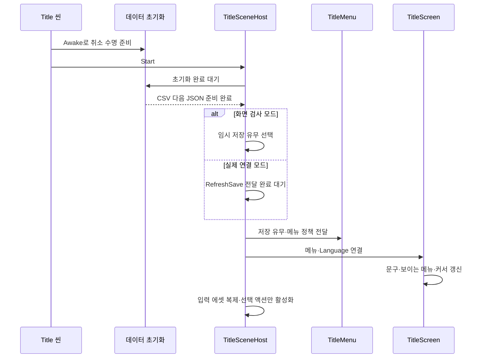
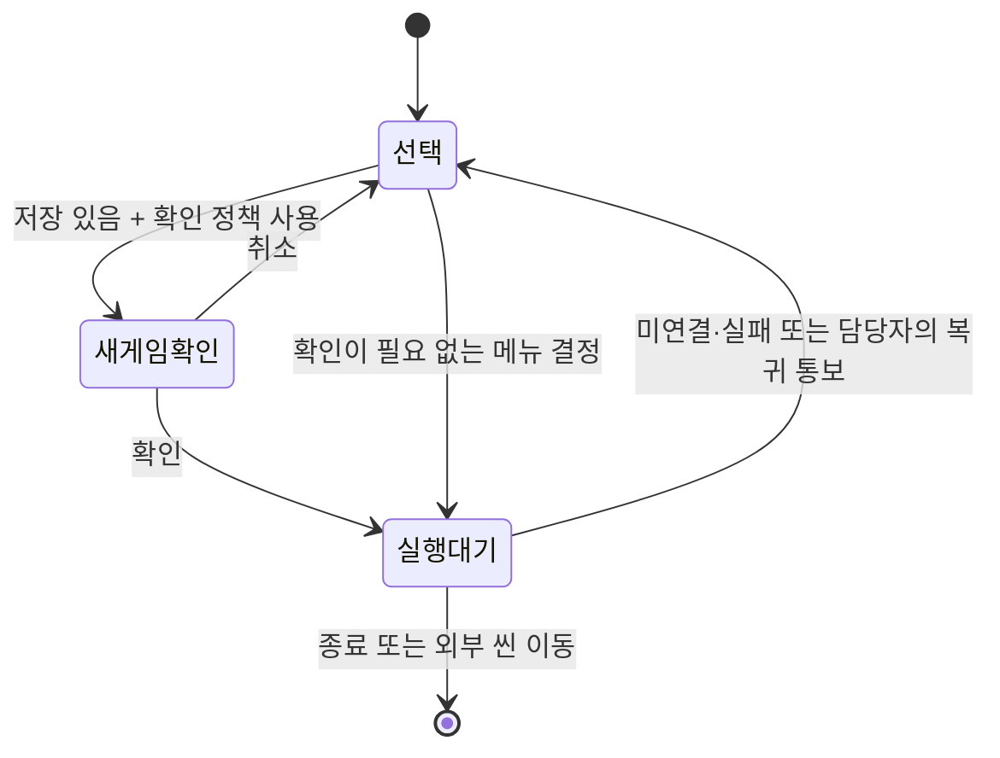

# 타이틀과 콘텐츠 잠금 설계

기능을 만든 이유부터 책임·계층·실행 순서·개발자 연결 계약까지 설명합니다. 기준일: 2026-11-03.

**현재 상태(2026-11-04):** 정규 메뉴와 새 게임 확인창에 마우스 올리기·왼클릭을 연결했고, 확인창 처음 커서는 Popup.DefaultButton을 따릅니다. `TitleGameEntry`가 저장 유무를 전달하고 새로 시작을 임시 로딩 화면 뒤 도화골 테스트 씬으로 연결합니다. 인트로·이어하기·설정 실행은 미연결입니다.

기획자의 씬 편집과 설정 절차는 [사용 안내](%EA%B8%B0%ED%9A%8D%EC%9E%90%EC%9A%A9%20%ED%83%80%EC%9D%B4%ED%8B%80%EA%B3%BC%20%EC%BD%98%ED%85%90%EC%B8%A0%20%EC%9E%A0%EA%B8%88%20%EC%82%AC%EC%9A%A9%20%EC%95%88%EB%82%B4.md)를 참고합니다.

## 1. 왜 이 기능을 나눴는가

기획자가 콘텐츠 사용 여부와 해금 조건을 조정해도 화면마다 같은 조건을 다시 작성하지 않기 위해 공통 판단을 만들었습니다. 타이틀은 저장 상태와 빌드 정책에 따라 메뉴를 구성하며, 그림 교체나 저장 방식 변경이 메뉴 규칙까지 바꾸지 않도록 책임을 분리했습니다.

콘텐츠 잠금과 타이틀 메뉴는 독립 기능입니다. 콘텐츠 잠금이 모든 타이틀 메뉴의 표시 정책을 대신하는 것은 아닙니다. 저장 없음에 따른 이어하기 숨김은 타이틀 규칙이고, 기획자가 스킬을 사용 중지하는 것은 콘텐츠 잠금 규칙입니다.

### 1.1 문제에서 구조로 이어지는 이유

| 해결할 문제 | 선택한 구조 | 기대하는 효과 |
| --- | --- | --- |
| 화면과 실제 실행에서 잠금 조건을 다르게 작성 | 공통 ContentAccess에 판단 집중 | 같은 정의와 기록에 같은 판단 사용 |
| 부스 설정 여러 개를 바꾸다 일부 누락 | 메뉴 설정 에셋 하나 선택 | 종료·확인 절차를 묶어서 관리 |
| 그림을 바꿀 때 메뉴 코드도 수정 | 규칙과 화면 프리팹 분리 | 아트 교체와 게임 규칙 변경을 독립 수행 |
| 로드 순서에 따라 잘못된 메뉴 공개 | 준비 완료 후 연결·입력 활성화 | 조회 중인 상태를 저장 없음으로 오해하지 않음 |
| 매 프레임 화면·저장 상태 조회 | 입력 콜백·변경 이벤트·비동기 완료 대기 | 불필요한 반복 처리 감소 |
| 새 기능마다 타이틀 분기 복사 | 액션별 실행 함수 등록 | 타이틀 규칙을 고치지 않고 담당 기능 연결 |

현재 메뉴는 선택·확인·실행 대기의 작은 상태 구조로 충분합니다. 캐릭터 복합 상태머신이나 상태 팩토리를 그대로 가져오지 않았습니다. 변경 이벤트는 Observer 역할, 호스트는 씬 연결 창구 역할을 합니다. 패턴 이름을 맞추려고 추가 계층을 만들지는 않았습니다.

**타이틀 화면은 씬 직접 편집을 기본으로 합니다.** 기획자는 Title 씬에서 이미지·위치·크기를 수정하고 저장합니다. 타이틀 위치용 테이블·JSON·AnchorName 규칙을 추가하지 않습니다. 이는 사용자가 정한 타이틀 전용 작업 기준이며, 콘텐츠 잠금 데이터와 다른 기능의 프리팹 배치 규칙까지 바꾸는 의미는 아닙니다.

## 2. 그래서 어떤 계층으로 구성했는가



| 위치 | 담당 | 이 위치에 둔 이유 |
| --- | --- | --- |
| `Assets/3.Script/Data` | 설정과 번역 문구 | 현재 체력·진행 기록을 섞지 않고 기존 공통 변환기로 읽기 |
| `Assets/3.Script/Core/Content/ContentAccess.cs` | 콘텐츠 잠금·해금 판단 | Unity·저장 파일 없이 여러 실행 기능에서 재사용 |
| `Assets/3.Script/Core/Title/TitleMenu.cs` | 메뉴 목록·선택·확인·중복 결정 방지 | 화면과 입력 장치를 교체해도 규칙 유지 |
| `Assets/3.Script/Presentation/TitleScreen.cs` | 문구·커서·메뉴·확인 창 표시 | 게임 규칙을 화면에 중복 작성하지 않기 |
| `Assets/3.Script/Adapters/TitleMenuSettings.cs` | 학원 시연·부스별 메뉴 정책 | 여러 옵션을 개별 수정하지 않고 설정 에셋 하나로 선택 |
| `Assets/3.Script/Adapters/TitleSceneActions.cs` | 요청별 실행 함수 등록·실제 종료 | 메뉴와 실행 기능의 연결을 한곳에서 관리 |
| `Assets/3.Script/Adapters/TitleSceneHost.cs` | 준비 순서·입력 수명·외부 실행 연결 | Unity 생명주기와 순수 규칙을 연결하는 조립 지점 |
| `Assets/2.Model/Prefabs/UI/TitleScreen.prefab` | 교체 가능한 화면 구성 | 아트가 이미지와 배치를 독립적으로 수정 |
| `Assets/1.Scene/Title.unity` | 화면 프리팹 인스턴스·기존 카메라 | 타이틀 진입 장면 |

별도의 전역 이벤트 버스·매니저·팩토리는 추가하지 않았습니다. 현재 책임은 메뉴 객체와 씬 조립자로 충분하며, 상태 변경 이벤트는 화면 갱신에만 사용합니다. 실행 요청은 반환값으로 전달해 완료된 상태 변경과 구분합니다.

```text
타이틀 기능
├─ 데이터: Language·TitleMenuSettings
├─ 규칙: TitleMenu
│  ├─ 보이는 메뉴 목록
│  ├─ 현재 선택
│  └─ 선택·확인·실행 대기 상태
├─ 표현: TitleScreen·TitleScreen.prefab
└─ 연결: TitleSceneHost·TitleSceneActions
   ├─ 데이터와 저장 조회 준비
   ├─ 입력 복제·구독 수명
   └─ 요청별 실행 담당 등록

콘텐츠 잠금 기능 — 타이틀과 독립
├─ 데이터: Stage·Skill·Item·Monster
├─ 판단: ContentAccess
└─ 외부 입력: 플레이어 진행 기록 조회 함수
```

설정 에셋과 테이블은 정의를 소유합니다. 메뉴는 현재 선택·처리 상태를 소유합니다. 호스트는 복제한 입력 에셋을 소유합니다. 화면은 연결 참조와 표시 구독을 소유하며 외부 저장 기록을 소유하지 않습니다.

## 3. 콘텐츠 잠금은 어떻게 판단하는가



Stage·Skill은 해금 조건도 사용합니다. Item·Monster는 현재 ContentEnabled만 사용합니다. 조건 번호 0은 조건 없음, 1은 스테이지 클리어입니다. 다른 번호는 구현되지 않았으므로 호출자에게 오류로 알립니다. 클라이언트에 배포 전 시트 검사기를 복제하지는 않습니다.

개발자는 `new ContentAccess(IsStageCleared)`로 진행 기록 조회를 전달하고 `Evaluate(definition)` 결과를 확인합니다. 조회 함수는 대상 스테이지 ID를 받아 클리어 여부를 반환해야 합니다. 판단 결과를 저장하지 않으므로 진행 기록이 변경되면 다음 조회에 반영됩니다.

이 기능은 상태를 변경하지 않습니다. 따라서 자체 갱신 이벤트나 매 프레임 처리가 없습니다. 기록 소유자가 변경을 알리면 필요한 소비자가 다시 판단합니다. 실제 진입·스킬 사용·아이템 획득 등을 막는 연결은 각 기능 담당이 해야 합니다. 화면만 숨기고 실제 실행을 허용하면 잠금이 완성되지 않습니다.

Active·UnlockType의 기존 의미와 캐릭터 공통 스탯 상속은 유지합니다. Item의 삭제된 InGstar는 다시 사용하지 않습니다.

## 4. 타이틀은 어떤 순서로 준비되는가



데이터 준비 전 메뉴 묶음은 숨겨져 있습니다. 입력은 데이터와 화면 연결 이후 활성화합니다. 호스트가 준비 도중 비활성화되면 입력을 켜지 않고, 다시 활성화될 때 연결합니다. 화면과 입력은 비활성화 시 구독을 해제합니다. 호스트가 제거되면 복제 입력을 정리합니다. 공유 입력 에셋 원본을 변경하거나 다른 캐릭터의 입력을 비활성화하지 않습니다.

화면은 상태 변경 때만 다시 그립니다. 선택 이동 입력도 콜백으로 처리하며 Update에서 키·저장·데이터 준비를 반복 확인하지 않습니다.



실행 대기 중에는 중복 결정과 선택 이동을 막습니다. 타이틀의 뒤로 입력은 무시하고, 새 게임 확인 창에서의 취소만 별도 처리합니다.

## 5. 개발자는 외부 기능을 어떻게 연결하는가

1. 씬에서 직렬화된 TitleSceneHost 참조를 받습니다. 전역 장면 검색은 사용하지 않습니다.
2. 저장 조회가 완료되면 `RefreshSave(hasSave)`를 전달합니다. 준비 전 호출도 보관해 초기 메뉴에 반영합니다.
3. 씬 프리팹에 연결된 `TitleSceneActions.Connect(action, execute)`로 각 실행 담당을 등록합니다. 실행 함수는 요청을 인수했으면 true를 반환합니다. 같은 요청을 중복 등록하면 오류로 알려 이전 담당을 조용히 덮어쓰지 않습니다. 호스트에는 이 조립자 하나만 연결합니다.
4. 새 게임·이어하기는 인트로·세션·씬 이동 담당에게 넘깁니다. 저장 슬롯 생성·최대 10개 보관·오래된 기록 삭제는 저장 담당의 책임입니다.
5. 설정 화면 복귀·실행 실패 시 `CompleteRequest()`를 호출해 메뉴를 다시 선택 가능하게 합니다. 인수한 비동기 요청은 실행 담당이 오류와 취소까지 처리해야 합니다.
6. 연결 소유자가 종료될 때 `TitleSceneActions.Disconnect(action, execute)`를 호출합니다. 등록한 함수와 같을 때만 해제합니다. 실행 조립자는 활성화 시 호스트에 연결하고 비활성화 시 자기 연결만 해제하며, 제거 시 함수 참조를 정리합니다. 호스트 직접 연결 API도 해제할 때 등록한 함수를 전달해야 합니다.

실제 연결 모드는 저장 조회 전 메뉴를 공개하지 않습니다. `RefreshSave`를 데이터 준비 전이나 후에 전달해도 메뉴 생성에 반영하며, 준비 대기는 매 프레임 조회하지 않습니다. 대기 중 호스트가 제거되면 대기를 취소합니다. 현재 씬은 화면 검사 모드이며, 실패한 요청을 성공한 씬 전환으로 처리하지 않습니다.

표시 콜백은 코어 명령을 다시 호출하지 않습니다. 화면 소비자는 자기 표시 오류를 기록하고 구독을 해제합니다. 필수 참조·초기 문구 연결 실패는 준비 실패로 처리하며 입력을 활성화하지 않습니다.

## 6. 현재 경계와 다음 연결

이번 구성은 공통 콘텐츠 판단, 타이틀 규칙, Title 씬의 화면 프리팹·입력·실행 조립자와 실제 종료 연결입니다. 저장 슬롯 정책·JSON 저장소와 테스트 타이틀 기록 선택 창도 구현했습니다. 저장 기록 선택은 정식 타이틀 항목을 늘리지 않고 별도 버튼으로 제공하며, 입력은 호스트를 재사용합니다. 출시 빌드에서는 해당 객체와 코드를 제거합니다. 세부 계약은 [저장 기능 설계](저장%20기능%20설계.md)를 따릅니다. 콘텐츠 실행 경계 차단, 실제 저장 복원, 인트로·설정·배경음·암전·무입력 영상, 운영 빌드 정책의 전체 연결은 완료되지 않았습니다. 로딩 작업은 기획 수정으로 보류합니다. Title을 빌드 시작 씬으로 바꾸는 작업도 운영 흐름 연결 후 별도로 진행합니다.

기준 기획은 2026-11-03 타이틀 R6와 추가 규칙 R2입니다. R6의 저장·부스 조합별 메뉴 수는 일반 저장 있음4개·없음3개, 부스 저장 있음3개·없음2개입니다. 충돌하면 추가 규칙을 우선합니다. 성능상 기대 효과는 이벤트 기반 표시와 입력 수명 분리이며, 실제 성능 측정 완료를 뜻하지 않습니다.

기획 원문: [타이틀 R6](https://docs.google.com/document/d/1iOxrjUxpSvG8JMKpW3Y9G1kECLYL4p8X/edit), [타이틀 추가 규칙 R2](https://docs.google.com/document/d/1RRTFdRBAeOFNzEflwCSLgQ7km8Yqviml/edit). 타이틀 씬 직접 편집과 위치 데이터·앵커 구조를 추가하지 않는 방침은 이후 사용자가 지정한 작업 기준입니다.

## 7. 검증 범위

2026-11-03 전체 점검의 기본 통합 검사는 데이터875개·코어462개가 통과했고 Unity 참조 컴파일은 경고·오류0개입니다. 개발 빌드·에디터의 타이틀 및 수동 저장 화면·빌드 제거 코드 참조 컴파일은 앞선 기능 단위에서 통과한 이력으로 구분합니다. 과거887개나 CS0649 경고18개 실패 기록을 현재 수치로 사용하지 않습니다. 공통 화면의 실제 Unity Play·마우스/패드 입력과 출시 플레이어에서의 객체 제거는 아직 검증이 남았습니다. 점검 중 Title 씬의 Canvas 크기·스케일0 오버라이드 변경도 발견했으며 수정·원복하지 않았습니다. 최신 결과의 기준은 [검증 현황](현재%20구현과%20검증%20현황.md)입니다.
