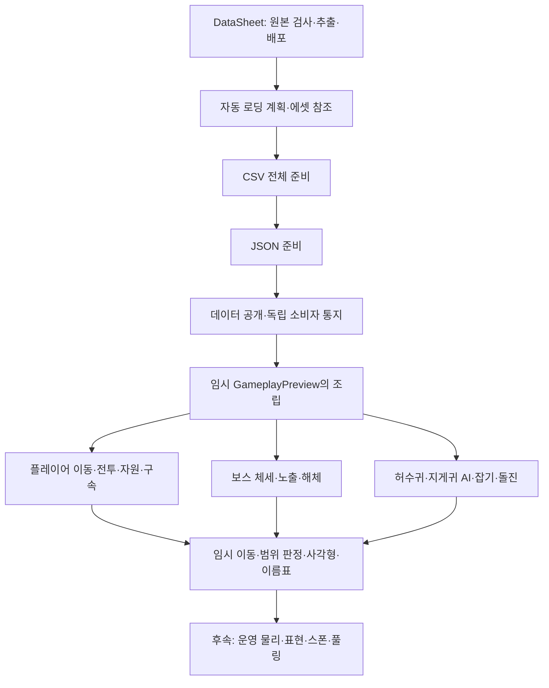
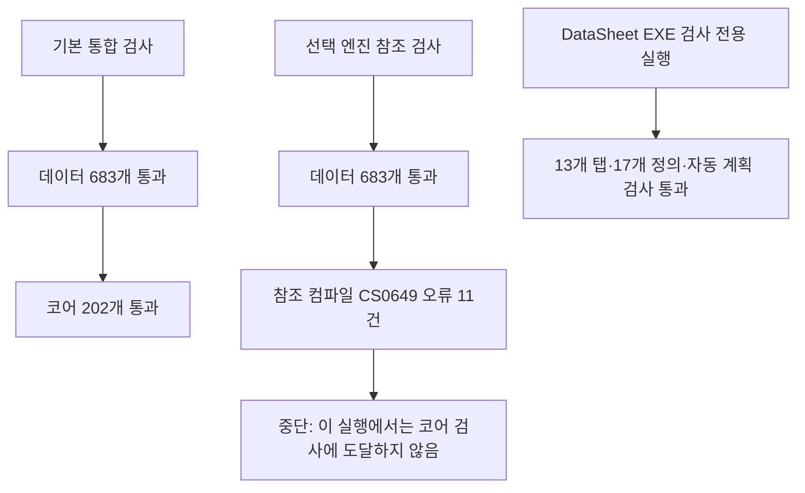
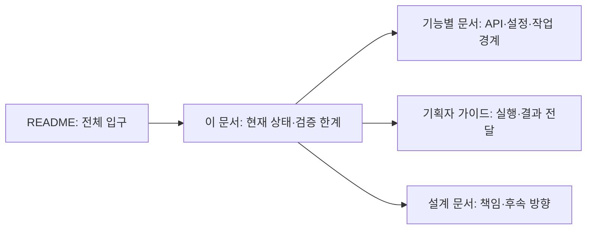

# 현재 구현과 검증 현황

## 2026-11-02 현재 병합 상태의 설계 점검·재검사

- 기준: 클라이언트 a604b4d 작업 트리와 형제 DataSheet. 이번 변경은 문서만이며 코드·시트·씬·프리팹은 수정하지 않았습니다.
- Verify-Project.ps1에서 데이터659개·코어354개, DataExporter.Checks에서48개가 통과했습니다. DeployData.exe --check도14개 탭·데이터14개·정의18개·자동 계획1개로 통과했으며 배포하지 않았습니다.
- Verify-Data.ps1 -CompileUnity는 데이터659개 통과 후 전체 참조 컴파일에서 실패했습니다. MonsterPatternSettings·BossPatternSettings의 직렬화 필드 CS0649가 오류18개로 처리됐습니다. 실제 Unity 컴파일·Play 실패를 이번에 확인한 것은 아닙니다.
- 기존 앵커 메뉴 검사24개는 이전 사용자 직접 실행 통과 기록입니다. 현재 병합 상태의 Play·새 Host 수명·운영 씬·최종 빌드는 재실행하지 않았습니다. 씬 연결 보류도 유지합니다.
- 판단: 설계 방향은 유지되고 있으며 데이터 공급·순수 코어·표현 분리는 구현돼 있습니다. 기존 스키마와 보존 클래스의 구조 비교, 빈 시트 규칙 검사, 경고 정책, 표시 오류 경계, Host 실제 수명 검사를 우선 보완해야 합니다. 상세 근거와 기대 효과는 [설계 기준 점검](설계%20기준%20점검과%20개선%20방향.md)을 따릅니다.

## 2026-11-02 보스 작업과 체력 표시 병합 직후 검사 (이전 기록)

- 보스 페이즈·문 돌진·동기 벽 충돌 회귀와 체력 표시 수명 검사를 함께 실행해 코어354개가 통과했습니다. 아래290·310·334개는 각 단계의 당시 기록입니다.
- 데이터 검사·선택 참조 컴파일·Unity Play·실제 장치·플레이어 빌드는 이번 병합 확인에서 재실행하지 않았습니다. 코어 통과를 운영 보스 이동·연출·전체 게임 완료로 해석하지 않습니다.

## 2026-11-02 씬 연결 창구 준비·실제 부착 보류

- HealthDisplayHost를 Presentation에 추가했습니다. 외부 조립자가 Connect로 준비된 데이터·프리팹 목록·플레이어·앵커 루트를 전달하며 Disconnect는 소유 표시와 대상 참조를 정리합니다.
- 비활성 상태에서 Connect하면 생성은 활성화 시점까지 대기합니다. 일시 비활성화는 표시를 정리하고 준비된 의존성은 보관해 재활성화 때 다시 구성합니다. 반환·대상 교체 때는 Disconnect가 필요합니다.
- 설치된 Unity 모듈 참조 컴파일은 경고·오류0개입니다. 실제 씬·기존 프리팹에는 연결하지 않았습니다. 현재 변경 업로드와 다른 작업자 코드 확인 후 부착·실행 검증한다는 사용자 요청을 반영했습니다.
- 이전 앵커 메뉴 검사24개 통과는 기존 그룹의 검사 결과입니다. 새 Host의 활성 수명은 이번에 실제 Play 검증한 것으로 기록하지 않습니다.

## 2026-11-02 앵커 체력 표시의 실제 Unity 검사 통과

- HealthDisplayAnchorLayout 배치 예제 프리팹과 에디터 전용 HealthDisplayVerification 검사를 추가했습니다. 부모 두 개 생성·이름 범위·위치 추종·피격 이벤트·비활성/재활성·실패 정리·부모 제거를 검사합니다.
- 설치된 Unity 모듈 참조 컴파일은 경고·오류 0개입니다. 배치 실행 시도는 검사 진입 전에 종료됐고 라이선스 프로세스 연결 충돌 로그가 남았습니다. 관리자 권한으로 열려 있는 Unity 창의 자동 제어도 제한됐습니다.
- 이후 사용자가 [테스트 안내](앵커%20체력%20표시%20테스트%20안내.md)의 메뉴를 직접 실행해 통과했다고 전달했습니다. 현재 검사 코드는24개 항목이며 **사용자 실행 통과 확인**으로 기록합니다. 별도의 콘솔 원문·화면은 수집하지 않았습니다. 운영 씬 조립·해상도별 최종 화면·플레이어 빌드는 여전히 별도 확인 대상입니다. 남은 범위는 [남은 구현과 검증 작업](남은%20구현과%20검증%20작업.md)에 정리했습니다.

## 2026-11-02 체력 표시 설정과 재사용 모듈

- HealthDisplayConfig 신규 CSV의 추출·정의 최초 생성·자동 로딩과 프리팹 키 검사를 연결했습니다. DataSheet 14개 탭·데이터 14개·정의 클래스 18개·로딩 계획 1개입니다.
- HealthDisplayConfig의 OffsetX·OffsetY를 AnchorName으로 전환했습니다. SpawnAnchors는 전달받은 씬·부모 인스턴스 내부에서 한 번 수집하고 선택한 이름의 누락·중복·제거를 확인합니다. 다른 인스턴스와 이름 범위를 공유하지 않습니다.
- HealthDisplayGroup은 플레이어·인스턴스별 앵커·프리팹 목록을 전달받아 설정 행 전체를 적용합니다. 각 앵커 아래 비활성 상태에서 연결하고 완료 후 활성화하며 실패·종료 시 소유 표시와 구독만 정리합니다. 매 프레임 갱신하지 않습니다.
- 프리팹 파일명과 내부 루트 이름이 달라도 선택할 수 있도록 자동 목록에 파일명 키와 참조를 함께 저장합니다.
- 데이터 검사 659개·코어 검사 310개·DataSheet 통합 검사 48개를 통과했습니다. 새 표현·공통 앵커·목록 수집 코드의 Unity 모듈 참조 컴파일은 경고·오류 0개입니다. 데이터 검사는 AnchorName 변환도 확인하지만 실제 엔진에서의 앵커 탐색·배치 실행 검사는 아닙니다.
- 실제 프리팹·앵커를 이용한 메뉴 검사 통과는 사용자 확인 결과로 기록했습니다. 운영 씬의 Canvas 화면 구성·플레이어 빌드는 별도 확인 대상이며 기존 GameplayPreview에 새 UI를 자동 부착하지 않았습니다. 사용법과 연결 코드는 [체력 표시 모듈 안내](체력%20표시%20모듈%20사용과%20설계%20안내.md)를 따릅니다.

## 2026-11-02 회피·치명 연결과 보스 기본 패턴

- 플레이어→보스/일반몹, 일반몹→플레이어 타격이 실제 Dodge·Crit 확률을 사용합니다. GameplayPreview와 PreviewMonsterDriver의 고정 `false,false`를 공격자 런타임 `HitRandom`으로 바꿨습니다. 보스 내려찍기·2연타 실행 코어(BossCombat)를 추가했습니다. 내용은 [게임플레이 코어](게임플레이%20코어와%20프리팹%20연결.md)의 확률 타격·보스 기본 패턴 절을 따릅니다.
- 코어 검사 290개가 통과했습니다(`Tools/Locomotion.Checks/Run-Checks.ps1`, NYM/Work a13ad3e 작업 트리 재실행 포함). 데이터 검사·선택 참조 컴파일·플레이어 빌드는 이날 실행하지 않았습니다. 기존 217개에 확률 타격 경계 30개, 보스 패턴 43개(타격 목록 읽기 전용 2개 포함)를 더한 수입니다.
  - 확률 타격: 확률 0/10000, p-1 성공·p 실패, 거부 시 난수 0회, 회피 시 치명 0회, 범위 밖 입력 거부.
  - 보스 패턴: 선딜·판정 경계, 2연타 창별 대상 1회, 피격 무적 거부와 종료 후 유효, 큰/분할 Tick, 사망·노출·해체 우선, 재시작.
- 실제 Unity에서 컴파일 오류 없이 새 타입이 로드됐습니다. 맵 확인 씬 Play에서 일반몹 잡기·돌진·평타와 플레이어 확률 타격 처치가 동작했습니다. Unity 메모리의 보스 개체에서 2연타·피격 무적 거부·노출 즉시 정리를 확인했습니다. 보스 패턴 설정 에셋은 판정·후딜·간격이 공급되지 않아 프리팹에 연결하지 않았습니다.
- 맵 확인 씬 `Assets/1.Scene/MapDohwagolTest.unity`: GameplayPreview 복사본에 `Map_1_Dohwagol`을 배치하고 개체를 지면 충돌체 위에 놓았습니다. 맵 x 2~18 구간이 화면 이동 한계(±8)입니다. 카메라 추적·맵 충돌 물리는 없습니다. 플레이어는 상태별 한 프레임 스프라이트(PreviewPlayerSprite, 애니메이션 없음)로 표시하고 파란 사각형 렌더링은 껐습니다. Play에서 이동·점프·구르기 추적, 대기·이동(좌우 반전)·공격·점프·구르기·피격·사망 프레임 전환, 꺼진 사각형의 판정 범위 추적을 확인했습니다.
- 큰 프레임 판정 누락 해결: 이전에는 판정 창을 매 프레임 `IsAttackActive`로만 확인했습니다. 그래서 한 프레임이 선딜 잔여+판정 시간보다 길면(예: 333ms 정지) 창이 한 Tick 안에 열렸다 닫혀 타격이 빠졌습니다. 이제 GameplayPreview와 PreviewMonsterDriver가 `AttackWindowChanged(true)` 순간에도 접촉을 확인하므로 창마다 최소 한 번 판정합니다. 중복 타격은 창 등록이 막습니다. Play에서 한 Tick 1000ms로 플레이어→보스(420→412)와 허수귀→플레이어(100→80) 타격을 확인했습니다. 운영 판정 어댑터도 같은 방식(창 열림 이벤트 + 프레임 확인)을 따릅니다.
- 보스 HP50% 페이즈 전환(C09): BossPoise가 HP 비율로 BossState 행을 4001→4002로 바꾸고 `PhaseChanged`를 알립니다. 코어 검사는 306개(전환 16개 추가: 211/210 경계, 통지 순서·1회, 패턴 중 전환 후 다음 대기 1000, 사망 타격 비전환, 해체로 전환, 다중 기준, 역행 없음, 기준 오류 4종)가 통과했습니다. MapDohwagolTest Play에서 HP 211 유지·210 전환(통지 1회)·대기 1000·보스 이름표 "페이즈 2"와 콘솔 오류 0을 확인했습니다. 전환 연출·전환 중 정지/무적은 미구현입니다.
- 보스 문 돌진(Skill1) 실행 코어: 페이즈 2 이상에서만 시작, 돌진 속도·방향 고정, 벽 충돌 시 돌진 종료·체세 −30, 체세 0이면 노출 우선. 코어 검사 334개(돌진 16개, 판정 창 콜백 안 벽 충돌 회귀 12개 추가)가 통과했고 Unity 재컴파일 콘솔 오류·경고 0입니다. 속도·상한·후딜 미공급으로 설정 에셋과 보스 이동 어댑터는 없습니다.
- Preview 타격 대상 ID는 데이터 ID 대신 장면 내 개체 ID(플레이어 1, 보스 2, 일반몹 3부터 순번)를 씁니다. 운영 스폰에서는 스폰 담당이 양수 고유 개체 ID를 할당합니다.

## 2026-11-02 모듈 분리 검사

- [게임플레이 모듈 구조](게임플레이%20모듈%20구조.md)에 따라 콤보·판정 창·개체별 시간 변환과 임시 이동/몬스터 연결/표시를 분리했습니다.
- 기존 202개와 모듈 간 독립성·이벤트 해제·프레임 나머지 보존 회귀 15개를 합친 코어 217개가 통과했습니다.
- 설치된 Unity Roslyn/Mono와 엔진 어셈블리로 런타임·에디터 소스를 참조 컴파일했고, 기존 컴파일본과 게임플레이 공개 API 284개 항목이 일치했습니다.
- 이 참조 컴파일은 기존 CS0649 경고를 허용하는 확인입니다. 아래 선택 -CompileUnity의 경고를 오류로 처리하는 실패 기록과 구분하며, 도구의 경고 정책은 변경하지 않았습니다. 아래 10/31 검사는 당시 기록입니다.
- 실제 Unity 재컴파일 후 새 모듈 타입 로드와 오류 없는 콘솔을 확인했습니다. GameplayPreview Play에서 기존4프리팹 초기화·제어된 이동/점프/구르기·재활성화 구독·추적/벽 허점·표시 연결15항목이 통과했습니다. 코어 명령과 반사 호출로 시간을 제어한 연결 검사이며 실제 키보드/가상 키 입력·운영 물리·플레이어 빌드 검사는 아닙니다. Play를 종료하고 기존 비플레이/비일시정지 상태로 복원했으며 씬/프리팹은 저장·수정하지 않았습니다.

2026-10-31 로컬 코드·설정·검사 도구와 문서를 대조한 기록입니다.
이번 작업은 문서만 수정했습니다. 검사 실행은 아래 결과의 근거를 확인하기 위한 것이며 게임 코드·시트·배포 설정은 수정하지 않았습니다.

## 현재 실행 구조



| 영역 | 현재 코드·에셋 | 구분할 후속 범위 |
| --- | --- | --- |
| 데이터 | 생성 계획·CSV 다음 JSON 순차 준비·읽기 전용 저장소 | 신규 데이터의 게임 동작은 별도 구현 |
| 데이터 오류 경계 | 두 데이터 초기화 계층에서 소비자별 동기 예외 격리 | 다른 런타임 이벤트 전체에 같은 정책이 적용된 것은 아님 |
| 플레이어 | 이동 요청·점프·콤보·구르기·스태미나·피격·구속 | 운영 물리·정식 표현·실제 장치 검증 |
| 보스 | HP·체세·노출·해체, 내려찍기·2연타·페이즈2 문 돌진 실행 코어, HP50% 페이즈 수치 전환 | 자동 AI(패턴 선택)·사슬 당기기·보스 이동 어댑터·전환 연출(포효)·패턴 운영 설정·정식 연출 |
| 일반 몬스터 | 허수귀·지게귀 추적·공격·구속·돌진·벽 허점 | 변종 고유 동작(불·투척)·운영 센서·스폰·풀링 |
| 확인 장면 | GameplayPreview와 플레이어·보스·일반몹 프리팹 | 임시 Transform·사각형 판정을 운영 물리로 해석하지 않음 |
| 자동 검사 | Develop 대상 PR·푸시·수동 실행 설정 | GitHub 실행 성공·필수 검사 등록은 저장소에서 별도 확인 |
| 콘텐츠 잠금 | DataSheet의 컬럼 작성안 문서 | 기획자 잠금·플레이어 해금 기능은 미구현 |

몬스터의 비활성화 시 Release는 구속·판정 등을 정리하지만 HP를 새로 채우는 풀 재사용 계약은 아닙니다.
전투·몬스터 패턴 수치 일부는 Unity 설정 에셋에 있으며 모든 수치가 시트로 일원화된 상태는 아닙니다.
운영 게임 전체의 시작 조립과 확인 장면의 임시 조립도 구분합니다.

## 2026-10-31 점검에서 실행한 검사 (당시 기록)

최신 결과는 문서 맨 위의 현재 병합 상태 점검을 따릅니다. 아래 데이터683개·코어202개와 선택 참조 검사는10/31 당시 기록이며 최신 결과와 합산하거나 대체하지 않습니다.



기본 통합 검사는 다음 명령으로 확인했습니다.

```powershell
powershell.exe -NoProfile -ExecutionPolicy Bypass -File Tools/Verify-Project.ps1
```

선택 검사는 같은 명령에 -CompileUnity를 붙여 실행했습니다.
MonsterPatternSettings의 SerializeField 필드 11개에 대해 CS0649가 발생했습니다.
참조 검사 도구는 경고를 오류로 처리하며, Unity 에셋에서 직렬화로 채워지는 값의 존재를 이 컴파일 결과만으로 판단할 수는 없습니다.
**이번 결과는 선택 참조 검사 실패이며, 실제 Unity 컴파일·Play 실패로 단정하지 않습니다.**
문서 갱신 범위를 지키기 위해 코드나 경고 정책은 변경하지 않았습니다.

DataSheet에서는 DeployData.exe --check를 실행했습니다.
현재 13개 탭·데이터 13개·정의 클래스 17개·자동 로딩 계획 1개의 검사가 통과했고 배포는 하지 않았습니다.
DataSheet 자체 회귀 검사 45개는 기존 기록이며 이번 점검에서 재실행하지 않았습니다.

## 이전 확인 기록과 미확인 항목

| 항목 | 이번 문서에서의 취급 |
| --- | --- |
| 임시 확인 장면 가상 키보드 Play 16개 | GameplayPreview 문서의 이전 기록. 이번에는 재실행하지 않음 |
| Unity 메모리 입력·연결 검사 18개 | GameplayCore 문서의 이전 기록. 이번에는 재실행하지 않음 |
| 과거 일괄 실행 라이선스 연결 실패 | 당시의 기록. 이후 Play 확인까지 없었다는 뜻으로 쓰지 않음 |
| 실제 키보드·운영 물리·플레이어 빌드 | 이번 점검에서 검증하지 않음 |
| 게임패드 | 현재 작업·검증 보류 |
| GitHub 검사·알림 | 설정 파일 존재 확인. 원격 실행 기록은 이번에 조회하지 않음 |

기본 검사 통과·선택 참조 컴파일·Unity Play·최종 빌드는 서로 다른 확인 단계입니다.
수동 디스코드 연결 테스트 성공이나 코드 반영 공지는 검사·빌드 성공을 뜻하지 않습니다.

## 문서의 역할과 예상 효과



현재 구현을 미구현으로 안내하거나 이전 검사 성공을 최신 결과로 오해하는 일을 줄이는 것이 목적입니다.
앞으로 운영 물리·실제 장치·플레이어 빌드를 확인하면 실행 날짜와 대상 커밋·범위를 함께 기록하는 방향을 지향합니다.
이는 후속 기록 방침이며 자동 빌드가 이미 구현됐다는 의미는 아닙니다.
문서는 한글 파일명을 사용하며 기존 영문 문서도 한글명으로 변경하고 관련 링크를 갱신했습니다. README.md와 AGENTS.md는 도구가 인식하는 이름이므로 유지합니다.
