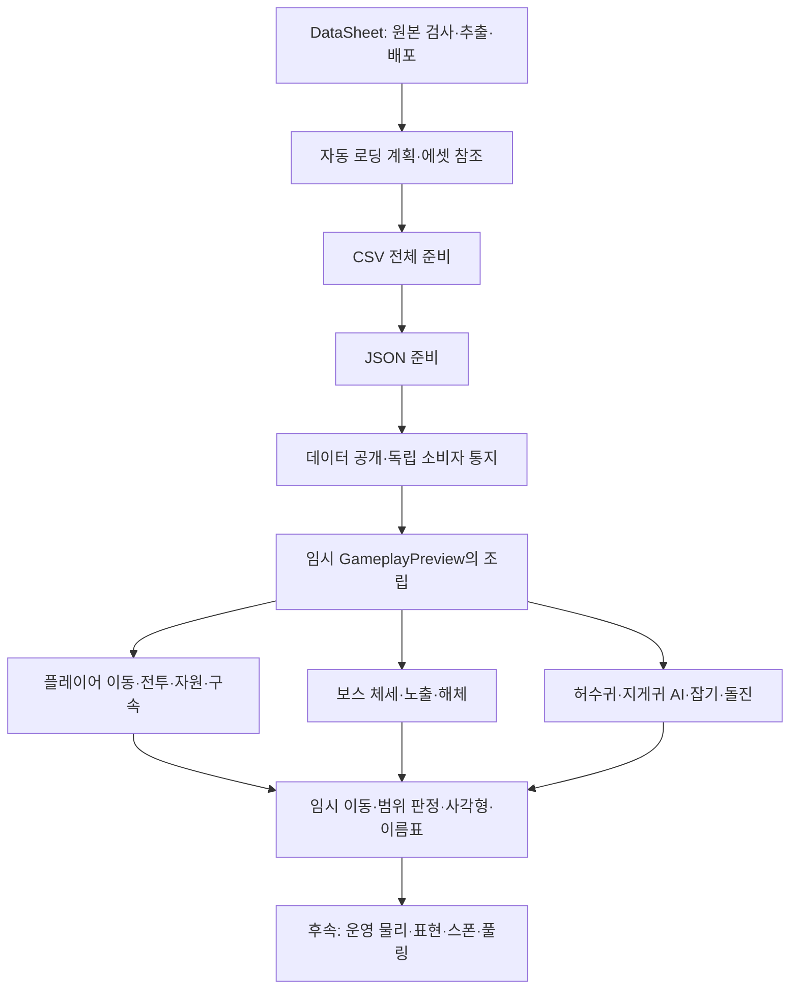
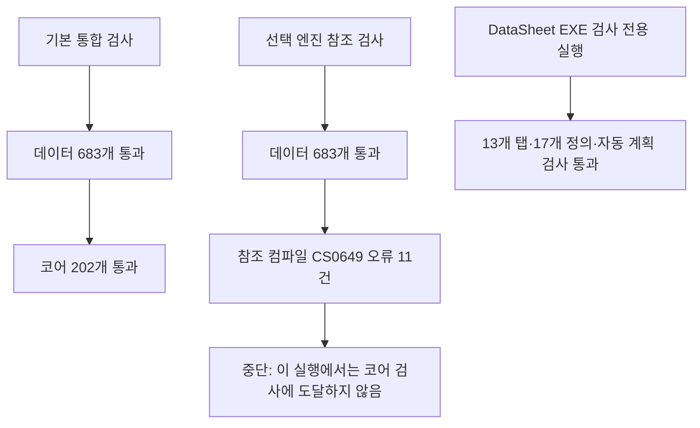
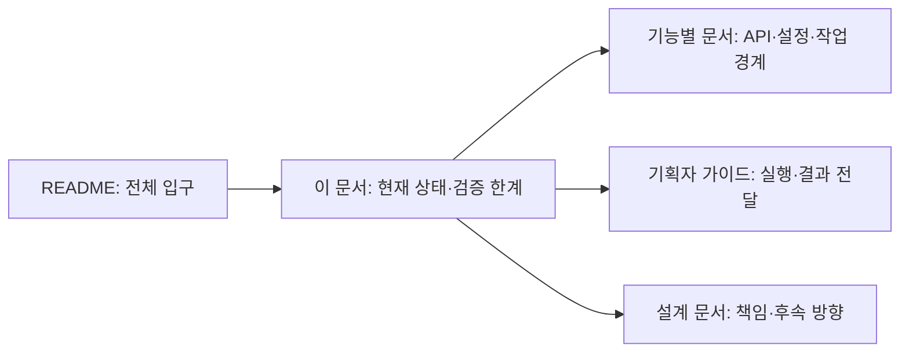

# 현재 구현과 검증 현황

2026-10-31 로컬 코드·설정·검사 도구와 문서를 대조한 기록입니다.
이번 작업은 문서만 수정했습니다. 검사 실행은 아래 결과의 근거를 확인하기 위한 것이며 게임 코드·시트·배포 설정은 수정하지 않았습니다.

## 현재 실행 구조



| 영역 | 현재 코드·에셋 | 구분할 후속 범위 |
| --- | --- | --- |
| 데이터 | 생성 계획·CSV 다음 JSON 순차 준비·읽기 전용 저장소 | 신규 데이터의 게임 동작은 별도 구현 |
| 데이터 오류 경계 | 두 데이터 초기화 계층에서 소비자별 동기 예외 격리 | 다른 런타임 이벤트 전체에 같은 정책이 적용된 것은 아님 |
| 플레이어 | 이동 요청·점프·콤보·구르기·스태미나·피격·구속 | 운영 물리·정식 표현·실제 장치 검증 |
| 보스 | HP·체세·노출·해체 | AI·페이즈 전환·정식 연출 |
| 일반 몬스터 | 허수귀·지게귀 추적·공격·구속·돌진·벽 허점 | 변종·운영 센서·스폰·풀링 |
| 확인 장면 | GameplayPreview와 플레이어·보스·일반몹 프리팹 | 임시 Transform·사각형 판정을 운영 물리로 해석하지 않음 |
| 자동 검사 | Develop 대상 PR·푸시·수동 실행 설정 | GitHub 실행 성공·필수 검사 등록은 저장소에서 별도 확인 |
| 콘텐츠 잠금 | DataSheet의 컬럼 작성안 문서 | 기획자 잠금·플레이어 해금 기능은 미구현 |

몬스터의 비활성화 시 Release는 구속·판정 등을 정리하지만 HP를 새로 채우는 풀 재사용 계약은 아닙니다.
전투·몬스터 패턴 수치 일부는 Unity 설정 에셋에 있으며 모든 수치가 시트로 일원화된 상태는 아닙니다.
운영 게임 전체의 시작 조립과 확인 장면의 임시 조립도 구분합니다.

## 이번 점검에서 실행한 검사



기본 통합 검사는 다음 명령으로 확인했습니다.

```powershell
powershell.exe -NoProfile -ExecutionPolicy Bypass -File Tools/Verify-Project.ps1
```

선택 검사는 같은 명령에 -CompileUnity를 붙여 실행했습니다.
MonsterPatternSettings의 SerializeField 필드 11개에 대해 CS0649가 발생했습니다.
참조 검사 도구는 경고를 오류로 처리하며, Unity 에셋에서 직렬화로 채워지는 값의 존재를 이 컴파일 결과만으로 판단할 수는 없습니다.
**이번 결과는 선택 참조 검사 실패이며, 실제 Unity 컴파일·Play 실패로 단정하지 않습니다.**
문서 갱신 범위를 지키기 위해 코드나 경고 정책은 변경하지 않았습니다.

DataSheet에서는 DeployData.exe --check를 실행했습니다.
현재 13개 탭·데이터 13개·정의 클래스 17개·자동 로딩 계획 1개의 검사가 통과했고 배포는 하지 않았습니다.
DataSheet 자체 회귀 검사 45개는 기존 기록이며 이번 점검에서 재실행하지 않았습니다.

## 이전 확인 기록과 미확인 항목

| 항목 | 이번 문서에서의 취급 |
| --- | --- |
| 임시 확인 장면 가상 키보드 Play 16개 | GameplayPreview 문서의 이전 기록. 이번에는 재실행하지 않음 |
| Unity 메모리 입력·연결 검사 18개 | GameplayCore 문서의 이전 기록. 이번에는 재실행하지 않음 |
| 과거 일괄 실행 라이선스 연결 실패 | 당시의 기록. 이후 Play 확인까지 없었다는 뜻으로 쓰지 않음 |
| 실제 키보드·운영 물리·플레이어 빌드 | 이번 점검에서 검증하지 않음 |
| 게임패드 | 현재 작업·검증 보류 |
| GitHub 검사·알림 | 설정 파일 존재 확인. 원격 실행 기록은 이번에 조회하지 않음 |

기본 검사 통과·선택 참조 컴파일·Unity Play·최종 빌드는 서로 다른 확인 단계입니다.
수동 디스코드 연결 테스트 성공이나 코드 반영 공지는 검사·빌드 성공을 뜻하지 않습니다.

## 문서의 역할과 예상 효과



현재 구현을 미구현으로 안내하거나 이전 검사 성공을 최신 결과로 오해하는 일을 줄이는 것이 목적입니다.
앞으로 운영 물리·실제 장치·플레이어 빌드를 확인하면 실행 날짜와 대상 커밋·범위를 함께 기록하는 방향을 지향합니다.
이는 후속 기록 방침이며 자동 빌드가 이미 구현됐다는 의미는 아닙니다.
문서는 한글 파일명을 사용하며 기존 영문 문서도 한글명으로 변경하고 관련 링크를 갱신했습니다. README.md와 AGENTS.md는 도구가 인식하는 이름이므로 유지합니다.
