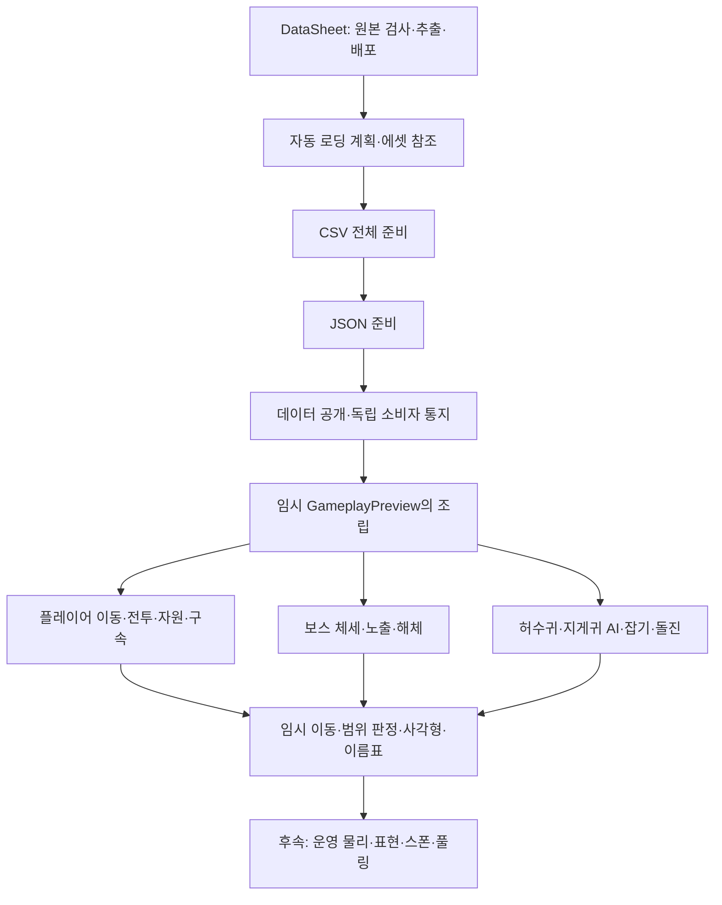
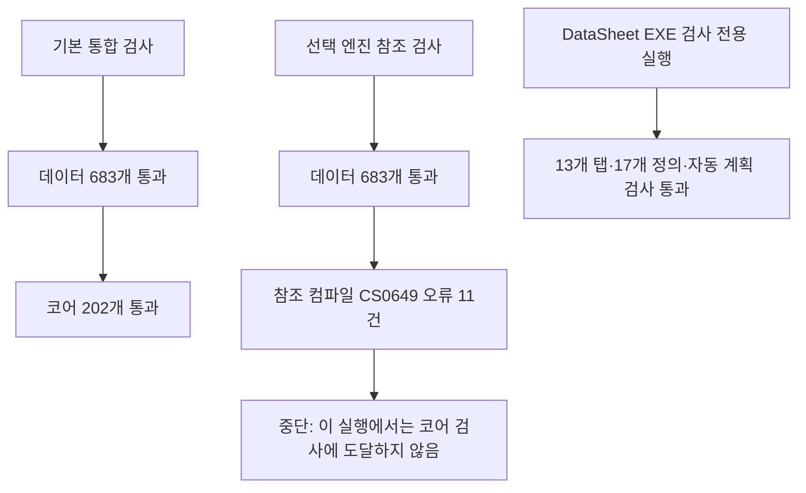
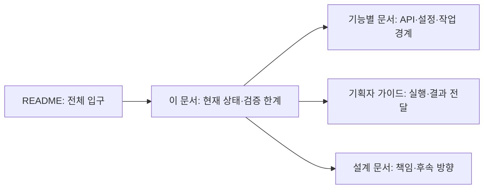

# 현재 구현과 검증 현황

## 2026-11-03 12:28 KST 최신 기획·데이터 반영과 N01 검수 완료

| 항목 | 이번 실행 결과 |
| --- | --- |
| 기획 폴더 | 현행62개 본문·표 대조: 변경27·신규 O11_1·동일34. 보관123개 목록 확인. 구조3개 동일. 6폴더 마감 재조회 추가 변경 없음 |
| 공급·정의 | 공식3cb99c4/340087a 해당3파일 수신, Language42행 추가(총69), Item.InGstar 폐기와 ContentEnabled bool 검사 정합. 기존 HealthDisplayConfig·브랜치/HEAD 보존 |
| 공식 배포 | check 후 deploy:14탭·데이터14·정의18·자동 계획1 통과. 실질 배포 변경은 Language.csv·Item.json |
| 자동 검사 | 데이터796·코어360 통과. 게임/Editor C#93 전체 참조 컴파일 통과(경고를 오류로 처리). SDK 없어 기존 Unity Roslyn·Mono 사용, 새 의존성 없음 |
| 실제 Unity | 재컴파일·도메인 재로딩 후 GameplayPreview·MapDohwagolTest 각23개 연결 검사, 기존 HealthDisplayVerification24개 통과. N01 검수 완료 |
| 기존 HP 표시 | PlayerHealthBar 흰 배경/검은 채움. 기존 Image·GUID/fileID 유지. 사용자 요청으로 제작 중 UI 이미지 반영은 연기 |
| 운영 잔여 | 진행/해금·타이틀/설정/HUD·저장/씬/Interactor·운영 맵/전투·최종 빌드는 후속. 새 기획 기준 정리와 실제 구현 완료를 구분 |

두 씬 검사는 catalog 준비·Language69행/새 문구·Item6002만 활성·8001→8002·7001/8002 해금1/8005/1·PlayerHealthAnchor/HP 바인딩·흑백 색상·몹2개 PreviewSprite 대기1프레임을 확인했습니다. 메타455개·기존829개 에셋의 변경 범위를 대조해 이번 추가 에셋 변경은 Item.cs·Language.csv·Item.json·PlayerHealthBar.prefab 네 개뿐임을 확인했습니다. 새 에셋은 추가하지 않았습니다.

새 규칙: 저장 없는 이어하기 숨김/메뉴 압축, 설정 확인 초기 예, E+동작 문구30063~30066, 연습 관문8005_101, 저장 시점2개·보스 비저장·엔딩 후 마지막 서낭당 Continue, QR 기능 보류. 타이틀 개발 나영민, 저장 황영근·사망/리스폰 나영민으로 원문 담당을 갱신했습니다. 상세 출처·후속 계약은 [기획 반영 기준](기획%20확정%20반영%20기준.md), 실행 순서는 [남은 작업](남은%20구현과%20검증%20작업.md)을 따릅니다.

간트는 아래11:56 점검 이후 이번에 편집하지 않았습니다. 상태2셀·상호작용 단일 소유·R3c 빌드 진입·제출 전 백업 일정은 잔여입니다. 아래673/659 등의 숫자와 Unity 미검수 표기는 당시 기록이며 현재 N01 상태는 위 완료 기록이 우선합니다. 커밋·푸시·최종 빌드·원격 실행은 수행하지 않았습니다.

## 2026-11-03 11:56 KST 작업 요약·간트 점검 (당시 기록)

| 오늘 작업 | 결과·남은 경계 |
| --- | --- |
| 최신 기획 | 현행61개 대조, 확정/제안/개발 기준 구분. 저장·상호작용·잠금·빌드 기준 정리 |
| 테스트씬·프리팹 | R3c 도화골, 몹 대기1프레임, 보스 설정/임시 이동, 잡기 피해, 플레이어 HP Host 적용. 운영 맵/전투 전체 완료는 아님 |
| 영문 호출 이름 | 프리팹6·씬2 내부 이름, 생성/탐색 코드·앵커 원본/CSV 동기화. GUID·직렬화 참조 보존 |
| N01 수신 | 정의4개·검사 fixture·공식 데이터 배포 반영. 데이터673·코어360·C#93 참조 컴파일 통과 기록 수신. N01 이후 Unity 내부 재컴파일/두 씬 초기화는 검수 대기 |
| 후속 준비 | N01 마감 → 진행/해금 계약 → 씬/저장·상호작용 → 운영 통합. 오늘 1차 전투 EXE는 전체 기능 완료를 기다리지 않는 별도 빌드 확인 |

검증 수치는 실행 시점을 구분합니다. 앞선 테스트씬 Play29·영문화 뒤 앵커 Play24는 직접 실행 기록, N01의673/360/93은 구현 기록과 현재 diff를 확인한 결과이며 이번 요약 과정에서 재실행하지 않았습니다. 변경은 게임43개 수정·신규5개, DataSheet2개 수정 상태로 미커밋·미푸시입니다(이 요약 문서 갱신 전 집계).

### 간트 현행 대조

원본: [인귀 지스타 일정 간트](https://docs.google.com/spreadsheets/d/16waFKHuXaZGdi2fz76nRUWFxiuQquhZGy6doAVHqBUI/edit). `간트` A1:H115, `흐름보기` A1:F210, `요약` A1:H35 및 상태 셀의 수식/메모를 읽었습니다. 공유 시트는 변경하지 않았습니다.

| 담당 | 업무 수(관문 제외) | 완료 | 진행 | 예정 |
| --- | --- | --- | --- | --- |
| 나영민 | 14 | 6 | 1 | 7 |
| 황영근 | 12 | 2 | 3 | 7 |
| 김현민 | 12 | 5 | 4 | 3 |
| 김현호 | 32 | 24 | 1 | 7 |
| 이건호 | 13 | 3 | 6 | 4 |
| 합계 | 83 | 40 | 15 | 28 |

업무만40/83(48.2%), 요약 탭은 담당이 정해진 관문8개까지 포함해41/91(45.1%)입니다. 나영민은 업무6/14(42.9%), 요약은 기능 완성 관문을 더해6/15(40.0%). 집계 범위 차이이며 같은 분모의 충돌이 아닙니다. 지연2개는 진행 항목과 겹치는 자동 판정이며 완료·진행에 다시 더하지 않습니다.

### 확인된 정합·마감 항목

- **상태 동기화2곳:** 간트 E52=진행 / 흐름보기 E62=완료, 간트 E53=예정 / 흐름보기 E70=진행. 흐름보기의 두 상태는 참조 수식 없이 직접 입력된 값입니다. 실제 상태를 담당과 맞춘 뒤 본표에 반영하고 흐름보기 상태 수식을 복구할 대상입니다. 이번에 어느 상태를 임의 정답으로 선택하지 않았습니다.
- **상호작용 담당 충돌:** K15 R2는 나영민11/4~5, 간트37행은 황영근11/5 ‘맵 패키지 통합·잠금·상호작용’입니다. N02 진행/잠금 상태와 상호작용의 소유자·소비 API부터 맞추고 중복 구현하지 않습니다. 나영민 NPC UI는 간트24행11/5~6입니다.
- **기반 완료와 행 완료 구분:**22행은 변종 불/투척·운영 연결이 남아 진행 유지,23행은 HP50%/돌진 기반이 선행됐으나 사슬·정식 패턴 연결이 남아 전체 완료가 아닙니다. HP 테스트 표시만으로26행 HUD·사망·Pause도 완료 처리하지 않습니다.
- **부분 공급 분리:** 간트82행은 잠금 컬럼과 스폰 JSON5개를 묶고 있습니다. 컬럼/클라 수신은 반영됐으나 지정 스폰 JSON5개는 현재 두 저장소에서 확인되지 않습니다. Hang·약초·스킬·입력 보정의 별도 일정/수용 기준도 드러나지 않습니다.
- **지연/날짜:**10/28 종료 ‘설계 확정’(7행)·‘오프닝 다시 쓰기·컷씬 콘티’(91행)가 진행으로 남아 자동 지연2개입니다. 구조설계 세부 완료와 옛 관문 ‘설계 확정’을 맞출 필요가 있습니다. 제출11/16보다 늦은 ‘완성 빌드 확정·백업’11/17(42행)은 제출 전 확정/백업 단계로 재조정할 대상입니다.
- **1차 빌드 진입 씬:** 간트8행의11/3 시도·11/4 목표는 R3c 마을에서 전투 가능한 EXE입니다. 현재 GitHub 기본 `preview`는 GameplayPreview, `build-settings`는 SampleScene만 포함합니다. MapDohwagolTest를 시작하는 빌드 경로가 없어 목표와 다릅니다. 빌드 담당이 진입 씬을 맞춘 뒤 실제 EXE를 실행해 확인해야 합니다.
- 마감은11/4 1차·11/7 한 판 완주·11/9 기능 고정·11/14 완성·11/16 제출입니다. 아트/기획 완료 표시를 게임의 동작/빌드 완료로 바꾸지 않습니다.

## 2026-11-03 N01 콘텐츠 잠금 컬럼 수신 (12:28 추가 검수로 완료)

- 기존 정의 `Stage`·`Skill`에 `ContentEnabled`(bool)·`UnlockConditionType`·`UnlockTargetID`·`UnlockRequiredValue`(int), `Item`·`Monster`에 `ContentEnabled`(bool)를 추가했습니다. 프로퍼티·생성자 순서는 배포 도구가 새로 생성하는 정의와 같으며 컬럼 끝에 붙습니다. 기본값으로 누락 컬럼을 숨기지 않습니다.
- DataSheet `DeployData.exe --check` 후 `--deploy`. 데이터 변경은 Stage·Skill·Monster CSV와 Item JSON의 새 컬럼, Stage 8001.NextStage=8002뿐입니다. 자동 로딩 계획과 다른 CSV 내용은 변하지 않았고 HealthDisplayConfig의 `PlayerHealthAnchor`를 유지했습니다.
- 검사 갱신: StageMappingChecks의 순서 섞인 fixture·빈 헤더·실제 행 비교에 새4열을 넣고, 이전 형식(새 컬럼 없음) CSV가 실패하는지 확인합니다. JsonMappingChecks는 Item의 InGstar와 ContentEnabled가 뒤바뀌면 실패합니다. MonsterChecks의 직접 생성자를 맞췄습니다. Skill·Monster·Item 전체 컬럼 비교는 기존 리플렉션 검사가 새 열까지 포함합니다.
- 결과: 데이터673·코어360 통과, C#93개 전체 참조 컴파일 경고 오류 처리 통과(SDK 없음, Unity Roslyn·Mono 경로). Stage 해금 대상·요구값 대입을 서로 바꾼 변이에서 검사가 실패함을 확인했습니다.
- 미확인: 이번 작업 환경에 Unity 에디터 연결이 없어 Unity 내부 재컴파일·두 테스트씬 초기화·Play 검사는 실행하지 않았습니다. 콘텐츠 잠금 동작(진행·해금 판정)은 N02 범위로 아직 없습니다.

## 2026-11-03 앵커·오브젝트 영문 이름 적용

- 프리팹6개(PlayerGameplay·BossGameplay·HusugwiGameplay·JigegwiGameplay·HealthDisplayAnchorLayout·PlayerHealthBar), 테스트씬2개(GameplayPreview·MapDohwagolTest)의 내부 오브젝트·앵커 이름을 영문 ASCII로 변경했습니다. 프리팹 파일명은 이미 영문이므로 유지했습니다.
- 기준 이름: `PlayerHealthAnchor`, `HealthAnchors`, `PreviewSprite`, `PreviewPlayerSprite`, `PreviewVisuals`, `Body`, `NameLabel`, `Fill`. 씬 루트는 Player·Boss·Husugwi·Jigegwi·GameDataInitializer·GameplayPreview·PreviewHealthHUD 등을 사용합니다.
- PreviewMonsterDriver의 자식 탐색, HealthDisplayGroup의 생성 이름, GameDataSceneSetup의 생성 이름, 기존 앵커 검사 상수를 함께 변경했습니다. 화면 문구·Inspector 설명·로그는 한글을 유지합니다.
- DataSheet HealthDisplayConfig의 C7과 클라이언트 CSV를 `PlayerHealthAnchor`로 동기화했습니다. 원본 B1의 AnchorName 한글 허용 예외를 제거해 기존 영문 검사 규칙을 적용하고 B4 안내를 갱신했습니다. 엑셀 변경은 B1·B4·C7뿐이며 다른 값·스타일·원본 파트는 보존했습니다. 전체 데이터 재배포는 하지 않았습니다.
- Unity 컴파일 후 기존 앵커 연결 검사24개 통과. 두 테스트씬에서 영문 앵커 체력바 바인딩·몬스터 드라이버의 PreviewSprite 탐색·Heosugui_Idle_0/1.Idle_0 고정 표시를 확인했습니다. Play 검사 때만 백그라운드 실행을 허용하고 false로 원복했습니다.
- 프리팹19개(오브젝트306개)·두 테스트씬의 영문 이름·Missing Script·직렬화 누락 참조 검사 통과. 기존 메타455개·오브젝트 fileID·직렬화 참조 모두 보존. DataSheet --check 14탭·데이터14·정의18·자동계획1 통과. 코어360·데이터659 전체 검사는 이름 변경으로 재실행하지 않았습니다.
- 앞으로 앵커·오브젝트·호출용 이름은 영문 ASCII를 사용합니다. 범위·이름 일치·누락/중복 실패 계약은 [앵커 배치 안내](앵커%20기반%20프리팹%20배치%20안내.md)를 따릅니다. 도화골 테스트씬을 저장된 Edit 모드로 남겼습니다.

## 2026-11-03 10:49 KST 기획 추가 점검

- 현행61개 재점검(앞선44개는 폴더 교체 중 일시 목록). 신규4·내용 변경6·기준판 표기만 변경5·본문 동일46. O03 R4 새 도식까지 확인. 새 기준·공급 불일치·구조 예시 보완은 [기획 반영 기준](기획%20확정%20반영%20기준.md)에 기록했습니다.
- 이번 추가 점검은 문서만 갱신했습니다. 제품 코드·데이터·씬·원본 수정이나 컴파일·Play·빌드 재실행은 없으며 아래659/360/29개 통과는 앞선 실행 기록입니다.

## 2026-11-03 기획·전체 참조·테스트씬 갱신

- 기준: d5467fa 이후 작업 트리. 기획 현행 집계는 위 추가 점검의61개로 정정했으며 확정/개발 기준/후속 구현은 [기획 반영 기준](기획%20확정%20반영%20기준.md)에 정리했습니다.
- 데이터659개·코어360개 통과. 잡기 피해·중복·무적·HP0 우선 회귀6개 추가. .NET SDK 미탐지 때문에 기본 Verify-Project.ps1은 실행 완료하지 못했고, 동일 검사 소스를 설치된 Unity Roslyn·Mono·기존 Newtonsoft로 실행했습니다. 새 의존성 설치 없음.
- 게임·Editor C#93개 전체 참조 컴파일: 경고를 오류로 처리해 경고·오류0. 기존 CS0649 18개는 직렬화 필드의 명시적 0 초기값으로 해결했으며 누락 설정 검증은 보존했습니다.
- Unity 실제 Play29개: HP 이벤트 표시·Host와 씬 조립자 Disable/재활성, 보스 1/2타 판정·HP210 페이즈·돌진·표시 이동/벽 충돌·체세−30·해체75/체세80, 실제 허수귀 설정 피해15/구속/X3회 해제·단일 프레임 사망 표시 통과. 두 테스트씬 모두 준비 완료·HP 표시·보스3패턴·몹2개 초기화를 확인했습니다.
- 프리팹19개와 실제 씬3개 Missing Script/끊어진 참조 검사 통과. YAML33개·메타 GUID455개 점검 중 발견한 Renderer2D의 폐기된 probeVolumeResources 참조6개를 정리했습니다. 활성 URP 리소스·프로젝트 패키지는 바꾸지 않았습니다.
- MapDohwagolTest의 구형 맵을 Map_1_Dohwagol_R3c로 교체. 플레이어 키1.5타일, 허수귀/지게귀는 대기1프레임만 적용. 기존 판정 사각형은 렌더링만 끄고 bounds/참조 보존. 두 테스트씬의 BossGameplay는 새 BossPatterns 설정을 상속합니다.
- DataSheet DeployData.exe --check: 14개 탭·데이터14개·정의18개·계획1개 통과. 배포·원본 시트 수정 없음.
- 위 결과는 임시 테스트 연결과 검사의 결과입니다. 실제 장치 입력·운영 물리/카메라·전체 맵/스폰·변종·사슬·UI/저장/씬 전환·최종 플레이어 빌드는 별도 구현·검증 대상입니다.
## 2026-11-02 현재 병합 상태의 설계 점검·재검사

- 기준: 클라이언트 a604b4d 작업 트리와 형제 DataSheet. 이번 변경은 문서만이며 코드·시트·씬·프리팹은 수정하지 않았습니다.
- Verify-Project.ps1에서 데이터659개·코어354개, DataExporter.Checks에서48개가 통과했습니다. DeployData.exe --check도14개 탭·데이터14개·정의18개·자동 계획1개로 통과했으며 배포하지 않았습니다.
- Verify-Data.ps1 -CompileUnity는 데이터659개 통과 후 전체 참조 컴파일에서 실패했습니다. MonsterPatternSettings·BossPatternSettings의 직렬화 필드 CS0649가 오류18개로 처리됐습니다. 실제 Unity 컴파일·Play 실패를 이번에 확인한 것은 아닙니다.
- 기존 앵커 메뉴 검사24개는 이전 사용자 직접 실행 통과 기록입니다. 현재 병합 상태의 Play·새 Host 수명·운영 씬·최종 빌드는 재실행하지 않았습니다. 씬 연결 보류도 유지합니다.
- 판단: 설계 방향은 유지되고 있으며 데이터 공급·순수 코어·표현 분리는 구현돼 있습니다. 기존 스키마와 보존 클래스의 구조 비교, 빈 시트 규칙 검사, 경고 정책, 표시 오류 경계, Host 실제 수명 검사를 우선 보완해야 합니다. 상세 근거와 기대 효과는 [설계 기준 점검](설계%20기준%20점검과%20개선%20방향.md)을 따릅니다.

## 2026-11-02 보스 작업과 체력 표시 병합 직후 검사 (이전 기록)

- 보스 페이즈·문 돌진·동기 벽 충돌 회귀와 체력 표시 수명 검사를 함께 실행해 코어354개가 통과했습니다. 아래290·310·334개는 각 단계의 당시 기록입니다.
- 데이터 검사·선택 참조 컴파일·Unity Play·실제 장치·플레이어 빌드는 이번 병합 확인에서 재실행하지 않았습니다. 코어 통과를 운영 보스 이동·연출·전체 게임 완료로 해석하지 않습니다.

## 2026-11-02 씬 연결 창구 준비·실제 부착 보류

- HealthDisplayHost를 Presentation에 추가했습니다. 외부 조립자가 Connect로 준비된 데이터·프리팹 목록·플레이어·앵커 루트를 전달하며 Disconnect는 소유 표시와 대상 참조를 정리합니다.
- 비활성 상태에서 Connect하면 생성은 활성화 시점까지 대기합니다. 일시 비활성화는 표시를 정리하고 준비된 의존성은 보관해 재활성화 때 다시 구성합니다. 반환·대상 교체 때는 Disconnect가 필요합니다.
- 설치된 Unity 모듈 참조 컴파일은 경고·오류0개입니다. 실제 씬·기존 프리팹에는 연결하지 않았습니다. 현재 변경 업로드와 다른 작업자 코드 확인 후 부착·실행 검증한다는 사용자 요청을 반영했습니다.
- 이전 앵커 메뉴 검사24개 통과는 기존 그룹의 검사 결과입니다. 새 Host의 활성 수명은 이번에 실제 Play 검증한 것으로 기록하지 않습니다.

## 2026-11-02 앵커 체력 표시의 실제 Unity 검사 통과

- HealthDisplayAnchorLayout 배치 예제 프리팹과 에디터 전용 HealthDisplayVerification 검사를 추가했습니다. 부모 두 개 생성·이름 범위·위치 추종·피격 이벤트·비활성/재활성·실패 정리·부모 제거를 검사합니다.
- 설치된 Unity 모듈 참조 컴파일은 경고·오류 0개입니다. 배치 실행 시도는 검사 진입 전에 종료됐고 라이선스 프로세스 연결 충돌 로그가 남았습니다. 관리자 권한으로 열려 있는 Unity 창의 자동 제어도 제한됐습니다.
- 이후 사용자가 [테스트 안내](앵커%20체력%20표시%20테스트%20안내.md)의 메뉴를 직접 실행해 통과했다고 전달했습니다. 현재 검사 코드는24개 항목이며 **사용자 실행 통과 확인**으로 기록합니다. 별도의 콘솔 원문·화면은 수집하지 않았습니다. 운영 씬 조립·해상도별 최종 화면·플레이어 빌드는 여전히 별도 확인 대상입니다. 남은 범위는 [남은 구현과 검증 작업](남은%20구현과%20검증%20작업.md)에 정리했습니다.

## 2026-11-02 체력 표시 설정과 재사용 모듈

- HealthDisplayConfig 신규 CSV의 추출·정의 최초 생성·자동 로딩과 프리팹 키 검사를 연결했습니다. DataSheet 14개 탭·데이터 14개·정의 클래스 18개·로딩 계획 1개입니다.
- HealthDisplayConfig의 OffsetX·OffsetY를 AnchorName으로 전환했습니다. SpawnAnchors는 전달받은 씬·부모 인스턴스 내부에서 한 번 수집하고 선택한 이름의 누락·중복·제거를 확인합니다. 다른 인스턴스와 이름 범위를 공유하지 않습니다.
- HealthDisplayGroup은 플레이어·인스턴스별 앵커·프리팹 목록을 전달받아 설정 행 전체를 적용합니다. 각 앵커 아래 비활성 상태에서 연결하고 완료 후 활성화하며 실패·종료 시 소유 표시와 구독만 정리합니다. 매 프레임 갱신하지 않습니다.
- 프리팹 파일명과 내부 루트 이름이 달라도 선택할 수 있도록 자동 목록에 파일명 키와 참조를 함께 저장합니다.
- 데이터 검사 659개·코어 검사 310개·DataSheet 통합 검사 48개를 통과했습니다. 새 표현·공통 앵커·목록 수집 코드의 Unity 모듈 참조 컴파일은 경고·오류 0개입니다. 데이터 검사는 AnchorName 변환도 확인하지만 실제 엔진에서의 앵커 탐색·배치 실행 검사는 아닙니다.
- 실제 프리팹·앵커를 이용한 메뉴 검사 통과는 사용자 확인 결과로 기록했습니다. 운영 씬의 Canvas 화면 구성·플레이어 빌드는 별도 확인 대상이며 기존 GameplayPreview에 새 UI를 자동 부착하지 않았습니다. 사용법과 연결 코드는 [체력 표시 모듈 안내](체력%20표시%20모듈%20사용과%20설계%20안내.md)를 따릅니다.

## 2026-11-02 회피·치명 연결과 보스 기본 패턴

- 플레이어→보스/일반몹, 일반몹→플레이어 타격이 실제 Dodge·Crit 확률을 사용합니다. GameplayPreview와 PreviewMonsterDriver의 고정 `false,false`를 공격자 런타임 `HitRandom`으로 바꿨습니다. 보스 내려찍기·2연타 실행 코어(BossCombat)를 추가했습니다. 내용은 [게임플레이 코어](게임플레이%20코어와%20프리팹%20연결.md)의 확률 타격·보스 기본 패턴 절을 따릅니다.
- 코어 검사 290개가 통과했습니다(`Tools/Locomotion.Checks/Run-Checks.ps1`, NYM/Work a13ad3e 작업 트리 재실행 포함). 데이터 검사·선택 참조 컴파일·플레이어 빌드는 이날 실행하지 않았습니다. 기존 217개에 확률 타격 경계 30개, 보스 패턴 43개(타격 목록 읽기 전용 2개 포함)를 더한 수입니다.
  - 확률 타격: 확률 0/10000, p-1 성공·p 실패, 거부 시 난수 0회, 회피 시 치명 0회, 범위 밖 입력 거부.
  - 보스 패턴: 선딜·판정 경계, 2연타 창별 대상 1회, 피격 무적 거부와 종료 후 유효, 큰/분할 Tick, 사망·노출·해체 우선, 재시작.
- 실제 Unity에서 컴파일 오류 없이 새 타입이 로드됐습니다. 맵 확인 씬 Play에서 일반몹 잡기·돌진·평타와 플레이어 확률 타격 처치가 동작했습니다. Unity 메모리의 보스 개체에서 2연타·피격 무적 거부·노출 즉시 정리를 확인했습니다. 보스 패턴 설정 에셋은 판정·후딜·간격이 공급되지 않아 프리팹에 연결하지 않았습니다.
- 맵 확인 씬 `Assets/1.Scene/MapDohwagolTest.unity`: GameplayPreview 복사본에 `Map_1_Dohwagol`을 배치하고 개체를 지면 충돌체 위에 놓았습니다. 맵 x 2~18 구간이 화면 이동 한계(±8)입니다. 카메라 추적·맵 충돌 물리는 없습니다. 플레이어는 상태별 한 프레임 스프라이트(PreviewPlayerSprite, 애니메이션 없음)로 표시하고 파란 사각형 렌더링은 껐습니다. Play에서 이동·점프·구르기 추적, 대기·이동(좌우 반전)·공격·점프·구르기·피격·사망 프레임 전환, 꺼진 사각형의 판정 범위 추적을 확인했습니다.
- 큰 프레임 판정 누락 해결: 이전에는 판정 창을 매 프레임 `IsAttackActive`로만 확인했습니다. 그래서 한 프레임이 선딜 잔여+판정 시간보다 길면(예: 333ms 정지) 창이 한 Tick 안에 열렸다 닫혀 타격이 빠졌습니다. 이제 GameplayPreview와 PreviewMonsterDriver가 `AttackWindowChanged(true)` 순간에도 접촉을 확인하므로 창마다 최소 한 번 판정합니다. 중복 타격은 창 등록이 막습니다. Play에서 한 Tick 1000ms로 플레이어→보스(420→412)와 허수귀→플레이어(100→80) 타격을 확인했습니다. 운영 판정 어댑터도 같은 방식(창 열림 이벤트 + 프레임 확인)을 따릅니다.
- 보스 HP50% 페이즈 전환(C09): BossPoise가 HP 비율로 BossState 행을 4001→4002로 바꾸고 `PhaseChanged`를 알립니다. 코어 검사는 306개(전환 16개 추가: 211/210 경계, 통지 순서·1회, 패턴 중 전환 후 다음 대기 1000, 사망 타격 비전환, 해체로 전환, 다중 기준, 역행 없음, 기준 오류 4종)가 통과했습니다. MapDohwagolTest Play에서 HP 211 유지·210 전환(통지 1회)·대기 1000·보스 이름표 "페이즈 2"와 콘솔 오류 0을 확인했습니다. 전환 연출·전환 중 정지/무적은 미구현입니다.
- 보스 문 돌진(Skill1) 실행 코어: 페이즈 2 이상에서만 시작, 돌진 속도·방향 고정, 벽 충돌 시 돌진 종료·체세 −30, 체세 0이면 노출 우선. 코어 검사 334개(돌진 16개, 판정 창 콜백 안 벽 충돌 회귀 12개 추가)가 통과했고 Unity 재컴파일 콘솔 오류·경고 0입니다. 속도·상한·후딜 미공급으로 설정 에셋과 보스 이동 어댑터는 없습니다.
- Preview 타격 대상 ID는 데이터 ID 대신 장면 내 개체 ID(플레이어 1, 보스 2, 일반몹 3부터 순번)를 씁니다. 운영 스폰에서는 스폰 담당이 양수 고유 개체 ID를 할당합니다.

## 2026-11-02 모듈 분리 검사

- [게임플레이 모듈 구조](게임플레이%20모듈%20구조.md)에 따라 콤보·판정 창·개체별 시간 변환과 임시 이동/몬스터 연결/표시를 분리했습니다.
- 기존 202개와 모듈 간 독립성·이벤트 해제·프레임 나머지 보존 회귀 15개를 합친 코어 217개가 통과했습니다.
- 설치된 Unity Roslyn/Mono와 엔진 어셈블리로 런타임·에디터 소스를 참조 컴파일했고, 기존 컴파일본과 게임플레이 공개 API 284개 항목이 일치했습니다.
- 이 참조 컴파일은 기존 CS0649 경고를 허용하는 확인입니다. 아래 선택 -CompileUnity의 경고를 오류로 처리하는 실패 기록과 구분하며, 도구의 경고 정책은 변경하지 않았습니다. 아래 10/31 검사는 당시 기록입니다.
- 실제 Unity 재컴파일 후 새 모듈 타입 로드와 오류 없는 콘솔을 확인했습니다. GameplayPreview Play에서 기존4프리팹 초기화·제어된 이동/점프/구르기·재활성화 구독·추적/벽 허점·표시 연결15항목이 통과했습니다. 코어 명령과 반사 호출로 시간을 제어한 연결 검사이며 실제 키보드/가상 키 입력·운영 물리·플레이어 빌드 검사는 아닙니다. Play를 종료하고 기존 비플레이/비일시정지 상태로 복원했으며 씬/프리팹은 저장·수정하지 않았습니다.

2026-10-31 로컬 코드·설정·검사 도구와 문서를 대조한 기록입니다.
이번 작업은 문서만 수정했습니다. 검사 실행은 아래 결과의 근거를 확인하기 위한 것이며 게임 코드·시트·배포 설정은 수정하지 않았습니다.

## 현재 실행 구조



| 영역 | 현재 코드·에셋 | 구분할 후속 범위 |
| --- | --- | --- |
| 데이터 | 생성 계획·CSV 다음 JSON 순차 준비·읽기 전용 저장소 | 신규 데이터의 게임 동작은 별도 구현 |
| 데이터 오류 경계 | 두 데이터 초기화 계층에서 소비자별 동기 예외 격리 | 다른 런타임 이벤트 전체에 같은 정책이 적용된 것은 아님 |
| 플레이어 | 이동 요청·점프·콤보·구르기·스태미나·피격·구속 | 운영 물리·정식 표현·실제 장치 검증 |
| 보스 | HP·체세·노출·해체, 내려찍기·2연타·페이즈2 문 돌진 실행 코어, HP50% 페이즈 수치 전환 | 자동 AI(패턴 선택)·사슬 당기기·보스 이동 어댑터·전환 연출(포효)·패턴 운영 설정·정식 연출 |
| 일반 몬스터 | 허수귀·지게귀 추적·공격·구속·돌진·벽 허점 | 변종 고유 동작(불·투척)·운영 센서·스폰·풀링 |
| 확인 장면 | GameplayPreview와 플레이어·보스·일반몹 프리팹 | 임시 Transform·사각형 판정을 운영 물리로 해석하지 않음 |
| 자동 검사 | Develop 대상 PR·푸시·수동 실행 설정 | GitHub 실행 성공·필수 검사 등록은 저장소에서 별도 확인 |
| 콘텐츠 잠금 | Stage·Skill·Item·Monster 정의가 ContentEnabled·해금 조건 컬럼을 수신 | 기획자 잠금·플레이어 해금 기능은 미구현 |

몬스터의 비활성화 시 Release는 구속·판정 등을 정리하지만 HP를 새로 채우는 풀 재사용 계약은 아닙니다.
전투·몬스터 패턴 수치 일부는 Unity 설정 에셋에 있으며 모든 수치가 시트로 일원화된 상태는 아닙니다.
운영 게임 전체의 시작 조립과 확인 장면의 임시 조립도 구분합니다.

## 2026-10-31 점검에서 실행한 검사 (당시 기록)

최신 결과는 문서 맨 위의 현재 병합 상태 점검을 따릅니다. 아래 데이터683개·코어202개와 선택 참조 검사는10/31 당시 기록이며 최신 결과와 합산하거나 대체하지 않습니다.



기본 통합 검사는 다음 명령으로 확인했습니다.

```powershell
powershell.exe -NoProfile -ExecutionPolicy Bypass -File Tools/Verify-Project.ps1
```

선택 검사는 같은 명령에 -CompileUnity를 붙여 실행했습니다.
MonsterPatternSettings의 SerializeField 필드 11개에 대해 CS0649가 발생했습니다.
참조 검사 도구는 경고를 오류로 처리하며, Unity 에셋에서 직렬화로 채워지는 값의 존재를 이 컴파일 결과만으로 판단할 수는 없습니다.
**이번 결과는 선택 참조 검사 실패이며, 실제 Unity 컴파일·Play 실패로 단정하지 않습니다.**
문서 갱신 범위를 지키기 위해 코드나 경고 정책은 변경하지 않았습니다.

DataSheet에서는 DeployData.exe --check를 실행했습니다.
현재 13개 탭·데이터 13개·정의 클래스 17개·자동 로딩 계획 1개의 검사가 통과했고 배포는 하지 않았습니다.
DataSheet 자체 회귀 검사 45개는 기존 기록이며 이번 점검에서 재실행하지 않았습니다.

## 이전 확인 기록과 미확인 항목

| 항목 | 이번 문서에서의 취급 |
| --- | --- |
| 임시 확인 장면 가상 키보드 Play 16개 | GameplayPreview 문서의 이전 기록. 이번에는 재실행하지 않음 |
| Unity 메모리 입력·연결 검사 18개 | GameplayCore 문서의 이전 기록. 이번에는 재실행하지 않음 |
| 과거 일괄 실행 라이선스 연결 실패 | 당시의 기록. 이후 Play 확인까지 없었다는 뜻으로 쓰지 않음 |
| 실제 키보드·운영 물리·플레이어 빌드 | 이번 점검에서 검증하지 않음 |
| 게임패드 | 현재 작업·검증 보류 |
| GitHub 검사·알림 | 설정 파일 존재 확인. 원격 실행 기록은 이번에 조회하지 않음 |

기본 검사 통과·선택 참조 컴파일·Unity Play·최종 빌드는 서로 다른 확인 단계입니다.
수동 디스코드 연결 테스트 성공이나 코드 반영 공지는 검사·빌드 성공을 뜻하지 않습니다.

## 문서의 역할과 예상 효과



현재 구현을 미구현으로 안내하거나 이전 검사 성공을 최신 결과로 오해하는 일을 줄이는 것이 목적입니다.
앞으로 운영 물리·실제 장치·플레이어 빌드를 확인하면 실행 날짜와 대상 커밋·범위를 함께 기록하는 방향을 지향합니다.
이는 후속 기록 방침이며 자동 빌드가 이미 구현됐다는 의미는 아닙니다.
문서는 한글 파일명을 사용하며 기존 영문 문서도 한글명으로 변경하고 관련 링크를 갱신했습니다. README.md와 AGENTS.md는 도구가 인식하는 이름이므로 유지합니다.
