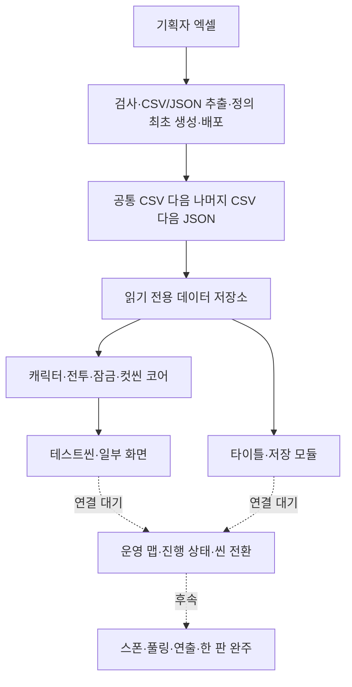

# 현재 구현과 검증 현황

기준일: 2026-11-03. 클라이언트 `d8db39b`와 형제 DataSheet의 로컬 코드·데이터를 점검한 결과입니다. 현재는 데이터 공급·개별 모듈 기반을 갖추고 운영 진행을 연결하기 전 단계입니다. 완료율을 검사 개수나 파일 수로 계산하지 않습니다.

기획 규칙은 [기획 확정 반영 기준](기획%20확정%20반영%20기준.md), 개선 판단은 [설계 기준 점검과 개선 방향](설계%20기준%20점검과%20개선%20방향.md), 실행 순서는 [남은 구현과 검증 작업](남은%20구현과%20검증%20작업.md)을 따릅니다. 이 문서는 구현·연결·검증 상태의 기준입니다.

## 1. 전체 연결 상태

실선은 현재 준비한 연결이고 점선은 운영 통합이 남은 부분입니다. 조회 가능한 데이터가 있다는 사실과 실제 콘텐츠가 그 데이터를 사용해 동작한다는 사실을 구분합니다.

## 2. 기능별 현재 범위

| 영역 | 구현한 부분 | 연결·추가 구현·검증이 남은 부분 |
| --- | --- | --- |
| 데이터 공급 | 새 파일·탭 탐색, 기존 탭 규칙 해석, 검사·추출·배포, 정의 최초 생성, 자동 로딩 계획 | 기존 컬럼·생성자 변경은 개발자 동기화. 새 행동 종류 자체를 자동 생성하지 않음 |
| 데이터 초기화 | 공통 스탯 CSV→나머지 CSV→JSON, 준비 완료 후 결과 공개, 취소 수명 | 운영 조립자가 기능별 준비·종료 순서 연결 |
| 스탯·상태 | CharacterStat 추상 상속, 고유 스탯, 상태 클래스와 행동 함수 전환 | 데이터 기반 상태 구성·실제 필요에 따른 복합 상태·상태 팩토리 |
| 전투 | 공격·콤보·구르기·피격·무적·자원, 체세·해체·페이즈·보스 패턴(사슬 Attack3 포함)·매달리기·결박 가르기·약초·착지·낙하 코어 | 운영 물리·센서·히트박스·애니메이션·사슬·변종 고유 동작 |
| 몬스터 | 허수귀·지게귀·불붙은 허수귀(죽을 때 불)·짐 던지는 지게귀(투척) AI, 잡기·돌진·벽 허점, 테스트 구동 | 운영 패턴 선택·관측·스폰·풀링 |
| 체력 표시 | 이벤트 표시, 설정·프리팹·앵커·Host 수명, 테스트씬 연결 | 최종 HUD·아트·연출·운영 씬 |
| 타이틀 | 메뉴 규칙·표시·키보드·마우스 입력, 아트 이미지, 저장 유무 조회, 새로 시작→임시 로딩 화면→도화골 테스트 씬, 종료, 테스트 기록 조회·선택 | 인트로 경유, 정식 로딩 그림, 이어하기·설정 실제 실행 |
| 저장 | 슬롯 직접 선택·JSON 파일 교체·조회, SaveGameFlow, 테스트 타이틀·F5 화면·확인창 | 실제 ISaveGameRuntime 구현, 운영 씬·저장 지점 연결, 관문 저장 형식 수정 |
| 잠금 | ContentAccess의 기획자 잠금·플레이어 해금 공통 판단 | 맵 입장·스킬·아이템·몬스터 생성에서 실제 적용 |
| 컷씬 | 빈 Cutscene/CutsceneStep 탭, 검사·배포·로딩·정의 변환·순수 재생 코어 | 실제 행, Addressables·리소스 검사·영상/그림 표시·입력/시간/소리·씬 연결 |
| 맵·진행 | Stage·StageLayer 데이터와 범위가 정해진 앵커 조회 | 운영 맵 JSON·스폰·풀·처치/재방문 상태·씬 전환 |
| 자동화 | 배포 EXE, Develop 검사·개발 알림, 수동 시작 빌드·보관·빌드 알림 | 타이틀 포함 전체 진행 빌드, 출시 빌드 정책, 실제 실행파일 검증 |

버프 효과·추가 무기/인벤토리 등 보류 범위를 완료로 간주하지 않습니다. 로딩은 기획 수정으로 보류하며 스테이지 완성 전 실제 맵 복원 연결도 사용자 지시에 따라 보류합니다.

## 3. 이번 점검의 검사 결과

| 검사 | 결과 | 의미 |
| --- | --- | --- |
| 클라이언트 데이터 검사 | 875개 통과 | 현재 데이터 읽기·변환·초기화·저장 파일 경계 등 검사 |
| 순수 코어 검사 | 462개 통과 | 전투·상태·저장/복원 순서·실패·취소·수동 저장 정책 등 검사 |
| Unity 모듈 참조 컴파일 | 경고 0·오류 0 | 설치된 엔진 참조로 코드 컴파일. 실제 Play·프리팹 표시·빌드 실행과 구분 |
| DataSheet EXE --check | 17탭·데이터17·정의21·자동 계획1 통과 | 임시 생성·호환성 검사 후 정리. 이번 점검에서 배포하지 않음 |
| 실제 Unity Play | 이번 점검에서 미실행 | 새 공통 슬롯 화면·입력·시각 배치 확인 필요 |
| 플레이어 빌드·원격 실행 | 이번 점검에서 미실행 | 출시 테스트 객체 제거·전체 게임 진행 확인 필요 |

검사 개수는 실행 시점과 데이터에 따라 바뀝니다. 이전 문서의 887개 등은 당시 결과이며 현재 수치를 덮어쓰지 않습니다. F5·공통 화면의 개발 빌드/에디터 분기 참조 컴파일 통과 이력은 있으나 이번 전체 점검에서 같은 분기를 다시 실행한 결과는 아닙니다.

### 이전 실제 Unity 검사에서 확인한 범위

2026-11-03 N01 당시 GameplayPreview·MapDohwagolTest 각23개 연결 검사와 앵커 검사24개가 통과했습니다. HP 표시·공급 데이터·연결 수명의 당시 확인이며, 이후 추가한 저장 공통 화면과 운영 진행의 검증 증거로 확장하지 않습니다.

## 4. 확인한 불일치와 미확인 사항

| 항목 | 현재 근거 | 처리 상태 |
| --- | --- | --- |
| 관문 키 | 기획은 StageID_PlacementID(예:8005_101), SaveSnapshot.OpenedGates는 정수 목록 | 연결 전 수정 필요. 정수 쌍 등 표현 방식은 아직 확정·구현하지 않음 |
| 정규 타이틀 마우스 | 2026-11-04 메뉴·확인창 올리기·왼클릭 연결. 편집기 Play에서 이벤트 주입으로 확인 | 실제 장치 입력 확인 필요 |
| Title 씬 표시 | 루트 Canvas 크기·스케일0 오버라이드는 그대로이며 Overlay Canvas라 실행 표시에 영향 없음. 임시 저장 있음 오버라이드는 검사 모드를 끈 뒤 사용하지 않음 | 정리 여부는 작업자와 확인 |
| 운영 정수 좌표 | 저장은 정수 좌표, PreviewPlayerMotion은 float 위치 누적 | 운영 위치 상태·반올림·경계 변환은 후속 |
| Preview 표시 | GameplayPreview.LateUpdate에서 이름표 반복 갱신 | 운영 표시로 옮길 때 이벤트 갱신으로 정리 |
| 빌드 대상 | GitHub 기본·Build Settings 모두 Title→MapDohwagolTest, BuildOptions.Development 고정 | 출시 빌드 정책은 별도 준비 필요 |

이번 문서 갱신은 코드·씬·시트·프리팹·빌드 설정을 변경하지 않습니다. 공유 간트와 GitHub 원격 실행 상태를 새로 조회한 점검도 아닙니다.
