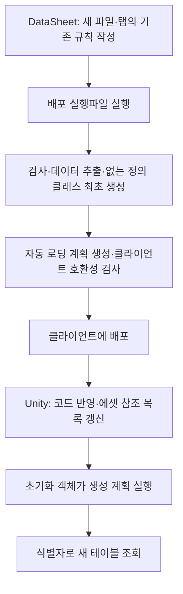
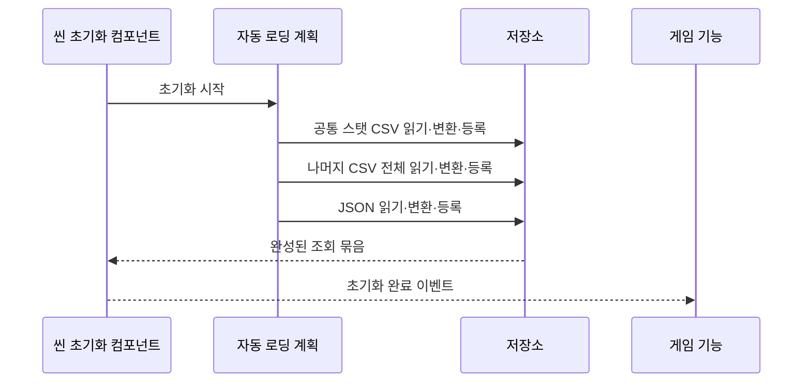

# Human_Ghost-

싱글플레이 2D 액션게임 클라이언트입니다. 데이터는 형제 프로젝트인 DataSheet에서 검사·배포하고, 클라이언트는 읽기·객체 변환·조회·게임 기능 연결을 담당합니다.

디스코드 머지 알림 설정과 연결 테스트는 [알림 가이드](Docs/%EB%94%94%EC%8A%A4%EC%BD%94%EB%93%9C%20%EC%95%8C%EB%A6%BC%20%EC%84%A4%EC%A0%95%20%EC%95%88%EB%82%B4.md)를 참고합니다.

## 먼저 볼 문서

| 문서 | 내용 |
| --- | --- |
| [프로젝트 기본설계](%ED%94%84%EB%A1%9C%EC%A0%9D%ED%8A%B8%20%EA%B8%B0%EB%B3%B8%EC%84%A4%EA%B3%84.md) | 객체 지향·이벤트·데이터 기반 설계 원칙과 이후 구현 범위 |
| [데이터 계층 인수인계 가이드](Docs/%EB%8D%B0%EC%9D%B4%ED%84%B0%20%EA%B3%84%EC%B8%B5%20%EC%9D%B8%EC%88%98%EC%9D%B8%EA%B3%84%20%EA%B0%80%EC%9D%B4%EB%93%9C.md) | 계층도, 초기화 순서, 조회 예시, 이벤트 구독·해제, 확장 방법 |
| [게임플레이 코어](Docs/%EA%B2%8C%EC%9E%84%ED%94%8C%EB%A0%88%EC%9D%B4%20%EC%BD%94%EC%96%B4%EC%99%80%20%ED%94%84%EB%A6%AC%ED%8C%B9%20%EC%97%B0%EA%B2%B0.md) | 이동·입력·콤보·자원·피격·보스 체세·프리팹 연결 |
| [임시 육안 확인](Docs/%EC%9E%84%EC%8B%9C%20%EA%B2%8C%EC%9E%84%ED%94%8C%EB%A0%88%EC%9D%B4%20%ED%99%95%EC%9D%B8%20%EC%95%88%EB%82%B4.md) | 사각형·텍스트로 기존 프리팹 동작 확인 |
| [일반 몬스터 AI](Docs/%EC%9D%BC%EB%B0%98%20%EB%AA%AC%EC%8A%A4%ED%84%B0%20%EC%9D%B8%EA%B3%B5%EC%A7%80%EB%8A%A5.md) | 허수귀·지게귀 AI 코어·패턴 설정·관측/판정 연결 계약 |
| [검사 자동화와 오류 경계](Docs/%EA%B2%80%EC%82%AC%20%EC%9E%90%EB%8F%99%ED%99%94%EC%99%80%20%EB%8D%B0%EC%9D%B4%ED%84%B0%20%EC%98%A4%EB%A5%98%20%EA%B2%BD%EA%B3%84.md) | 통합 검사·GitHub 실행·소비자 오류 분리·향후 방향과 예상 효과 |
| [기획자용 검사 사용 안내](Docs/%EA%B8%B0%ED%9A%8D%EC%9E%90%EC%9A%A9%20%ED%94%84%EB%A1%9C%EC%A0%9D%ED%8A%B8%20%EA%B2%80%EC%82%AC%20%EC%82%AC%EC%9A%A9%20%EC%95%88%EB%82%B4.md) | 사용 이유·준비·실행 순서·결과 확인·개발자에게 오류 전달 |
| [CSV 리더기](Docs/CSV%20%EB%A6%AC%EB%8D%94%EA%B8%B0.md) | 입력 계약, 문자열 해석과 오류 전달 |
| [현재 구현과 검증 현황](Docs/%ED%98%84%EC%9E%AC%20%EA%B5%AC%ED%98%84%EA%B3%BC%20%EA%B2%80%EC%A6%9D%20%ED%98%84%ED%99%A9.md) | 현재 구조 도식·이번 검사 결과·검증 한계 |
| [작업 규칙](AGENTS.md) | 명명 규칙과 책임 분리 |

## 현재 구현 범위


CSV·JSON 읽기, 공통 객체 변환, 식별자 조회 저장소, 자동 로딩 계획 실행, 씬 초기화·취소 수명, 빌드용 데이터 에셋 참조 연결을 구현했습니다. 게임플레이 코어는 공통 상태, 이동/점프 요청, New Input System, 공격/콤보, 구르기/스태미나/피격/무적, 보스 체세/해체 API까지 구현했습니다. 허수귀·지게귀 AI와 잡기·구속·돌진·벽 충돌 허점 코어, 패턴 설정과 프리팹도 있습니다. GameplayPreview 장면에서 임시 이동·판정·상태 표시를 연결했습니다. 운영 물리·카메라·히트박스·애니메이션·보스 AI·스폰·풀링은 후속 범위입니다. 현재 상태에 불필요한 상태 Factory는 추가하지 않았습니다.

## 프로젝트 배치와 폴더

두 저장소는 같은 부모 폴더 아래에 둡니다. 클라이언트는 Unity `6000.2.8f1`을 사용합니다. JSON 읽기는 Unity의 Newtonsoft JSON 패키지 `3.2.2`를 사용하며 에디터에서 패키지를 복원합니다.

```text
공통 부모 폴더/
├── DataSheet/
│   ├── tables/
│   └── DeployData.exe
└── Human_Ghost-/
    ├── Assets/
    │   ├── 1.Scene/                 ← SampleScene·GameplayPreview
    │   ├── 3.Script/
    │   │   ├── Common/              ← 입력 계약·형식 읽기
    │   │   ├── Core/              ← 순수 이동·전투·몬스터 AI
    │   │   ├── Adapters/          ← 입력·초기화·설정 에셋
    │   │   ├── Preview/           ← 임시 표시·이동·판정
    │   │   └── Data/
    │   │       ├── Mapping/         ← 공통 객체 변환
    │   │       ├── Storage/         ← 읽기 전용 저장소
    │   │       ├── Infrastructure/  ← 초기화·에셋 입력·수명
    │   │       └── Generated/       ← 자동 로딩 계획
    │   ├── Data/                    ← CSV·JSON·데이터 에셋 목록
    │   └── Editor/                  ← Data: 데이터 연결 / Preview: 확인용 편집기
    ├── Docs/
    └── Tools/Verify-Project.ps1
```

## 데이터 추가부터 실행까지



새 파일·탭을 추가할 때 클라이언트 초기화 목록을 수동 수정하지 않습니다. `Assets/3.Script/Data/Generated/GeneratedDataLoadPlan.cs`가 시트 규칙에서 생성됩니다. 코드와 에셋이 반영된 후 실행하면 새 테이블도 읽기·변환·저장소 등록까지 자동 연결됩니다. 이미 빌드한 실행파일에 새 타입을 추가하려면 클라이언트 재빌드가 필요합니다.

| 배포 대상 | 처리 방식 |
| --- | --- |
| CSV·JSON | 매번 갱신. 삭제한 탭의 이전 배포 데이터 정리 |
| 데이터 정의 C#·상태 열거형 | 해당 파일이 없을 때만 최초 추가. 기존 파일 보존 |
| 자동 로딩 계획 | 매번 갱신. 수동 수정 금지 |
| Unity 메타 파일 | 유지 |

기존 시트의 컬럼·생성자·상태 식별자 변경은 기존 클래스·열거형에 자동 반영되지 않습니다. 개발자가 함께 수정해야 합니다. 새 데이터로 실제 게임 동작을 만드는 일은 해당 기능의 구현 범위입니다.

## 초기화 순서와 사용



기본 씬의 `GameDataInitializer`가 시작 단계에서 초기화합니다. 다른 시작 씬에서는 **인귀 → 데이터 → 현재 씬에 초기화 연결**을 실행하고 씬을 저장합니다. 참조 목록 수동 갱신은 **인귀 → 데이터 → 에셋 목록 갱신**입니다.

일반 정의는 `ID`, 상태 묶음은 `UnitID`로 조회합니다. 소비자는 완료 이벤트를 구독하고, 이미 초기화된 경우 현재 `Data`를 확인하며, 비활성화 시 구독을 해제합니다. 자세한 코드는 [인수인계 가이드](Docs/%EB%8D%B0%EC%9D%B4%ED%84%B0%20%EA%B3%84%EC%B8%B5%20%EC%9D%B8%EC%88%98%EC%9D%B8%EA%B3%84%20%EA%B0%80%EC%9D%B4%EB%93%9C.md)를 따릅니다. 전역 정적 저장소는 사용하지 않습니다.

데이터 정의는 읽기 전용 설정입니다. 현재 체력·위치·타이머·대상은 캐릭터 런타임이 별도로 소유합니다. 클라이언트에 배포 전 데이터 검사기를 중복 구현하지 않습니다.

## 수치·협업 원칙

기본 수치는 정수, 시간은 밀리초, 확률 분모는 10000입니다. 이동 값은 시트의 타일×100 단위를 따르고 엔진 경계에서 변환합니다. 정수 나눗셈 잔여량·반올림·범위는 각 런타임 기능에서 정의합니다. 주석·설명·로그·직접 작성한 오류 안내는 한글로 작성합니다.

공통 계약은 인터페이스로 표현하고 의존성은 명시적으로 주입합니다. 공통 스탯은 추상 기반 클래스에 한 번만 선언합니다. 상태 팩토리는 상태 구성에 사용하며 캐릭터 자체의 팩토리는 이번 설계에 두지 않습니다.

## 검증과 남은 확인

2026-10-31 재확인 결과 기본 통합 검사는 데이터 683개·게임 코어 202개가 통과했습니다. 선택 Unity 모듈 참조 컴파일은 현재 MonsterPatternSettings 직렬화 필드의 CS0649가 오류로 처리돼 실패합니다. 새 CSV 탭 2개·JSON 탭 1개의 자동 등록·초기화·식별자 조회는 DataSheet 통합 검사에서 확인했습니다.

```powershell
powershell.exe -NoProfile -ExecutionPolicy Bypass -File Tools/Verify-Project.ps1
```

기본 통합 검사에는 .NET 10 SDK가 필요하며 Unity 설치는 필요하지 않습니다. GitHub에서도 Develop 대상 PR·푸시에 같은 검사를 실행합니다. 선택 인자 `-CompileUnity`를 붙이면 설치된 Unity 모듈 참조 컴파일을 추가합니다. Unity 설치 위치가 다르면 `-UnityEditorPath`로 에디터 실행파일을 지정합니다. 임시 빌드 결과는 종료 시 정리합니다.

임시 확인 장면의 가상 키보드 Play 검사 기록은 GameplayPreview 문서에 있습니다. 이번 문서 점검에서 Play를 재실행하지 않았으며, 실제 장치·운영 물리·최종 플레이어 빌드는 별도 검증 대상입니다. 과거 라이선스 연결 실패와 이후의 임시 Play 확인 기록을 구분합니다. 데이터 준비 실패는 실패로 반환하고, 완료 소비자 예외는 개별 기록한 뒤 다음 소비자에게 전달합니다. 소비자 실패 때문에 준비된 데이터를 실패로 바꾸지 않습니다. 세부 계약과 후속 자동화 방향은 검사 자동화 문서를 따릅니다.

최초 자동 로딩 전환 시 클라이언트와 DataSheet 실행파일을 함께 최신화합니다. 도구 변경은 소스와 배포 EXE를 함께 공유합니다. 작성 기준일: 2026-10-31.
